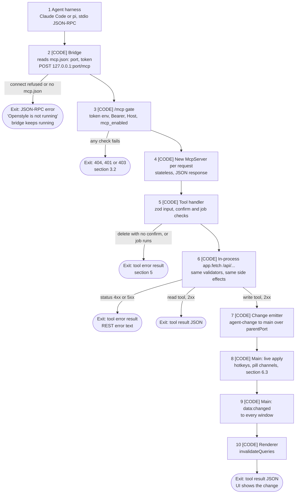

# Technical Spec: The Openstyle MCP server

**Status:** Spec. Not built.
**Date:** 2026-11-06
**Repo state read:** main at `d5c6da6a` (branch `docs/mcp-spec`). All `file:line` citations are from that tree.
**Scope:** `apps/server/src/mcp/` (new), new REST routes in `apps/server/src/routes/`, `apps/electron/src/main/` (token, `mcp.json`, agent changes, app-shell request, agent install), `apps/electron/src/mcp-bridge/` (new), `apps/electron/resources/mcp/` (new), Settings and the onboarding Ready step.
**Release target:** `3.1.0-alpha.1`, Dev channel.

Writing rules: Simplified Technical English (ASD-STE100). One instruction per sentence. No em-dashes. The citations go stale fast. Verify each one against the tree before you build from it.

---

## 1. Context and owner decisions

The owner wants agent harnesses (Claude Code, pi) to work with Openstyle through MCP:

- Read meetings, folders and all other data.
- Change all mutable items. An agent is usually a better model than the local LLM.
- Help with the configuration: vocabulary, settings and models.

Today the app has no MCP code and no `@modelcontextprotocol/*` dependency (`.lore.md:78`).

The work is done when:

1. The MCP server is designed, mapped and documented (this file).
2. All user journeys (section 10) are documented and validated.
3. Real runs with the local Claude Code and pi give evidence for EVERY tool.
4. The Dev release `3.1.0-alpha.1` is out and validated.

Owner decisions (2026-11-06). Do not change them without the owner.

| Topic | Decision |
|---|---|
| Transport | The tools live in the embedded server at `/mcp` (Streamable HTTP, stateless). A thin stdio bridge in the .app is the setup path. stdio is the standard for a local MCP (modelcontextprotocol.io spec, Transports: "Clients SHOULD support stdio whenever possible"). |
| Access | ON by default. Settings gets a new section "Agents (MCP)" with an on/off toggle. Every delete needs `confirm: true`. |
| Onboarding | A "Connect your agent" card on the Ready step. The step numbers do not change. Since canvas v17 (2026-11-06) the card has one-click install rows, not copy buttons (row "One-click install"). |
| One-click install (canvas v17, 2026-11-06) | The Ready card and Settings > Agents (MCP) show one row for each agent tool found on this Mac. v1 tools: Claude Code, pi, Codex. A click on `Add to <tool>` runs the tool's own CLI from Electron main. Openstyle never edits the config file of a tool. The copy commands stay only as the fallback. Details: section 7.2. |
| PATH | A GUI app does not get the shell PATH. Read the login-shell PATH once with `$SHELL -ilc 'echo $PATH'` and a 5 s timeout. Add the known folders `~/.local/bin`, `/opt/homebrew/bin`, `/usr/local/bin`. Run the CLIs with that PATH. |
| Server name | Stable registers as `openstyle`. Dev registers as `openstyle-dev`. Each name has its own launcher path, so a user can add both. |
| Other clients | Claude Desktop, Cursor, VS Code and other clients are out of v1 (section 13). |
| Overwrite | Summary (the old version is kept), enhanced transcript, Ask threads (rename and delete), dictation history (delete), all folder items, meeting title, notes, language, attendees, tags, speakers. The raw ASR text stays read-only. |
| Extra scope | Model downloads, plus the app-shell settings (pill position, auto-update, update channel, launch at login). Out of scope: API keys and "delete all history". |
| Attendees | Attendees can be set manually with no linked calendar event. |
| Tests | Writes go only to an isolated profile with fictional data. After the release, run a read-only check (list and get only) on the owner's real Dev app. pi uses its default model. If that model cannot use the tools, ask the owner. |
| Version | `3.1.0-alpha.1`, on the Dev channel. |
| Design gate | The prototype canvas "Openstyle Chat Prototypes" (<https://claude.ai/artifact/Lmj4x8X2X54acD75MGRyq4>) gets the new card and the new Settings board first. The UI code in PR 4 starts only after the owner approves the canvas (section 8.3). The owner approved canvas v17 on 2026-11-06. |
| pi | pi-delegate is allowed for this work (2026-11-06), for the MCP harness runs only. pi children are the MCP client under test. They do not write code. |

## 2. Architecture

### 2.1 Request path



The diagram has no LLM call. No MCP tool calls an LLM directly. `start_meeting_job` starts the existing Enhance or Summarize run. That run has its own LLM calls (`specs/meeting-enhance-agentic.md`).

### 2.2 Parts

1. **SDK.** `@modelcontextprotocol/server@2.4.0`, pinned exactly (risk R7). `npm view` on 2026-11-06 gives the dependencies `zod ^4.2.0` and `@modelcontextprotocol/core 2.4.0`. Do not use `sdk@1.x`: it pulls in express and a different `@hono/node-server` version.
2. **Route.** A new folder `apps/server/src/mcp/` holds the route, the gate, the tools, the settings catalog and the change emitter. `createApp()` mounts `/mcp` next to the API routes (`apps/server/src/index.ts:132`).
3. **Stateless.** Each POST builds a new `McpServer` and a new transport in the stateless mode of the SDK (no session id, JSON responses, no SSE stream). Nothing stays in memory between requests. A GET or a DELETE on `/mcp` gives 405.
4. **One source of truth.** Each tool calls the existing REST route in-process with `app.fetch()`. The call carries `Authorization: Bearer <getAuthToken()>` (`apps/server/src/lib/auth.ts:37`), so it passes the global auth also on a standalone server. It uses the same zod validators and the same side effects as the app. A new write ability first becomes a REST route, then a thin tool. This adds no refactor of `routes/meetings.ts`.
5. **Change emitter.** The server cannot import Electron. `apps/server/src/mcp/changes.ts` exports `setAgentChangeSink(fn)`. The utility process entry (`apps/electron/src/server-host/entry.ts:35`, `process.parentPort`) sets the sink. After a write tool gets a 2xx, the emitter sends `{ type: "agent-change", tool, settingKeys, meetingIds }`. With no sink (standalone server, tests), the emitter does nothing.
6. **Main.** `server-host.ts` `handleMessage` (`apps/electron/src/main/server-host.ts:93`) gets a new case `agent-change`. It calls the new `apps/electron/src/main/agent-changes.ts`, which does the live apply (section 6.3) and sends `data:changed`.
7. **Renderer.** The preload adds `onDataChanged`. The dashboard, tray popover and chat bubble roots call `queryClient.invalidateQueries()` on it. The roots are `renderer/src/dashboard.tsx`, `components/tray-popover.tsx` and `components/chat-bubble.tsx`. Without this, the UI does not refresh: the default `staleTime` is `ONE_HOUR` (`apps/electron/src/renderer/src/lib/query.ts:535-543`).
8. **Server process.** The server runs in an Electron utility process, not in the main process (`server-host.ts:1-4`, `utilityProcess.fork` at `:129`). `AGENTS.md:9` still says "in-process". PR 2 fixes that line.

## 3. Security

### 3.1 Trust model

The MCP server has the same trust as the REST API today: every process of the same macOS user can reach it (risk R2). The token protects against other users and against web pages. It does not protect against code that runs as the same user. That code can already read `freestyle.db`.

### 3.2 The `/mcp` gate

`/mcp` does not use the global auth middleware. Add `/mcp` to `EXEMPT_PATHS` (`apps/server/src/lib/auth.ts:47`). Then a strict gate runs these checks in this order:

| # | Check | Failure |
|---|---|---|
| 1 | `OPENSTYLE_MCP_TOKEN` is set in the server env. | 404. The route does not exist for this server (standalone server, old main). |
| 2 | `Authorization: Bearer <token>` matches, compared with `timingSafeEqual` (`hono/utils/buffer`, as `auth.ts:4` uses). | 401, JSON-RPC error `Unauthorized`. |
| 3 | The `Host` header is a loopback host: `127.0.0.1:<port>`, `localhost:<port>` or `[::1]:<port>`. | 403. This blocks DNS rebinding. |
| 4 | The setting `mcp_enabled` is not `"false"`. A missing row means on. | 403, JSON-RPC error "Agent access is off. Turn on Settings > Agents (MCP) in Openstyle." |

- The gate never uses the no-Origin fallback of `isTrustedRendererOrigin` (`apps/server/src/lib/trusted-origin.ts:17-18`). A request with no token fails check 2 also when it has no Origin.
- `trustedOriginMiddleware` (`trusted-origin.ts:31`) still runs first (`index.ts:55`). A browser request with a foreign Origin gets 403 there. The bridge sends no Origin.
- Add `mcpEnabled: "mcp_enabled"` to `SETTINGS_KEYS` (`packages/validations/src/settings-keys.ts:5`).

### 3.3 Token and `mcp.json`

1. Main mints one token per boot with 32 random bytes (the same strength as `generateAuthToken`, `auth.ts:42`). A server restart in the same boot keeps the token.
2. Main gives the token to the utility process as `OPENSTYLE_MCP_TOKEN` in `buildChildEnv` (`server-host.ts:206`).
3. At each `ready` message (`server-host.ts:95`), main writes `<userData>/mcp.json` with `{ "port": <port>, "token": "<token>" }`. Main writes a temp file in the same folder with mode `0600`, then renames it to `mcp.json`. A restart on a new port writes the file again.
4. `stopServerHost` (`server-host.ts:298`) deletes `mcp.json`.
5. When main reuses a server that it did not start (`server-host.ts:253-264`), main does not write or delete `mcp.json`. The instance that owns that server owns the file.
6. The token never goes into a log line, a tool result or the renderer. The Settings section shows the port only.

## 4. Tool map

### 4.1 Rules for every tool

- Names are `snake_case`. Each tool has a zod input schema and a one-line description in STE.
- Annotations: `readOnlyHint`, `destructiveHint`, `idempotentHint`, and `openWorldHint: false` on all tools. In the table, `R` = readOnlyHint true, `D` = destructiveHint true, `I` = idempotentHint true, `-` = false. MCP defines destructive as "may perform destructive updates". So an overwrite with no kept history is `D`. `set_summary` is not `D`, because the old version is kept.
- A tool result is the REST JSON body as text content, plus `structuredContent` with the same object.
- The server logs one line for each tool call to `openstyle-server.log`: `mcp tool=<name> agent=<X-Openstyle-Agent> status=<http status> ms=<n>`. The harness uses this line as evidence.
- PR column: 2 = the tool uses an existing route. 3 = the tool needs a new route. The model download tools use existing routes, but the plan puts them in PR 3.

### 4.2 The tools (50)

Paths are under `/api`. `meetings.ts` is `apps/server/src/routes/meetings.ts`. The other route files are in the same folder. `*` = needs `confirm: true`.

#### Meetings (10)

| Tool | Main input | Backing route | Route | Ann. | Confirm | PR |
|---|---|---|---|---|---|---|
| list_meetings | `folder_id?`, `limit?`, `offset?` (section 4.4) | GET `/meetings?limit=&offset=` (`meetings.ts:1532`). The route takes `limit` (1 to 200) and `offset` since issue #431. Without them it gives the newest 200, as before. `total` counts all meetings of the filter. The tool gives short rows: `id`, `title`, `started_at`, `duration_ms`, `status`, `folder_id`, `tags`, `job` (the kind of the running job, or null). | existing | R I | no | 2 |
| get_meeting | `meeting_id` | GET `/meetings/:id` (`meetings.ts:2367`) and GET `/meetings/:id/speakers` (`meetings.ts:2116`) | existing | R I | no | 2 |
| update_meeting | `meeting_id`, `title?`, `language?`, `context?` (the notes) | PATCH `/meetings/:id` (`meetings.ts:1711`, schema `:1102`) | existing | D I | no | 2 |
| set_calendar_link | `meeting_id`, `event` or `null` | PUT `/meetings/:id/calendar` (`meetings.ts:1667`), DELETE (`meetings.ts:1687`) for `null` | existing | D I | no | 2 |
| set_attendees | `meeting_id`, `attendees[]` (`name`, `email?`) | PUT `/meetings/:id/attendees` | NEW, in `meetings.ts` after the calendar routes | D I | no | 3 |
| list_tags | `limit?`, `offset?` (section 4.4) | GET `/meetings/tags` (`meeting-tags.ts:35`). The tool pages the list. | existing | R I | no | 2 |
| set_meeting_tags | `meeting_id`, `tags[]` | PUT `/meetings/:id/tags` (`meeting-tags.ts:40`) | existing | D I | no | 2 |
| move_meetings | `meeting_ids[]`, `folder_id` | POST `/meetings/move` (`meeting-folders.ts:166`) | existing | - I | no | 2 |
| delete_meeting* | `meeting_id`, `confirm` | DELETE `/meetings/:id` (`meetings.ts:2415`) | existing | D I | yes | 2 |
| search_meetings | `query`, scope fields, `k?` (1 to 50, default 10) | POST `/search/meetings` (`search.ts:26`). The tool refuses `k` above `SEARCH_K_MAX` (50) before the route call. Each snippet has at most 400 characters. | existing | R I | no | 2 |

#### Live transcription (1)

| Tool | Main input | Backing route | Route | Ann. | Confirm | PR |
|---|---|---|---|---|---|---|
| get_live_transcript | `meeting_id?`, `since_seq?`, `since_ms?` (old) | GET `/meetings/:id/live` (`meetings.ts:1700`, store `apps/server/src/lib/meetings/live/store.ts`). With no id: GET `/meetings?limit=20` and the row with status `recording`. | existing | R I | no | 2 |

The result has these fields (issue #434):

- `recording`: always `true`. The tool gives an error when the meeting does not record.
- `paused`: `true` while the user paused the recording. The route GET `/meetings/:id/live` gives it since issue #434 (`isRecordingPaused`).
- `live_transcriber` and `live_transcriber_reason`: the state of the live loop (`starting`, `warming`, `ready`, `unavailable`, `store.ts` `LiveStatus`). It is not the state of the meeting. Before issue #434 the field was `status`, and an agent read `ready` as "the meeting does not record".
- `lines`: the final lines with `seq > since_seq`. Each final line has a `seq`. The store gives the next `seq` when a line becomes final or gets a new text (the language lock reads the first lines again). `seq` only goes up in the server process, over all meetings.
- `partial`: the open partial line of each channel. A partial line has no `seq`.
- `cursor`: the largest `seq` of the final lines. An agent polls with `since_seq = cursor`.

A line can come again with a higher `seq` when its text changes. The agent keeps the line with the highest `seq` for the same `source` and `startMs`.

`since_ms` stays for old callers: it gives the final lines with `endMs > since_ms`. It can skip a line. The two channels finish lines out of time order: a mic line that ends at 69840 can become final before a system line that ends at 68500. A cursor on the latest end time then filters the system line out of the next poll. `since_seq` wins when both are given. The error texts are in section 5.

#### Transcript and speakers (3)

| Tool | Main input | Backing route | Route | Ann. | Confirm | PR |
|---|---|---|---|---|---|---|
| get_transcript | `meeting_id`, `offset?`, `limit?` (default 200) | GET `/meetings/:id/transcript` (`meetings.ts:2361`). The tool pages the segments (risk R6). | existing | R I | no | 2 |
| set_enhanced_segments | `meeting_id`, `segments[]` (`id`, `enhanced_text`) | PUT `/meetings/:id/enhanced-segments`. It writes `enhanced_text` only, then calls `writeTranscriptMarkdown` (`apps/server/src/lib/meetings/transcript-io.ts:160`). | NEW, in `meetings.ts` | D I | no | 3 |
| update_speaker | `meeting_id`, `label`, `display_name?`, `merged_into?` | PATCH `/meetings/:id/speakers/:label` (`meetings.ts:2199`, schema `:1132`) | existing | D I | no | 2 |

#### Summary and jobs (5)

| Tool | Main input | Backing route | Route | Ann. | Confirm | PR |
|---|---|---|---|---|---|---|
| get_summary_versions | `meeting_id` | GET `/meetings/:id/summary-versions` (`meetings.ts:2336`) | existing | R I | no | 2 |
| set_summary | `meeting_id`, `markdown`, `summary_json` | PUT `/meetings/:id/summary`. It calls the new `saveMeetingSummary`, moved out of the SW3 block of `apps/server/src/lib/meetings/workflow/nodes/save.ts:222-291`. Provider `agent`, model = the agent name. The old summary goes to `meeting_summary_versions`. | NEW, in `meetings.ts`, store in `lib/meetings/summary-store.ts` | - - | no | 3 |
| start_meeting_job | `meeting_id`, `kind` (`enhance`, `summarize`, `transcribe`, `retry_failed`, `diarize`) | POST `/meetings/:id/enhance` (`meetings.ts:2331`), `/summarize` (`:2324`), `/transcribe` (`:1814`), `/retry-failed` (`:1846`), `/diarize` (`:1998`) | existing | - - | no | 2 |
| cancel_meeting_job | `meeting_id` | POST `/meetings/:id/cancel-transcribe` (`meetings.ts:1829`). It cancels transcribe, retry-failed, enhance and summarize. Diarize cannot be cancelled. | existing | - I | no | 2 |
| list_jobs | none | GET `/jobs` (`jobs.ts:7`) | existing | R I | no | 2 |

#### Folders (8)

| Tool | Main input | Backing route | Route | Ann. | Confirm | PR |
|---|---|---|---|---|---|---|
| list_folders | `limit?`, `offset?` (section 4.4) | GET `/meetings/folders` (`meeting-folders.ts:63`, mount `meetings.ts:1525`). The tool pages the list and renames `stage_counts` to `need_stage` (section 4.5). | existing | R I | no | 2 |
| create_folder | `name`, `description?`, `color?` | POST `/meetings/folders` (`meeting-folders.ts:76`) | existing | - - | no | 2 |
| update_folder | `folder_id`, `name?`, `description?`, `color?` | PATCH `/meetings/folders/:id` (`meeting-folders.ts:99`) | existing | D I | no | 2 |
| delete_folder* | `folder_id`, `confirm` | DELETE `/meetings/folders/:id` (`meeting-folders.ts:138`). 409 when the folder has meetings. | existing | D I | yes | 2 |
| get_folder_overview | `folder_id` | GET `/meetings/folders/:id/overview` (`meeting-folder-overview.ts:27`). The tool renames `counts.summarized` to `counts.with_summary` and `counts.stage_counts` to `counts.need_stage` (section 4.5). | existing | R I | no | 2 |
| set_action_item_done | `folder_id`, `key`, `done` | PUT `/meetings/folders/:id/action-items/:key` (`meeting-folder-overview.ts:34`) | existing | D I | no | 2 |
| get_folder_standing | `folder_id` | GET `/meetings/folders/:id/standing` (`meeting-folder-standing.ts:35`) | existing | R I | no | 2 |
| set_folder_standing | `folder_id`, `bullets[]` | PUT `/meetings/folders/:id/standing`. It saves the text as given, with no LLM call. The existing POST (`meeting-folder-standing.ts:44`) is the LLM refresh and gets no tool. | NEW, in `meeting-folder-standing.ts` | D I | no | 3 |

The Overview items come from the `summary_json` of each meeting in the folder (`apps/server/src/lib/meetings/folder-overview.ts:259-277`). An agent changes them with `set_summary`.

#### Open items, the ledger (5)

The ledger has two tables: `ledger_items` and `ledger_marks` (`apps/server/src/lib/schema.ts:1437-1465`). Marks are append only. `first_meeting_id` and the mark `quote` are NOT NULL. The new router `apps/server/src/routes/ledger.ts` mounts at `/api/ledger` in `routes/index.ts` (next to `:58`). It reuses `readLedger` (`apps/server/src/lib/chat/loop/ledger.ts:414`).

| Tool | Main input | Backing route | Route | Ann. | Confirm | PR |
|---|---|---|---|---|---|---|
| list_open_items | `folder_id?`, `kind?`, `status?`, `limit?`, `offset?` (section 4.4) | GET `/ledger/items?limit=&offset=`. The route takes `offset` since issue #431. | NEW | R I | no | 3 |
| create_open_item | `meeting_id`, `kind` (`action`, `decision`, `question`), `text`, `quote`, `owner?` | POST `/ledger/items`. It writes the item (folder = the folder of the meeting) and one `raised` mark. | NEW | - - | no | 3 |
| update_open_item | `item_id`, `text?`, `kind?` | PATCH `/ledger/items/:id` | NEW | D I | no | 3 |
| add_open_item_mark | `item_id`, `meeting_id`, `status` (`open`, `done`, `dropped`, `changed`), `quote`, `owner?`, `reason?` | POST `/ledger/items/:id/marks`. `writer_model` = `agent:<agent name>`. `quote_ok` = 1 only when the quote is in the meeting transcript. | NEW | - - | no | 3 |
| delete_open_item* | `item_id`, `confirm` | DELETE `/ledger/items/:id`. The marks go with it (`ON DELETE CASCADE`). | NEW | D I | yes | 3 |

#### Ask and dictation history (7)

| Tool | Main input | Backing route | Route | Ann. | Confirm | PR |
|---|---|---|---|---|---|---|
| list_ask_threads | `meeting_id?`, `folder_id?`, `limit?`, `offset?` (section 4.4) | GET `/chat/threads` (`chat.ts:78`, query `:63`). With no scope the tool sends `all=1`. The tool pages the list. | existing | R I | no | 2 |
| get_ask_thread | `thread_id` | GET `/chat/threads/:id` (`chat.ts:107`) | existing | R I | no | 2 |
| rename_ask_thread | `thread_id`, `title` | PATCH `/chat/threads/:id` | NEW, in `chat.ts` | D I | no | 3 |
| delete_ask_thread* | `thread_id`, `confirm` | DELETE `/chat/threads/:id`. The messages go with it (`ON DELETE CASCADE`, `schema.ts:1412`). | NEW, in `chat.ts` | D I | yes | 3 |
| list_dictations | `search?`, `start_date?`, `end_date?`, `limit?`, `offset?` (section 4.4) | GET `/history` (`history.ts:49`) | existing | R I | no | 2 |
| get_dictation | `id` | GET `/history/:id` (`history.ts:170`) | existing | R I | no | 2 |
| delete_dictation* | `id`, `confirm` | DELETE `/history/:id` (`history.ts:180`) | existing | D I | yes | 2 |

No tool calls DELETE `/history` (`history.ts:186`, "delete all history"). That is out of scope.

#### Vocabulary (4)

| Tool | Main input | Backing route | Route | Ann. | Confirm | PR |
|---|---|---|---|---|---|---|
| list_vocabulary | `search?`, `limit?`, `offset?` (section 4.4) | GET `/vocabulary` (`vocabulary.ts:23`) | existing | R I | no | 2 |
| add_vocabulary | `terms[]` (`term`, `notes?`) | POST `/vocabulary/import` (`vocabulary.ts:109`) | existing | - I | no | 2 |
| update_vocabulary | `id`, `term?`, `notes?` | PUT `/vocabulary/:id` (`vocabulary.ts:75`) | existing | D I | no | 2 |
| delete_vocabulary* | `id`, `confirm` | DELETE `/vocabulary/:id` (`vocabulary.ts:102`) | existing | D I | yes | 2 |

#### Settings (4)

| Tool | Main input | Backing route | Route | Ann. | Confirm | PR |
|---|---|---|---|---|---|---|
| list_settings | `group?` | GET `/settings` (`settings.ts:79`), filtered by the catalog (section 6.1) | existing | R I | no | 2 |
| set_setting | `key`, `value` | PUT `/settings/:key` (`settings.ts:107`). Catalog keys only. Then live apply (section 6.3). | existing | D I | no | 2 |
| get_app_settings | none | GET `/system/app-settings` (server-to-main request, section 6.4) | NEW, in `system.ts` | R I | no | 3 |
| set_app_settings | `pill_position?`, `auto_update?`, `update_channel?`, `launch_at_login?` | PUT `/system/app-settings` (section 6.4) | NEW, in `system.ts` | D I | no | 3 |

#### Models (3)

| Tool | Main input | Backing route | Route | Ann. | Confirm | PR |
|---|---|---|---|---|---|---|
| list_models | none | GET `/models/configured` (`models.ts:276`), GET `/models/available` (`models.ts:144`), GET `/settings/llm_task_assignments` (`settings.ts:95`) | existing | R I | no | 3 |
| download_model | `model` (a built-in MLX LLM id) | POST `/mlx-llm/models/:model/download` (`mlx-llm.ts:61`) | existing | - I | no | 3 |
| get_download_status | none | GET `/mlx-llm/status` (`mlx-llm.ts:42`) | existing | R I | no | 3 |

Count: 10 + 1 + 3 + 5 + 8 + 5 + 7 + 4 + 4 + 3 = 50 tools. 6 need `confirm`. 15 need a new route.

### 4.3 New REST routes (summary)

| Route | File | Notes |
|---|---|---|
| PUT `/api/meetings/:id/attendees` | `routes/meetings.ts` | Writes `calendar_attendees` in the shape of `calendarEventSchema.attendees` (`packages/validations/src/meeting-calendar.ts:22`). `calendar_event_id` does not change. |
| PUT `/api/meetings/:id/enhanced-segments` | `routes/meetings.ts` | `enhanced_text` only. The raw `text` stays read-only. |
| PUT `/api/meetings/:id/summary` | `routes/meetings.ts`, `lib/meetings/summary-store.ts` | `saveMeetingSummary` from `save.ts:222-291`. The workflow save node calls the same function. |
| PATCH, DELETE `/api/chat/threads/:id` | `routes/chat.ts` | Rename and delete. |
| PUT `/api/meetings/folders/:id/standing` | `routes/meeting-folder-standing.ts` | Manual text, no LLM. |
| GET, POST `/api/ledger/items`, PATCH, DELETE `/api/ledger/items/:id`, POST `/api/ledger/items/:id/marks` | `routes/ledger.ts` (new), mount in `routes/index.ts` | Store functions next to `readLedger`. |
| GET, PUT `/api/system/app-settings` | `routes/system.ts` | Server-to-main request (section 6.4). |

Each new meeting write route gives 409 while a job holds the slot of that meeting (`hasJob`), with the text of `runningJobMessage` (`meetings.ts:313`).

### 4.4 Paging of the list tools (issue #431)

Every `list_*` tool gives one page. The output must fit inline in the context of an agent.

- Input: `limit` (1 to 100, default 20) and `offset` (default 0). The helpers are `pageArgs`, `pageFields` and `pageOf` in `apps/server/src/mcp/tools/define.ts`.
- Output: `{ total, offset, limit, next_offset, items }`. `total` counts all items of the filter. `next_offset` is null on the last page.
- A route that pages in SQL gets `limit` and `offset`: `list_meetings`, `list_dictations`, `list_vocabulary`, `list_open_items`. For `list_tags`, `list_folders` and `list_ask_threads` the route gives the full list, and the tool cuts the page.
- `list_jobs`, `list_settings` and `list_models` do not page. Their size does not grow with the user data.
- The REST routes stay compatible for the app. Without `limit`, GET `/api/meetings` gives the newest 200 full rows, as before. Each row also has `tags` now.

### 4.5 Counts that an agent can misread (issue #433)

The REST fields keep their names for the app. The tools rename them.

| Tool field | Route field | What it counts |
|---|---|---|
| `get_meeting.stored_asr_segments` | `segment_counts` | The rows of `meeting_segments` for the meeting: both channels, also the failed rows, the empty rows (silence) and the rows that the merge removes. |
| `get_transcript.total` | none (the tool counts) | The merged transcript segments (`loadMergedTranscript`, `transcript-io.ts:90`). The merge keeps only rows with status `ok` and text. It removes hallucinations, vocabulary leaks, repeats and mic echoes of the system channel (`mergeTranscript`, `merge.ts:371`). |
| `get_folder_overview.counts.with_summary` | `counts.summarized` | The meetings of the folder that have a summary row, also an old one (`folder-overview.ts:386`). |
| `need_stage.<stage>.ready` and `.blocked` | `stage_counts` | The meetings that need the stage (`stage-needs.ts` `NEEDS`). `ready`: the stage can run now. `blocked`: no audio, or no AI model. |

So `stored_asr_segments.total` is often larger than `get_transcript.total`. On the owner's data: 127 stored rows, 36 of them empty, 88 merged segments.

A meeting can count in `with_summary` and in `need_stage.summarize`. A full transcribe sets the status `transcribed` and keeps the old summary (`meetings.ts:1038`). The rule `summarize` needs a meeting with the status `transcribed` (`stage-needs.ts:25-30`). So the old summary is for an older transcript, and the meeting needs a new one. This is not a bug in the counts.

## 5. Error contracts

A tool error is a tool result with `isError: true` and one text line. The agent reads that line, so it says what to do next.

| Case | Where | Text |
|---|---|---|
| A delete tool with no `confirm: true` | Tool handler, before any REST call | "Ask the user, then call again with confirm: true" |
| A write while a job runs on the same meeting | New routes: REST 409. Existing routes: the tool reads `job` from GET `/meetings/:id` first. | 409 and the `runningJobMessage` text, for example "Enhance is already running" (`meetings.ts:313-325`). `delete_meeting` keeps the REST rule: it cancels the job and deletes (`meetings.ts:2423`). |
| `get_live_transcript` while `live_chat_enabled` is not `"true"` (`settings-keys.ts:66`) | Tool handler | "Live transcription is off. Turn it on with set_setting live_chat_enabled=true; it starts with the next recording." |
| `get_live_transcript` with no recording | Tool handler: no row with status `recording`, or the route gives `status: "off"` | "No recording is running" |
| Agent access is off | `/mcp` gate, check 4 | "Agent access is off. Turn on Settings > Agents (MCP) in Openstyle." |
| Wrong or missing token | `/mcp` gate, check 2 | HTTP 401, JSON-RPC error "Unauthorized" |
| The app is not running | Bridge: no `mcp.json`, or the connection is refused | "Openstyle is not running. Start the app, then try again." The bridge keeps running and tries again on the next request. |
| Wrong token | Bridge: the gate gives 401 | "Openstyle refused the connection key of this agent. Quit Openstyle and start it again, then try again." |

The bridge answers `initialize` and `notifications/initialized` itself (owner decision 2026-11-06), so an agent connects in each case of this table. When the app cannot answer because it does not run, agent access is off (403 `mcp_disabled`) or the token is wrong (401), `tools/list` gives one tool, `openstyle_status` (no input, read-only). Every `tools/call` gives a tool result with `isError: true` and the text of the case. While the bridge gives this list, it checks the app every 5 s with a `ping`. When the app answers, the bridge sends `notifications/tools/list_changed` (it declares `tools.listChanged`), and the next `tools/list` gives the real tools.
| App-shell request with no main process | `/system/app-settings` | HTTP 503 "App settings need the Openstyle app. This server runs without it." |
| Any other REST 4xx or 5xx | Tool handler | The REST `error` text, for example "Move the meetings before you delete this folder" (`meeting-folders.ts:154`). |

## 6. Settings

### 6.1 The `list_settings` catalog

The catalog is an allowlist over `SETTINGS_KEYS` (`packages/validations/src/settings-keys.ts:5-159`), in `apps/server/src/mcp/settings-catalog.ts`. Each entry has the key, a group, a one-line description and `writable`.

Not in the catalog:

| Key | Reason |
|---|---|
| `language` (`settings-keys.ts:23`) | Legacy. Kept for a one-time migration read. |
| `llm_profile_links_migrated` (`:32`) | Internal migration flag. |
| `meeting_audio_devices` (`:45`) | Device memory. Main writes it. |
| `meeting_enhance_prompt_seen` (`:114`) | One-time prompt state. |
| `network_proxy_url` (`:138`) | A proxy URL can hold `user:password@`. Treated as a credential. |
| `omlx_api_key`, `local_llm_api_key`, `openai_stt_api_key` | Legacy credential rows (`apps/server/src/lib/own-servers-migration.ts:15-17`). Not in `SETTINGS_KEYS`. |
| Any key that `isCredentialKey` matches (`apps/server/src/routes/settings.ts:38-50`) | Credential shape. Today no `SETTINGS_KEYS` value matches. |
| `retired_model_notices` (`apps/server/src/lib/cloud-models.ts:636`) | Not in `SETTINGS_KEYS`. Internal. |

API keys live in the `api_keys` table and `own_servers.api_key` (`apps/server/src/lib/own-servers.ts:14`), not in `settings`. No tool reads or writes them.

In the catalog but not writable: `search_embedding_model` (only POST `/api/mlx-embed/models/:id/use` writes it, `settings-keys.ts:148-154`) and `mcp_enabled` (an agent does not change its own access).

The other keys are writable. `set_setting` refuses a key that is not in the catalog or not writable, with "This setting is not available to agents". The PUT route validates the value (`validateSetting`, `settings.ts:121`) and runs the server side effects (`settings.ts:61-70,134-139`).

Coverage test: for each value of `SETTINGS_KEYS`, the test fails when the key is in neither the catalog nor the exclusion list. The test also fails when a catalog key matches `isCredentialKey`.

### 6.2 Server side effects

The PUT route already applies these on the server: the keep-alive policies, `history_retention_days` (`settings.ts:61-70`) and the network dispatcher (`settings.ts:137-139`). The MCP layer adds nothing for them.

### 6.3 Live apply in main

`apps/electron/src/main/agent-changes.ts` maps a changed key to the path that the Settings page uses today. Then it sends `data:changed`.

| Setting key | Main-process path | Today's renderer trigger |
|---|---|---|
| `hotkey` | `scheduleHotkeyRegistration(value)` (`apps/electron/src/main/hotkeys/dictation.ts:358`) | `hotkey-record:stop` (`apps/electron/src/main/ipc/core-ipc.ts:320-327`) |
| `hotkey_mode` | Set the mode, then `scheduleHotkeyRegistration` (the body of `hotkey:set-mode`, `dictation.ts:72-77`). The mode variable is module-private (`:44`). Export a setter. | `settings.tsx:442` |
| `language_hotkeys` | `applyLanguageHotkeySettings` (`dictation.ts:600`). It is private today. Export it. | `language-hotkeys:update` (`dictation.ts:81-86`), `settings.tsx:660` |
| `chat_hotkey`, `meeting_chat_enabled` | `refreshChatHotkey` (`apps/electron/src/main/hotkeys/chat.ts:140`) | `settings-ask.tsx:226`, `settings.tsx:820` |
| `output_mode` | Send `settings:output-mode-changed` to the pill (`core-ipc.ts:190-192`) | `settings.tsx:707` |
| `sound_enabled` | Send `settings:sound-enabled-changed` (`core-ipc.ts:195-200`) | `settings.tsx:794` |
| `pill_cancel_button` | Send `settings:pill-cancel-mode-changed` (`core-ipc.ts:202-207`) | `settings.tsx:719` |
| `audio_playback_mode` | Send `settings:audio-playback-mode-changed` (`core-ipc.ts:209-214`) | `settings.tsx:885` |
| `llm_cleanup`, `cleanup_*` | Send `settings:cleanup-context-changed` (`core-ipc.ts:219-221`) | `models/use-models.ts:766`, `tone.tsx:250` |
| every key, and every other write tool | `data:changed` to every window | none (new) |

- Move each IPC handler body into a named function. The IPC handler and `agent-changes.ts` both call it. Do not send a fake IPC event.
- `broadcastToWindows` reaches only the pill and the settings window (`apps/electron/src/main/main-state.ts:100-103`). A new `broadcastDataChanged` also sends to the chat bubble and the tray popover.
- The channel name `data:changed` is a string literal, so the preload drift test (`apps/electron/tests/preload-channels.test.ts`) finds it.
- Before you write the table into code, audit every renderer sender again with a grep for `window.api?.send` and `refreshChatHotkey`. The table above is the audit of `d5c6da6a`.
- A form can keep old state after a refetch (risk R3). The E2E checks one form field after `set_setting`.

### 6.4 App-shell settings

The app-shell settings live in the main-process file `<userData>/settings.json` (`apps/electron/src/main/local-settings.ts`), not in the server DB. The server asks main over `parentPort`:

1. The route sends `{ type: "app-settings-request", id, patch }` to main (`patch` is `null` for a read). The entry file sets the sender, as for the change emitter.
2. Main applies the patch with the same functions as the IPC handlers, then answers `{ type: "app-settings-result", id, ok, settings }` or `{ ..., ok: false, error }`. The request waits at most 5 s, as `requestModelCacheDirs` does (`server-host.ts:34,329`).
3. With no sender (standalone or reused server), the route gives 503 (section 5).

| Tool field | `settings.json` key | Main function (from the IPC handler) |
|---|---|---|
| `pill_position` | `pillPosition` | `settings:set-pill-position` (`core-ipc.ts:366`): writes, moves the pill, sends `settings:pill-position-changed` |
| `auto_update` | `autoUpdate` | `settings:set-auto-update` (`apps/electron/src/main/app-settings-ipc.ts:119`) |
| `update_channel` | `updateChannel` | `switchChannel(channel, false)` (`apps/electron/src/main/updater.ts:308-324`). A switch to Stable from an alpha build installs the Stable version at once (`specs/update-channels.md`, D4). The tool description says so. |
| `launch_at_login` | (macOS login item) | `settings:set-launch-at-startup` (`app-settings-ipc.ts:131`) |

`settings.json` also holds `serverToken` (`app-settings-ipc.ts:57-63`). The tools never read or return it.

## 7. Bridge and agent install

### 7.1 Bridge

1. **Source.** `apps/electron/src/mcp-bridge/index.ts`. Node builtins only (`node:fs`, `node:http`, `node:readline`, `node:os`, `node:path`). It is the third main entry in `electron.vite.config.ts:80-83`, next to `index` and `server-process`. The output is `out/main/mcp-bridge.js` inside `app.asar`.
2. **Launcher.** `apps/electron/resources/mcp/openstyle-mcp`, a POSIX `sh` script. Add it to `mac.extraResources` (`apps/electron/electron-builder.yml:63-72`) with the target `mcp/openstyle-mcp`, mode 755. The installed path is `<App>.app/Contents/Resources/mcp/openstyle-mcp`.
3. **Run.** The launcher finds the app executable from its own path and runs `ELECTRON_RUN_AS_NODE=1 "<App>.app/Contents/MacOS/<exe>" "<Resources>/app.asar/out/main/mcp-bridge.js" "$@"`. It reads `CFBundleName` from `Contents/Info.plist` with `/usr/bin/plutil` and passes it as `OPENSTYLE_BUNDLE_NAME`. Risk R1: RunAsNode in the notarized app is not proven. The fallback is a bridge file outside the asar.
4. **userData lookup**, first match wins:
   1. `--user-data <dir>`
   2. `OPENSTYLE_USER_DATA` (the same variable as the app, `apps/electron/src/main/index.ts:92-95`)
   3. `~/Library/Application Support/<CFBundleName>`. The bundle name is `Openstyle` or `Openstyle Dev` (`apps/electron/src/main/flavor.ts:21`), which is also the userData folder name.
5. **Forward.** For each JSON-RPC line on stdin, the bridge reads `mcp.json` again (the port can change after a restart). It POSTs the message to `http://127.0.0.1:<port>/mcp` with `Authorization: Bearer <token>`, `Accept: application/json, text/event-stream` and `X-Openstyle-Agent: <clientInfo.name>/<clientInfo.version>` (from the `initialize` request). It writes the JSON response to stdout. A notification gets no output.
6. **App not running.** The bridge answers the handshake itself. No `mcp.json`, `ECONNREFUSED`, access off or a wrong token: `tools/list` gives only `openstyle_status`, and a tool call gives the text of section 5 as a tool error. It does not exit. When the app answers again, it sends `notifications/tools/list_changed` and forwards as before. The launcher passes the app version (`CFBundleShortVersionString`) as `OPENSTYLE_APP_VERSION` for `serverInfo`.
7. **Logs.** The bridge writes errors to stderr only. stdout carries JSON-RPC only.

### 7.2 One-click install (`apps/electron/src/main/agent-install.ts`)

Source of the facts: [`docs/research/2026-11-06-mcp-one-click-install.md`](../docs/research/2026-11-06-mcp-one-click-install.md). Tags such as [L1] and [S8] refer to that file.

The new main-process module registers the launcher with each agent tool. It uses the tool's own CLI. It never reads or writes `~/.claude.json` or `~/.codex/config.toml`. Concurrent writes already corrupt `~/.claude.json` [S26], and the CLI is the writer that the tool itself uses. The one file that the module reads is the pi config, for the state check below.

**Name and launcher.** The name is `openstyle` for a Stable build and `openstyle-dev` for the Dev flavor (`state.devFlavor`) and for an unpackaged run. The launcher path is `<App>.app/Contents/Resources/mcp/openstyle-mcp` of the running app (section 7.1, item 2). When the app runs with a userData override (`OPENSTYLE_USER_DATA`, `apps/electron/src/main/index.ts:92-95`), the registration adds the args `["--user-data", "<dir>"]`. Then a test install never points at the real profile. A normal user gets `args: []`.

**PATH.** A GUI app does not get the shell PATH [S12]. With the GUI PATH, `claude` is not found, and `pi` and `codex` fail with `env: node: No such file or directory` (exit 127) [L1] [L2]. The module:

1. Runs `$SHELL -ilc 'echo $PATH'` once for each app run, with a 5 s timeout. It runs only when the Ready card or the Settings section opens for the first time. Not at app start.
2. Adds `~/.local/bin`, `/opt/homebrew/bin` and `/usr/local/bin` after that PATH, with no duplicates.
3. Uses the result as `PATH` for every CLI run. `pi` and `codex` need `node` on that PATH [L2].
4. Falls back to the known folders only when the shell fails or times out.

**Detection.** A tool is found when its executable (`claude`, `pi`, `codex`) is on that PATH. A config folder alone does not count: a folder can stay after an uninstall [L1]. "Check again" in Settings runs the detection again. It does not read the shell PATH again.

**Commands.** The module runs each CLI with `execFile` and an argument array (no shell), a 20 s timeout, and the PATH above. The other env variables come from main unchanged. `<name>` and `<launcher>` are from the paragraph above.

| Tool | State check | Add | Remove | Reload hint |
|---|---|---|---|---|
| Claude Code | `claude mcp get <name>`: exit 0 and the output has `Command: <launcher>`. Exit 1 means not added [L1]. | `claude mcp add-json -s user <name> '{"type":"stdio","command":"<launcher>","args":[]}'`. `add-json` refuses a duplicate (exit 1) [L1]. So when an entry has a different path, run `claude mcp remove -s user <name>` first. | `claude mcp remove -s user <name>` | "Start a new Claude Code session to load it." |
| pi | Read `mcpServers.<name>.command` in `~/.pi/agent/mcp.json` (or `$PI_CODING_AGENT_DIR/mcp.json`) [S8]. Do not run `pi mcp list`: it connects to every server and is slow [S8]. | `pi mcp add <name> -- "<launcher>"`. It adds or replaces [L2]. | `pi mcp remove <name>` | "Run /reload in pi to load it." [S8] |
| Codex | `codex mcp get <name> --json`, compare `transport.command`. Exit 1 means not added [L2]. | `codex mcp add <name> -- "<launcher>"`. It adds or replaces [L2]. | `codex mcp remove <name>` | "Start a new Codex session to load it." |

- After each add, the module runs the state check again. "Added" shows only when the check passes. A CLI exit 0 alone is not proof.
- `claude mcp get` also starts the launcher for a health check [L1]. So the check proves that the bridge starts.
- An entry with the same name and a different launcher counts as not added. The row shows `Add to <tool>`, and the add replaces the entry.
- Consent: a click on `Add to <tool>` is the consent for that one tool. The module never adds or removes anything at app start or in the background.

**Row states.** `not-found`, `not-added`, `adding`, `added`, `removing`, `failed`. The IPC result carries the state, the CLI path, the fallback command and, for `failed`, the CLI stderr (the first 500 characters, for the log only).

**IPC** (main, registered next to `registerAppSettingsIpc`; preload adds the matching `window.api` calls):

| Channel | Kind | Result |
|---|---|---|
| `agents:list` | invoke | One row for each v1 tool: `{ tool, name, found, state, fallbackCommand }` |
| `agents:rescan` | invoke | The same list after a new detection ("Check again") |
| `agents:add` | invoke, arg `tool` | The row after add and state check |
| `agents:remove` | invoke, arg `tool` | The row after remove and state check |

### 7.3 Fallback commands

The UI shows these commands only when a tool is not found, or when an add fails. `<launcher>` is the absolute launcher path. The path can hold a space (`Openstyle Dev.app`), so the commands quote it.

```sh
claude mcp add-json -s user openstyle '{"type":"stdio","command":"<launcher>","args":[]}'
pi mcp add openstyle -- "<launcher>"
codex mcp add openstyle -- "<launcher>"
```

The Dev app shows `openstyle-dev` in place of `openstyle`. `pi mcp add <server> -- <command>` is the syntax of `pi mcp --help` (checked 2026-11-06). The research file has the tested output of all three CLIs [L1] [L2].

## 8. UI

### 8.1 Settings > "Agents (MCP)"

- Add the id `agents` to `settingsSectionIds` (`apps/electron/src/renderer/src/pages/settings.tsx:137`). The section is visible on macOS.
- New file `apps/electron/src/renderer/src/pages/settings-agents.tsx`. It follows the pattern of `settings-ask.tsx` (a panel that gets `Row`, `settings.tsx:1541-1543`).
- Content, from top to bottom:
  - The on/off toggle for `mcp_enabled` (missing = on).
  - The status: "Ready on port N" or "Off".
  - One row for each v1 tool: Claude Code, pi, Codex. All three rows show, also when a tool is not found.
  - The note "The app must be running".
- A new IPC `mcp:status` gives `{ enabled, port, launcherPath, name }`. In an unpackaged dev run, `launcherPath` is the path in `apps/electron/resources/mcp/`. The rows use the `agents:*` IPC (section 7.2).

Row states and text (Settings):

| State | The row shows |
|---|---|
| `not-found` | "Not found on this Mac", a "Check again" button, and the Terminal command (section 7.3) with Copy. |
| `not-added` | The button `Add to <tool>`. |
| `adding` | "Adding..." The button is disabled. |
| `added` | The chip "Added", the reload hint of the tool (section 7.2), and a "Remove" button. |
| `removing` | "Removing..." The button is disabled. |
| `failed` | "Could not add it. Run this command in Terminal.", the command with Copy, and "Try again". |

### 8.2 Onboarding Ready step

- Add a "Connect your agent" card to the Ready step (`apps/electron/src/renderer/src/pages/onboarding/ready-step.tsx`, step 7 in `specs/onboarding.md:42`).
- The card shows one row only for each tool that is found. It hides the not-found tools. When no tool is found, the card does not show.
- A row has the same states as in Settings, with no "Remove": `Add to <tool>`, "Adding...", "Added" with the reload hint, and the failure text with the command, Copy and "Try again".
- The card has the note "The app must be running".
- The card does not block the step. "Open Openstyle" works in every state.
- The step numbers do not change. Update `specs/onboarding.md` section 4 (`:93`) with the card.

### 8.3 Design gate

1. Update the canvas "Openstyle Chat Prototypes" first: the card in `OBPrototype.dc.html` (it works in Play) and in `OB8Ready.dc.html`, and a new interactive board `MCPSettings.dc.html` linked from the flow.
2. The owner approves the canvas. Done: canvas v17, 2026-11-06 (one-click install rows).
3. Only then does the PR 4 builder write UI code. The builder builds from canvas v17. The builder reports conformance (built, changed, gap). After the merge, add an "as built" note on the canvas.

### 8.4 i18n

All new strings go through `t()`. Add them to the 7 locales (`de`, `en`, `es`, `fr`, `it`, `ja`, `pt`) and `template.json` in `apps/electron/src/renderer/src/locales/` (8 files). Do not translate `{{placeholders}}` or the commands.

## 9. Tests

### 9.1 Server unit tests (`apps/server/tests/`)

- One JSON-RPC test for each tool through `POST /mcp`: `tools/call` with valid input, then a read-back of the row from SQLite.
- A meta-test: the list from `tools/list` equals the set of tools that have a test. A new tool with no test fails.
- Auth: no `OPENSTYLE_MCP_TOKEN` gives 404; no token gives 401; a wrong token gives 401; no Origin with no token gives 401 (no fallback); a non-loopback `Host` gives 403.
- Toggle: `mcp_enabled = "false"` gives 403 with the text of section 5. A missing row works.
- Confirm: each of the 6 delete tools with no `confirm` gives the text of section 5 and deletes nothing.
- Job: `set_summary` while a fake job holds the slot gives 409.
- Live: the "off" text and the "No recording is running" text, and a seeded live store (`openLive`, `addFinalLine`) with a `since_seq` cursor. One test adds a system line that ends before the last mic line but becomes final after the poll (issue #434). `since_ms` skips it. `since_seq` gives it.
- Catalog coverage (section 6.1).
- The change emitter: a write tool calls the sink once. A read tool does not.

### 9.2 Electron unit tests

- `mcp.json` writer: mode `0600`, temp file then rename, a rewrite on a new port, a delete on stop, no write for a reused server.
- Bridge with a fake HTTP server: forward and answer, the `X-Openstyle-Agent` header, the "not running" error with no file and with a refused port, a recovery after the server comes back.
- `agent-changes.ts`: each row of section 6.3 calls its function, and every change sends `data:changed`.
- `agent-install.ts`, with a fake `execFile`:
  - PATH reader: it parses the shell output, adds the known folders with no duplicates, uses only the known folders after a timeout of 5 s or a shell error, and reads the shell once for each app run.
  - Command builder: the exact argument arrays of section 7.2 for each tool, the name `openstyle` or `openstyle-dev`, a launcher path with a space, and the `--user-data` args with an override. The fallback text of section 7.3 quotes the path.
  - State parse: `claude mcp get` exit 0 with the same path, with a different path, and exit 1. The pi `mcp.json` with the entry, with no entry, with no file, and with bad JSON. `codex mcp get --json` with the same path, with a different path, and exit 1.
  - Claude Code with a different path runs `remove` before `add-json`.
  - A CLI that exits 0 but fails the state check gives `failed`.
  - A missing CLI gives `not-found`. No command runs.

### 9.3 E2E `apps/electron/tests/mcp.test.ts`

Run it isolated and quiet through `scripts/test-runner/run.sh`. Keep it short: the CI E2E budget is 12-14 of 15 minutes (risk R4).

1. Start the app with the ask-fixture seed (`apps/electron/tests/helpers/ask-fixture.ts`).
2. Drive the real bridge with the SDK stdio client.
3. Call every tool once. `download_model` uses an id that is not in the catalog and expects the REST error. `start_meeting_job` and `cancel_meeting_job` expect the 409 contract on a fixture meeting. The real runs are in the harness (J12).
4. Call `update_meeting` with a new title. Check that the title changes in the window, in light and in dark.
5. Call `set_setting chat_hotkey`. Check the live hotkey through `e2e:chat-hotkey-state` (`apps/electron/src/main/hotkeys/chat.ts:165`).
6. One-click install with fake CLIs. An E2E-only variable (`OPENSTYLE_E2E=1` and `OPENSTYLE_E2E_AGENT_BIN=<dir>`) puts a folder with stub `claude`, `pi` and `codex` scripts first on the PATH. Each stub records its argv and writes the file that the state check reads.
   1. Open Settings > Agents (MCP). Check the three rows.
   2. Click "Add to Claude Code". Check "Added", the reload hint, and the recorded `add-json` argv with the launcher path.
   3. Let the `codex` stub fail. Click "Add to Codex". Check the failure text and the command with Copy.
   4. Remove the `pi` stub and click "Check again". Check "Not found on this Mac".
   5. Take screenshots in light and dark.
7. Quit the app. Check that the bridge gives "Openstyle is not running. Start the app, then try again."

### 9.4 Real harness `scripts/mcp-harness/run.mjs`

The harness runs real agents against an isolated profile with fictional data only. The seed is `seedDatabase` (`scripts/site-captures/seed-data.mjs:519`). Add `scripts/mcp-harness/` to the knip ignore list (`knip.jsonc`).

Claude Code, peer session (main path):

1. Make a scratch cwd. Write `mcp.json` there with the entry `openstyle`. Use the command and args that the one-click install registered in J1 (the launcher with `--user-data <isolated profile>`).
2. Start the session in tmux: `claude -n openstyle-mcp-test --remote-control openstyle-mcp-test --strict-mcp-config --mcp-config mcp.json --allowedTools 'mcp__openstyle__*'`.
3. Run `ListAgents` and check that the session is there. If messages do not arrive, check the real name of the inbound setting before you set it.
4. Send each journey with `SendMessage`. Multi-turn journeys (J15) use more than one message.
5. Collect the `tool_use` and `tool_result` entries from the session JSONL (`~/.claude/projects/<scratch cwd>/*.jsonl`) and `tmux capture-pane`.
6. Close the session and the tmux pane.

Claude Code, fallback and quick re-run: `claude -p --strict-mcp-config --mcp-config <scratch>.json --allowedTools 'mcp__openstyle__*' --output-format stream-json --verbose "<journey>"`.

pi through pi-delegate:

1. Write an untracked project `.pi/mcp.json` with the entry `openstyle` (bridge command, `env.OPENSTYLE_USER_DATA`). Make sure git ignores it. Trust the project.
2. Run `pi mcp list --json` to prove the tool list.
3. Start one pi child with `pi_agent` (default model) for each journey group. Use `pi_send_message` for follow-up turns.
4. Collect each tool call and result with `pi_read what=transcript`. Run `pi_stop` at the end.
5. Delete `.pi/mcp.json`.

Evidence for each tool and each harness: the `tool_use` and `tool_result` JSON, the server log line (section 4.1), and a SQLite read-back of the row for a write. The output is a matrix of tool x {claude, pi} with 100 cells. The script exits non-zero when a cell is missing.

## 10. User journeys

Each journey runs in both harnesses on the isolated profile, except where it says otherwise. Evidence path: `specs/assets/mcp/<journey id>.md` (for example `specs/assets/mcp/J03-summary.md`), with one section for Claude Code and one for pi, plus screenshots in the same folder. This follows the `specs/assets/<topic>/` convention. The PR 5 body holds the matrix and links these files.

Validation types: **T** = tool_result JSON, **L** = server log line, **S** = SQLite read-back, **UI** = a screenshot of the window in light and dark.

| Id | Journey | Goal | Steps | Tools | Validation |
|---|---|---|---|---|---|
| J1 | Connect Claude Code | One click adds Openstyle to Claude Code, and Claude Code sees all tools. | 1. Start the isolated app with `CLAUDE_CONFIG_DIR=<sandbox>`. 2. Open Settings > Agents (MCP). 3. Click "Add to Claude Code". 4. Check "Added" and the hint "Start a new Claude Code session to load it." 5. Run `claude mcp get openstyle-dev` with the sandbox. 6. Start the peer session with the registered command (section 9.4). 7. Ask the agent to list its Openstyle tools. 8. Call one read tool. 9. Click "Remove" and run `claude mcp get` again. | list_meetings | Command: `claude mcp get` shows `Command: <launcher>` and the health check connects. After step 9 it exits 1. T: 50 tools in `tools/list`. L: one line with `agent=claude-code/...`. UI: the row in each state, light and dark. |
| J2 | Connect pi | One click adds Openstyle to pi, and pi sees all tools. | 1. Start the isolated app with `PI_CODING_AGENT_DIR=<sandbox>`. 2. Click "Add to pi" on the Ready card. 3. Check "Added" and the hint "Run /reload in pi to load it." 4. Read `mcpServers.openstyle-dev` in the sandbox `mcp.json`. 5. `pi mcp list --json` with the sandbox. 6. One read call in a pi child. | list_meetings | Read-back: the sandbox `mcp.json` holds the launcher path. T: 50 tools in `pi mcp list --json`. L: one line with the pi agent name. UI: the Ready card, light and dark. |
| J3 | Summary rewrite with versions | The agent writes a better summary and the old one stays. | 1. Read the meeting and its transcript. 2. Write a new summary. 3. Read the versions. | get_meeting, get_transcript, set_summary, get_summary_versions | T: the new summary in get_meeting, one more version. S: `meeting_summaries.llm_provider = 'agent'`, the old row in `meeting_summary_versions`. UI: the summary and the version list. |
| J4 | Enhanced fixes | The agent fixes names in the enhanced text. The raw text does not change. | 1. Page the transcript. 2. Send fixed `enhanced_text` for 3 segments. | get_transcript, set_enhanced_segments | S: `enhanced_text` changed, `text` the same as before. T: the Markdown export path. UI: the transcript view. |
| J5 | Speakers | The agent names and merges speakers. | 1. Read the speakers. 2. Name `Them 1`. 3. Merge `Them 2` into `Them 1`. | get_meeting, update_speaker | S: `meeting_speakers` rows. UI: the speaker chips. |
| J6 | Meeting fields and attendees | The agent sets title, notes, language, tags and attendees with no calendar event. | 1. update_meeting. 2. set_meeting_tags. 3. set_attendees. 4. set_calendar_link `null`. | update_meeting, set_meeting_tags, list_tags, set_attendees, set_calendar_link | S: `meetings` columns, `calendar_event_id IS NULL` with attendees set. UI: the meeting header. |
| J7 | Folders | The agent files meetings and keeps the folder page current. | 1. Create a folder. 2. Move 2 meetings. 3. Read the Overview. 4. Mark an action item done. 5. Write the standing. 6. Rename the folder. | create_folder, move_meetings, list_folders, get_folder_overview, set_action_item_done, get_folder_standing, set_folder_standing, update_folder | S: `meetings.folder_id`, the standing row. UI: the folder page. |
| J8 | Open items | The agent keeps the ledger of a folder. | 1. List items. 2. Create one. 3. Add a `done` mark. 4. Edit the text. | list_open_items, create_open_item, add_open_item_mark, update_open_item | S: `ledger_items` and `ledger_marks` rows, `writer_model` starts with `agent:`. |
| J9 | Ask and history | The agent tidies Ask threads and reads dictations. | 1. List threads. 2. Read one. 3. Rename it. 4. List and read dictations. | list_ask_threads, get_ask_thread, rename_ask_thread, list_dictations, get_dictation | S: `chat_threads.title`. UI: the Ask thread list. |
| J10 | Vocabulary from meetings | The agent finds names in meetings and adds them as vocabulary. | 1. Search meetings. 2. Read a transcript. 3. Add 3 terms. 4. Fix one term. 5. List the vocabulary. | search_meetings, get_transcript, add_vocabulary, update_vocabulary, list_vocabulary | S: `vocabulary` rows. UI: the Vocabulary page. |
| J11 | Config with live apply, and app-shell settings | A setting change acts at once, with no restart. | 1. list_settings. 2. Set `chat_hotkey`, `output_mode`, `sound_enabled`. 3. get_app_settings. 4. Set `pill_position` and `launch_at_login`. 5. Try `set_setting network_proxy_url`. | list_settings, set_setting, get_app_settings, set_app_settings | T: the refusal of step 5. S: the `settings` rows and `settings.json`. Live: `e2e:chat-hotkey-state` and the pill position. UI: the Settings fields. |
| J12 | Model download, and jobs | The agent downloads a model, then runs and cancels jobs. | 1. list_models. 2. download_model (the smallest built-in model). 3. Poll get_download_status. 4. start_meeting_job `summarize`. 5. list_jobs. 6. start `enhance`, then cancel_meeting_job. | list_models, download_model, get_download_status, start_meeting_job, list_jobs, cancel_meeting_job | T: the download reaches `ready`. S: a new summary version, the cancel result. L: the job log lines. The model goes to the isolated model cache only. |
| J13 | Delete with consent | No delete happens without the user. | 1. Call each delete tool with no `confirm`. 2. Check that nothing changed. 3. Call again with `confirm: true`. | delete_meeting, delete_folder, delete_open_item, delete_ask_thread, delete_dictation, delete_vocabulary | T: the text of section 5 six times, then six successes. S: each row is there after step 1 and gone after step 3. |
| J14 | Failure messages | Each failure gives a clear next step. | 1. Quit the app, call a tool. 2. Start it, turn access off, call a tool. 3. Use a wrong token (edit the profile `mcp.json`). | list_meetings | T: the 3 texts of section 5. The bridge process stays alive (`ps`). |
| J15 | Follow the live transcript of the current recording | The agent follows a running meeting. | 1. With live off, call get_live_transcript. 2. Turn live on. 3. Start a recording. 4. Poll. 5. Wait. 6. Poll with `since_seq = cursor`. | get_live_transcript, set_setting | T: the "off" text, then lines that match what was said and a cursor that moves forward. The harness also adds a late line (issue #434): after poll 1 a mic line that ends at 99000, after poll 2 a system line that ends at 45000. The check needs the late line once, in a later poll than the mic line. An end-time cursor (99000) skips it. Before the release this runs on a seeded live store (unit test) and the E2E. The real proof is after the release: the owner records a short meeting in Openstyle Dev, and the Claude Code peer session and a pi child each poll during it. |

J1 and J2 never touch the real config of a tool. The sandbox variables (`CLAUDE_CONFIG_DIR`, `PI_CODING_AGENT_DIR`, `CODEX_HOME`) move each config to a scratch folder [L1] [L2]. Main passes its env to the CLI unchanged, so the variables reach the CLI. For Codex, the harness proves the install only: "Add to Codex" with `CODEX_HOME=<sandbox>`, then `codex mcp get openstyle-dev --json` shows the launcher. The tool matrix has no Codex column (plan scope: tool x {claude, pi}).

After the release, a read-only run (list and get tools only) with Claude Code on the owner's real Openstyle Dev data adds one more evidence file, `specs/assets/mcp/real-read-only.md`.

## 11. PR breakdown

Each PR is a draft at birth, WIP 2, squash auto-merge on green CI. Only the main session creates branches and PRs. Each PR body has a `### Changelog Entry`.

1. **`docs/mcp-spec`**: this file. It runs in parallel with PR 2.
2. **`feat/mcp-server`**: the SDK, `/mcp` with the gate, `mcp_enabled`, the change emitter, the tools on existing routes (PR column 2), the settings catalog, the unit tests, the `AGENTS.md:9` fix.
3. **`feat/mcp-agent-writes`**: the summary store, enhanced segments, attendees, Ask rename and delete, the standing PUT, the ledger routes, the app-settings request, the model download tools, with tests. It needs PR 2.
4. **`feat/mcp-bridge-ui`**: `mcp.json`, the token env, agent-change routing in main, `data:changed`, the bridge and the launcher, the builder change, the one-click install module `agent-install.ts` with its `agents:*` IPC and preload calls and its unit tests, the Settings section, the onboarding card, i18n, the E2E `tests/mcp.test.ts` (with the install check of section 9.3, step 6). The UI part waits for the canvas approval (section 8.3). It needs PR 2 and runs in parallel with PR 3.
5. **`test/mcp-harness`**: `scripts/mcp-harness/run.mjs`, the README section "Use with your AI agent (MCP)", `site/llms.txt`, `site/llms-full.txt`, the `.lore.md` fix (the "no MCP" note, `.lore.md:78`), and the evidence matrix in the PR body.

Then: `pnpm release:local 3.1.0-alpha.1 --dry-run`, the launcher test from the dry-run .app (R1), the release, `release-verify` with `RESULT: PASS`, `.prerelease` true, `latest` still 3.0.0, and the after-release runs (section 10).

## 12. Risks

| Id | Risk | Mitigation |
|---|---|---|
| R1 | RunAsNode in the notarized app is not proven. | Test the launcher from the `--dry-run` .app before the release. Fallback: the bridge file outside the asar. |
| R2 | ON by default trusts every process of the same user. | The same trust as the REST API today (section 3.1). The toggle turns it off. |
| R3 | The settings form state can stay old after a refetch. | The E2E checks a form field after `set_setting`. |
| R4 | The CI E2E budget is 12-14 of 15 minutes. | Keep `mcp.test.ts` short (section 9.3). |
| R5 | The `agent` provider label in the summary versions UI. | Show the agent name as the model. Check it in the J3 screenshot. |
| R6 | Large output. | `get_transcript` pages (default 200 segments). Every list tool pages (section 4.4). On the owner's profile (93 meetings) `list_meetings` gave about 59,000 characters before issue #431. |
| R7 | `@modelcontextprotocol/server` 2.x is new. | Pin the exact version `2.4.0`. |

## 13. Not proven

- RunAsNode and the asar read in the signed and notarized app (R1).
- The exact class names of the stateless mode in SDK `2.4.0`. Read the installed package source in PR 2.
- How Claude Code and pi act when the bridge answers `initialize` with the "not running" error. They can mark the server as failed until a reconnect.
- The real name of the Claude Code setting for inbound messages to a peer session.
- That the default pi model can use 50 tools. If it cannot, ask the owner.
- The live journey J15 on a real recording. It needs the owner after the release.
- A Stable switch through `set_app_settings` from an alpha build installs at once (section 6.4). The harness does not run that switch.
- The login-shell PATH read runs the dotfiles of the user. It is the common method [S12], but it is a side effect. A slow or broken dotfile hits the 5 s timeout, and then only the known folders apply.
- A `codex` or `claude` installed in a folder that is not on the login PATH and not a known folder (for example a custom npm prefix) is "Not found". The fallback command still works in Terminal.
- The reload rule for Codex is an assumption: a new session loads the server. The Codex IDE extension needs "Restart extension", and the ChatGPT desktop app needs a restart [S9].
- The Claude Code rule "a running session does not see a new server" comes from third-party sources only [S19].
- A user who has the third-party `pi-mcp-adapter` extension: pi then does not read `mcp.json` [S27]. The pi state check shows "Added", but pi does not load the server.
- Out of v1, for later: Claude Desktop (JSON edit of `claude_desktop_config.json`, which Claude Desktop rewrites itself [S28]), Cursor (deep link or `~/.cursor/mcp.json`), VS Code (`code --add-mcp`), Gemini CLI, OpenCode, Windsurf, Zed, Goose, LM Studio and `.mcpb` bundles. Section 5 of the research file has the method for each.
