# Meeting chat agent (engineering spec)

Status: DRAFT for owner review. Date: 2026-10-31. Base: `main` at `a7083674`.
Revision 2 (2026-10-31, 09:49): owner answers applied. Section 12.1 lists them as decisions D1 to D4. Revision 3 (10:45): placement decided, D5 (section 11).
Revision 4 (2026-10-31, 11:10): owner review applied, decisions D6 to D18 (section 12.1). Revision 5 (2026-11-01): decision D19, the P2 surfaces (section 11.6). Revision 6 (2026-11-02): decision D21, research mode, and the digging eval baseline (section 11.9). Revision 9 (2026-11-03, N12 resolved: scorer v3; 14:15 owner answers: N8 to N11 resolved, 10 items open: Q7, Q16, N1 to N4, N6, N13, N14, N15): decision D22 PROPOSED, Ask as a tool loop over a better index, with the Opus ladder answer to N7 (section 11.10). Revision 9b (2026-11-03, base `main` at `25e43388`): phase 1 and phase 2 are measured (PR #414, section 11.10.12). The coordinator resolved N9, N13, N14 and N15 under the owner's D22 goal. 7 items are open: Q7, Q16, N1 to N4, N6. Name note: `SD8` is decision D8 of `specs/local-semantic-search.md`. `D1` to `D22` are decisions of this spec.
Scope of this document: design only. No product code is part of this change.
Language: ASD-STE100 Simplified Technical English.
Diagrams follow the rule "Diagram conventions" in `AGENTS.md`. The pipeline diagram (2.2), the live-variant diagram (2.4) and the failure diagrams (2.5a, 2.5b) are written to it. The other diagrams are small single-concern sketches.

## 0. How to read this spec

### 0.1 Labels

Every claim has one label or one source.

| Label | Meaning |
|---|---|
| `path:line` | VERIFIED. A line in the tree at `a7083674` shows it. |
| URL | VERIFIED in a discovery file. The URL is the source. |
| ASSUMPTION | My inference. No source says it. A test in section 8 must confirm it. |
| DECISION | A design choice of this spec. The reason follows. The owner can reverse it. |
| OPEN | The owner must decide. Section 12 lists them. |

### 0.2 Path prefixes

| Prefix | Path |
|---|---|
| `S/` | `apps/server/src/` |
| `V/` | `packages/validations/src/` |
| `R/` | `apps/electron/src/renderer/src/` |
| `W/` | `scripts/mlx_asr_server.py` (the local LLM worker) |

### 0.3 Sources

Three discovery files hold the research. They are in the private eval folder of the owner.
This spec names them. It does not copy their paths.

| Name | Content |
|---|---|
| Discovery A (`A-data-model.md`) | Tables, entities, write routes, gaps. |
| Discovery B (`B-retrieval-llm.md`) | Retrieval, live chat, LLM layer, worker limits. |
| Discovery C (`C-patterns.md`) | External research: small-model tool use, RAG, write safety, evaluation. |

I re-read the lines of the code that this spec cites most (retrieve, vector store, chat route, schema, gateway, worker). Other lines come from Discovery A and B.

### 0.4 Short summary

1. The agent is a fixed pipeline. It is not a free tool-calling loop.
2. Code sets the scope. A small router call picks the intent. Code runs 1 to 3 typed tools. One answer call writes the text from numbered sources. Code validates the cites.
3. The model never writes data. It can only fill the slots of a proposal. The user confirms. Every apply is logged and can be undone.
4. The design targets Gemma 4 E2B. A bigger model or a cloud model gets the same pipeline and must only do better.
5. Owner decisions D1 to D4 (section 12.1): cloud is allowed like any provider, but local is first. The mic channel needs diarization. A person merge rewrites everything, with full undo. Retrieval gets a full measured workstream in P0.
6. Principle (D8): structure and idempotency by default; relax only where the eval shows a cost. A weak model can be raised by a smart, well-built harness.
7. Gemma 4 E2B is the floor (D9). Every other model must score better on the gold set.
8. The work has 7 phases (P0 to P5 plus the mic workstream PM). Each phase ships behind a setting. Each phase needs an isolated-app E2E proof and gold-eval numbers.
9. Research mode (D21, section 11.9): for questions that need digging, one LangGraph graph repeats search, observe and reflect under stop rules that code owns. `cite_check` is always the last node. Simple facts stay on the fast path.
10. Proposed (D22, section 11.10, not approved): Ask becomes a tool loop. The model picks from four tools (`list_meetings`, `search`, `read`, `list_items`) over an index with an item ledger. Code owns the phases, the caps and the cite check. The ladder shows that the harness, not the model, limits the digging pass.

## 1. Goals, non-goals and user stories

### 1.1 Goals

1. The user asks a question about one meeting, one folder (project) or all meetings. The user gets a short answer with cites.
2. Every fact in an answer traces to a source that the user can open.
3. When no source supports the answer, the answer says "not found".
4. The user can ask for a change (close an action item, merge two names, retag, move). The agent proposes it. The user confirms it.
5. The feature works with local Gemma 4 E2B on a Mac. Local first.
6. The same feature works during a recording (live variant). It reuses the live loop.
7. Every default has a measured number from the gold eval (section 8). This follows the owner rule "every default needs a measured number" (Discovery B section 4, last paragraph).

### 1.2 Non-goals

1. The default design does not use the native tools protocol. Tool choice and arguments come from `json_schema_strict` structured output. The local worker lacks the native tools protocol: it ignores `tools` and drops `tool` roles (`W:731`, `W:741-746`; Discovery B section 3.2). P0 measures a native-tools arm behind a flag against the structured router and keeps the winner (D11, section 2.1 point 6).
2. No free ReAct loop. Reason: the owner ethos "one narrow job per LLM stage, code does rule-like work" (`AGENTS.md`, section "LLM design ethos").
3. No delete by the agent. Not for meetings, folders, items or people (Discovery C section 3, risk tiers).
4. No edit of transcript text by the agent. No edit of key points or the overview. (Reason: no user edit path exists for them today, Discovery A section 3 last paragraph.)
5. No new embedding model is assumed. FTS5 hybrid search, a reranker and a multimodal embedding are measured in the P0 retrieval workstream (section 7.4) and built only if the bars are met.
6. No streaming of tokens. The worker does not stream (`W:734-735`).
7. No voice input, no speech output.
8. No chat over dictation history. (Non-goal D17 of the search spec, Discovery B section 1.2.)
9. No special "cloud blocked" rule. Cloud follows the normal provider choice (decision D1, section 12.1).

### 1.3 User stories and tool mapping

Scope key: M = one meeting, F = one folder, A = all meetings.
Tool names are in section 3.

| ID | Story | Scope | Intent | Tools | Answer mode |
|---|---|---|---|---|---|
| R1 | Lookup: "What did we decide about the vendor contract?" | M, F, A | lookup | `search_chunks`, then `get_meeting_summary` when needed | text with cites |
| R2 | Aggregation across meetings: "List the open action items for Ana in project X." | F, A | aggregate | `list_people`, `list_action_items` | list blocks, no LLM text |
| R3 | Temporal: "Which meetings did we have last week?" "What changed between the 3 Oct and the 17 Oct meeting?" | F, A | temporal | `list_meetings`, `get_meeting_summary` (2 calls) | list blocks, or text with cites |
| R4 | Who said: "Who proposed the pilot?" "What did Ana say about the budget?" | M, F, A | who_said | `search_chunks`, `get_transcript_window`, `list_people` | text with cites |
| R5 | Review: "Show all decisions of October." "Which questions are still open?" | F, A | review | `list_decisions_questions`, `list_action_items` | list blocks |
| R6 | Project status: "Where do we stand on project X?" | F | status | `folder_status` | status blocks (code) |
| R7 | Count: "How many meetings mentioned the audit?" | F, A | aggregate | `search_chunks` (grouped by meeting), `list_meetings` | number block + cites |
| R8 | Follow-up in the same thread: "And who owns it?" | any | any | same as above, with the last question | as above |
| R9 | Not answerable: "What was the budget?" (never said) | any | any | any | "not found" block |
| W1 | Dedup person names in a project | F | write | `list_people`, `propose_merge_people` | proposal cards |
| W2 | Close, reopen or edit an action item | M, F, A | write | `list_action_items`, `propose_action_item_change` | proposal card |
| W3 | Retag meetings | M, F, A | write | `list_meetings`, `propose_retag` | proposal card |
| W4 | Move a meeting to another folder | M, F, A | write | `list_meetings`, `propose_move` | proposal card |

Live stories (P5): R1, R4 (Me or Them only), R8 and R9 during a recording. Writes during a recording touch only other meetings (section 2.4).

## 2. Architecture

### 2.1 Why a code router and not a tool loop

1. The local worker has no tool calling (`W:731`, `W:741-746`). It does support JSON-schema grammar through llguidance (`W:649-652`, `W:761-774`). The gateway ladder for the local provider is `json_schema_strict`, then `prompt_only` (`S/lib/llm/model-profiles.ts:198-200`).
2. No measured tool-call accuracy exists for E2B in the repo (Discovery B section 4, row "Tool-calling accuracy"). Google gives Tau2 24.5% for E2B and 42.2% for E4B (https://huggingface.co/google/gemma-4-E2B-it/raw/main/README.md, Discovery C section 1.1). Tau2 measures agentic tool use. It is not our task. It still shows that E2B is weak at free tool use.
3. Owner principle (D8): structure and idempotency by default. Relax a rule only where the eval shows a cost. A weak model can be raised by a smart, well-built harness. One study warns of a cost: hard schema decoding gave 48.0% executable accuracy against 91.5% for prompt-only JSON on Qwen2.5-1.5B (https://arxiv.org/abs/2605.26128, not Gemma). So the answer stage has two arms ("strict" against "lenient", section 8.5). The default is strict. The lenient arm replaces it only for a model where the eval shows a cost. The code router and the closed choices are settled (owner agreed).
4. Anthropic advises the simplest solution and fixed code paths for well-defined tasks (https://www.anthropic.com/engineering/building-effective-agents).
5. DECISION: the model makes only small closed choices (intent, slot values, one choice from a list that code builds). Code runs the tools. Free text appears in one place: the answer call.
6. Native tools arm (D11). mlx-lm ships a Gemma 4 tool-call parser. Checked by command on the bundled worker: `dist/mlx_asr_worker/_internal/mlx_lm/tool_parsers/gemma4.py` exists, the version file says `0.32.2` (the pin in `S/lib/mlx-asr/families.ts:24`), and `tokenizer_utils.py:735-739` reads a `tool_parser_type` or infers one. (`dist/` is build output and is not tracked. Re-run the check on the build used.) The Gemma 4 E2B chat template has `tools`, `tool_call` and `tool_response` blocks (Discovery B section 3.2). P0 adds an arm T1: the worker accepts `tools`, passes them to the chat template, parses the call with the Gemma 4 parser and returns `tool_calls`, behind a flag. The scope stays set by code. The model sees only the tools of the plan (at most 8). Code validates tool name and arguments in both arms. T1 is compared with the structured router (A1) on tool-choice accuracy and argument accuracy on the gold set. The winner stays; the loser is removed. T1 cannot use `callStructured`, which throws on a `tool-calls` finish (`S/lib/llm/gateway.ts:1089-1099`), so it needs a gateway entry or the light path. The Gemma card says thinking must stay in history for tool-call turns (Discovery C section 1.1). The T1 loop code keeps it.

### 2.2 The pipeline

DECISION: the turn has stages 0 to 5. Stages 0, 2, 3 and 5 are code. Stages 1, 2b and 4 are LLM calls. The number of tool rounds is a user setting (D7), default 3.

Legend: boxes marked [CODE] run without a model. Boxes marked [LLM] are one model call. Every exit of the turn is drawn.

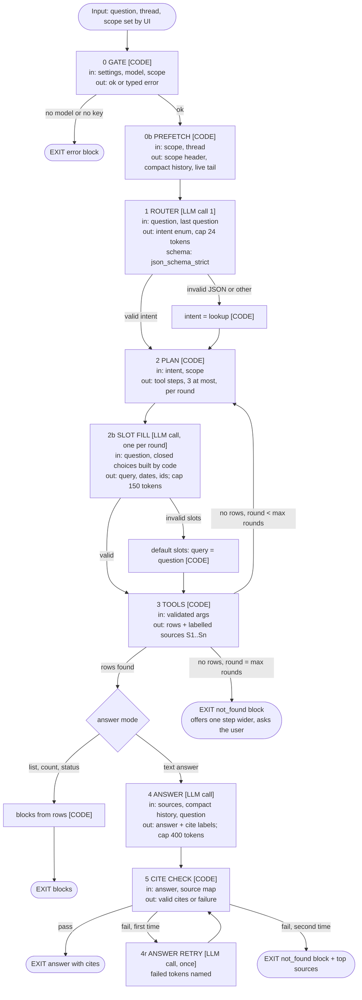

Counting from the diagram: the LLM calls are 1 (router), 2b (once per round), 4 (answer) and 4r (retry, once). Each call has one transport retry from the gateway (`S/lib/llm/call-unit.ts:16-23`). The loop 3 to 2 is bounded by the round setting. The exits are X1 to X5.

Budget of one turn (DECISION). The knobs are user settings on the Ask page (D7, section 2.9). The bars of section 8 are measured at the defaults only.

| Item | Default | Range | Note |
|---|---|---|---|
| Tool rounds `R` | 3 | 1 to 5 | |
| LLM calls (logical) | `R + 3` at most: 1 router, `R` slot fills, 1 answer, 1 answer retry. Typical 3. | | formula |
| LLM calls (with transport retries) | `2 x (R + 3)` at most | | each call may be retried once by the gateway (`S/lib/llm/call-unit.ts:16-23`) |
| Hard cap per turn | 16 calls (`2 x (5 + 3)`), a constant, not a setting | | stops any runaway loop. A turn that reaches it ends with the not_found block |
| Answer source budget | 6000 estimated tokens | 2000 to the window of the model minus output minus fixed | cut to the window like the live chat (`S/routes/meetings-chat.ts:54-56`, `:104-111`) |
| Retrieval `k` | 8 | 3 to 20 | |
| Output caps | router 24, slot fill 150, answer 400 tokens | fixed | caps given by the caller; section 2.6 says how (ASSUMPTION) |
| Turn deadline | 60 s | 20 to 180 s | The first call after an idle unload can load the model. The live chat uses a 120 s cold timeout and a 30 s warm timeout (`S/lib/llm/task-profiles.ts:130-136`; Discovery B section 2.1 step 6) |

Typical cost on E2B (ASSUMPTION, arithmetic from numbers in the repo): the live chat answers in 246 ms warm (`specs/live-chat.md`, section 6). Prefill is 23,985 tok/s and decode 144 tok/s (`specs/llm-runtime-tuning.md:63`). A turn of 3 small calls should take about 1 to 2 s warm. Section 8 measures it.

### 2.3 Stages in detail

#### Stage 0 Gate (code)

1. The setting `meeting_chat_enabled` is `"true"`. DECISION: a new setting, default off, experimental. The live chat keeps `live_chat_enabled` (`V/settings-keys.ts:66`).
2. `resolveTaskCall("meetingChat")` returns a model. DECISION: one new task id `meetingChat` for all stages. A new task id needs a profile, a settings key and a route branch (`S/lib/llm/task-profiles.ts:158-161`).
3. Provider (decision D1). The chat uses the model that the user assigned to the task `meetingChat`, local or cloud, through the normal provider and key flow. The gate fails only when no model or no key is set. Today the live chat blocks non-local providers (`S/routes/meetings-chat.ts:98-103`). The new route has no such block. The old live route changes in P5 (section 10). Local stays the first target of the design and of the eval. Rules: the app sends only the sources of the turn (up to 6000 estimated tokens, section 2.2) to the chosen provider, never to another one. The thread shows the name of the provider and model that answered. The default model is the shared resident model (section 2.7).
4. The scope exists (meeting or folder id found).
5. Search state is read. `off` does not stop the turn. Only retrieval tools degrade (section 2.5).

#### Stage 0b Prefetch (code)

Code reuses the live chat context builder for the blocks `[F]` (folder name and description) and `[L#]` (live tail) (`S/lib/meetings/live/chat-context.ts:22-31`, `:146-161`, `:84-105`). The last 4 saved messages join the prompt (`S/routes/meetings-chat.ts:53`).

#### Stage 1 Router (LLM call 1)

DECISION: the router is one small call with `json_schema_strict`. Its job is one choice.

Schema:

```json
{ "type": "object", "required": ["intent"], "additionalProperties": false,
  "properties": { "intent": { "enum": ["lookup","who_said","aggregate","temporal","review","status","write","other"] } } }
```

1. The router does not choose the scope. The UI sets the scope. Reason: a scope guess is one more error source, and Granola also lets the user choose the scope (https://help.granola.ai/article/chatting-with-your-meetings-ask-granola; Discovery C section 2.1).
2. The router prompt is under 150 words. It lists the 8 intents, each with 2 short examples. ASSUMPTION: examples in the 7 UI languages are needed. Section 8 measures router accuracy per language.
3. Invalid output or `other` gives the default intent `lookup`. A lookup with the answer call is the safest path.
4. Why an LLM and not rules: the question can be in 7 languages (`AGENTS.md`, section "UI conventions"). A rule list per language is a large, brittle table. DECISION: rules stay as the baseline arm in the eval. A rule route is used only if it matches the router on the gold set (section 8).

#### Stage 2 Plan (code)

A table maps (intent, scope) to a plan. A plan is a list of at most 3 tool steps and one fallback chain.

| Intent | Scope M | Scope F | Scope A |
|---|---|---|---|
| lookup | `search_chunks(meeting)`, then `get_meeting_summary` if the hit is thin | `search_chunks(folder)` | `search_chunks(all)` |
| who_said | `search_chunks(meeting)`, `get_transcript_window` | `search_chunks(folder)`, `get_transcript_window` on the best hit | same as F |
| aggregate | `list_action_items(meeting)` | `list_people`, `list_action_items(folder)` or `search_chunks` grouped by meeting | same, all scope |
| temporal | `get_transcript_window` | `list_meetings`, `get_meeting_summary` x2 | same |
| review | `list_decisions_questions` or `list_action_items` | same, folder | same, all |
| status | `get_meeting_summary` | `folder_status` | `list_meetings` + `list_action_items(all, open)` |
| write | write plan, section 5 | write plan | write plan |

Fallback chain for an empty `search_chunks` (DECISION): round 2 raises `k` from 8 to 20 and drops the date filter. Round 3 adds the keyword channel (section 7.4) when it exists. Then `not_found`.

#### Stage 2b Slot fill (LLM call)

The model fills slots. Code builds each slot as a closed choice where it can.

| Slot | Form | Who builds the choices |
|---|---|---|
| `query` | short standalone search text, max 200 chars | model (it rewrites a follow-up into a full query) |
| `date_from`, `date_to` | ISO date or null | model, with today's date in the prompt. Code checks that both parse and `from <= to`. |
| `person` | one `person_id` from a list, or `none` | code lists people of the scope (max 30, ranked by string match with the question) |
| `item` | one candidate label `A1..A8`, or `none` | code ranks open items by word overlap with the question and lists the top 8 |
| `meeting` | one of the meetings in a short list, or `none` | code lists meetings that match the date filter (max 12) |

Reason: a choice from a list is the most reliable output for a small model. ASSUMPTION; section 8 measures slot accuracy per model.

#### Stage 3 Tools (code)

Section 3 has the catalogue. Rules:

1. Code validates the arguments with zod before each call. Unknown meeting ids and ids outside the scope are rejected, not repaired.
2. Every tool result registers sources in a per-turn map: label `S1..Sn` to a source record (section 6.1).
3. A tool never returns more than the source budget. Long text is cut by code.
4. Tools read the database directly. They do not call HTTP routes.

#### Stage 4 Answer (LLM call)

1. Input: system prompt (one job: "answer from the numbered sources, cite labels"), sources, question, last 4 messages. Same pattern as `S/lib/meetings/live/chat-prompt.ts:9-16`.
2. Output: `{ "answer": string, "cites": string[] }`. The live chat reply format is the same (`S/lib/meetings/live/chat-prompt.ts:15-16`).
3. The answer is in the language of the question (`S/lib/meetings/live/chat-prompt.ts:10` rule).
4. Two arms are measured: strict schema (with `maxLength` on `answer` and `maxItems` on `cites`, to prevent `length` loops, precedent `S/lib/meetings/workflow/unit.ts:36-57`) and lenient parse (as the live chat does, `S/lib/meetings/live/chat-prompt.ts:24-55`). The arm with the higher answer accuracy wins per model class. Reason: the Constraint Tax finding (section 2.1 point 3).

#### Stage 5 Cite validation (code)

Section 6.

### 2.4 Live variant

During a recording the meeting has no index rows. `BUSY_STATUSES` (`recording`, `transcribing`) skip the indexer (`S/lib/search/indexer.ts:44`, `:212`). Its text is only in the in-memory live store (`S/lib/meetings/live/store.ts:99-113`).

DECISION:

1. The live variant is the same pipeline with scope `meeting` and the flag `live=true`.
2. A tool `get_live_tail` joins the tool set. It reads the live store and returns `[L#]` lines (labels as today).
3. Live lines win over older sources, as the live chat rule says (`S/lib/meetings/live/chat-prompt.ts:12`).
4. During a recording the intents are limited to `lookup`, `who_said`, `other`. Speaker labels in live lines are only Me and Them. The speaker pass runs after Stop (`specs/live-chat.md`, section 7 "No live diarization").
5. Write proposals never target the live meeting. Reason: its ids are not final. Segments are rewritten by the final pass (`specs/live-chat.md`, section 8).
6. The router call is skipped in live mode when the question has no write verb. DECISION to save latency: live mode uses intent `lookup` directly. ASSUMPTION; the eval compares both.
7. The chat model and the ASR model are different workers. The live chat already runs this way (`specs/live-chat.md`, section 6, memory numbers).
8. Owner decision 2026-11-02: the live chat merges into Ask (P5) only after Ask answers at least as well as the live chat does today ("Merge after the Ask style fix"). Until then the live chat keeps its own code path. Cloud models are allowed in the live chat since #410 (`specs/live-chat.md:74`).

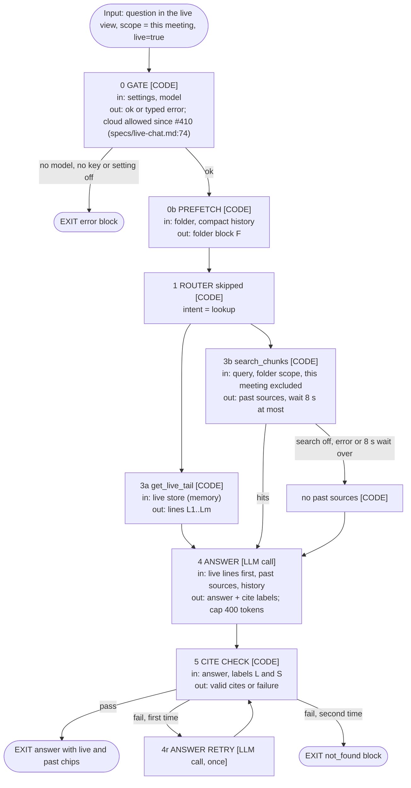

Counting from the diagram: the live turn has 1 LLM call (stage 4), plus 1 retry call (4r) and one gateway transport retry for each call. The router and the slot fill do not run. The exits are LX1 to LX3. LLM failures follow diagram 2.5b.

The 8 s retrieval wait is the live chat value (`S/lib/meetings/live/chat-context.ts:31`).

### 2.5 Failure paths

Two diagrams. 2.5a covers the gate and the tools (stages 0 and 3 of diagram 2.2). 2.5b covers the LLM calls (stages 1, 2b, 4 and 4r).

#### 2.5a Gate, tools and turn limits

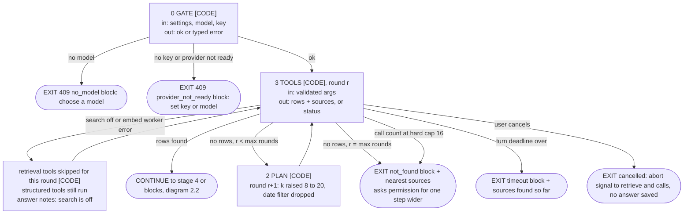

Counting from the diagram: no LLM call is made here. The only loop is 3 to 2 to 3, bounded by the round setting (default 3, range 1 to 5). The exits are X1 to X5 and the CONTINUE node.

#### 2.5b LLM call failures

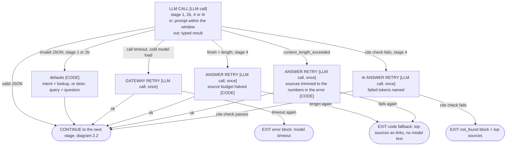

Counting from the diagram: each path adds at most one extra LLM call to the call it follows. A gateway transport retry can still happen once for each call (`S/lib/llm/call-unit.ts:16-23`). The total stays under the hard cap of 16 calls (section 2.2). The exits are X1 to X3 and the CONTINUE node.

Facts behind the paths:

1. Search off returns `{status:"off", reason}`. The search route answers 200 with the reason (`S/lib/search/retrieve.ts:137-138`; `S/routes/search.ts:52-58`). An embed worker error returns `{status:"error", kind}` (`S/lib/search/retrieve.ts:123-134`).
2. The worker returns a typed 400 `context_length_exceeded` with the token numbers (`W:672-698`).
3. A `length` finish with a whitespace loop was a real failure on E2B. The worker now bounds whitespace to 24 characters (`W:649-657`; Discovery B section 4).
4. The gateway never loops. It makes one request per call and has typed errors and one retry (`S/lib/llm/gateway.ts:68`; `S/lib/llm/call-unit.ts:16-23`; Discovery B section 3.1).
5. The embed worker unloads after 5 idle minutes. The first search can wait for the load (`S/lib/mlx-embed/server.ts:17-32`).

### 2.6 How the stages call the model

1. DECISION: all LLM calls use the gateway (`callUnit` with a zod schema). Reason: typed errors, one retry, and the recorder (`S/lib/llm/recorder.ts`) so the LLM inspector shows each stage (Discovery B section 3.1, style b).
2. The agent does not use `callStructured` for a native tool loop. The gateway throws `UnexpectedToolCallsError` on a `tool-calls` finish (`S/lib/llm/gateway.ts:1089-1099`). This spec has no native tool loop, so it does not matter.
3. `llm_runs` has `scope` and `scope_id` columns and no fixed enum (`S/lib/schema.ts:1036-1050`). DECISION: one run per turn with `scope = "chat"` and `scope_id = thread id`. Each stage is one `llm_calls` row.
4. Output caps per stage are given by the caller. ASSUMPTION: `callUnit` accepts a per-call `maxOutputTokens`. P1 must verify this in code before the build. If not, add one task id per stage (`meetingChatRoute`, `meetingChatAnswer`).
5. Sampling: the Auto path sends temperature 0 for every stage (`S/lib/llm/task-profiles.ts:51`; `AGENTS.md`, rule 2.2 "New model rule"). Runs at temperature 0 are deterministic (`specs/llm-runtime-tuning.md:427`). This makes the eval repeatable.
6. Thinking is off, as for `liveChat` (`S/lib/llm/task-profiles.ts:130-136`).
7. The lane: one request at a time per local model (`S/lib/llm/lane.ts:106`). The lane is held per request, so a dictation can run between two stages (Discovery B section 3.1, last bullet).

### 2.7 Shared resident model (D6)

Owner decision D6: chat (`meetingChat`) and the live chat default to the model that is already loaded and serving the other tasks. One serving instance serves all tasks, to save memory.

1. The live chat already follows this: its default assignment is the app default LLM, which is the dictation cleanup model, so both share one worker (`specs/live-chat.md` section 3). The pool maps one model id to one HTTP worker, and two tasks with the same model share that worker (`specs/llm-runtime-tuning.md:365`). The cleanup model is pinned while cleanup is on (`specs/llm-runtime-tuning.md:367`).
2. DECISION: the default assignment of `meetingChat` is the model of the task `cleanup`. No second model loads for chat.
3. A different model for chat is an explicit opt-in on the Models page. Before the user confirms, the row shows a warning with the RAM cost (the MLX peak of the catalog entry, for example 5.1 GiB for E2B and 16.3 GiB for 26B-A4B, `S/lib/mlx-llm/constants.ts:65-73`, `:110-118`) and the load time (ASSUMPTION: measured in P1 and shown as a number). The pool admission rule can refuse a model that does not fit (`specs/llm-runtime-tuning.md:366`).
4. The 120 s cold path applies mostly after an idle unload, because the shared model stays loaded while dictation uses it. "Keep ready" keeps it loaded (`specs/llm-runtime-tuning.md:368`).
5. The sharing has two costs. Both are measured risks (section 9.2, risk 6), not assumptions:
   - Dictation delay: all tasks of one model share one lane with one slot (`specs/llm-runtime-tuning.md:369`; `S/lib/llm/lane.ts:106`). A dictation can wait for one chat call. Bar in 8.7.
   - Prefix cache: the worker keeps one prefix entry, sent on cleanup requests only (`W:905-925`). A chat call with a different system prompt can evict it, and the next cleanup prefills again.
6. Fix options if the cost is too high (decided by the measurement, in order): (a) chat stages put the same fixed system prefix first, so the cached prefix survives. ASSUMPTION; the measurement shows if it works. (b) The worker keeps a prefix cache of 2 entries (a worker change). (c) The user opts in to a separate model for chat (point 3). (d) Chat calls are split so that each is short. No option is built before the number exists.

### 2.8 Context window handling (D18)

The owner calls this "one of the most sensitive parts of any chat". The rules are code, not model choices.

1. Fixed budget split for each LLM call. Parts: system prompt, sources, history, question. Each part has its own cap. The answer call: system about 300 tokens, question up to 300, history up to 600, sources the rest of the source budget (default 6000 total, section 2.2). The live chat has the same idea with a fixed block order (`S/lib/meetings/live/chat-context.ts:22-31`). The caps are ASSUMPTIONS until P1 measures them.
2. History never pushes sources out. If the parts do not fit, code shrinks history first (older turns drop), then the question stays whole, and sources are dropped whole, last-ranked first. A source is never cut in the middle, so a cite always points to complete text. The live chat drops whole blocks from the end of the list and cuts each hit to 320 characters (`S/lib/meetings/live/chat-context.ts:29`, Discovery B section 2.1). This spec keeps the 320 characters for chunk hits and cuts nothing else.
3. Compact history. A past turn enters the prompt as: the question, a short answer (at most 200 characters, taken from the first sentence of the stored answer by code) and the cite ids. It does not include the full answer text or the source texts. The last 4 messages today are full text (`S/routes/meetings-chat.ts:53`). This spec replaces them with the compact form. The full thread stays in the database.
4. Standalone follow-up rewrite before retrieval. The `query` slot of the slot fill (stage 2b) rewrites a follow-up ("and who owns it?") into a full search query, using the compact history. Retrieval never runs on the raw follow-up. The eval slice "follow-up" measures it.
5. Budget per model. The window is the real context of the model (`contextWindowFor`, `S/lib/llm/token-budget.ts:88`; 32,768 for the catalog models, `S/lib/mlx-llm/constants.ts:65-135`; null for an own server, which has no guard, Discovery B section 3.3). The default source budget is capped by measured prefill time. At the prefill rates in `specs/llm-runtime-tuning.md:63` (E2B 23,985 tok/s, 26B-A4B 4,283, Qwen3.8 27B 736), 6000 tokens cost about 0.25 s, 1.4 s and 8.2 s (arithmetic, ASSUMPTION). P1 measures it and sets the default per model class. A user value above the measured default is labelled "unmeasured".
6. The trace records what was cut: for each call, the token count of each part, the sources dropped (labels and titles), and the history turns dropped. The step trail in the UI can show "2 sources left out". The trace is stored in `trace_json` (section 4.2). The recorder keeps the final messages (`llm_calls.messages_json`, `S/lib/schema.ts:1070`).
7. Overflow from the worker (`context_length_exceeded`, `W:672-698`) triggers one retry with the numbers from the error, as in the failure paths (2.5).
8. Eval: threads of 5 to 10 turns with a fact planted early (turn 1 or 2) and asked again late. The fact must still be answerable, or the answer must be a correct not-found. Metrics: late-fact accuracy, sources dropped per turn, and answer accuracy against thread length (section 8.3).

### 2.9 Settings: the "Ask" page (D7)

Owner decision D7: the budget values are user settings on a new Settings sub-page "Ask" (chat parameters).

| Setting | Default | Range |
|---|---|---|
| Tool rounds | 3 | 1 to 5 |
| Answer source budget (tokens) | 6000 | 2000 to the model limit |
| Retrieval k | 8 | 3 to 20 |
| Turn deadline | 60 s | 20 to 180 s |
| Search wider | "ask me, one step at a time" | also "do not offer" |
| Chat history retention (later) | keep | one global knob, later (D18) |

Rules:

1. Every setting is read by the code at the moment of use, and a test pins it. The repo has a past case of a phantom knob: the enhance timeout shipped with a validator and no reader (`S/lib/llm/task-profiles.ts:158-161`). New settings need a settings key, a validator in `V/` and a route branch.
2. The eval bars are measured at the defaults. A non-default value shows the label "unmeasured" next to the field.
3. Decision D7 sets a UI knob for run settings. An older owner rule says no UI knobs for run settings (project memory "LLM runtime plan"; Discovery B section 4, last paragraph). D7 is the newer request and covers this page only.
4. The switch `meeting_chat_enabled` and the model choice stay where they are (Settings, Meetings; Models page).
5. Strings in 7 locales plus template.

## 3. Tool catalogue

### 3.1 Rules for all tools

1. A tool is a TypeScript function with a zod input schema. Code calls it. The model never calls it directly.
2. Every tool gets `scope` from the turn context. A tool input cannot widen the scope. DECISION.
3. Scope rule: scope M allows one `meeting_id`. Scope F allows meetings with that `folder_id`. Scope A allows all. Unfiled meetings belong to scope A only. (The vector store uses the partition `''` for unfiled, `S/lib/search/vec-store.ts:18-25`.)
4. At most 8 tools are visible per turn. Visible means "in the plan and in the slot-fill prompt". Read-only turns show at most 5. Write turns show the read tools of the plan plus one write tool.
5. Cost classes: C0 SQL read, under 20 ms. C1 embed plus KNN, about 80 ms embed per batch and about 1.2 ms KNN on 46,000 rows once the embed worker is loaded (Discovery B section 1.6; `S/lib/mlx-embed/client.ts:23`; `specs/local-semantic-search.md` S1). C2 resolver or LLM work.
6. Every result row carries what code needs for a cite: `meeting_id`, `title`, `started_at` and a time or item id.

### 3.2 Read tools

| Tool | Purpose | Input (JSON schema, short) | Output | Scope rule | Stories | Cost |
|---|---|---|---|---|---|---|
| `search_chunks` | Find text by meaning. Add meeting and date filters. | `{query:string(1..200), meeting_ids?:string[](<=500), date_from?:iso, date_to?:iso, kinds?:("transcript"\|"summary")[], k?:int(1..50, default 8)}` | `hits[{label, meeting_id, title, started_at, kind, start_ms, end_ms, best_ms, text(<=320 chars), score}]`, grouped: best chunk per meeting plus up to 2 more transcript chunks | `meeting_ids` is intersected with the scope. In scope F code sets the folder partition. | R1, R4, R7, R9 | C1 |
| `get_meeting_summary` | Read the summary of one meeting. | `{meeting_id}` | `{meeting_id, title, started_at, overview, key_points[], decisions[{item_id,text}], action_items[{item_id,task,owner,due,done}], open_questions[{item_id,text}]}` | meeting in scope | R1, R3, R5, R6 | C0 |
| `list_action_items` | List action items with done state. | `{status?:"open"\|"done"\|"all", person_id?, date_from?, date_to?, meeting_id?}` | `{total, items[{item_id, meeting_id, title, task, owner_person?, owner_text, due, done, group_size}]}` grouped like the folder overview (`S/lib/meetings/folder-overview.ts:85`) | folder or all, as scope | R2, R5, W2 | C0 |
| `list_decisions_questions` | List decisions or open questions. | `{kind:"decision"\|"open_question", date_from?, date_to?, meeting_id?, limit?:int(<=50)}` | `{total, items[{item_id, meeting_id, title, text, started_at}]}` | as scope | R5 | C0 |
| `list_people` | List people (resolved). | `{query?:string, min_meetings?:int}` | `{people[{person_id, name, aliases[], meetings_count, confirmed}]}`. Before P4 it returns only certain matches (section 4.3). | as scope | R2, R4, W1 | C0 |
| `get_transcript_window` | Read transcript lines of one meeting, with speakers. | `{meeting_id, from_ms:int, to_ms:int (max 180000 span), speaker?:string}` | `lines[{label, start_ms, end_ms, speaker, text}]` | one meeting in scope | R4, R3 | C0 |
| `folder_status` | Where a project stands. | `{}` (folder from scope) | `{folder:{name,description}, standing:{bullets[],generated_at,stale}, overview:{open_actions, recent_decisions, open_questions, people, timeline}}` | scope F only | R6 | C0 |
| `list_meetings` | List meetings by date, tag, folder. | `{date_from?, date_to?, tag?, limit?:int(<=50)}` | `{total, meetings[{meeting_id,title,started_at,folder,tags[],has_summary}]}` | as scope | R3, R7, W3, W4 | C0 |
| `get_live_tail` | Live lines of the recording. | `{}` | `lines[{label:"L#", time, speaker:"Me"\|"Them", text}]` | live meeting only | live R1 | C0 |

Notes and grounding:

1. `search_chunks` extends `retrieve()` (`S/lib/search/retrieve.ts:136`). Today `RetrieveInput` has no meeting scope and no date filter (`S/lib/search/retrieve.ts:26-35`). The KNN layer has `meetingIds` (`S/lib/search/vec-store.ts:133`, `:159-166`) with a cap of 500 per query (`KNN_IN_LIST_MAX`, `S/lib/search/vec-store.ts:16`). The tag path already groups ids by 500 (Discovery B section 1.3). A date filter becomes a SQL pre-filter on `meetings.started_at` that yields a `meetingIds` list. Section 7 has the plan.
2. `search_chunks` returns no `meta` chunks. The live chat drops them too (`S/lib/meetings/live/chat-context.ts:233`).
3. `get_meeting_summary` and the list tools read `meeting_summaries.summary_json` through `parseSummary` (`S/lib/meetings/folder-overview.ts:158`). Older rows have NULL `summary_json` (Discovery A section 1.2). The tool then returns `has_summary:false` and the markdown text as one source.
4. `list_action_items` in scope F uses the group logic of `folderActionGroups` (`S/lib/meetings/folder-overview.ts:252`). The overview limits are 100 meetings and 30 people (`S/lib/meetings/folder-overview.ts:16-18`). For scope A the tool loops over folders and reads unfiled meetings too. Done state of an unfiled meeting does not exist today: `folder_action_item_state` has a foreign key to `meeting_folders` (`S/lib/schema.ts:1291-1298`). Section 4.1 fixes this.
5. `get_transcript_window` reads `loadMergedTranscript` (`S/lib/meetings/transcript-io.ts:90-123`). It returns `speaker_label` and the speaker names from `meeting_speakers`. The mic channel is always "Me" (`S/lib/meetings/merge.ts:412`).
6. `folder_status` reuses `buildFolderOverview` (`S/lib/meetings/folder-overview.ts:341`, no LLM) and the stored `folder_standing` row (Discovery A section 1.3). It never starts a standing LLM call. If the standing is stale, the block says so.
7. The cap on `date` filters uses epoch ms in `meetings.started_at` (Discovery A section 2, row "Date/time").

### 3.3 Write proposal tools

Write tools return a proposal object. They change no data. Section 5 has the object.

| Tool | Purpose | Input | Proposal payload | Applied through | Stories | Risk tier |
|---|---|---|---|---|---|---|
| `propose_action_item_change` | Close, reopen or edit one action item. | `{item_id, change:{done?:bool, task?:string(<=220), owner_person_id?, owner_text?, due?:string\|null}}` | `{item_id, before, after}` | done: `setActionItemDone` (`S/lib/meetings/folder-overview.ts:428`). Edit: new write path on `summary_json` (section 5.5). | W2 | low (done), medium (edit) |
| `propose_retag` | Add or remove tags on meetings. | `{meeting_ids[] (<=20), add?:string[], remove?:string[]}` | per meeting: `{before:tags[], after:tags[]}` | `setMeetingTags` is a full replace (`S/lib/meetings/tags.ts:74`). Code computes the full new set. | W3 | low |
| `propose_move` | Move meetings to a folder or to unfiled. | `{meeting_ids[] (<=20), folder_id:string\|null}` | per meeting: `{from_folder, to_folder}` | the move logic of `POST /meetings/move` (`S/routes/meeting-folders.ts:166`), which also re-partitions vectors (`S/routes/meeting-folders.ts:197-203`; `S/lib/search/indexer.ts:104-121`) | W4 | low |
| `propose_merge_people` | Merge a cluster of names into one person. | `{cluster_id}` (a cluster from the resolver, not free names) | `{person_ids[], canonical, affected:{meetings, speaker_rows, action_items}, rewrite:bool}` | person tables and the rewrite of section 5.6 | W1 | medium |

Rules:

1. Write tools take ids from the lists that code built. The model cannot pass a free name.
2. Moving a meeting does not move the done marks. They stay under the old folder id (Discovery A section 3, row "POST /meetings/move", marked there as inference). Section 4.1 fixes this with per-item status.
3. The move and retag tools handle at most 20 meetings per proposal. A larger request becomes several proposals.

## 4. Data model changes

### 4.1 Stable ids for action items, decisions and questions

Gap: items live only inside `summary_json` as plain strings (`S/lib/meetings/workflow/schemas.ts:224-240`). The done mark key is a hash of meeting id and the normalized task (`S/lib/meetings/folder-overview.ts:43-48`). A changed task text gives a new key and loses the mark (`S/lib/meetings/folder-overview.ts:40-42`).

DECISION: `summary_json` stays the stored LLM output and the source that all existing readers use. A new table `meeting_items` adds ids and state on top of it. Reason: no change for current readers (folder overview, summary view). Rollback means dropping the table.

```sql
-- schema v54 (next free version at build time; SCHEMA_VERSION is 53 today, S/lib/schema.ts:14)
CREATE TABLE IF NOT EXISTS meeting_items (
  id TEXT PRIMARY KEY,                    -- UUID, stable
  meeting_id TEXT NOT NULL REFERENCES meetings(id) ON DELETE CASCADE,
  kind TEXT NOT NULL CHECK(kind IN ('decision','action','question')),
  ordinal INTEGER NOT NULL,               -- index in the summary_json array
  text_hash TEXT NOT NULL,                -- sha256 of normalized text, drift check
  legacy_key TEXT,                        -- actionItemKey(), kinds 'action' only
  status TEXT NOT NULL DEFAULT 'open' CHECK(status IN ('open','done')),
  status_updated_at INTEGER,
  created_at INTEGER NOT NULL,
  superseded_at INTEGER                   -- set when a new summary drops the item
);
CREATE INDEX IF NOT EXISTS idx_meeting_items_meeting ON meeting_items(meeting_id, kind, ordinal);
CREATE UNIQUE INDEX IF NOT EXISTS uq_meeting_items_pos ON meeting_items(meeting_id, kind, ordinal) WHERE superseded_at IS NULL;
```

Migration (one transaction, in `S/lib/schema.ts`, like the v52 block at `:1324`):

1. For each row of `meeting_summaries` with `summary_json`: parse it with `parseSummary`. Insert one `meeting_items` row for each decision, action and question. Compute `legacy_key` for actions with `actionItemKey(meeting_id, task)`.
2. For each row of `folder_action_item_state` with `done = 1`: find the `meeting_items` row with the same `legacy_key` in a meeting of that folder. Set `status = 'done'`. Keep the old table untouched.
3. Old summaries with NULL `summary_json` get no items. The tool reads their markdown.

Sync rule (DECISION):

1. After a new summary is saved (`S/lib/meetings/workflow/nodes/save.ts:242`), a sync step compares the new items with the live rows. A new item matches an old one when `sameOverviewItem` is true (`S/lib/meetings/folder-overview.ts:57`; it builds on `sameItem`, `S/lib/meetings/workflow/schemas.ts:118`). A match keeps the id and status. A non-match gets a new id. Old rows without a match get `superseded_at`.
2. The `text_hash` detects a `summary_json` change that bypassed the sync. A read tool with a hash mismatch re-syncs first.
3. Dual write for the done state: a done change writes `meeting_items.status` and `folder_action_item_state` in one transaction. The folder overview keeps reading the old table, so it needs no change in P3. Unfiled meetings have only `meeting_items.status`. This closes the unfiled gap. A later change can make the overview read `meeting_items`. It is not part of this spec.
4. Rollback: stop reading `meeting_items`. The old table is complete for filed meetings because of the dual write. Unfiled done marks are lost on rollback. DECISION: accept this, because they never existed before.

Stability limits:

1. A re-summarize can change the wording, so a match can fail. The old item goes to `superseded_at` and its done mark is lost. This is the same behavior as the key hash today (`S/lib/meetings/folder-overview.ts:40-42`). It is a known limit.
2. A re-transcribe rewrites segment rows (`INSERT OR REPLACE`, Discovery A section 1.1). Items do not depend on segment ids. Cites use `meeting_id` plus `start_ms` (Discovery A, gap 10).

### 4.2 Chat threads for folder and global scope

Gap: `meeting_chat_messages` has one meeting id and cascades with the meeting (`S/lib/schema.ts:1324-1342`; `S/lib/meetings/live/chat-store.ts:1-6`).

```sql
-- schema v55
CREATE TABLE IF NOT EXISTS chat_threads (
  id TEXT PRIMARY KEY,                                  -- UUID
  meeting_id TEXT REFERENCES meetings(id) ON DELETE CASCADE,
  folder_id  TEXT REFERENCES meeting_folders(id) ON DELETE CASCADE,
  title TEXT,
  created_at INTEGER NOT NULL,
  updated_at INTEGER NOT NULL,
  CHECK (NOT (meeting_id IS NOT NULL AND folder_id IS NOT NULL))
);                                    -- both NULL = scope "all"
CREATE INDEX IF NOT EXISTS idx_chat_threads_scope ON chat_threads(meeting_id, folder_id, updated_at);
CREATE TABLE IF NOT EXISTS chat_messages (
  id INTEGER PRIMARY KEY AUTOINCREMENT,
  thread_id TEXT NOT NULL REFERENCES chat_threads(id) ON DELETE CASCADE,
  role TEXT NOT NULL CHECK(role IN ('user','assistant')),
  content TEXT NOT NULL,                -- plain text of the answer, or the question
  blocks_json TEXT,                     -- structured answer blocks (list, count, status, not_found)
  cites_json TEXT,                      -- [{label, meeting_id, start_ms, item_id, kind}]
  trace_json TEXT,                      -- tool names, row counts, ms per stage
  change_ids_json TEXT,                 -- proposal ids (section 5)
  run_id TEXT REFERENCES llm_runs(id) ON DELETE SET NULL,
  model_id TEXT,
  ms INTEGER,
  created_at INTEGER NOT NULL
);
CREATE INDEX IF NOT EXISTS idx_chat_messages_thread ON chat_messages(thread_id, id);
```

DECISION: two nullable foreign keys with a CHECK. Reason: SQLite has no polymorphic foreign key. A deleted meeting or folder removes its threads, as `meeting_chat_messages` does today. A folder delete is blocked when the folder is not empty (Discovery A section 3, row `DELETE`), so folder threads rarely cascade.

Migration: `meeting_chat_messages` is copied into `chat_messages` with one thread per meeting. It runs in P5 (section 9). The old table stays for one release. Rollback: the old table is complete until the P5 switch.

### 4.3 Cross-meeting person entity

Gap: no person table exists. One human appears as an attendee name or email, a `display_name`, a `suggested_name`, an action item owner, loose text, `speaker_names_lost`, and a vocabulary term (Discovery A section 2.1). The only merge logic today is `countPeople`, which lowercases and trims names (`S/lib/meetings/folder-overview.ts:297`).

```sql
-- schema v56
CREATE TABLE IF NOT EXISTS people (
  id TEXT PRIMARY KEY,                 -- UUID
  display_name TEXT NOT NULL,          -- canonical name shown in answers
  email TEXT,                          -- from calendar, if any
  is_account_owner INTEGER NOT NULL DEFAULT 0,   -- the "Me" person; set by the user
  merged_into TEXT REFERENCES people(id),        -- soft merge pointer
  created_at INTEGER NOT NULL,
  updated_at INTEGER NOT NULL
);
CREATE TABLE IF NOT EXISTS person_aliases (
  id INTEGER PRIMARY KEY AUTOINCREMENT,
  person_id TEXT NOT NULL REFERENCES people(id) ON DELETE CASCADE,
  alias TEXT NOT NULL,                 -- as written
  alias_norm TEXT NOT NULL,            -- folded, lowercase
  source TEXT NOT NULL CHECK(source IN ('attendee','speaker_display','speaker_suggested','owner','vocabulary','manual')),
  meeting_id TEXT REFERENCES meetings(id) ON DELETE CASCADE,
  speaker_label TEXT,                  -- link to (meeting_id, speaker_label) when source is a speaker
  confirmed INTEGER NOT NULL DEFAULT 0,
  created_at INTEGER NOT NULL
);
CREATE UNIQUE INDEX IF NOT EXISTS uq_person_alias ON person_aliases(person_id, alias_norm, source, COALESCE(meeting_id,''), COALESCE(speaker_label,''));
CREATE INDEX IF NOT EXISTS idx_person_alias_norm ON person_aliases(alias_norm);
```

The labels "Me" and "Them N" are not names. The resolver skips them. Decision D2 changes what "Me" means: it is not "every mic segment". Section 4.5 describes the mic workstream. The person with `is_account_owner = 1` is created after one user confirmation. It links only to the mic speaker clusters that the user confirms as themselves. Today the mic channel is always "Me" and has no `meeting_speakers` row (`S/lib/meetings/merge.ts:15`, `:412`; Discovery A section 1.1). The prompt tells the summary model to write "Me", "Them 2" or a confirmed name as owner (`S/lib/meetings/workflow/prompts.ts:184-186`).

Entity resolution (DECISION: code first, human confirms):

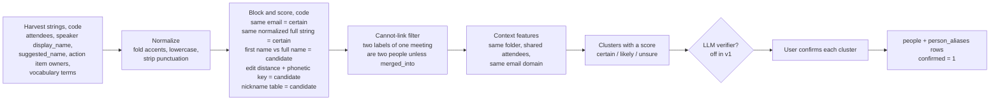

1. Certain matches (same email, or the same normalized full string inside one folder) create unconfirmed `people` rows. They are used by `list_people` and by owner filters at once. DECISION: a certain match does not change any text.
2. Likely and unsure clusters are not used by tools until the user confirms them (P4).
3. The cannot-link rule: `meeting_speakers` has one row per label per meeting (`S/lib/schema.ts:856` block; Discovery A section 1.1). Two different labels in one meeting are two people, except when the user set `merged_into` (`S/routes/meetings.ts:2286` route).
4. ASR spelling variants of one name are common. One-word bias-term segments are noise and are not evidence (owner-verified note in project memory "short leak segments"; Discovery C section 4, last bullet). DECISION: the resolver reads names, never segments.
5. The LLM verifier is off in v1. If the dedup precision on the labelled set (section 8.6) is below the bar, P4 adds a verifier call that may answer "unsure". An LLM judge raised precision to 95.4% and cut recall to 50.9% in one blog test on products (https://pub.towardsai.net/using-gpt-4o-mini-as-an-entity-resolution-judge-95-precision-for-0-04-b216d44a7f20; a blog, not people). With a human confirm step, a lower recall is acceptable. ASSUMPTION.
6. The nickname table is a small data file per language. ASSUMPTION; the eval measures its gain.
7. The first run on a folder builds the rows. Later runs update them when a speaker or summary changes. Staleness uses the same idea as the index source hash (`S/lib/search/source.ts:146-154`).

### 4.4 Apply and undo audit log

```sql
-- schema v57
CREATE TABLE IF NOT EXISTS agent_changes (
  id TEXT PRIMARY KEY,                    -- UUID, the proposal id
  batch_id TEXT NOT NULL,                 -- groups proposals from one turn
  thread_id TEXT REFERENCES chat_threads(id) ON DELETE SET NULL,
  message_id INTEGER,
  kind TEXT NOT NULL CHECK(kind IN ('action_item','retag','move','merge_people')),
  status TEXT NOT NULL CHECK(status IN ('proposed','applied','undone','failed','expired','rejected')),
  payload_json TEXT NOT NULL,             -- what to do, ids only
  payload_hash TEXT NOT NULL,             -- sha256 of canonical payload_json
  idempotency_key TEXT NOT NULL UNIQUE,   -- hash(kind, payload_hash)
  preview_json TEXT NOT NULL,             -- before/after rows shown to the user
  before_hash TEXT NOT NULL,              -- hash of the rows read at proposal time
  inverse_json TEXT,                      -- old values, written at apply
  after_hash TEXT,                        -- hash of the rows right after apply
  run_id TEXT REFERENCES llm_runs(id) ON DELETE SET NULL,   -- the LLM run that built the proposal
  model_id TEXT,
  created_at INTEGER NOT NULL,
  expires_at INTEGER NOT NULL,
  applied_at INTEGER,
  undone_at INTEGER,
  error TEXT
);
CREATE INDEX IF NOT EXISTS idx_agent_changes_thread ON agent_changes(thread_id, created_at);
ALTER TABLE meeting_summary_versions ADD COLUMN change_id TEXT;   -- nullable
```

Prose and field changes need a before and after text for each place. DECISION: one more table in the same migration.

```sql
-- schema v57, same migration
CREATE TABLE IF NOT EXISTS agent_change_places (
  id INTEGER PRIMARY KEY AUTOINCREMENT,
  change_id TEXT NOT NULL REFERENCES agent_changes(id) ON DELETE CASCADE,
  table_name TEXT NOT NULL,          -- meeting_summaries, meeting_speakers, meetings, folder_standing, ...
  row_key TEXT NOT NULL,             -- primary key of the row, as text
  field TEXT NOT NULL,               -- column or JSON path, e.g. summary_json.keyPoints[2]
  before_text TEXT NOT NULL,
  after_text TEXT NOT NULL,
  before_hash TEXT NOT NULL,         -- hash of the full field value before
  after_hash TEXT NOT NULL,          -- hash of the full field value right after apply
  patches_json TEXT NOT NULL,        -- [{start, before, after}] spans inside the field, for prose
  status TEXT NOT NULL DEFAULT 'applied' CHECK(status IN ('applied','undone','conflict','superseded','skipped'))
);
CREATE INDEX IF NOT EXISTS idx_agent_change_places_change ON agent_change_places(change_id);
CREATE INDEX IF NOT EXISTS idx_agent_change_places_row ON agent_change_places(table_name, row_key, field);
```

DECISION: a new table and not `llm_call_links`. Reason: `llm_call_links` records what an LLM wrote (`target_type`, `applied_text`, `outcome`, `S/lib/schema.ts:1082-1093`). Here the user writes, and the LLM only proposes. The table links to the run through `run_id`, so the inspector can show the proposal call.

Migration plan for v54 to v57:

1. All four migrations are additive (new tables, one nullable column). The migration block pattern is `if (currentVersion < N && tableExists(...))` (`S/lib/schema.ts:1324`).
2. An app that is older than the database returns early at `if (currentVersion >= SCHEMA_VERSION) return;` (`S/lib/schema.ts:168`). It ignores the new tables. ASSUMPTION: no old code path fails on extra tables. A test opens a v57 database with the v53 build (P0 gate for the first migration).
3. Rollback of the feature: set `meeting_chat_enabled` off. No data loss. Applied changes stay applied. The user can undo them before the rollback; after it, undo is not available.
4. Data written by P3 apply (done marks, tags, folder, summary versions) is normal app data. It stays valid without the new tables, except `meeting_items.status` of unfiled meetings (section 4.1 point 4).
5. Each migration needs a unit test with a seeded v53 database. The test checks counts and the dual write.

### 4.5 Workstream PM: diarize the mic channel (decision D2)

Owner decision D2: the mic channel can hold more than one person (a team in one room on one mic). So "Me" must not mean "every mic segment". Diarization is needed on all channels, the mic included.

What exists today:

1. Diarization is opt-in and runs on the system channel only. It spawns `fluidaudio-diarize` on `system.wav` and writes `speaker_label` ("1", "2", ...) on segments (`S/lib/meetings/diarize.ts:3-12`, `:590-597`).
2. The merged transcript labels every mic segment "Me" and every system segment "Them" (`S/lib/meetings/merge.ts:15`, `:412`). The mic channel has no row in `meeting_speakers` (Discovery A section 1.1). `meeting_speakers` holds a mapping over the diarizer label index (`S/lib/schema.ts:848-856`).
3. The live loop has no diarization during the recording. The speaker pass runs after Stop (`specs/live-chat.md` section 7).
4. Raw diarizer turns are stored in `meeting_diarizer_turns` with primary key `(meeting_id, idx)` and no channel column (`S/lib/schema.ts:948`; Discovery A section 1.1).

What PM changes (DECISIONS):

| Item | Change |
|---|---|
| Diarizer input | Run the helper on `mic.wav` too, after the system pass. ASSUMPTION: the helper accepts a mic file as it accepts `system.wav`. A spike in PM step 1 proves or disproves it. |
| Labels | Mic labels use a prefix: `m1`, `m2`, ... System labels stay "1", "2", .... Reason: `meeting_speakers` has primary key `(meeting_id, speaker_label)` (`S/lib/schema.ts:856`), and both channels would collide on "1". No schema change is needed for the labels: the column `meeting_segments.speaker_label` already exists (`S/lib/schema.ts:824`). |
| Diarizer turns | Add a `source` column (`'system'` default, `'mic'`). The primary key must include it. SQLite cannot change a primary key in place, so the migration rebuilds the table (create new, copy, drop, rename). The table holds derived data and can be rebuilt from audio. |
| Merge output | `mergeTranscript` stops hard-coding "Me" for mic rows (`S/lib/meetings/merge.ts:15`, `:412`). A mic row gets its label. The `Speaker` type widens. A mic row with no label (diarization off or failed) keeps "Me" as today. |
| Display name for a mic cluster | If the cluster is linked to the account-owner person: "Me". Else the confirmed name. Else "Mic 1", "Mic 2" in the UI. If a meeting has exactly one mic cluster and no confirmation yet: "Me" (today's behavior). |
| Owner link | The person with `is_account_owner = 1` links through `person_aliases` rows with `source = 'speaker_display'`, `meeting_id` and `speaker_label = 'm1'` (section 4.3). Only clusters that the user confirmed as themselves link to the owner. Other mic clusters become their own speakers and people. |
| Confirmation flow | One confirmation creates the owner person. Per meeting: if the meeting has one mic cluster, code links it to the owner and shows this in the change preview. If it has more than one, the UI asks "which voice is you?" and plays a short audio snippet for each cluster. The answer is a normal speaker update (`S/routes/meetings.ts:2286`). |
| Carry over | The carry rule after a re-transcribe (`S/lib/meetings/speaker-carry.ts`) must work with mic labels. It keys on time overlap. PM step 2 adds a test with mic labels. |
| Summary owner strings | The summary prompt tells the model to write the transcript label as owner (`S/lib/meetings/workflow/prompts.ts:184-186`). A mic cluster label (a name or "Mic 2") flows through that rule with no prompt change. ASSUMPTION; the eval checks owner accuracy on multi-voice meetings. |
| Cannot-link rule | Two mic clusters in one meeting are two people unless the user merged them (section 4.3, point 3). |
| Cross-meeting voice identity (D15) | Depends on four existing issues, all OPEN on 2026-10-31 (checked with the GitHub issue view): #67 "Recognize the same speaker across meetings", #73 "Store voiceprints on the device only", #79 "Add voiceprint enrollment with a consent screen", #85 "Match known voiceprints in new meetings". A mic or system cluster that is near a stored voiceprint becomes a suggestion ("same voice as Ana, last meeting"). The user confirms. Nothing links by voice alone. A voiceprint is created only after consent. It is kept until the person is deleted or the user asks, on the device only. Its retention does not depend on audio retention. PM does not build voiceprints. It only reads the suggestion when #85 exists. |
| Live recording | The live view shows "Me" and "Them" until Stop (`specs/live-chat.md` section 7). The live chat answers with those two. |

Risks specific to PM:

1. Echo: the mic can pick up remote voices from the speakers. The code already repairs some mic tracks (`system.original.wav` repair, `S/lib/meetings/retention.ts:15-17`) and removes echo rows before chunking (Discovery B section 1.2). The diarizer could then make mic clusters for remote people. Code must compare each mic cluster with the system channel in time (overlap of speech with the same audio content) and mark likely echo clusters "echo" so they are not offered as people. ASSUMPTION; the eval has an echo case.
2. A single speaker can be split into two clusters (false split). The user can merge two labels of one meeting with the existing `merged_into` path (`S/routes/meetings.ts:2286`).
3. Time: a second diarizer run adds time to the post-recording job. PM measures it (system pass today: Discovery has no number; GAP).
4. The summary of old meetings keeps "Me" as owner string for every mic voice. The merge preview of section 5.6 shows these places, and the user decides.

Eval (also section 8.8): fictional multi-voice mic audio.

## 5. Write safety

### 5.1 The rule

The model never writes. The path is: propose, preview, user confirms, apply, log, undo. This follows the pattern in Discovery C section 3: Linear keeps the human as owner and the agent as delegate (https://linear.app/developers/agents). Granola lets chat fix names and reassign action points (https://help.granola.ai/article/chatting-with-your-meetings-ask-granola). Approval requests hold the action, params, a preview, an expiry and an idempotency key (https://pypi.org/project/agent-runtime-governance/). Sources for the last pattern are practitioner pages, not standards (Discovery C section 3).

### 5.2 Proposal object

```json
{
  "id": "uuid",
  "batch_id": "uuid",
  "kind": "action_item | retag | move | merge_people",
  "scope": {"kind": "folder", "id": "..."},
  "payload": { "...ids and new values only..." },
  "payload_hash": "sha256 of canonical JSON of payload",
  "idempotency_key": "sha256(kind + payload_hash)",
  "before_hash": "sha256 of the rows read now",
  "preview": [ { "row_id": "...", "label": "...", "before": "...", "after": "...", "cite": {"meeting_id": "...", "start_ms": 0} } ],
  "risk": "low | medium",
  "expires_at": 0
}
```

1. Code builds the proposal. The model only chose ids from a list (section 2.3, slot fill).
2. The preview has one row per change. The user can untick single rows (a merge or a retag of many meetings).
3. `expires_at`: DECISION 30 minutes. A late apply needs a new proposal. Reason: the data can change.

### 5.3 Routes

DECISION: placement-agnostic routes under `/api/chat`. The names are proposals.

| Route | Action |
|---|---|
| `POST /api/chat/threads` | Create a thread `{scope}`. |
| `POST /api/chat/threads/:id/messages` | Ask `{question}`. Returns the answer, cites, trace and `changes[]` (proposals). |
| `GET /api/chat/threads/:id` | Messages, oldest first. |
| `POST /api/chat/changes/:id/apply` | Body `{payload_hash, row_ids?}`. Applies. |
| `POST /api/chat/changes/:id/reject` | Marks `rejected`. |
| `POST /api/chat/changes/:id/undo` | Undoes an applied change. |
| `GET /api/chat/changes` | The audit log, newest first, filter by thread or folder. |

### 5.4 Apply and undo

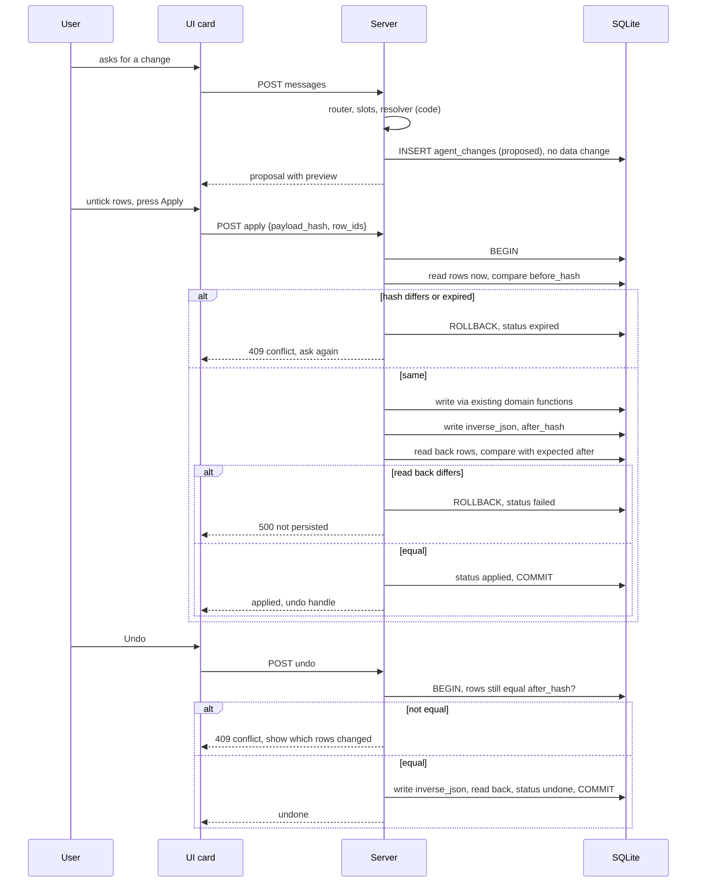

Rules:

1. Apply is idempotent. The `idempotency_key` is unique. A second apply of an applied change returns the first result and writes nothing.
2. Apply checks `payload_hash` from the client against the stored hash. A changed payload is refused.
3. Apply re-reads the rows and compares `before_hash`. A mismatch means the data changed since the proposal. The change expires.
4. Every write reads back inside the transaction and compares with the expected state. Reason: the owner rule "a write that returns success may have stored nothing. Read it back" (user-wide `CLAUDE.md`, section "How the Definition of Done gets faked").
5. Undo applies `inverse_json` only when the rows still equal `after_hash`. Otherwise it reports a conflict and lists the rows.
6. Apply uses the existing domain code, not raw SQL, so side effects stay right. Examples: the vector re-partition of a move, the `transcript.md` rewrite of a speaker rename (Discovery A section 3). ASSUMPTION: some route bodies (`POST /meetings/move`, `PATCH /:id/speakers/:label`) hold inline logic. P3 and P4 extract it to `S/lib/` functions first, with a no-behavior-change test.
7. Delete is not a change kind (non-goal 3).

### 5.5 Edit of an action item

1. `done` changes use the dual write of section 4.1.
2. A text, owner or due edit patches `summary_json.actionItems[ordinal]`. Steps in one transaction: copy the current row to `meeting_summary_versions` with `change_id` (same pattern as `S/lib/meetings/workflow/nodes/save.ts:231-242`), update `summary_json`, re-render `markdown` with `renderSummaryMarkdown` (`S/lib/meetings/workflow/summary-pure.ts:44`), update `meeting_items.text_hash` and `legacy_key`, and copy the done state to the new `folder_action_item_state` key.
3. Reason to re-render: `markdown` and `summary_json` can drift apart if only one changes (Discovery A section 4, gap 4).
4. The index sees the summary change through its source hash and re-embeds the summary chunk (`S/lib/search/source.ts:146-154`).
5. No summary restore route exists today (Discovery A section 1.2). Undo uses `inverse_json`. DECISION: P3 does not add a restore UI for versions.

### 5.6 Person merge: rewrite everything (decision D3)

Owner decision D3: a merge rewrites every place where the names appear, including prose. The default in the preview is on for every place. Every rewrite is a versioned copy. Every rewrite can be undone.

Discovery A section 2.1 lists where one person's strings live. The merge treats each place like this:

| Place | What a merge does | Version kept in |
|---|---|---|
| `people`, `person_aliases` | Soft merge: `merged_into` points to the canonical person. Aliases move. | `inverse_json` of the change |
| `meeting_speakers.display_name` | Set to the canonical name | `agent_change_places`. Through the existing speaker update path (`S/routes/meetings.ts:2286`), which also rewrites `transcript.md` (Discovery A section 3). |
| `summary_json.actionItems[].owner` | Replace the alias with the canonical name. Labels "Me" and "Them N" are never replaced (they are labels, not aliases). | `meeting_summary_versions` (copy of the old row, as `S/lib/meetings/workflow/nodes/save.ts:231-242`) and `agent_change_places` |
| `summary_json` prose: overview, key points, decisions, open questions, action item text | Replace aliases by the canonical name (rules below) | same |
| `meeting_summaries.markdown` | Re-rendered from the new `summary_json` with `renderSummaryMarkdown` (`S/lib/meetings/workflow/summary-pure.ts:44`) | same |
| `folder_standing.bullets_json` | Replace aliases in the bullets by the same rules. The row has no versions today (Discovery A section 1.3). | `agent_change_places` |
| `meetings.title`, `meetings.context` | Replace aliases by the same rules | `agent_change_places` |
| `meeting_chunks` and vectors | Re-embedded by the indexer after the summary and title change | The source hash changes (`S/lib/search/source.ts:146-154`). Undo changes it back and the indexer re-embeds. |
| Chat history (`meeting_chat_messages`, `chat_messages`) | Display only: the renderer maps aliases of merged people to the canonical name when it shows a message. Stored text is not changed. | Nothing to version. Undo of the merge restores the old display at once. |
| `meetings.calendar_attendees` (display names) | Replace the `name` of an attendee that matches a confirmed alias. The `email` stays the key and is never changed. | `agent_change_places` |
| Transcript text: `meeting_segments.text` and `enhanced_text` | Replace confirmed aliases (D13). Only confirmed aliases: an ASR misspelling is fixed only when the user confirmed it as an alias of the person. No fuzzy match. The transcript export file is rebuilt from the new text. | `agent_change_places`, one row per changed segment field (before text and after text) |
| `vocabulary.term` | Not changed. It is a global list and not a project record. | n/a |

Decision D13 (was Q14): the merge also rewrites the stored transcript text and the attendee display names. Transcript rows in the preview start ticked, like all other places. Facts and limits:

1. Until now the app does not overwrite the raw `text` of a segment after the transcription (Enhance writes `enhanced_text`, Discovery A section 3). This is the first agent write to `text`. The audit rows keep the old text, so it can be restored.
2. A re-transcribe rewrites the segment rows (Discovery A section 1.1) and an Enhance run rewrites `enhanced_text`. A calendar re-sync rewrites the attendee columns (`S/routes/meetings.ts:1742`). In each case the affected places become `superseded` (section 5.7 rule 5).
3. Changed segments change the source hash, so the indexer re-embeds only the changed chunks (`S/lib/search/source.ts:140-154`; Discovery B section 1.6).
4. A large merge can change thousands of segments. The preview groups transcript rows by meeting with a count and a tick for the group, and each row can still be opened.

Replacement rules (DECISION):

1. Only aliases of the merged people are replaced. The alias list comes from `person_aliases` of the cluster that the user confirmed.
2. A latin-script alias matches at word boundaries, ignoring case and accents. The replacement keeps the case pattern of the match (all lower, Capitalized, ALL CAPS).
3. For Japanese and other scripts with no word spaces, an alias matches as an exact substring of 2 or more characters.
4. Ambiguous-alias guard: if an alias is also an alias of another person in the same folder (two people called "Ana"), code does not replace that alias in free text. The preview lists those places as "left, ambiguous" with a tick box that is off.
5. A match inside a longer name that belongs to another person ("Ana Souza" when merging "Ana" into "Ana Silva") is skipped by the same guard.
6. A grammar effect is possible (a language with name inflections). Code does not repair it. The preview shows each changed place so the user can untick it.

Preview content: every changed place is a row. A row shows table, meeting title, field, the text before and after with 40 characters of context around each change, and a tick box. A summary line shows counts for each place type. The row count shown equals the rows in `agent_change_places` after Apply (a test checks this).

### 5.7 Conflict and undo rules for prose

1. Apply writes one `agent_change_places` row per changed field. The row holds the full before and after hash and the list of patches (position, before span, after span).
2. Undo goes place by place. For each place, code reads the current field value and compares its hash with `after_hash`.
3. Same hash: restore `before_text`. Status `undone`.
4. Different hash (the user or another process edited the text after the merge): try a patch-level undo. For each patch, if the `after` span is still at the expected place (same 40 characters of context), put back the `before` span. If all patches fit, status `undone`. If some do not fit, status `conflict` for those patches. Code leaves them as they are and lists them. The user can edit the text by hand.
5. A summary replaced by a new Summarize run, a transcript replaced by a re-transcribe, an `enhanced_text` replaced by a new Enhance run, or attendee names replaced by a calendar re-sync since the merge: the place is `superseded`. Undo skips it. The merge copy stays in `meeting_summary_versions`. The new summary is a fresh LLM output and has its own names.
6. Order rule: if a later applied change touched the same place, undo of the earlier change is blocked for that place until the later change is undone. The check uses `agent_change_places` for the same `(table_name, row_key, field)` with a newer `applied` row.
7. Undo of the entity merge (`merged_into`) happens last and only when no place is in `conflict`. Otherwise the merge stays soft-merged and the UI says which places need manual work. DECISION: partial undo is allowed, and it is logged in the audit table with the per-place status.
8. Undo re-reads and compares inside one transaction, like apply (section 5.4 rule 4).
9. After apply and after undo, `folder_standing` and the index need no extra step: the standing input hash changes (stale mark), and the indexer re-embeds changed chunks.
10. A re-transcribe or a re-diarize after the merge rewrites segments and `meeting_speakers` (Discovery A section 3). The carry rule (`S/lib/meetings/speaker-carry.ts`) keeps names by overlap. The alias rows stay linked to `(meeting_id, speaker_label)`. If the label changes, the link is marked `stale` and the user sees it in the next merge preview. ASSUMPTION; P4 tests it.

## 6. Grounding and citations

### 6.1 Source labels

DECISION: numbered labels `S1..Sn` per turn. In live mode the live lines keep `L1..Lm`. The model sees only the label, the meeting title, the date and the text. Reason: short labels are easy to copy for a small model, and the live chat already works with short labels (`S/lib/meetings/live/chat-prompt.ts:9-16`). ASSUMPTION: E2B copies labels with high accuracy. The eval measures label copy accuracy (section 8).

The per-turn source map:

| Field | Meaning |
|---|---|
| `label` | `S3` |
| `kind` | `transcript`, `summary`, `item`, `window`, `live`, `folder` |
| `meeting_id`, `title`, `started_at` | for display |
| `start_ms`, `end_ms` | time range for transcript, window and live |
| `item_id` | for action items, decisions, questions |
| `text` | the text shown to the model, kept for the checks |
| `scope_ok` | set by code at tool time |

The cite that goes to the UI and the database is `{label, kind, meeting_id, start_ms, item_id}`. It uses `meeting_id` plus `start_ms`. It does not use segment ids, because a re-transcribe rewrites them (Discovery A, gap 10).

### 6.2 Code checks

For each answer, code checks in this order. No LLM is used.

1. Label exists: every cite label is in the source map. This is the live chat check (`S/routes/meetings-chat.ts:155-169`).
2. In scope: the source `scope_ok` is true and its meeting is in the scope.
3. Fact check (DECISION). Code extracts three kinds of tokens from the answer: numbers and dates (digits, resolved date strings), known entity names (people aliases, folder names, meeting titles, attendee names), and quoted strings. Each token must appear (after accent folding and lowercase) in the text of the cited sources, the question, or the tool metadata (titles and dates). Names and numbers that fail are the main small-model errors (Discovery C section 2.4, last bullet; ASSUMPTION).
4. Coverage: an answer with text and zero valid cites is not shown as an answer. It becomes "not found", unless the intent is `other`.

On a failed check:

1. If the unsupported token appears in another source of the turn, code adds that source to the cites (repair).
2. Else the answer call runs once more, with the failed tokens named ("remove or fix: ...").
3. Else the response is a `not_found` block with the top sources as links. No model text is shown.

Optional later check: an NLI score with HHEM-2.1-Open (https://huggingface.co/vectara/hallucination_evaluation_model; Apache-2.0, small, local). No speed number on Apple Silicon is known (Discovery C section 2.4, gap). It is not in the plan. The eval may test it as an extra signal. ALCE reports 85.1% and 77.6% agreement with humans for its NLI checks (https://arxiv.org/abs/2305.14627, a search-summary figure in Discovery C). So the NLI check is a signal and not the truth.

### 6.3 Not-found behavior

1. A turn is `not_found` when all tools return nothing after the fallback chain, when the best score is below a floor, or when cite validation fails twice. The score floor is a number that section 8 measures (no value is set here).
2. The response is a structured block: `{kind:"not_found", scope, nearest:[cites]}`. The renderer writes the text in the UI language with `t()`. Reason: code answers need no server-side translation (7 locales, `AGENTS.md`, section "UI conventions").
3. When the model itself says "not found" (the prompt rule as in `S/lib/meetings/live/chat-prompt.ts:13`), code converts the reply to the same block.
4. Search wider (D16). When the selected scope finds nothing, the not_found block asks the user for permission to widen. One confirm widens one step: meeting to folder, folder to everything. An unfiled meeting goes straight to everything. A new turn runs at the wider scope in the same thread, and its cites show that scope. Code never widens on its own, also not in the last tool round. The setting "Search wider" (section 2.9) can turn the offer off.

### 6.4 Language

1. A text answer uses the language of the question (the live chat rule).
2. Code-mode answers (lists, counts, status, not-found) are structured blocks. The renderer localizes the fixed words. Item texts stay in the language of the summary.
3. Question language: the live loop already uses `tinyld` for text language detection (`specs/live-chat.md`, section 1). The router prompt does not need it.

## 7. Retrieval improvements (in order)

Each step lists a measurement. All numbers come from the gold eval in section 8 (recall of gold source ranges at k, and cite precision).

### 7.1 R1 Meeting scope and date filter in `retrieve()`

1. Add `scope: {kind:"meeting", meetingId}` and an optional `dateRange` to `RetrieveInput` (`S/lib/search/retrieve.ts:26-35`). Meeting scope passes `meetingIds=[id]` to `knn` (`S/lib/search/vec-store.ts:133`).
2. A date range runs a SQL query on `meetings.started_at` (within the folder scope) and passes the ids as `meetingIds`. Above 500 ids, the call splits into groups of 500, as the tag path does (Discovery B section 1.3; `S/lib/search/vec-store.ts:16`).
3. The public route `POST /api/search/meetings` stays as is (`V/search.ts:42-49`). The new filters are used by the tools. A later change can expose them.
4. Measure: recall@8 of the gold source range on the "lookup" and "temporal" questions, before and after, for scope M and for date-bounded questions. No regression on the existing search eval of `specs/local-semantic-search.md`.

### 7.2 R2 Who said

1. Keep rule S7: no speaker label in chunk text (`S/lib/search/chunker.ts:6`). Changing it would force a full re-embed of all meetings.
2. Add `get_transcript_window` (section 3.2). A chunk stores its `segment_ids` (`S/lib/schema.ts:1177-1190`; Discovery A section 1.4). Code joins them to `meeting_segments.speaker_label` and the speaker names. This needs no re-index.
3. Plan for who_said: `search_chunks` finds the chunk. Code opens the window of the best segment. The answer call gets lines with speaker names.
4. Measure: who-said accuracy by key (speaker person id). Compare with the arm that has no window (retrieval text only).

### 7.3 R3 Fix #297 and #298 where they hurt cites

1. #297 (open): a transcript hit opens at the first segment of the chunk, not at the matching line (Discovery B section 1.5). A chunk has several segments. The `search_chunks` tool adds `best_ms`: code picks the segment inside the chunk with the highest word overlap with the query. The cite uses `best_ms`.
2. #298 (open): one meeting can give up to 3 rows (meta, summary, transcript). The tool groups by meeting and keeps the best row plus up to 2 more transcript chunks (section 3.2).
3. DECISION: the fix lives in the tool first, so the agent does not wait for the UI issues. The two issues stay open for the search UI. A shared helper can fix both later.
4. Measure: cite time error (ms between `best_ms` and the gold line start) and duplicate meeting rate per answer.

### 7.4 Retrieval workstream R4 (in P0, decision D4)

Owner decision D4: "if we add anything, we do it right." Owner decision D10: the embedder stays EmbeddingGemma 2 (there is little reason for another embedder). A reranker is built only if the eval shows the need. The workstream compares four things on one gold set, then keeps only what the numbers support.

Why this reverses decision SD8 of the search spec. SD8 says: "Vectors only, no plain-RRF hybrid" (`specs/local-semantic-search.md:71`). The same spec lists hybrid search, a reranker and an "ask" answer as non-goals (`specs/local-semantic-search.md:49`; Discovery B section 1.4). Reasons to reverse now:

1. The agent asks questions that hold exact names and numbers. The spike measured recall@10 of 0.613 (PT) and 0.703 (EN) for the current int8 vectors on a hard set (`specs/local-semantic-search.md:105-111`). About 3 of 10 hard queries miss in the top 10.
2. The agent cannot repair a miss. It answers "not found" or a wrong fact, and the cite check cannot see what the search missed.
3. Outside evidence says BM25 plus embeddings cut failed top-20 retrievals by 49% (5.7% to 2.9%), and a reranker cut them by 67% (to 1.9%) (https://www.anthropic.com/news/contextual-retrieval). Their data sets differ from ours. This is a hint, not a promise.
4. The spec's own reason for SD8 is in an issue comment that the spec links. This spec does not restate it. The P0 PR must quote it and answer it with the measured numbers. The search spec is edited in the P0 PR (SD8 and the non-goal line change status to "reversed by `specs/meeting-chat-agent.md` section 7.4, with numbers").

Arms (all use the same gold set, section 8.2, plus the #233 hard set for continuity):

| Arm | Retrieval | Notes |
|---|---|---|
| V0 | Dense vectors only (today): EmbeddingGemma 2 text tower, int8, cosine | baseline, `S/lib/mlx-embed/constants.ts:44-62`, `S/lib/search/vec-store.ts:18-25` |
| H1 | V0 plus BM25 from SQLite FTS5, fused with RRF (k=60) | fusion: https://www.elastic.co/search-labs/blog/improving-information-retrieval-elastic-stack-hybrid |
| H2 | H1 with a second FTS5 tokenizer (see below) | picks the tokenizer |
| R1 | H1 or V0 candidates, then a cross-encoder reranker | picks the model |
| M1 | V0 plus audio vectors from the multimodal EmbeddingGemma 2 (same family, so D10 holds) | spike only (section 7.4.4). Audio vectors follow the retention of D14. |

##### 7.4.1 BM25 with FTS5

1. The unit is the chunk, the same unit as the vectors. Chunk text is not stored today. The indexer rebuilds it from segments and summaries (`S/lib/search/retrieve.ts:243-295`, Discovery B section 1.1). DECISION (owner, 2026-10-31, P0 report section 9 point 4): the FTS table is CONTENTLESS and uses the word tokenizer (`unicode61 remove_diacritics 2`). It stores the index only and no copy of the chunk text. `rowid = meeting_chunks.id`. The indexer fills it in the same transaction as the vectors (`S/lib/search/indexer.ts:299-302` area). The meeting, folder and date filters are a join with `meeting_chunks` (a contentless table cannot filter by a column). P0 measured 0.73 x the transcript text at 46,080 chunks, under the size bar.
2. Two tokenizers are compared. The repo already has an FTS5 table with the `trigram` tokenizer for dictation history, which matches any substring of 3 or more characters (`S/lib/schema.ts:960-975`). The other candidate is a word tokenizer with accent folding. ASSUMPTION: the word tokenizer gives better BM25 ranking for PT and EN, and trigram is needed for Japanese. The eval decides. The names of the SQLite tokenizers are from the repo comment above. P0 must read the SQLite FTS5 documentation and quote it before the build (the discovery files do not contain it: GAP).
3. Filters: the folder filter is a `JOIN` on `meetings.folder_id`. The meeting and date filters are `meeting_id IN (...)`, the same list that the vector channel uses (section 7.1).
4. Query building: code, not the model. Code removes stop words per language and quotes terms, to avoid FTS syntax errors. A name list (people aliases, section 4.3) gets a boost. ASSUMPTION; the eval measures it.

##### 7.4.2 Fusion

1. Each channel returns its top 50 chunk ids. RRF with k=60 gives a fused list. Elastic reports that RRF raised average NDCG@10 by 1.4% over its learned sparse model alone, and by 18% over BM25 alone, with no tuning (https://www.elastic.co/search-labs/blog/improving-information-retrieval-elastic-stack-hybrid).
2. The eval also tests a weighted RRF (weights per channel) and a plain score-normalized sum. The simple RRF wins ties.
3. The fused top 30 go to the reranker when it exists. Else the top 8 go to the tool output.

##### 7.4.3 Reranker

Rule (D10): a reranker is built only if the eval shows the need and it passes the bars in 7.4.6. Decision (owner, 2026-10-31): Qwen3-Reranker-0.6B, 15 candidates first; 30 candidates (batched) only if the measured added p95 stays at most 400 ms. P1 measured it (PR #401): the constant `RERANK_CANDIDATES` in `S/lib/mlx-rerank/constants.ts` holds the result. No other embedder is tested. Candidates:

| Candidate | Facts | Source |
|---|---|---|
| Qwen3-Reranker-0.6B | Text reranker, 0.6B parameters, 100+ languages, 32k context, Apache-2.0. Scores on reranking subsets: MTEB-R 65.80, CMTEB-R 71.31, MMTEB-R 66.36, MLDR 67.28 (reranking the top 100 of Qwen3-Embedding-0.6B). Scoring is the probability of "yes" against "no". | https://huggingface.co/Qwen/Qwen3-Reranker-0.6B |
| Qwen3-Reranker-4B | Same family, larger. Used as the default in the MLX service below. | https://github.com/aperepel/mlx-rerank |
| MLX builds of the Qwen reranker | A community MLX service uses `mlx-community/Qwen3-Reranker-4B-mxfp8` by default and shows `mlx-community/Qwen3-Reranker-0.6B-mxfp8` in its example. It needs Apple Silicon and `mlx-lm`. It states no license, no latency and no memory numbers. | https://github.com/aperepel/mlx-rerank |
| Sentence-Transformers cross-encoders `ms-marco-MiniLM-L6-v2` / `L12-v2` | NDCG@10 on TREC DL 19: 74.30 and 74.31. Speed on the page: 1800 and 960 docs/s (the hardware is not stated). Trained on MS MARCO. ASSUMPTION: English-only, so weak on PT. | https://sbert.net/docs/cross_encoder/pretrained_models.html |
| `BAAI/bge-reranker-v2-m3` | Listed on the same page as a community model, with no metrics there. ASSUMPTION: multilingual (the name says "m3"). | https://sbert.net/docs/cross_encoder/pretrained_models.html |

Runtime options on a Mac (what is known):

1. MLX: the Qwen3 reranker runs through `mlx-lm`, with one forward pass per (query, document) pair (https://github.com/aperepel/mlx-rerank). The app already bundles an MLX LLM worker (Discovery B section 3.2: mlx-lm 0.32.2, `S/lib/mlx-asr/families.ts:24`). A reranker needs its own worker process, like the embed worker, with idle unload (`S/lib/mlx-embed/server.ts:17-32`). One worker for the embed model and the reranker is an option. The eval measures RAM.
2. ONNX Runtime or CoreML for small cross-encoders (MiniLM, bge): GAP. The discovery files do not confirm backend support. P0 spikes it with a time box and reports.
3. The Sentence-Transformers page links a "Speeding up Inference" page with ONNX and OpenVINO sections. This spec did not read it (GAP).
4. The chat LLM itself as a listwise reranker is not a candidate. It holds the lane (`S/lib/llm/lane.ts:106`) and breaks the one-job ethos.

##### 7.4.4 Multimodal embedding: does it exist, and is it viable locally?

Findings:

1. The app already uses EmbeddingGemma 2, not the first EmbeddingGemma. The id is `embeddinggemma-2-bf16-text`: the text tower only, 413 tensors, from a community MLX mirror (`S/lib/mlx-embed/constants.ts:44-62`).
2. A multimodal EmbeddingGemma exists. Google released EmbeddingGemma 2 on 2026-10-06 (https://vpsranking.com/news/ai/ai-2026-10-06-google-embeddinggemma-2/; secondary source). The primary model card is at https://huggingface.co/google/embeddinggemma-2. It says: one shared 768-dimension space for text, code, images, video and audio; 740M parameters in total; 270M text, 170M vision, 300M audio; 8,192 tokens of context shared across modalities; audio at 25 tokens per second, up to about 327 seconds, mono 16 kHz; Apache-2.0.
3. The card lets you load only some towers: text only (270M), text and image (440M), text and audio (570M), all (740M), by setting `vision_config` or `audio_config` to `None` in `config_kwargs` for Sentence-Transformers. The card says this varies by library (https://huggingface.co/google/embeddinggemma-2).
4. Scores on the card (768 dimensions): MAEB (audio, mean over tasks) 49.87; MSEB (audio retrieval, MRR@10) 69.54; MTEB multilingual v2 61.36; MTEB code 78.68. What the MSEB tasks contain is not stated on the page I read (GAP).
5. The first EmbeddingGemma was text-only: 0.3B, 768 dimensions, MTEB multilingual v2 61.15, input up to 2048 tokens (https://huggingface.co/google/embeddinggemma-300m). So the text score is about the same (61.36 against 61.15 on the card numbers).
6. Frameworks on the card: Transformers, Sentence-Transformers, Safetensors. The article says Google lists MediaPipe and LiteRT for devices, and does not mention MLX or ONNX. Whether the audio tower runs under `mlx-vlm` (the runtime of the embed worker, Discovery B section 1.1) is UNKNOWN. Whether the text tower of the full model gives the same vectors as the current text-only mirror is UNKNOWN (ASSUMPTION: yes; a cosine test on 1000 chunks checks it before any mixing).
7. A cloud multimodal model also exists: Gemini Embedding 2 (text, image, video, audio) (https://www.mayhemcode.com/2026/03/google-gemini-embedding-2-review-first.html, a blog review; not verified). It is not local. Under D1 it could be a user-chosen provider. It is not in the plan.
8. I found no other verified local multimodal embedding candidates. GAP.

Viability limits (INFERRED from the facts above and the repo):

1. Audio is deleted by the retention sweep after `meeting_retention_days` (`S/lib/meetings/retention.ts:15-21`). Audio vectors must be built before the sweep. After it they cannot be rebuilt.
2. An audio window is at most about 327 s. The chunk unit of the text index is about 300 tokens (`S/lib/search/chunker.ts:9-13`). ASSUMPTION: 30 s windows give a comparable unit, at 750 tokens each.
3. Cost: 300M more parameters, and every minute of audio becomes vectors. P0 measures index time per audio hour, RAM and size.
4. Benefit case: search that survives ASR errors on names (query text against audio vectors), and a voice query. ASSUMPTION; the eval slice "ASR-error names" measures it.

DECISION: M1 is a time-boxed spike in P0, not a shipping feature. Steps: load the 570M text and audio setup in a Python environment, embed 30 s windows of the fictional audio (section 8.2 spoken meetings), run text queries, and report recall@8 on the ASR-error slice against V0 and H1. It becomes a build item only if it beats H1 by a margin set in 7.4.6 and runs under MLX or another runtime that the app can bundle. Else the report names the blocker.

##### 7.4.5 Index and cost

1. The vector index stays as is. Dimensions stay 768, int8.
2. New: FTS table, optional reranker worker, optional audio vectors.
3. A full rebuild of the FTS table from existing segments runs as a background job at the first start of the new version, one meeting per tick, like the slow scan (`S/lib/search/indexer.ts:426-447`).

##### 7.4.6 Metrics and initial pass bars (P0)

Metrics, per language (PT and EN) and per slice (names and exact numbers, concept questions, ASR-error names, date-bounded):

| Metric | Definition |
|---|---|
| recall@k | gold chunk range found in the top k, for k = 1, 5, 10 |
| nDCG@10 | on graded gold ranges (2 = exact line, 1 = same chunk window) |
| MRR@10 | continuity with the #233 spike table (`specs/local-semantic-search.md:105-111`) |
| Latency | p50 and p95 of the retrieval call: embed query, KNN, FTS, fusion, rerank. Warm and cold (embed worker load) separate. |
| RAM | peak RSS of the embed worker and of the reranker worker, sampled every 5 s |
| Index size | bytes of FTS table and of audio vectors per hour of meeting; time to index one hour |

Pass bars (ASSUMPTION: initial targets. P0 measures V0 first; the owner confirms the bars; "every default needs a measured number"):

| Item | Bar |
|---|---|
| Hybrid H1 against V0 | nDCG@10 not lower than V0 in any language. At least +5 points on the names and exact numbers slice. |
| Hybrid recall@10 on the #233 hard set | at least 0.75 PT and 0.80 EN (V0 is 0.613 and 0.703, `specs/local-semantic-search.md:111`) |
| Reranker R1 adopted | at least +3 points nDCG@10 overall over the best of V0 or H1, no language below V0, added p95 latency at most 400 ms for 30 candidates on an M-class Mac, added RAM at most 1.5 GB |
| Multimodal M1 adopted | at least +5 points recall@8 on the ASR-error slice over H1, runs in a bundled runtime, audio indexing at most 0.2x real time |
| Index size | FTS table at most 1.0x of the transcript text size |
| Query latency p95 warm, hybrid without reranker | at most 150 ms (V0 query is dominated by about 80 ms embed and 1.2 ms KNN, Discovery B section 1.6) |
| No regression | the existing search UI results for the #233 set do not drop in nDCG@10 |

##### 7.4.7 Output of P0

A table of arms against metrics in the PR, a decision per candidate (adopt, drop, later), and the changes to the search spec. The agent tools use the winning arm behind the same `search_chunks` interface, so a later change needs no tool change.

### 7.5 R5 Chunk context by code

Idea from Anthropic's contextual retrieval: prepend context to each chunk (https://www.anthropic.com/news/contextual-retrieval). Their method calls an LLM for each chunk. A code-only version prepends title, date and folder. ASSUMPTION. It needs a re-embed of every chunk. It is one more arm for the P0 workstream if time allows (arm C1). The `meta` chunk already holds title and tags (`S/lib/search/source.ts:84-92`).

### 7.6 Order

| Step | Phase | Gate |
|---|---|---|
| R1 meeting scope and date filter | P0 | recall@8 not lower than the current search eval |
| R3 `best_ms` and grouping (in the tool) | P0 | cite time error measured |
| R4 FTS5 + RRF, reranker, multimodal spike | P0 | bars in 7.4.6 |
| R2 transcript window | P2 | who-said accuracy measured |
| R5 contextual chunk text | P0 if time allows | slice recall gain |

## 8. Evaluation plan

### 8.1 Rules

1. Fixed answer keys. No LLM judge decides pass or fail. This is the owner rule. Reasons on record: blind judges and gold keys were wrong against the owner on 22 answers (project memory "judges unreliable"; Discovery B section 4). Judges over-credit wrong answers without a reference (https://arxiv.org/abs/2607.12885).
2. The corpus is fictional (privacy). No owner data enters the repo or the eval keys.
3. The eval runs against the real server over HTTP in an isolated app (skill `.claude/skills/live-testing/SKILL.md`). A mock of the model does not count as a result.
4. Each model run takes the shared GPU lock (`/tmp/openstyle-gpu.lock`) only for the model steps, like `.claude/skills/app-check/SKILL.md` step 4.
5. Temperature 0. Same input gives same output (`specs/llm-runtime-tuning.md:427`), so one run per cell is a valid measure. A rerun checks it.

### 8.2 Corpus

DECISION: a script builds the corpus from templates and a seeded random number generator. It is in `scripts/chat-eval/` (new, P0).

1. 30 fictional meetings. 4 folders (6 to 8 meetings each) and 4 unfiled meetings. Dates over 12 weeks.
2. 12 fictional people. Each has 2 to 4 spelling variants and a nickname ("Ana", "Ana S.", "Anna"). 4 people share a first name.
3. Languages: 20 meetings in English, 6 in Portuguese, 4 mixed. ASSUMPTION: these cover the owner's main case (Discovery B section 6 spike set is PT and EN).
4. Each meeting has transcript segments with speakers (Me and Them N, some named), a summary with decisions, action items (some done) and questions. Facts are planted at known lines. Some facts change between meetings (knowledge update).
5. Distractors: similar numbers, similar names in other folders.
6. The corpus loads into the isolated app through the seed path used by the live-testing skill. A subset of 3 meetings is also spoken with the macOS speech tool and run through the ASR path, to check that the chat works on real pipeline output (like the live chat proof).

### 8.3 Question taxonomy and keys

About 190 questions. The mix follows LongMemEval's abilities (https://arxiv.org/abs/2410.10813: extraction, multi-session reasoning, temporal reasoning, knowledge update, abstention) plus who-said, count and write.

| Type | N | Scope mix | Key form (code-scored) |
|---|---|---|---|
| Lookup | 25 | M, F, A | regex set of accepted values (normalized), plus the gold cite range |
| Who said | 20 | M, F, A | person id set |
| Aggregation (lists) | 20 | F, A | set of item ids (precision, recall, F1) |
| Count | 10 | F, A | integer |
| Temporal | 20 | F, A | list of facts with gold ranges, or meeting id set |
| Knowledge update | 10 | F, A | date or value plus the id of the newest meeting |
| Not answerable | 30 (above 15%) | any | must be a `not_found` block, no text answer |
| Scope trap | 10 | M, F | a fact that exists only outside the scope. The answer must be `not_found`. |
| Follow-up | 10 | any | as lookup, with a prior turn |
| Long thread (5 to 10 turns, a fact planted in turn 1 or 2 and asked again late) | 10 | M, F, A | as lookup, or a correct not-found. Also scores sources dropped per turn (section 2.8). |
| Write proposal | 25 | M, F, A | expected proposal: kind plus id set. Compared as a set, not as prose. |

Key forms for text answers: a list of "must contain" alternatives and a list of "must not contain" distractors. Both are normalized (accent fold, lowercase, digits). Pass means all must-contain groups match and no must-not-contain token appears. This is deterministic code. Free-text quality beyond the key is not scored by a judge. The owner spot-checks a sample of 20 answers per model (rule from Discovery C section 5.3).

### 8.4 Metrics

| Metric | Definition | How scored |
|---|---|---|
| Answer accuracy | pass by key | code |
| List F1 | precision and recall of item ids | code |
| Cite precision | valid cites whose source range overlaps a gold range / all cites shown | code |
| Cite recall | gold ranges covered by a cite / gold ranges | code |
| Cite validity | shown cites with a label in the source map | code (must be 100% by construction) |
| Not-found accuracy | not-answerable and scope-trap questions answered with a `not_found` block | code |
| False not-found rate | answerable questions answered with `not_found` | code |
| Route accuracy | router intent equals the gold intent (labelled per question) | code |
| Slot accuracy | slot values equal the gold slots | code |
| Label copy accuracy | labels in the answer that exist in the source map / labels in the answer | code |
| Rounds per turn, calls per turn | from the trace | code |
| Latency p50, p95 | wall time of a turn, warm and cold separate | harness clock |
| RAM | RSS of the chat worker, sampled every 5 s (method of `specs/live-chat.md`, section 6, proof 9) | harness |
| Write proposal match | kind and id set equal the key | code |
| Apply and undo round trip | hash of the affected tables before and after undo is equal | code |
| Dedup precision, recall | on the labelled set (8.6) | code |

### 8.5 Arms and models

Per-model runs: Gemma 4 E2B (`gemma-4-e2b-qat-4bit`), Gemma 4 E4B (`gemma-4-e4b-qat-4bit`), Nemotron 3.5 Bolt E4B (`nemotron-3.5-bolt-e4b-4bit`), Qwen3.8 27B (`qwen3.8-27b-4bit`), and Gemma 4 26B-A4B (`gemma-4-26b-a4b-qat-4bit`) (ids: `S/lib/mlx-llm/constants.ts:66,77,95,111,128`). The owner said "E2B, E4B, Qwen, Nemotron Bolt". The 26B model is optional.

Arms (each on E2B first):

| Arm | Change |
|---|---|
| A0 | Baseline: the live chat as it is (one-shot context, no router), on the same questions with scope M or F |
| A1 | Router, tools, answer, strict answer schema |
| A2 | Same, lenient answer parse |
| A3 | Rules router instead of the LLM router |
| A4 | A1 plus the FTS channel (when built) |
| A5 | No slot fill (default slots) to measure the value of the slot call |
| T1 | Native `tools` / `tool_calls` in the local worker behind a flag, with the Gemma 4 parser of mlx-lm (section 2.1 point 6). Compared with A1 on tool-choice accuracy and argument accuracy. The winner stays (D11). |

An arm wins by the key metrics. Per decision D1, cloud models are normal providers. Local models are the focus and set the bars. Decision D12 (was Q15): no cloud reference models for now.

E2B is the floor (D9). If E2B gives acceptable results, that is a win. Every other model must score better than E2B on the gold set. Rule: for a model to be offered as an option for the chat, its answer accuracy by key, list F1 and not-found accuracy must each be at least those of E2B, and its answer accuracy must be higher. A model that fails the rule is reported and not offered. The check runs at the default settings of section 2.9.

### 8.6 Name-dedup set

1. A fictional set: 200 labelled string pairs from the corpus people (same person: yes or no), with ASR-style variants, nicknames, shared first names.
2. An owner-labelled set (D17): the owner labels by hand on a labelling page, like the earlier gold labelling page. Choices: same, different, unsure, skip. The pairs come from the likely and unsure candidates of the resolver on real meetings. This happens between P2 and P4 (100 to 200 pairs, Discovery C section 4). The page is a local tool and not part of the shipped app (DECISION). The labels and strings stay private on the Mac. Only precision and recall numbers go into the repo.
3. Metrics: precision and recall of the clusters before the human step; precision after "certain" only. A wrong merge costs more than a missed one, so the bar is precision first.
4. The eval compares code-only against code plus an LLM verifier that may answer "unsure". The verifier is built only if code-only precision is under the bar.

### 8.7 Pass bars

No measured baseline exists for any of these numbers. The values below are initial targets (ASSUMPTION). P0 measures A0 and the arms, then the owner confirms the bars before P1 starts. This follows the rule "every default needs a measured number".

| Metric | P1 (E2B) | P2 | P3 write | P4 |
|---|---|---|---|---|
| Cite validity | 100% | 100% | 100% | 100% |
| Invalid cite shown | 0 | 0 | 0 | 0 |
| Not-found accuracy (not-answerable plus scope trap) | at least 90% | at least 90% | at least 90% | at least 90% |
| False not-found rate | at most 15% | at most 15% | at most 15% | at most 15% |
| Answer accuracy, lookup and follow-up | beat A0 by at least 10 points | at least 70% | | |
| List F1 (aggregation) | at least 0.85 | at least 0.85 | | |
| Route accuracy | at least 90% | at least 90% | | |
| Cite precision | at least 0.8 | at least 0.8 | | |
| Who-said accuracy | n/a | at least 70% | | |
| Write proposal match | n/a | n/a | at least 90% | |
| Apply then undo equals before (hash) | n/a | n/a | 100% | 100% |
| Direct writes by the model | 0 | 0 | 0 | 0 |
| Dedup precision (certain plus confirmed) | n/a | n/a | n/a | at least 0.98 before confirm on "certain"; recall reported |
| Latency p95 warm, E2B | at most 6 s | at most 6 s | at most 6 s | at most 6 s |
| Dictation latency while a chat turn runs | not more than 1 call later | | | |

E4B, Nemotron and Qwen must meet the same bars or better. A bar missed by E2B but met by bigger models is a finding for the owner. It does not change the E2B target silently.

#### 8.7a P1.1 changes (issue #402, PR #404)

The P1 eval on E4B missed five bars. P1.1 changes the pipeline as follows. Each change is code, and each has a unit test (`apps/server/tests/chat-pipeline.test.ts`, `chat-plan.test.ts`).

1. **Cited line by the reranker.** A question in another language than the meeting shares no word with any segment of a chunk. The word count then picked the first segment, so the 640-character snippet and the cite start missed the fact. When no segment holds a query word, one reranker call scores the segments of the shown chunks (at most 60 documents, the worker limit is 64) and the best one starts the snippet and the cite (`rankPieces`, `tools.ts`).
2. **Follow-up query.** The search query of a follow-up holds the earlier question, the earlier answer and the new question. "My first question" points to the first turn (`followUpQuery`, `plan.ts`). The slot scorer of the eval builds the query with the same function.
3. **Review kind by code.** `reviewKind` reads "decision" or "open question" from the words of the question. The review slot call is gone.
4. **Intent corrections by code** (`refineIntent`): a lookup with a numbered day is temporal, a temporal with no date, no "when" word and no meeting word is a lookup, a who_said with no who word and no verb of speech is a lookup.
5. **Cheap route.** When the native call gives no valid tool and the question asks for no list, count, status or change, code makes the search call. The structured router and the slot call do not run. A plain follow-up (a question with earlier turns) skips the native turn: on E4B all 10 follow-ups and 7 of 10 long-thread turns got text and no tool call after 650 to 850 ms.
6. **Cross-language rewrite.** A first search with a best score under the floor (0.5) gets one model call that writes English search words. The second search replaces the first only when its best score is at least 0.8 (`REWRITE_SCORE`). A hit just over the floor is another topic: a rewrite at the floor turned two not-answerable questions into false answers on E2B.
7. **Count of mentions.** "In how many meetings was X named?" is counted in SQL over the transcripts of the scope (`countMentions`). The count block cites the meetings. No model writes the number.
8. **Cite start by the reranker.** After the cite check, one reranker call scores the segments of the cited transcript sources against the question (with the earlier turn for a follow-up). The best segment gives the start of the cite (`pickCiteTimes`, `cites.ts`). The word count of `refineCiteTimes` stays as the fallback.
9. **Answer rule.** The answer prompt asks for the full name of a person when the sources have it (surname keys).

Tried and removed: an empty-answer retry at a best score of 0.9. After change 1 it fixed no question, and it turned the not-answerable question q130 (best score 0.98) into a false answer in both variants (with and without a prompt that forbids an empty list). Also tried and removed: the question text as the search query. It raised the best score of unanswerable questions (0.06 to 0.56 on E2B) and broke the not-found floor.

#### 8.7b P1.2 changes (branch fix/ask-followups-thread-persist)

The owner asked four questions in one thread ("What has been decided?", "Why?", "But why did we decide that?", "But, what WAS this last meeting about?"). All four got the same answer text and the same cite. Two bugs caused this. A third bug showed a raw "[S1]" in the text. A fourth bug lost the conversation when the owner left the meeting during a turn.

1. **A follow-up keeps the topic, not the old answer.** P1.1 built the search query from the earlier question, the whole earlier answer and the new question. The old answer took over the query, so every follow-up found the same chunk. Now `isDependentFollowUp` (`plan.ts`) decides in code: a question is a follow-up when it is short (3 words or fewer), starts with a conjunction, holds a reference word ("that", "isso", "dies"), asks "why" or "who" and is short, or points to "my first question". A follow-up searches with the new question first, then the earlier question, then the first 100 characters of the earlier answer (`followUpQuery`). "Why" and "who" make a follow-up only in 4 words or fewer ("Why did we pick Postgres?" has a topic). A follow-up of a follow-up ("Who said that?" after "Why?") also leans on the turn before the "Why?" (`followUpQuery` walks back up to 3 turns until a question has a topic). A question with its own topic searches with its own words only, and it makes a native turn again. The skip of the native turn (P1.1 change 5) applies to a dependent follow-up only.
2. **Overview questions read the summary.** "What was this meeting about?" is not a follow-up. `asksOverview` (`plan.ts`, 7 UI languages) matches it. In a meeting scope, code calls `get_meeting_summary` (`pipeline.ts`, step `rules:overview`). No search runs first.
3. **Repeat guard.** A small model gave the first answer again to "Why?" because the same chunk came back. After the cite check, `repeatedEarlierAnswer` (`cites.ts`) compares the first sentence of the new answer with the first sentence of the last 4 earlier answers (word overlap of 0.8 or more, Jaccard). The same question asked again may repeat. Else the answer call runs once more with the note "Your answer repeats an earlier answer". If it repeats again, the turn ends as not found (`no_sources`).
4. **Cite marker strip.** The model sometimes writes "[S1]" inside the sentence. `stripCiteMarkers` (`cites.ts`) removes `[S1]`, `[S1, S2]`, `[S1][S2]`, `(S1)`, `【S1】`, `[Source 1]` and `[source: S2]` before the cite check. The answer prompt also forbids labels in the text and tells the model to answer the new question and not to copy an earlier answer.
5. **A turn does not stop when the client leaves.** `POST /api/chat/threads/:id/messages` used the abort signal of the HTTP request. A window reload or a closed request cancelled the turn and saved no answer. Now only the deadline ends a turn (`routes/chat.ts`). `GET /api/chat/threads/:id` returns `pending` (a turn runs now) and `failure` (the last turn failed with no answer). The user message is saved first, as before. The Ask tab reloads the thread every 1.5 s while `pending` is true, remembers the selected thread of each meeting (`ask-model.ts`), merges messages by id and shows a failed turn that nobody waited for with a Retry button.

Eval: `pnpm chat-eval p1 --only threads` runs 12 threads of 4 to 5 turns on a fictional meeting each. The REAL answer of each turn goes back as history. The turns are a fact, "why?", "who said that?", a topic switch and "what was this meeting about?". Keys: a text key for fact, switch, speaker and topic; "why?" has no key (the corpus holds no reasons), so it passes when it is not a repeat. A repeat is an answer with a word overlap (Jaccard) of 0.8 or more with an earlier answer to another question. The threads are not part of the gold set, so the gold hash does not change.

6. **Decisions and next steps read the summary.** In a meeting scope, `asksDecisions` ("What has been decided?", "what did we decide", "o que foi decidido", "decisões", and the same in es, de, fr, it, ja) and `asksNextSteps` ("What are the next steps?") call `get_meeting_summary` by code (`pipeline.ts`, steps `rules:decisions` and `rules:steps`). A question with a topic ("What did we decide on the database?") and a request for the whole list ("show all decisions") keep their old paths. After the summary call, one search with the words of the Decision (or Action item) lines gives transcript lines, so `tidyCites` can point a cite at the spoken segment. That search never ends the turn on a weak score. A meeting with no summary falls back to the search rounds.

Measured 2026-11-01 (temperature 0, thinking off; MLflow experiment `openstyle-lab-chat-agent-p1`, every run read back). Base is `origin/main` (6c3592cc), new is this branch. Values are gold / held-out. Threads is the turn accuracy of the 16 thread eval; repeats are answers that repeat an earlier answer to another question.

| Setup | Lookup + follow-up (bar 85) | Cite precision (bar 0.80) | Not-found acc (bar 90) | Threads base to new | Repeats base to new |
|---|---|---|---|---|---|
| Mac E4B base | 91.4 / 91.4 | 0.856 / 0.882 | 95.0 / 97.5 | 85.1 / 77.8 | 0 / 0 |
| Mac E4B new | 91.4 / 91.4 | 0.854 / 0.870 | 95.0 / 95.0 | 98.6 / 97.2 | 0 / 0 |
| Mac E2B base | 77.1 / 82.9 | 0.805 / 0.821 | 92.5 / 92.5 | 62.2 / 66.7 | 16 / 17 |
| Mac E2B new | 77.1 / 82.9 | 0.805 / 0.821 | 92.5 / 92.5 | 91.9 / 95.8 | 0 / 0 |

After change 6 (20 threads, 90 turns): thread turn accuracy base to new is 70.0 to 95.6 on Mac E4B and 52.2 to 91.1 on Mac E2B (gold); decisions turns 0 to 75 and next-steps turns 0 to 100 on both. The bars of the table above did not move. The E2B lookup + follow-up bar still fails, as before P1.2 (issue #402). The desktop E4B run (llama.cpp) matches: lookup + follow-up 94.3 / 94.3 both ways, threads 98.6 / 93.1 new against 75.0 (held-out) base.

#### 8.7c P2 results (branch feat/chat-ask-p2, 2026-11-01)

Measured at temperature 0, thinking off. Each cell is "corpus seed / held-out seed" (seed 20271105). Desktop is the llama.cpp server (Gemma 4 E4B and E2B, GGUF). Mac is the MLX worker (`gemma-4-e4b-qat-4bit`, `gemma-4-e2b-qat-4bit`), run under the GPU lock. Every run is in MLflow experiment `openstyle-lab-chat-agent-p1` (id 100), tags `chat.set` (`gold` or `p2`), `backend` and `model`, and each run was read back (`READ BACK OK`). The gold hash is `1e41bd5cea578222`. The P2 set is `buildP2` in `scripts/chat-eval/gold.mts` (`pnpm chat-eval p1 --set p2`, section 11.6.6).

**No regression.** A control on the Mac E4B, corpus seed: `origin/main` (f1791df1) and this branch give the same pass or fail on all 190 gold questions, and the same numbers (lookup + follow-up 91.4, cite precision 0.854, not-found 95.0, list F1 0.979). The Mac E4B held-out threads give the same 88 turns, 93.2% and 1 repeat on both. The repeat is an older P1.2 case (PT "Why?"), not a P2 change.

### P0 gold set (P1 bars, no regression). Values are corpus seed / held-out seed.

| Metric | Desktop E4B | Desktop E2B | Mac E4B | Mac E2B |
|---|---|---|---|---|
| Lookup + follow-up, bar 85 | 94.3 / 91.4 | 85.7 / 88.6 | 91.4 / 91.4 | 77.1 / 82.9 |
| A0 22, bar 74 | 95.5 / 90.9 | 86.4 / 86.4 | 90.9 / 90.9 | 81.8 / 81.8 |
| Cite precision, bar 0.80 | 0.851 / 0.886 | 0.774 / 0.807 | 0.854 / 0.870 | 0.805 / 0.821 |
| Not-found acc, bar 90 | 95.0 / 95.0 | 95.0 / 95.0 | 95.0 / 95.0 | 92.5 / 92.5 |
| False not-found, bar max 15 | 1.4 / 1.4 | 1.4 / 1.4 | 0.7 / 0.7 | 1.4 / 0.7 |
| List F1, bar 0.85 | 0.979 / 1.000 | 0.979 / 1.000 | 0.979 / 1.000 | 0.979 / 1.000 |
| Who said, P2 bar 70 | 100.0 / 100.0 | 95.0 / 100.0 | 100.0 / 100.0 | 100.0 / 100.0 |
| Tool+args, bar 85 | 94.2 / 94.2 | 93.7 / 93.2 | 94.2 / 94.2 | 92.6 / 92.6 |
| Write, bar 90 | 92.0 / 92.0 | 92.0 / 92.0 | 92.0 / 92.0 | 92.0 / 92.0 |
| Route gold, bar 90 | 94.2 / 94.2 | 85.3 / 84.7 | 94.7 / 94.7 | 95.8 / 95.8 |
| Cite valid, bar 100 | 100.0 / 100.0 | 100.0 / 100.0 | 100.0 / 100.0 | 100.0 / 100.0 |
| Invalid cites shown, bar 0 | 0 / 0 | 0 / 0 | 0 / 0 | 0 / 0 |
| Turn p95 ms, bar 6000 | 1063 / 1151 | 884 / 902 | 2141 / 1989 | 1229 / 1232 |
| Threads turn acc | 95.6 / 88.6 | 90.0 / 93.2 | 95.6 / 93.2 | 91.1 / 92.0 |
| Thread repeats | 0 / 0 | 0 / 0 | 0 / 1 | 0 / 1 |

### P2 set (folder and Everything). Values are corpus seed / held-out seed.

| Metric | Desktop E4B | Desktop E2B | Mac E4B | Mac E2B |
|---|---|---|---|---|
| Lookup (P2 bar 70) | 90.5 / 90.5 | 90.5 / 85.7 | 90.5 / 90.5 | 85.7 / 90.5 |
| Who said, bar 70 | 100.0 / 100.0 | 100.0 / 100.0 | 100.0 / 100.0 | 100.0 / 100.0 |
| Cite precision, bar 0.80 | 0.947 / 0.947 | 0.919 / 0.971 | 0.947 / 0.947 | 0.886 / 0.972 |
| List F1, bar 0.85 | 1.000 / 0.900 | 1.000 / 0.900 | 1.000 / 0.900 | 1.000 / 0.900 |
| Cite valid, bar 100 | 100.0 / 100.0 | 100.0 / 100.0 | 100.0 / 100.0 | 100.0 / 100.0 |
| Invalid cites shown | 0 / 0 | 0 / 0 | 0 / 0 | 0 / 0 |
| Widen: offer, bar 90 | 95.8 / 95.8 | 91.7 / 87.5 | 91.7 / 95.8 | 87.5 / 87.5 |
| Widen: answer, bar 70 | 87.5 / 87.5 | 75.0 / 70.8 | 79.2 / 83.3 | 66.7 / 62.5 |
| Threads A and F turn acc | 100.0 / 94.9 | 94.6 / 89.7 | 97.3 / 89.7 | 89.2 / 87.2 |
| Thread repeats | 0 / 0 | 0 / 0 | 0 / 0 | 0 / 0 |
| False not-found | 1.9 / 1.9 | 1.9 / 3.7 | 1.9 / 1.9 | 3.8 / 1.9 |
| Turn p95 ms | 1047 / 998 | 1718 / 1996 | 2234 / 1965 | 1124 / 1211 |

Findings:

1. E4B meets every P1 and P2 bar on both backends and both seeds (the Mac E4B P2 set: lookup 90.5, who said 100, widen offer 91.7 / 95.8, widen answer 79.2 / 83.3).
2. E2B misses these bars (the floor, D9): lookup + follow-up on the gold set (Mac 77.1 / 82.9, the open issue #402; the desktop passes), the widen offer on the held-out P2 set (87.5) and the widen answer on the Mac (66.7 / 62.5). The cases that fail are scope traps where the model answers from a near topic at the narrow scope, and lookups that the model calls not found at the wide scope. Cite validity is 100% and no invalid cite was shown in any of the 16 runs.
3. Dictation latency while a chat turn runs was not measured in P2. The 150 ms guard adds a fixed 150 ms to a dictation start only while the chat hotkey is on.
4. The retrieval bars of P1 were run again once on the final head (Mac, `--only retrieval`): nDCG@10 0.651, recall@10 any 86.4%, rerank 30 passes both slices (100.0 / 92.5), rerank 15 fails both slices (73.0 / 80.0), as in P1. The 46,000-row latency bar was not run again (`retrieve()` has no change).

### 8.8 Retrieval eval (P0) and mic diarization eval (PM)

Retrieval eval: metrics, arms and bars are in section 7.4. The gold ranges come from the corpus of 8.2. Add to the corpus: 40 queries with exact names, 40 with exact numbers, 30 concept queries, 20 with an ASR-style misspelling of a name in the transcript, 20 date-bounded queries. Half are in Portuguese and half in English, so nDCG@10 is per language.

Mic diarization eval (fictional multi-voice mic audio):

1. Audio: scripted meetings spoken with 2 to 4 different macOS voices on one mic track, with room noise and a typing track, 2 to 5 minutes each. Also: one voice on the mic (false-split check), one mic voice plus remote voices on the system track, and one case where the system audio leaks into the mic (echo). The method follows the live chat proof (fictional scripts, macOS voices, `specs/live-chat.md` section 6).
2. Key: a script file that says which voice speaks each sentence and when.
3. Metrics, scored by code:

| Metric | Definition |
|---|---|
| Speaker count accuracy | detected mic clusters equal the true voice count |
| Label purity | share of mic sentences whose cluster maps (best one-to-one match) to the true voice |
| False split rate | single-voice mic meetings that produce 2 or more clusters |
| Owner link accuracy | the cluster that the user confirms as owner is the true owner voice, and no other voice links to the owner |
| Echo rejection | echo clusters not offered as people |
| Summary owner accuracy | action items spoken by a non-owner mic voice do not get the owner as owner |
| Time | diarizer time per audio minute for the mic pass |
| No regression | system-channel labels and ASR text are unchanged on the existing fixtures |

4. Initial bars (ASSUMPTION): speaker count accuracy at least 80% on 2 to 3 voices; label purity at least 0.85; false split rate at most 15%; owner link accuracy 100% on cases with one confirmation; echo rejection at least 90%; no regression. PM step 1 measures the helper on the mic first, then the owner confirms the bars.

## 9. Phased plan

### 9.1 Phases

Every phase is a vertical slice behind a setting. Every phase has a draft PR at birth (`.claude/skills/branch-lifecycle/SKILL.md`, rule 1). At most 2 PRs are open at once (rule 2). Each phase is one or more PRs.

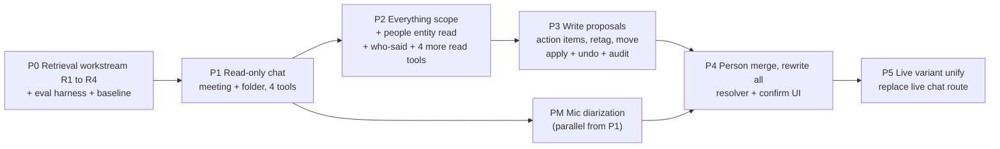

| Phase | Content | Schema | Setting | DoD (all needed) |
|---|---|---|---|---|
| P0 | R1 meeting scope and date filter; R3 `best_ms` and grouping helper; the retrieval workstream R4 of section 7.4 (FTS5 BM25, RRF fusion, reranker candidates, multimodal spike) with its own eval and bars; reversal of SD8 in the search spec; the chat eval corpus builder and harness (`scripts/chat-eval/`); the native-tools arm T1 in the worker behind a flag, compared with the structured router (D11); baseline runs of A0 on E2B, E4B, Nemotron, Qwen; a skill `.claude/skills/chat-eval/SKILL.md` | FTS table (version at build time) only if H1 passes its bar | none (no user feature) | Arms table (V0, H1, H2, R1, M1) with recall@k, nDCG@10 per language, latency, RAM, index size, in the PR. Unit tests of the new filters. The existing search eval does not regress. The harness runs against an isolated app. Bars of 7.4.6 met or the PR says which arm was dropped. T1 against A1 table (tool-choice and argument accuracy); the loser is removed. |
| P1 | Router, plan table, slot fill, answer, cite validation. Tools: `search_chunks`, `get_meeting_summary`, `list_action_items` (read only, derived key), `folder_status`. Threads and messages. Scope M and F. The Ask tab on the meeting page only (section 11.4). Built (2026-10-31, PR #401): all 8 read tools and the 4 write-proposal builders (eval only, nothing is applied), because the P0 bars are measured on the full gold set. The router is MIXED (native tool call, then the structured router). Schema: v54 is the FTS5 table (not items), v55 is threads and messages. The items table (`meeting_items`, section 4.1) moves to P3: P1 is read only and uses the derived key. | v54 (FTS5), v55 (threads) | `meeting_chat_enabled` (default off) | E2E in the isolated app on the meeting Ask tab: a real question per story R1, R2 (one meeting), R5, R9 with screenshots in light and dark, and the accessibility tree check of 11.3. R6 and folder-level R2 and R5 are proven by the gold eval and by command (said so in the PR); their screen proof is in P2. Gold eval numbers for E2B meet the P1 bars. Failure paths 2.5 each tested. |
| P2 | Scope A. Tools: `list_meetings`, `list_decisions_questions`, `list_people` (certain matches only), `get_transcript_window`. Resolver for certain matches. The Ask tab on the folder Overview, Cmd+K with widening to Everything, and the source-text panel of 11.5. | v56 (people) | same | E2E for R3, R4, R6, R7 and folder-level R2 and R5 in the screen, Cmd+K widen and continue-in-tab. Gold numbers meet the P2 bars. Resolver run on the fictional corpus. |
| P3 | `propose_action_item_change`, `propose_retag`, `propose_move`. Proposal cards. Apply, undo, audit log. Extract the move and tag logic to lib functions. Item sync after summarize. | v57 (changes) | same | E2E: propose, apply, check in the screen, undo, check again, for each kind. The undo round trip hash test. Write bars met. No path writes without Apply (a test posts a write-intent question and checks the tables did not change). |
| PM | Workstream of section 4.5: spike of the helper on `mic.wav`, mic labels `m1..`, `source` column in diarizer turns, merge output without the hard-coded "Me", owner confirmation flow, echo check, carry rule with mic labels. Starts after P1 (one PR open at a time with the main line, WIP limit 2). | rebuild of `meeting_diarizer_turns` (version at build time) | extends the diarization setting | Multi-voice mic eval of 8.8 meets its bars. E2E in the isolated app: a fictional 3-voice mic meeting shows 3 speakers, the user confirms one as owner, light and dark screenshots. No regression on single-voice meetings. |
| P4 | `propose_merge_people`, resolver clusters (likely, unsure), confirm UI, full rewrite of D3 with the preview of every changed place, `agent_change_places`, conflict rules of 5.7. Needs PM for the owner link. | none beyond v57 | same | E2E on a fictional folder with 3 name variants and a mic with 2 voices: merge, check every place in the screen, edit one summary line by hand, undo, see the conflict report. Dedup precision bar. Round trip hash test for tables without a conflict. |
| P5 | Live variant on the pipeline, `get_live_tail`, thread migration from `meeting_chat_messages`, the old route becomes an adapter. | none (data copy) | `live_chat_enabled` keeps gating the live view | The 9 proofs of `specs/live-chat.md` section 6 still pass. Latency and RSS no worse than today (246 ms warm chat, 231 to 247 MB app RSS, 9.0 GB peak all processes). Gold live questions pass. |

Rule for all phases: an E2E result on the screen is needed. A 200 response alone does not count (user-wide `CLAUDE.md`, "A 200 is not evidence"). Evidence is the command and its real output, plus screenshots in light and dark (project memory "UI proof: both themes").

### 9.2 Risks and mitigations

| # | Risk | Why it matters (source) | Mitigation |
|---|---|---|---|
| 1 | E2B is too weak for the router, the slots or the answer | Tau2 24.5% for E2B (https://huggingface.co/google/gemma-4-E2B-it/raw/main/README.md); a 4k multi-job prompt lost to a focused prompt on E2B (`AGENTS.md` ethos section) | Small closed choices. Code renders lists. P0 baseline before any build. Arms A1 to A5. Bars confirmed by the owner. |
| 2 | Hard schema lowers answer quality | https://arxiv.org/abs/2605.26128 | Strict only on small closed outputs. Arm A2 compares lenient parse. |
| 3 | A wrong person merge corrupts data in many meetings | Names appear in 7 places (Discovery A section 2.1) | Entity merge is soft (`merged_into`). The full rewrite (D3) is shown place by place in the preview. Cannot-link rule. Ambiguous-alias guard. User confirms every cluster. Versioned copy of every place. Patch-level undo with a conflict report. Precision first. |
| 4 | Vector-only recall misses names and numbers | recall@10 0.613 PT, 0.703 EN (`specs/local-semantic-search.md:105-111`) | Structured tools for counts and owners. Optional FTS5 channel by a measured gate. |
| 5 | Item ids drift on re-summarize or re-transcribe | Key hash changes with text (`S/lib/meetings/folder-overview.ts:40-42`); segment ids rewritten (Discovery A, gap 10) | `sameOverviewItem` sync, `text_hash` drift check, cites by `meeting_id` plus `start_ms`. |
| 6 | The lane or RAM hurts dictation or small Macs | One request at a time per local model (`S/lib/llm/lane.ts:106`); peak 9.0 GB with ASR and chat models, 16 GB Macs untested (`specs/live-chat.md` section 7); the prefix cache of cleanup is one entry (`W:905-925`) | The default is the shared resident model (D6). Measure dictation latency during a chat turn (bar in 8.7) and the cleanup prefix cache after a chat turn. If a cost shows, use the fix options of 2.7 point 6 in order. The turn deadline is a setting (default 60 s). |
| 7 | Data goes to a cloud provider that the user chose, in a chat over many meetings | Decision D1 lifts the local-only rule of the live chat (`S/routes/meetings-chat.ts:98-103`) | The app sends only the sources of the turn (up to 6000 estimated tokens) to the provider that the user set for the task. The thread shows provider and model. The LLM inspector keeps the sent messages (`llm_calls.messages_json`, `S/lib/schema.ts:1070`). No fallback to another provider. |
| 8 | Eval corpus does not match real use | Fictional corpus (8.2) | Owner-labelled private set for dedup. Owner spot check of 20 answers per model. The three spoken meetings. |
| 9 | Scope creep from the UI | Three surfaces (tab, folder tab, Cmd+K) plus dissents (section 11.5) | The API is placement-agnostic. P1 builds only the meeting tab. Cmd+K and the folder tab wait for P2. |

Two more risks come from the owner decisions. Risk 10: a mic diarizer that splits one voice, or makes clusters from echo (section 4.5). Risk 11: a prose rewrite that changes the wrong word (section 5.6 rules 4 to 6). Mitigation for 11: ambiguous-alias guard, per-place preview, patch-level undo. Top five by impact: 1, 3, 4, 5, 6.

### 9.3 Open questions for the owner

See section 12.2. Decisions D1 to D5 are in section 12.1.

## 10. Effect on existing features

| Feature | Effect | What is reused |
|---|---|---|
| Live chat (`S/routes/meetings-chat.ts`, `S/lib/meetings/live/*`) | Replaced in P5. In P5 the local-only block (`S/routes/meetings-chat.ts:98-103`) goes away, by decision D1. The text of `specs/live-chat.md` section 3 ("only a local model answers") is updated in the same PR. Until then it is untouched. The routes `GET/POST /api/meetings/:id/chat` stay as an adapter in P5 so the live panel keeps working. The 9 proofs must pass again. | Context builder blocks F and L, prompt style, cite drop, live store, panel (`R/pages/meetings/live-chat-panel.tsx`), cite chips |
| `meeting_chat_messages` | Copied to threads in P5. Kept one release. | Table rows |
| Folder standing and overview | Read only through `folder_status`. Overview unchanged. After a merge the standing shows stale through its input hash. | `buildFolderOverview`, `folder_standing`, `folderActionGroups` |
| Folder action item done marks | P3 adds a dual write with `meeting_items.status`. The overview stays unchanged. | `setActionItemDone` |
| Search UI (`R/pages/meetings/search.tsx`) | Unchanged API. Retrieval changes are additive. #297 and #298 stay open for the UI. | `retrieve()`, `hitText()` |
| Search index | A summary edit by Apply re-embeds the summary chunk. A move re-partitions vectors. | indexer, vec store |
| Cleanup (dictation cleanup, renamed from "Tone" in #398) | It shares the default LLM worker and the lane with the chat (`specs/live-chat.md` section 3). A chat turn of several calls can delay a dictation by up to one call. Chat does not send the prefix-cache header, so a chat call can evict the one-entry cleanup cache (`W:905-925`; `S/lib/llm/registry.ts:529-534`). Measured in P1. | `resolveTaskCall`, `withLlmLane`, the lane |
| Summarize and Enhance | P3 item sync runs after the save step. A new summary keeps ids by `sameOverviewItem`. | `save.ts` pipeline |
| Speaker naming and diarization | P4 uses the existing speaker update path. PM adds the mic channel to diarization and changes `merge.ts` (section 4.5). | `PATCH /:id/speakers/:label`, `fluidaudio-diarize` helper |
| Search spec | SD8 and the hybrid and reranker non-goals are reversed with numbers (section 7.4). | `specs/local-semantic-search.md` |
| Models page and Settings | A warning on the opt-in row for a separate chat model (2.7). A new Settings sub-page "Ask" (2.9). | Task rows of the Models page |
| Voiceprints | Suggestions of the same voice depend on issues #67, #73, #79 and #85 (4.5). | |
| Retention (work outside the chat spec, D14) | Listed below in 10.1. | |
| AGENTS.md | A new rule "Diagram conventions" (same PR). | |
| LLM inspector | Shows chat stages through `llm_runs` with `scope = "chat"`. | recorder, inspector UI |
| Settings, Models page | New switch `meeting_chat_enabled`. New row for the task `meetingChat` on the Models page (as `models.taskProfiles.liveChat`, `specs/live-chat.md` section 5). 7 locales plus template. | task profile UI |
| Knip | New files must be imported or listed in `knip.jsonc` (`AGENTS.md`, development gotchas). | |

### 10.1 Retention work outside the chat spec (D14)

Owner decision D14 (was Q13): audio vectors follow the retention of the app. The default is no retention: data persists. This is separate work with its own PR, because it changes existing behavior.

Today: one global setting `meeting_retention_days` with a default of 30 days (`V/settings.ts:196`, `V/settings-keys.ts:93`). The sweep deletes only the WAV files and sets `audio_dir` to NULL. The database rows (segments and summaries) stay forever. A meeting with `retention_exempt = 1` is never swept (`S/lib/meetings/retention.ts:15-21`).

New policy:

1. Default: no retention. Meetings persist. Audio and vectors persist.
2. Per folder: meetings in a folder persist by default. A folder may opt in to a retention period.
3. Unfiled meetings get a retention period. When it ends, the purge removes the WHOLE meeting: audio, transcript, summary, vectors and chat. The delete path today removes the row with cascade and removes the audio directory (`S/routes/meetings.ts:2502`).
4. Before the purge, the app shows a warning that lists the meetings, with a "move to a folder" action. A move exempts the meeting (the move route is `S/routes/meeting-folders.ts:166`).
5. Vectors and audio are always deleted together. Audio vectors, if M1 ships, die with the audio. Text vectors die with the meeting.

Work items (not part of the chat phases):

| # | Item |
|---|---|
| 1 | A per-folder retention setting: a nullable column on `meeting_folders` (`NULL` = persist) and a field in the folder controls. |
| 2 | The retention period for unfiled meetings: change the meaning of `meeting_retention_days` from "delete audio of all meetings" to "purge unfiled meetings". A migration decides what happens to users who have the 30-day default today (OPEN Q16). |
| 3 | The warning surface and the move action. |
| 4 | The sweep change in `S/lib/meetings/retention.ts`: whole-meeting purge with the vector cleanup that a meeting delete already does (the GC trigger of `meeting_chunk_gc`, Discovery A section 1.4), and the audio-vector deletion. |
| 5 | Tests: a folder meeting is never purged, an unfiled meeting is purged only after the warning period, and an exempted meeting stays. |

## 11. UI placement: decided (D5)

Status: DECIDED by the owner on 2026-10-31 (decision D5, section 12.1). The choice is concept C of the prototype canvas, with the dissents of the persona conference recorded in 11.5. The server API in section 5.3 did not depend on the choice and does not change.

### 11.1 The placement

| Surface | What it is | Scope |
|---|---|---|
| Ask tab on the meeting page | A tab in the tab row of the meeting detail (the active tab is state in `R/pages/meetings/detail.tsx:171-173`; the live chat already adds a tab when a meeting has chat messages, `R/pages/meetings/detail.tsx:225`). | this meeting (M) |
| Ask tab on the folder Overview | A tab next to the Overview in the folder panel (`R/pages/meetings/folder-panel.tsx:75`, tab row at `:383`). | this folder (F) |
| Cmd+K quick ask | A palette opened from anywhere in the app. It starts with the scope of the page the user is on. The user can widen it to Everything (A). A long exchange continues in the Ask tab of the matching meeting or folder, or in an Everything thread. | page scope, widenable to A |
| Live view during a recording | The live view stays as it is: transcript left, chat right (`specs/live-chat.md` section 5). Its chat becomes the same Ask pipeline at scope "this meeting, live" (section 2.4). Until P5, today's live chat panel (`R/pages/meetings/live-chat-panel.tsx`) stays unchanged. | this meeting, live |
| Ask page (concept B) | Not built now. A later option only for the Everything scope and for search over old threads. | A |

The owner said the Cmd+K quick ask and the Ask tab have "an awesome synergy". The design keeps one thread model for both (section 4.2): a thread made in Cmd+K has a scope, and the tab for that scope lists it.

### 11.2 Requirements for the surfaces

1. A scope line in words, with the scope default from context: the meeting tab gives M, the folder tab gives F, Cmd+K gives the page scope. In Cmd+K the user widens to A with one action. In a tab the scope is fixed by the page, and the tab offers "ask across everything" which opens Cmd+K at A. DECISION: the tab does not change its own scope. Reason: a meeting tab that answers from other meetings confuses the cites.
2. Cite chips. A chip opens the meeting at `start_ms`, or opens the item. A dead chip (meeting deleted) is shown as "removed".
3. Answer blocks: text, list, count, status, not-found with the "search wider" offer (D16, section 6.3).
4. Proposal cards with a before and after preview, row checkboxes, Apply, Reject, and Undo after Apply (P3 and later).
5. An activity log of applied changes with Undo (reads `GET /api/chat/changes`).
6. A step trail of the tools that ran ("searched 3 meetings, read 1 summary"). It comes from `trace_json`. The POST returns once, because the worker does not stream (`W:734-735`).
7. A "warming" state for the first call, as in the live chat (`specs/live-chat.md` section 5).
8. All strings through `t()` in 7 locales. Light and dark themes. Accent rules of `specs/design-system.md`.
9. The thread list of the current scope, newest first. Cmd+K shows recent threads of the scope.
10. Cmd+K is a keyboard shortcut of the renderer. It must not clash with a global dictation hotkey (OS-level hotkeys go through the main process, `AGENTS.md` section "IPC"). ASSUMPTION; P2 checks the existing shortcuts before it binds the key.

### 11.3 Accessibility notes (from the persona conference)

1. Tab semantics: the Ask tab is a real tab in the existing tab list, with the tab role, `aria-selected`, arrow-key movement and a tab panel. The tab row of the meeting page and the folder panel already use the shared `Tabs` component (`R/pages/meetings/folder-panel.tsx:383`; `R/components/ui/tabs.tsx:87`). The component wraps the Radix tabs primitive (`R/components/ui/tabs.tsx:3`), which is expected to give the roles (ASSUMPTION). P1 checks it in the screen (accessibility tree) and does not claim it from code reading.
2. Live region for the thinking state: the "thinking" and "warming" text, and the step trail, sit in a polite live region (`aria-live="polite"`), so a screen reader hears "thinking", the steps and then the answer. The answer itself is added to the message list and is not read twice. Because the answer is not streamed (`W:734-735`), the live region announces only state changes.
3. Cmd+K palette: dialog role with a label, focus moves into the input on open, Escape closes and returns focus to the element that opened it, and arrow keys move in the result list.
4. Cite chips and proposal buttons are real buttons with names that include the target ("Open meeting Weekly sync at 12:40"). Do not rely on colour alone for applied, undone and conflict states.
5. Both themes are checked (project rule: UI proofs in light and dark).

### 11.4 What this changes in the plan

| Phase | UI scope |
|---|---|
| P1 | One thin UI: the Ask tab on the meeting page (scope M). The API and the eval already cover scope F. The folder questions (R2 at folder level, R5, R6) are proven by the gold eval and by command against the real server in P1, and this is stated in the PR. Their screen proof comes in P2. |
| P2 | Replaced by D19 (section 11.6): the Ask tab on the folder Overview (scope F), the Ask page, the global bubble and the Everything scope (A). Cmd+K is dropped. Screen proofs for R3, R4, R6, R7. |
| P3 and P4 | Proposal cards and the activity log in the same tab (and in the Cmd+K result when a proposal comes from there). |
| P5 | The live view chat panel switches to the Ask pipeline at scope "this meeting, live". |
| Later | Ask page for the Everything scope and old-thread search. |

### 11.5 Dissents (recorded)

1. Power user: wants an optional drawer later, so the chat stays open while the user moves between pages. Not in the plan. Reopen after P2 if Cmd+K plus the tab is not enough.
2. Product manager: wants the source-text panel of concept B (the cited text next to the answer) inside the tab. Plan: a cite chip opens the cited lines in a side panel of the tab (transcript lines around `start_ms`, from `get_transcript_window`, section 3.2), in addition to opening the meeting. DECISION: P2 builds it, because it needs the window tool.

### 11.6 P2 placement: Ask page, global bubble, folder tab (D19)

Status: DECIDED by the owner on 2026-11-01 (decision D19, section 12.1). D19 replaces D5 for P2. D5 stays for the Ask tab of one meeting (P1). The in-app Cmd+K palette of D5 is dropped. The API of section 5.3 stays placement-agnostic: any surface gives a scope and a thread.

#### 11.6.1 The surfaces

| Surface | What it is | Scope |
|---|---|---|
| Ask tab on the meeting page | Unchanged from P1. | M |
| Ask tab on the folder Overview | A tab next to the Overview in the folder panel. The scope is fixed by the page. | F |
| Ask page | A page in the left sidebar, next to Meetings. It has a scope picker (Everything, one folder, one meeting), the thread list of the picked scope (newest first), a new-chat button, and the same answer, cite chip and "How I found this" UI as the meeting tab. | A, F or M |
| Bubble | A small floating window. A global hotkey opens it from any app. It has the scope in words, one action to widen the scope, an input, a short answer with cite chips, and "Open in Ask". | the selection in the Meetings page, else A |

One thread model serves all four surfaces (section 4.2). A thread made on any surface shows in the thread list of its scope on every surface. A thread with no meeting and no folder has the scope A (the table already allows it: both columns NULL).

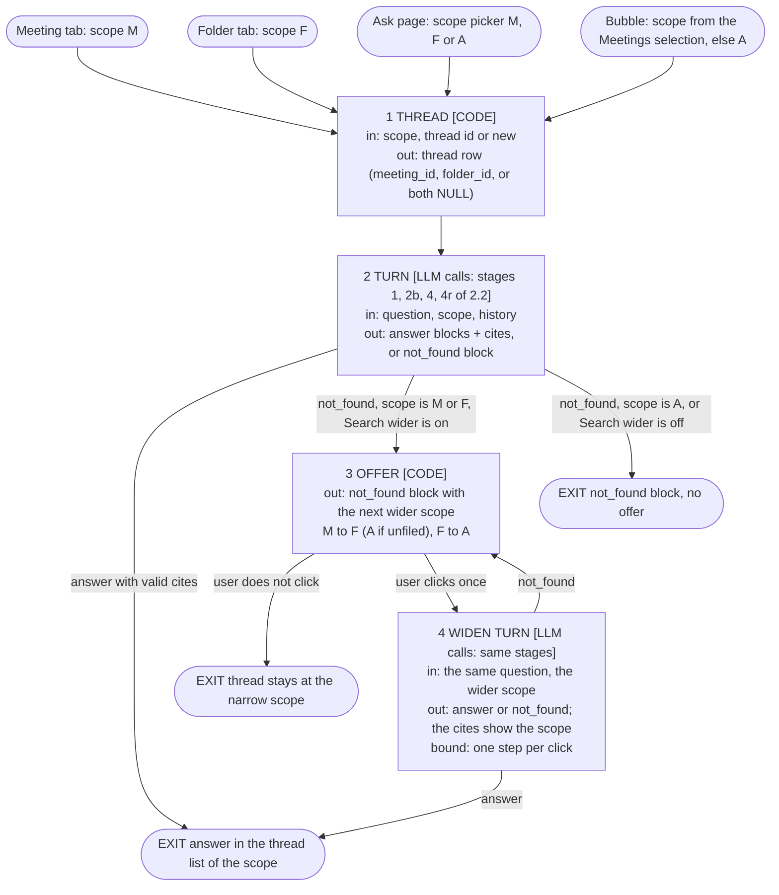

Counting from the diagram: a turn has the LLM calls of section 2.2 (at most `R + 3`). A widen turn is a normal turn at a wider scope. It adds no extra call. The exits are X1, X2 and X3.

#### 11.6.2 The global hotkey and the guard

The owner holds Control+Option for dictation (the default hotkey of macOS is `Control+Alt`, `apps/electron/src/shared/hotkey-defaults.ts`). The chat hotkey is `Control+Option+K` by default. It is a setting (`chat_hotkey`) with a recorder in Settings. Control+Space and Control+Option+Space are taken by macOS input sources on the owner's Mac, so they are not used.

Rules (DECISION):

1. OS-level hotkeys go through the main process (`AGENTS.md`, section "IPC"). The main process starts one native key listener for the chat hotkey, as it does for each language hotkey. The listener swallows the key, so the foreground app does not get a "k".
2. The hotkey is registered only when `meeting_chat_enabled` is `"true"`. A change of the switch or the hotkey registers or removes it at once.
3. The guard. When the chat hotkey is on and the dictation hotkey is a prefix of it (all modifiers of the dictation hotkey are modifiers of the chat hotkey), a dictation start waits 150 ms. If the chat key goes down in this window, the start is cancelled and the bubble opens. If the window ends first, dictation starts. If the user releases the dictation hotkey inside the window, dictation starts at once and stops at once (the same as before the guard). If the chat key goes down while a dictation runs, the chat key is ignored. The cost: every dictation start is 150 ms later while the chat is on. A dictation hotkey that is not a prefix of the chat hotkey has no delay.
4. The same guard applies to the per-language dictation hotkeys.

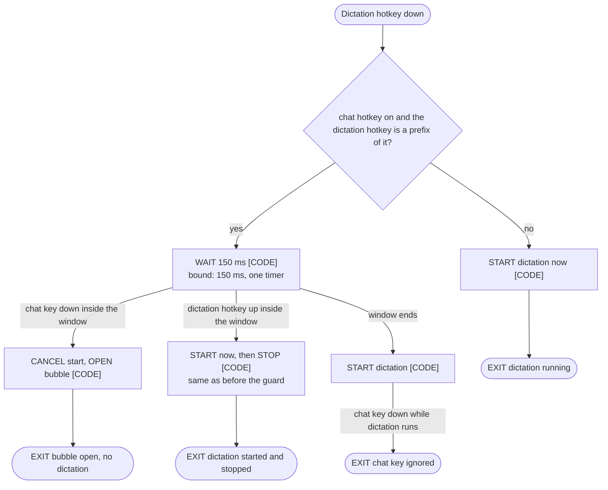

The bubble closes with Escape and returns focus to the app that had it. When the bubble was opened from the background, Openstyle hides itself on close, so macOS gives focus back.

#### 11.6.3 The bubble scope

The Meetings page tells the main process which meeting or folder is selected (IPC `chat:selection`). The main process keeps the last value. The hotkey reads it at press time. A meeting that is selected gives scope M. A folder gives scope F. Nothing selected, or the Meetings page was never open, gives scope A. The bubble shows the scope in words ("Asking in: Weekly sync") and one action "Search everything" that widens the scope of the next question one step (M to F, F to A, an unfiled meeting to A). "Open in Ask" opens the main window on the Ask page with the same thread selected, so the thread continues there.

#### 11.6.4 Search wider (D16) in P2

1. A `not_found` block at scope M or F carries `wider`: the next scope (kind, id, name), or none when Search wider is off or the scope is A. Code computes it. The model does not.
2. The user clicks "Search the whole folder" or "Search everything". The client sends `POST /api/chat/threads/:id/messages` with `{"widen": true}`. The server reads the last message of the thread. It must be an assistant message with a `not_found` block that has `wider`. The server takes the question of the user message before it and runs a normal turn at `wider`. It saves no second user message. A thread whose last message is not such a block gets 409 `widen_not_offered`.
3. The answer message carries its scope in `trace.scope`. The UI shows "Searched in: Project Atlas" when the scope of the answer differs from the scope of the thread.
4. Code never widens alone, also not in the last tool round (section 6.3).

#### 11.6.5 What P2 does not build

1. The Cmd+K palette (dropped by the owner). The API has no palette code.
2. The source-text side panel of section 11.5 point 2. A cite chip opens the meeting on the Transcript tab at the time of the cite. The side panel moves to a later phase.
3. Proposal cards (P3), person merge (P4), live variant (P5).

#### 11.6.6 P2 evaluation

The gold set and its hash stay as in P0. A new set file adds folder and Everything questions (section 8 of the chat-eval skill): lookup, who said, temporal and count at scope A, who said at scope F, and "search wider" cases (a question that is not found at M and found after one widen to F, and after one widen to A). Threads at scope A get their own turns. The bars of section 8.7 (P1 and P2 columns) are reported on E4B and E2B, gold and held-out.

#### 11.6.7 What the build does (facts of the P2 branch)

1. API. Scope A is a thread with no meeting and no folder: `GET /api/chat/threads?all=1`, `POST /api/chat/threads` with `{"scope":{"kind":"all"}}`. `POST /api/chat/threads/:id/messages` takes `{"question"}` or `{"widen":true}`. A not_found block has `wider` (`{kind:"folder",id,name}` or `{kind:"all"}`), and a message trace has `scope`. A widen with no offer gets 409 `widen_not_offered`. There is no schema change: `chat_threads` already allowed both columns NULL (section 4.2).
2. Settings. `chat_hotkey` (an accelerator, empty means the default). The Ask section of Settings has the recorder. A chord with no key, or the dictation hotkey, is refused.
3. Main process. `hotkeys/chat.ts` registers the listener and reads the settings; `hotkeys/chat-guard.ts` is the guard (pure, tested with a fake clock); `windows/chat-bubble-window.ts` is the window. The bubble closes on Escape, on the close button and when it loses focus (400 ms after it shows are ignored). When another app had the focus, closing the bubble hides Openstyle, so macOS gives the focus back. When an Openstyle window had the focus, that window gets it back.
4. Renderer. One `AskPanel` serves the meeting tab, the folder tab and the Ask page (the thread list is a dropdown in the tabs and a column on the page). The cite chip of a folder tab, the Ask page and the bubble opens the meeting at the cited time (`/meetings?meeting=<id>&at=<ms>`). The bubble has its own page (`chat-bubble.html`) and keeps one thread for its questions until it opens again.
5. Not covered by an automated test (said plainly): a real press of Control+Option+K, the focus return after Escape in a real session, and the window-end path of the guard in the app (it would start the dictation, which opens the microphone). The guard is tested at unit level on both paths (`chat-guard.test.ts`). The app test drives the "K inside the window" path through the E2E seam `e2e:trigger-chat-hotkey` and checks the state of the main process.

### 11.7 Broad questions: synthesis (owner report 2026-11-01)

A lookup pipeline answers one fact. Owners also ask broad questions: "give me details", "tell me the story of this project", "how did it begin", "an onboarding", "can't you tell me anything". The first answer was one sentence, a follow-up repeated it, and a folder status had no bullets. Decisions of the owner:

1. **Code decides.** `asksSynthesis` (`S/lib/chat/plan.ts`) covers these questions in 7 languages, and the overview question of a meeting (`asksOverview`). A question after a `not_found` that leans on the turn before ("Cant you tell me anything?") also counts. No native or router call runs.
2. **Sources.** Meeting scope: all summary sections (overview, key points, decisions, action items, open questions) and the top 8 chunks. Folder scope: one source for each meeting in date order (`summaryDigest`, `S/lib/chat/tools.ts`), then 4 chunks. The detail of each meeting (full, gist, one line) is chosen by code to fit 60% of the source budget (section 2.8). Everything scope: the top 8 chunks, then the digest of the (at most 6) meetings of those hits.
3. **Answer shape.** A lead of 1 to 3 sentences and 2 to 6 bullets (`SYNTH_SCHEMA`, `S/lib/chat/prompts.ts`). Every sentence and every bullet has its own cites. A text block has the optional field `bullet` (`P/validations/src/chat.ts`). A lookup may add `bullets` too. The output cap is 1500 tokens for a broad answer and 500 for a lookup.
4. **Grounding stays.** The cite check works per sentence as before. On the last attempt of a broad answer a sentence with a fact that no source holds is removed (never kept, never invented). A date written day/month (04/08/2026) counts for the source in either order.
5. **Elaboration.** "More details", "tell me more", a broad question after a broad answer: the clauses that the thread told are cut from the sources (`withoutTold`), more chunks are read (14 in a meeting), the prompt lists what is told, and a sentence that repeats a told sentence (word overlap 0.6) is removed. When nothing is left the block is `not_found` with the reason `nothing_new` and no wider offer. The #405 repeat guard stays.
6. **Folder status.** A `folder_status` with no saved text has no bullets: the summaries answer, and the counts are the last block.

Eval: the `broad` part of `pnpm chat-eval p1` (section 8; skill `chat-eval`). The private regression on real threads is `pnpm chat-eval real`.

### 11.8 Clarifying question and map-reduce synthesis (D20, owner request 2026-11-02)

The owner asked whether Ask asks about the scope and whether it synthesizes broad questions. Before D20, Ask never asked a question back. It offered "search wider" only after a `not_found`. A folder with more than about 32 meetings lost its oldest meetings in the digest (`assembleAnswerInput` drops the last-ranked source first, and the digest is in date order).

**A. Clarify block.** The answer block `clarify` (`P/validations/src/chat.ts`) holds a reason (`scope`, `intent`, `person`), a subject, and 2 to 6 options. Each option has a chip label and the full question that the chip sends. The renderer adds the chip "Answer anyway". A chip click posts `option.ask` as a normal question in the same thread. "Answer anyway" posts the first question again with `no_clarify: true`.

Rules (all in code, `S/lib/chat/clarify.ts`; no LLM call, so no latency cost):

1. **Person (c).** A first name in the question matches two or more people (speakers and owners) and no full name is in the question. Any scope.
2. **Folder (a).** Scope Everything. Two or more folders with meetings share the same topic words with the question, none is named in full, and no folder matches more words than the others. A word in more than half of the folder names is ignored.
3. **Intent (b).** Scope Everything, no earlier question in the thread, and the question has no topic word (words like "status", "update", "it", "more" are not topics). The chips are summary, decisions, next steps, open questions.
4. **Limits.** A "search wider" turn never gets a clarify. A page that fixes the scope (meeting tab, folder tab) never gets rule 2 or 3. At most one clarify for each question, and never two in a row (the last assistant message must not be a clarify). The setting "Ask clarifying questions" (`chat_clarify`, default on) turns the block off.
5. **Recall is limited on purpose.** The topic and name words are English plus names. A wrong question costs more than a missed one, so the rules ask only when the evidence is split.

**B. Map-reduce synthesis.** The synthesis path (section 11.7) keeps its sources. A folder or Everything digest with 6 or more meetings is measured first with the FULL summaries (on a scratch source map, so labels do not change). When the full summaries do not fit the digest budget (60% of the source budget), the old digest would cut every meeting to one line and lose the facts. Code then runs a map step (`S/lib/chat/mapreduce.ts`):

1. The digest is built again with the full summaries. A question over Everything with no topic word ("an overview of everything") digests every meeting, not only the meetings of the top hits.
2. Sources are cut into groups that fit the window and the output cap. Each group is one `chatAnswer` call (`MAP_SCHEMA`): one short note for each source, with the label of the source (`[S5]` and `S5` both count). A group that fails (cut at the output cap, or notes missing) is split in halves and asked again once. At most 10 map calls for each turn; a source after that keeps the code cut. The hard cap of 16 calls for each turn still holds: a turn that reaches it ends with `not_found` (`call_cap`).
3. Code checks each note. A note with a number that its source does not hold, a missing note or a failed call gives the code cut of the source text. The note replaces the text of the source; the label, meeting and date stay.
4. Reduce in date slices: the notes go to at most 3 `synth` answers, one for each part of the period (24 meetings or fewer in each). Each slice has its own cite check, cite times and `dropUnsupported` rule. The first slice gives the lead; the other slices give bullets only. A model that reads 72 notes in one call writes about the first ones only (measured: late third 0 to 1% of the facts, with slices 23 to 25%, E4B). Cites point to real meetings because the labels never change.
5. Progress: the trace step `map_reduce` says "Reading N meetings in G groups" and the trail line of the answer says "shortened N meeting summaries". The route is one request, so the UI shows its normal pending state. Streaming the step text is not built.

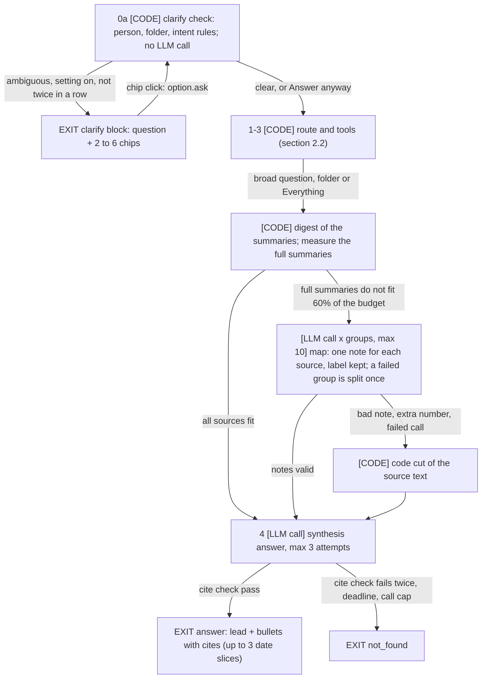

LLM calls on the map path: up to 10 map calls, then up to 3 answer attempts for each of up to 3 slices. The clarify path has 0 calls.

**C. Design gaps closed with D20 (owner decision 2026-11-02).**

1. A cite chip names its meeting at folder and Everything scope ("S1 · Title · 02:00", the title is cut with an ellipsis; the full name stays in `aria-label` and the tooltip). At meeting scope the chip stays short.
2. The scope line shows the number of meetings and "answers cite only these" (`GET /api/chat/scope-size`).
3. The bubble is `role="dialog"` with `aria-modal` and a label. E2E checks the role and the name.
4. A running turn shows its step ("Searching N meetings...", "Reading N meetings...", "Writing the answer..."). The server keeps the stage of each running turn (`ChatProgress`, `GET /api/chat/threads/:id` field `progress`); the client polls it every second. No token streaming.
5. A not-found block is a card with the line "Searched N meetings in this folder" (field `searched` of the block) and the nearest sources.

Eval: the `clarify` part of `pnpm chat-eval p1` (section 8; skill `chat-eval`). Results are in the PR that added D20.

### 11.9 Research mode (D21, owner request 2026-11-02)

Status: BUILT in PR #412 (2026-11-02). Section 11.9.16 says what the build changed against this text and shows the numbers. The text before 11.9.16 is the approved design; where the build differs, 11.9.16 wins. The owner approved the open decisions on 2026-11-02 (11.9.14, 12.2). The numbers in 11.9.13 are measured on `main` at `ad98f171` with the eval code of the spec step. Prefixes `S/`, `V/` and `W/` are from section 0.2. Labels are from section 0.1. A name in `monospace` with no path is a name in the code of the build step (it does not exist yet).

#### 11.9.1 The owner request and the problem

The owner said (2026-11-02): "it doesn't seem to proactively go into different things, proactively keep searching ... until it is more sure ... let's say ... 'what are the open items' ... 'why are these items open?' ... requires quite a bit of digging, searching, journeying through other data".

What Ask does today (all VERIFIED at `ad98f171`):

1. **One hit ends the search.** The tool loop stops when any round gives a block or any text source: `if (blockResult() || textMaterial()) break;` (`S/lib/chat/pipeline.ts:1242`). The loop runs again only when nothing came back. The setting `rounds` (default 3, range 1 to 5, `V/chat.ts:12`) is a fallback chain for an empty search. It is not a research budget.
2. **"What are the open items" is not a list question.** The list words (`LIST_RE`, `S/lib/chat/prompts.ts:202-209`) have no "open". A list tool that the model picks is replaced by `search_chunks` (`S/lib/chat/pipeline.ts:1062-1076`). A Portuguese question with "quais" does reach a list tool. So the answer depends on the language of the question.
3. **The follow-up "why are these open?" does not know the items.** The search query comes from the question and the earlier turns (`followUpQuery`, `S/lib/chat/plan.ts:525`). The items of the earlier list are not leads.
4. **Cross-meeting reasons stay in one meeting.** One search returns the best chunks (k = 8). The best chunks come from the meeting with the best match. The other meetings that hold the other reasons are not read.
5. **One model does every stage** (`resolveTaskModel("meetingChat")`, `S/lib/chat/llm.ts:124`). No stage can ask for more evidence.
6. **The progress is a poll of three stages** (`searching`, `reading`, `answering`; `V/chat.ts:269-274`, `S/routes/chat.ts:59,188`). It cannot show a research step.

Section 11.9.13 measures what this costs. On the dig part, today's Ask passes 22.9% of the 35 digging turns on Mac E2B and on Mac E4B (25.7% on desktop E4B). It ends in `not_found` on 40.0% (E2B) and 31.4% (E4B) of them, although the corpus holds every answer. The "why are these still open" turn passes 0 of 7.

#### 11.9.2 Decision D21 in one table

| # | DECISION | Reason |
|---|---|---|
| 1 | Ask gets a research mode. It is a LangGraph.js graph in `S/lib/chat/research/` (build step). It uses `StateGraph`, `Command`, `ReducedValue` and `NodeSqliteSaver`, as the Enhance graph does (`S/lib/meetings/workflow/graph.ts:1-2,133`, `state.ts:1,30-45`). | One graph shape for LLM work in this app. The pipeline of 11.2 stays the definition of the fast path. |
| 2 | The nodes are `scope`, `plan`, `act`, `observe`, `reflect`, `blocks`, `synthesize`, `cite_check`, `not_found`. | Section 11.9.5. |
| 3 | Code owns every stop rule: `MAX_ITER` (4 local, 6 cloud), `stalled` (2 rounds with nothing new), no repeat of a tool with the same arguments, the call cap 16, the deadline and `recursionLimit`. The model never decides to stop alone. | Owner decision. Section 11.9.6. |
| 4 | `cite_check` is the last node before the end. No edge skips it. | Section 11.9.7. |
| 5 | One graph runs both modes. The fast mode keeps the behaviour of section 2.2 and the bars of 8.7. The research mode adds the loop. Code decides the mode. | A simple fact finishes in round 1. Section 11.9.9. |
| 6 | The model makes only small closed choices in the loop: `next` (one word of a list that code builds) and a search query of at most 120 characters. Code builds every tool call. | D8 and D11, and the P0 numbers on E2B (11.9.5, node `act`). |
| 7 | Clarify stays as it is: it ends the turn, the chip starts the next turn. No `interrupt()` in v1. | Section 11.9.8. |
| 8 | The step text streams with `streamMode: "custom"` into the existing progress poll. | Section 11.9.8. |
| 9 | A setting `chat_research` turns the mode on or off. Default: on (APPROVED by the owner, 2026-11-02). | Section 11.9.9. |
| 10 | The migration is four steps. Each step must pass every existing bar before the next one starts. | Section 11.9.11. |

#### 11.9.3 The graph

Legend: [CODE] runs without a model. [LLM call] is one model call. Every exit is drawn. The loop `act` to `reflect` is bounded by the rules of 11.9.6.

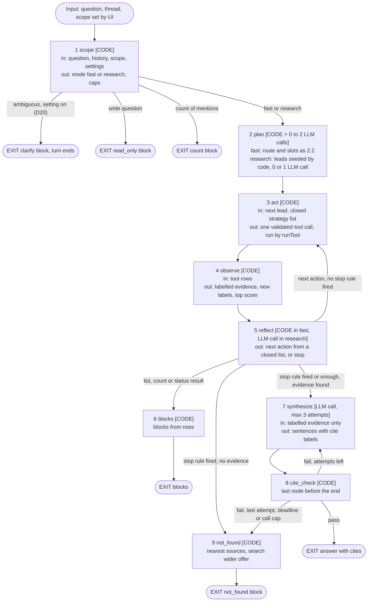

A client abort or an unexpected model error throws out of any node, as it does today (section 2.5a). The route turns it into the error reply. The gate (no model, no key) runs in the route before the graph starts (`createChatLlm`, `S/lib/chat/llm.ts:121-165`), so it is not a node.

Counting from the diagram: the LLM calls are `plan` (0 to 2 in fast mode, 0 or 1 in research mode), `reflect` (research mode only, one for each loop turn) and `synthesize` (1 to 3). The exits are X1 to X6. The loop `act` to `reflect` runs at most `MAX_ITER` times in research mode and at most `rounds` times in fast mode (11.9.6).

#### 11.9.4 State (raw data only)

DECISION: the state holds data, never prompt text and never class instances. This is the rule of the Enhance state (`S/lib/meetings/workflow/state.ts:13-15`). Each node builds its prompt from the state. `SourceMap` (`S/lib/chat/types.ts`) is a class, so it lives in the dependencies of the graph (as `WorkflowDeps` does in `graph.ts`). The state keeps the plain list `evidence`, so a checkpoint can rebuild the map (`SourceMap.restore(evidence)`, build task).

```ts
// S/lib/chat/research/state.ts  (build step; shape only)
const ResearchState = new StateSchema({
  // set once by `scope`
  turnId: z.string(),              // the llm run id of the turn; also the checkpoint thread id
  question: z.string(),
  history: z.array(HistoryTurn),   // compact turns, as compactHistory gives them
  scope: TurnScope,                // { kind, id }
  mode: z.enum(["fast", "research"]),
  answerKind: z.enum(["lookup", "synthesis", "blocks"]).nullable(),
  maxIter: z.number(),             // research: 4 local, 6 cloud. fast: settings.rounds
  startedAt: z.number(),           // epoch ms
  deadlineAt: z.number(),          // epoch ms, from the setting
  // the plan
  intent: Intent.nullable(),
  leads: new ReducedValue(z.array(Lead), { reducer: mergeById }),
  //   Lead = { id, text, status: "open"|"done"|"dropped", acts: number, origin: "question"|"prior_answer"|"plan"|"reflect" }
  // the loop
  evidence: new ReducedValue(z.array(Evidence), { reducer: mergeByLabel }),
  //   Evidence = { label, kind, meetingId, title, startedAt, startMs, endMs, itemId, text, tool, leadId, score }
  steps: new ReducedValue(z.array(Step), { reducer: append }),
  //   Step = { tool, argsKey, rows, topScore, newLabels: string[], leadId }
  iteration: z.number().default(0),
  llmCalls: z.number().default(0), // mirror of llm.calls(); the cap reads the live value
  next: Next.nullable(),           // the closed action that `reflect` chose
  done: Done.nullable(),           // "enough"|"max_iter"|"stalled"|"call_cap"|"deadline"|"no_leads"|"error"
  // the end
  draft: z.array(AnswerSentence).nullable(),
  attempts: z.number().default(0),
  citeFailure: z.array(CiteFailure).nullable(), // data from failureNote, not a prompt
  result: TurnResult.nullable(),
});
```

#### 11.9.5 Nodes

| # | Node | Type | In | Out | Model (step id) |
|---|---|---|---|---|---|
| 1 | `scope` | CODE | question, history, scope, settings | `mode`, `maxIter`, deadlines. Early exits: clarify block (`detectClarify`, `S/lib/chat/clarify.ts:215`), `read_only`, count of mentions. | none |
| 2 | `plan` | CODE, then 0 to 2 LLM calls | `mode`, question, history, closed choices | Fast: the route of 2.2 (rules, native call, or the structured router and slots) gives the first call. Research: 1 to 3 `leads` (5 on cloud). | Fast: `chatRoute`, `chatSlots` as today. Research: optional `chatPlan` (new step id), one structured call. |
| 3 | `act` | CODE | the first open lead, `next`, steps already run | one tool call, checked by the zod schema and by `runTool` (`S/lib/chat/tools.ts:1364`), which checks every meeting id against the scope | none in research mode. Fast mode keeps the native tool turn of 2.2. |
| 4 | `observe` | CODE | the tool result | `evidence` (each hit gets a label S1..Sn from the `SourceMap`), `newLabels`, `topScore`. A search whose best score is under `SCORE_FLOOR` (0.5, `S/lib/chat/pipeline.ts:118`) adds no evidence. | none |
| 5 | `reflect` | Fast: CODE. Research: LLM call, structured, one narrow job. | question, the lead, at most 12 evidence snippets of 160 characters, the steps | `{ next, query }`. `next` is one of: `rephrase`, `other_meetings`, `read_summaries`, `next_lead`, `stop`. `query` is a search text of at most 120 characters. Code decides the edge from `next` and from the stop rules (11.9.6). | `chatReflect` (new step id) |
| 6 | `blocks` | CODE | list, count or status result | the blocks of section 2.2 (list, count, status) | none |
| 7 | `synthesize` | LLM call | the evidence (labelled), the lead texts as questions, the thread | sentences with cite labels. Lookup schema or `SYNTH_SCHEMA`. The map-reduce of 11.8 B runs inside this node when the digest is too big. | `chatAnswer` as today |
| 8 | `cite_check` | CODE | the sentences, the source map | `checkAnswer` (`S/lib/chat/cites.ts:323`), the told and repeat guards, `tidyCites`, `refineCiteTimes`, `pickCiteTimes`. Result: pass (the turn result), or fail with the failure data. | none |
| 9 | `not_found` | CODE | `done`, the evidence | the `not_found` block: reason, nearest sources, `searched`, `wider` offer (`S/lib/chat/pipeline.ts:271-296`) | none |

**Node `plan`, research mode.** Code seeds the leads. This costs no LLM call.

1. A dependent follow-up of a list answer ("why are these still open?") takes one lead for each item of the list block of the last answer, at most 3 (5 on cloud). The lead text is the item text. The lead keeps the meeting id of the item as a hint.
2. A dependent follow-up of a text answer takes one lead: the question with the earlier turns (`followUpQuery`).
3. A first question takes one lead: the question.
4. If code made fewer than 2 leads and the question has two parts, the optional `chatPlan` call splits it. Whether this call helps on E2B is a question for the build eval (arm R1 in 11.9.12). It is OFF until the eval shows a gain.

**Node `act`, research mode, closed strategy list.** Code builds the call. The model never writes a tool name or an id. The strategies, in the order of use for one lead:

1. `search_chunks` with the lead text, over the scope.
2. `search_chunks` with the `query` of `reflect` (the model words go only into the query text).
3. `search_chunks` over the meetings of the scope that are NOT in the evidence yet (`meeting_ids`, `S/lib/chat/tool-schemas.ts:13-20`), k = 4. This is the cross-meeting step.
4. `get_meeting_summary` for the meeting of the best unread hit.
5. `get_transcript_window` around the best hit (the speaker names).
6. For "open items": `list_action_items` with `status: open` and `list_decisions_questions` with `kind: open_question`, in the scope.

A lead that asks for open items starts with strategy 6 (the trigger knows it, section 11.9.9), then goes to 1, 3 and 4. `reflect` chooses with `next`: `rephrase` = strategy 2, `other_meetings` = strategy 3, `read_summaries` = strategy 4, `next_lead` = close the lead and go to the next one, `stop` = enough. Code can override `next` when the strategy was already run for this lead (no repeat). Why a closed list: P0 measured native tool choice on E2B at 66.8% first-tool accuracy against 75.3% for the structured router, and 48% against 74% on lookup (`specs/meeting-chat-agent-p0-report.md:14,285-293`). A free tool loop on E2B has a measured risk.

**Node `reflect`, the prompt rules.** The prompt says that the sources are data, and that instructions inside them are ignored (the grader prompt of the LangChain agentic RAG page does the same: https://docs.langchain.com/oss/javascript/langgraph/agentic-rag). The output is validated by zod. An invalid output, a gateway error or an empty `next` is not retried: code treats it as `stop`. This is the safe default: the turn writes an answer from the evidence it has.

**Model routing.** The chat uses one model for each turn: `resolveTaskModel("meetingChat")` (`S/lib/chat/llm.ts:124`). DECISION: D21 keeps this. There is no second model. If the user picked a cloud model (D1), every node uses it, including `plan` and `reflect`, and `MAX_ITER` is 6. If the user picked a local model, every node uses it and `MAX_ITER` is 4. The code reads `llm.isLocal` (`S/lib/chat/llm.ts:71`). The plan-and-execute pattern says that a better model matters most for planning (https://github.com/langchain-ai/langgraph/blob/23961cff61a42b52525f3b20b4094d8d2fba1744/docs/docs/tutorials/plan-and-execute/plan-and-execute.ipynb). A split (local `act` and `synthesize`, cloud `plan` and `reflect`) would send evidence text to a cloud provider while the owner picked a local model. It is NOT proposed. The owner approved this on 2026-11-02 (Q18).

#### 11.9.6 Edges and stop rules

Code owns the edges. After `reflect`, the function `afterReflect` checks the rules in this order. The first rule that fires sets `done` and ends the loop.

| # | Rule | `done` | Source |
|---|---|---|---|
| 1 | The client aborted: the turn throws (as today). The turn deadline passed: stop. | `deadline` | `S/lib/chat/pipeline.ts:301-312` |
| 2 | `llm.calls() >= HARD_CAP_CALLS - 3` (16 minus the 3 answer attempts that must stay possible). | `call_cap` | `S/lib/chat/pipeline.ts:108,310` |
| 3 | No lead is open. | `no_leads` | new |
| 4 | `iteration >= MAX_ITER` (4 local, 6 cloud). | `max_iter` | owner decision |
| 5 | The soft deadline passed: `startedAt + 0.5 x turn deadline` (30 s at the default 60 s). A new loop turn needs time for the answer call. DECISION. Note: the p95 bar of 30 s (11.9.14 D14) is above this soft deadline, so the build step must check the deadline setting against the bar. | `deadline` | new |
| 6 | Stalled: the last 2 `observe` steps added no new label. | `stalled` | owner decision; the open_deep_research prompt has the same rule ("Your last 2 searches returned similar information"), https://github.com/langchain-ai/open_deep_research |
| 7 | `reflect` returned `stop` and the evidence is not empty. | `enough` | new |
| 8 | None of the above: go to `act`. | - | - |

More rules, all in code:

- **No repeat.** `act` never runs a tool with the same arguments twice. The key is the tool name plus the arguments with the query in lower case and with single spaces. A query whose word overlap (Jaccard) with an earlier query is 0.8 or more counts as a repeat (the same measure as `isRepeat` in the eval, `scripts/chat-eval/p1-broad.mts`). When all strategies of a lead ran, the lead closes (`dropped`).
- **Per-lead cap.** One lead gets at most 3 `act` steps. This keeps one hard lead from using the whole `MAX_ITER`.
- **After the loop.** `done` is set. If the evidence is empty: `not_found` with the reason `no_sources`. If the evidence is not empty: `synthesize`. A fast-mode block result goes to `blocks`.
- **Fast mode.** `reflect` is code only: `if (block or text material) go on; else if round < rounds go to act (widen); else go on`. This is the rule of `S/lib/chat/pipeline.ts:1154-1243`. The loop bound is `settings.rounds`.
- **`cite_check` edges.** Pass: the end. Fail with attempts left (3 for a lookup, as `answerStage` has today, `S/lib/chat/pipeline.ts:389`): back to `synthesize` with the failure data. Fail on the last attempt, the deadline or the call cap: `not_found` with the reason `cite_check`, `deadline` or `call_cap`.
- **`recursionLimit`.** The invoke config sets `recursionLimit = 3 x MAX_ITER + 12`. One loop turn is 3 super-steps (`act`, `observe`, `reflect`). The fixed nodes and 2 retries are 12. The LangGraph default is 25 (`DEFAULT_RECURSION_LIMIT` in `langgraph-core/src/pregel/utils/config.ts`, https://github.com/langchain-ai/langgraphjs); 6 loop turns need 30. The stop rules fire long before this limit, so `GraphRecursionError` means a bug. The runner catches it, reads the last state (`getState`), and runs `synthesize` and `cite_check` on the evidence it has. The trace step says `research:recursion_limit` (https://docs.langchain.com/oss/javascript/langgraph/use-graph-api).

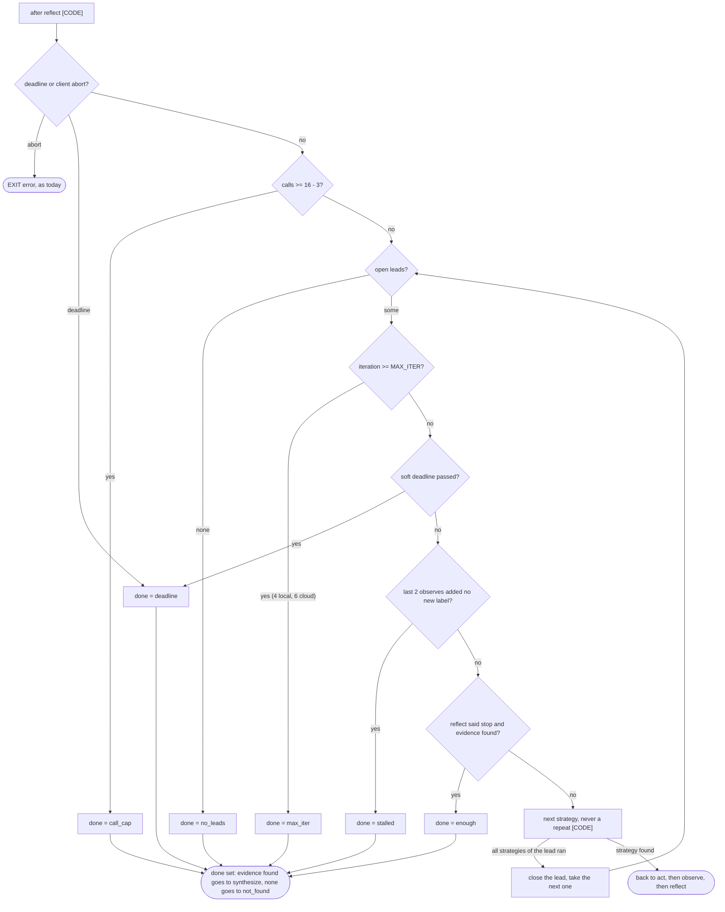

#### 11.9.7 Grounding

1. **Only labelled evidence can be cited.** Only `observe` adds evidence. Each item gets a label S1..Sn from the `SourceMap` that `runTool` fills (`S/lib/chat/types.ts`, section 6.1). `synthesize` sees the evidence list and nothing else. A lead text is a question for the model, never a fact.
2. **`reflect` output is never shown and never cited.** `next` and `query` go to `act` only. The `query` text is a search text. It cannot become a source.
3. **`cite_check` is the last node before the end.** The only edge from `synthesize` goes to `cite_check`. The edge to the end comes from `cite_check` and from `not_found` only. A test on the compiled graph checks this (build step): no path from the start reaches the end without `cite_check` or `not_found`.
4. **The check is unchanged.** Every sentence needs a cite to a label in the map. Names, numbers and dates in a sentence must be in the cited source (`checkAnswer`). On the last attempt of a broad answer a sentence with an unsupported fact is dropped (11.7 point 4).
5. **Empty evidence goes to `not_found`.** The block shows the nearest sources and the search wider offer (D16). It never shows model text.
6. **A search under the floor adds nothing.** A weak hit (best score under 0.5) is not evidence. It counts as "nothing new" for the stall rule.
7. **What the research did not find is told by code.** If the loop ended with `max_iter`, `stalled`, `call_cap` or `deadline` while a lead is still open, the answer trail line says so. The line is built from fields (`meetings`, `searches`, `done`, `openLeads`) with `t()`: "Looked in N meetings · K searches · not found: ...". It is not model text. It needs no cite. The details (each search, each round, the stop reason) go under "How I found this". Approved (Q20).

#### 11.9.8 Clarify, streaming and the checkpointer

**Clarify.** Today clarify ends the turn with a `clarify` block and the chip posts the next question (11.8 A; `S/lib/chat/pipeline.ts:314-330`). DECISION: this stays. D21 does not use `interrupt()`. Reasons:

1. A chip click is already a normal new question with the clarify block in the history. It works and it is measured (27 items, 11.8).
2. `interrupt()` needs the same graph thread in two HTTP requests. The run row of a turn (`llm_runs`) closes at the end of the turn (`S/lib/chat/llm.ts:193`), and the checkpoint tables have a foreign key to it (`S/lib/schema.ts:1097-1109`). A paused turn would keep a run open, keep the `running` flag of the route (`S/routes/chat.ts`) and need a resume route.
3. The docs list pitfalls: the node runs again from its start on resume, `interrupt()` must not sit in a bare try/catch, and a `while` loop with `interrupt` in one node is wrong (https://docs.langchain.com/oss/javascript/langgraph/interrupts).
4. D21 needs no pause. Only `scope` can ask, and it asks before any other work.

The research mode never asks in the middle of the loop. A question that is vague goes through the clarify rules first. A later use of `interrupt()` (for example "this needs about 30 seconds, go on?") is not built. Approved by the owner, 2026-11-02 (Q22).

**Streaming of step text.** Each of `act`, `observe` and `reflect` calls `config.writer({ stage, tool, leadIndex, leads, iteration, maxIter })`. The runner reads the graph with `streamMode: "custom"` and calls `input.onProgress` (`S/lib/chat/pipeline.ts:269,407,762`). The route keeps the last value (`S/routes/chat.ts:59,188`) and the client polls it every second (11.8 C.4). The doc for the mode is https://docs.langchain.com/oss/javascript/langgraph/streaming. The wire change is `ChatProgress` (`V/chat.ts:269-274`): a new stage `researching` with the optional fields `iteration`, `max_iter`, `lead_index` and `leads`. The renderer writes the text with `t()` ("Looking for: reason 2 of 3, round 2 of 4"). The server sends no English text. DECISION: no token streaming of the answer in v1. `callStructured` calls `generateText`, not a streaming call (`S/lib/llm/gateway.ts:1096-1099`), and the answer must pass `cite_check` before the user sees it. UNKNOWN: a transport that pushes the progress (SSE) is not needed at a poll of one second; it is not proposed.

**Checkpointer.** `NodeSqliteSaver` (`S/lib/llm/workflow/checkpoint-saver.ts`), compiled as in `S/lib/meetings/workflow/graph.ts:133`. The thread id is the run id of the turn (`turnId`), because `llm_checkpoints.thread_id` has a foreign key to `llm_runs(id)` (`S/lib/schema.ts:1097-1109`) and `createChatLlm` makes that run (`S/lib/chat/llm.ts:191`). The uses: (a) a crashed turn can be read back for debugging; (b) `getState` for the `GraphRecursionError` path; (c) the same pattern as Enhance, so the checkpoint validation package (`@langchain/langgraph-checkpoint-validation`, dev dependency) already covers the saver. Cost: the state holds at most 40 evidence items of 640 characters, about 25 KB for each super-step. The build step measures the write time. Bar (approved): checkpoint writes add at most 10 ms p95 for each node. Retention (approved, Q23): the checkpoints of a succeeded turn are deleted at the end (`recorder.deleteCheckpoints`, `S/lib/llm/recorder.ts:598`), because the answer is stored in `chat_messages`. The checkpoints of a failed turn stay until the run is removed. The evidence is meeting text, so it must not outlive its meeting: the foreign key `ON DELETE CASCADE` follows the run (`S/lib/schema.ts:1098`). UNKNOWN: whether a deleted meeting removes the chat runs that read it. The build step checks this and writes the answer here.

#### 11.9.9 When research mode runs, and the setting

DECISION: code decides, with no model call (as the broad questions of 11.7 and the clarify rules of 11.8 do).

`researchTrigger(question, history, scope, settings)` returns `research` when all of these hold:

1. The setting `chat_research` is on.
2. The question is not a write question, not a count of mentions, and not a broad question (`asksSynthesis`, `asksOverview`: those keep the synthesis path of 11.7 and 11.8 B).
3. One of these is true:
   a. The question has a digging word. The list is in 7 languages like `LIST_RE`. Examples (English): why, because, reason, blocked, blocker, "still open", "open items", unresolved, outstanding, pending, evolve, "changed between", "what changed", "who pushed", "who argued", "who objected". Examples (Portuguese): "por que", motivo, bloque, "em aberto", pendente, "sem resolver", "o que mudou", "quem defendeu". The final list is a build task. It is measured (below).
   b. The question is a dependent follow-up (`isDependentFollowUp`, `S/lib/chat/plan.ts:249`) that asks for a reason, and the last answer had a list block or two or more cites.
4. The question is not a single fact. A "who", "when", "how much" or "how many" question without a digging word stays fast.

Everything else is fast mode. A simple fact finishes in round 1 with the same calls as today (the controls of the dig set measure this: 11.9.13).

Two measures need no model, so the build step reports them like the false-clarify rate of 11.8: `trigger.recall` (digging turns of the dig set that the detector sends to research) and `trigger.false` (gold questions, controls and the 42 broad turns that it sends to research). Bars (approved): recall at least 90%, false at most 5% on the 190 gold questions and 0 on the controls.

**The setting.** `chat_research` in the Ask settings (D7, section 2.9). Values `true` and `false`. The reading code is `!== "false"`, like `chat_clarify` (`S/lib/chat/settings.ts`). The Ask page shows one switch "Research mode" with a help line. Default (approved, Q17): **on**. Reason: the owner asked for the behaviour, the trigger is code and narrow, and the fast path is unchanged. The cost is time: a research turn is slower (11.9.10). The owner approved the default on 2026-11-02. The number of loop turns is NOT a setting. The owner decided that code owns the stop rules, and a user knob would move them (D7 said budgets are settings; D21 is the one exception, because these caps protect the model from a loop).

#### 11.9.10 Latency and call budgets

Fast mode keeps the budget of 2.2. Research mode:

| Item | Local model (E2B, E4B) | Cloud model |
|---|---|---|
| `MAX_ITER` (loop turns) | 4 | 6 |
| Leads | at most 3 | at most 5 |
| `act` steps for one lead | at most 3 | at most 3 |
| LLM calls: `plan` | 0 (1 if arm R1 is on) | 0 or 1 |
| LLM calls: `reflect` | at most 4 | at most 6 |
| LLM calls: `synthesize` | 1 to 3 | 1 to 3 |
| Worst case without map-reduce | 1 + 4 + 3 = 8 | 1 + 6 + 3 = 10 |
| Typical (3 loop turns) | 3 + 1 = 4 | 5 |
| Call cap | 16, unchanged. A loop turn needs `calls <= 13` (rule 2). | same |
| Tool calls | at most 3 for each loop turn | same |
| Soft deadline for a new loop turn | 50% of the turn deadline (30 s at 60 s) | same |
| Turn deadline | the setting (default 60 s) | same |

The map-reduce of 11.8 B (up to 10 calls) may run inside `synthesize` only while `calls + needed answer calls <= 16`. Else the code cut stays, as today.

Latency (ASSUMPTION, to be measured in the build step): one loop turn is one search (a few hundred ms warm, with the reranker) plus one `reflect` call (about the router call of P0: 200 to 375 ms p50 on E2B, `specs/meeting-chat-agent-p0-report.md:285-291`), so about 1 s. Four loop turns plus the answer should give 6 to 8 s p50. The baseline of 11.9.13 is the number to beat for quality. The approved latency bars are in 11.9.14.

#### 11.9.11 Migration from `pipeline.ts` to the graph

Rule (owner): keep every existing behaviour and pass every existing bar. The old code is removed only when the graph passes. There is no long-lived second implementation.

| Step | What | Exit check (all by command) |
|---|---|---|
| M1 | Cut `runChatTurn` into functions that the nodes can call (route, tools, block answer, `answerStage`, `runSynthesis`, not-found). No behaviour change. | `pnpm chat-eval:test` and the server tests pass. `pnpm chat-eval p1 --only e2e,threads,widen,broad,clarify,bars` on Mac E2B gives the same rows as `main` (temperature 0, spec 8.1 rule 5): per question the same tool, cites and answer text. A diff of the two result files shows 0 changed rows. |
| M2 | Build the graph with mode `fast` only: `scope`, `plan`, `act`, `observe`, `reflect` (code), `blocks`, `synthesize`, `cite_check`, `not_found`. `runChatTurn` calls the graph and keeps its signature and `TurnResult`. The route does not change. | The same diff: 0 changed rows on the Mac E2B run of the same parts. The bars of 8.7 and 8.7c hold. The gold hash stays `1e41bd5cea578222`. The test of 11.9.7 point 3 passes. Checkpoint write time is measured. |
| M3 | Add research mode: the trigger, `chatPlan` (arm R1, off by default), `chatReflect`, the closed strategies, the stop rules, the progress stage, the trail line, the setting. | The dig part (11.9.12) meets the bars of 11.9.14 on Mac E2B and E4B. The controls do not move. `trigger.false` is within the bar. The old parts still give 0 changed rows with `chat_research` off, and no regression on the bars with it on. |
| M4 | Delete the old loop code that the graph replaced. | `pnpm knip` and Biome clean. The M2 diff is 0 on the final commit. |

Between steps the pipeline stays shippable. Each step is its own PR (branch lifecycle). The coordinator merges.

#### 11.9.12 The eval: the dig part

Command: `pnpm chat-eval p1 --only dig`. It is not in the default parts and not in the gold hash (like `broad` and `clarify`). The code is `scripts/chat-eval/dig-corpus.mts` (data), `p1-dig.mts` (questions, keys, scoring), `dig.test.mts` (unit tests) and `partDig` in `p1-run.mts`. MLflow run name `p1-dig` in the experiment `openstyle-lab-chat-agent-p1`. `CHAT_EVAL_IDS=dg01,dg07` picks single questions. The base corpus, the gold set and both hashes are unchanged: the extra data is loaded on top of the base corpus inside this part (ids start with `dg-`).

**Data (fictional, built by code).** Three projects with 13 meetings:

- Orchard Platform (EN, 5 meetings). The hosting contract "Kestrel" stays unsigned for three reasons told in three meetings (a data region rule, a 36 month term with no exit clause, a budget freeze). A sign-in decision changes twice (Aldoro, then Brumel, then both). An API freeze is pushed by one person (14 incidents, an audit) and doubted by another (two endpoints missing). The release budget moves from 80000 to 95000. One open question stays open (hardware keys for contractors). One action item is done and must not appear in a list of open items.
- Projeto Lagoa (PT, 4 meetings). An app is not published for three reasons (an icon with a beta badge, a signing certificate that did not arrive, a privacy review). A launch date moves twice (1 December, 15 December, 15 January). One person pushes to postpone (battery drain, a map that freezes on old devices). The choice of a push provider stays open (a 40 s delay, a cost that nobody approved).
- Cedar Rollout (EN, 4 meetings). Pilot kits are not ordered (a supplier lead time, a customs hold, a safety check that waits for 10 kits). The pilot shrinks from 4 sites and 40 kits to 2 sites and 24 kits (two sites dropped for two reasons). A fourth blocker of the Kestrel contract (a service level of 99.5 percent) is told here, so "what blocked Kestrel" at scope Everything needs 4 meetings of 2 projects.

Most reasons are in the transcript only. The test `dig set: the reasons are spread over 2 to 4 meetings` proves that no single meeting holds all the reasons of a "why" key. The test `every must-mention group is in the data` proves that each key is supported by the named meetings.

**Questions.** 32 questions, 48 turns: 28 digging questions (44 turns: 35 digging turns and 9 setup turns of the kind `fact`) and 4 controls (a simple fact). 16 of the 28 are two-turn threads ("what are the open items?" then "why are they still open?"; "who owns it?" then "what blocked it?"; "when is the launch?" then "how did that date change?"). The kinds: `list` (what is open), `why`, `blocker`, `evolve` (how did decision Y change across the meetings), `pushed` (who pushed for Z and why), `changed` (what changed between the first and the last meeting), `unresolved` (is anything still open about W; one of them is resolved on purpose), `fact` (the first turn of a thread, and the controls). Scopes: meeting, folder and Everything. Languages: EN and PT. The real answer of a turn is the history of the next turn.

**Keys (code, no judge).** A turn passes when all of these hold:

1. **Coverage.** The share of the must-mention groups (reasons and facts, each with spelling alternatives) that the answer names is at least `minCov` (0.5 to 1, set for each turn; "2 of 3" uses 2/3).
2. **Cross-meeting recall.** The share of the meetings that hold a reason and that the answer cites is at least 0.5, for a key that names two or more meetings. A list item cite counts.
3. **Cites.** No invalid cite (`checkCites`) and no text block without a cite.
4. **No repeat.** The answer is not a repeat of an earlier answer of the thread (`isRepeat`).
5. **Length.** A digging answer has 1 to 9 text blocks and 60 to 1800 characters. A list answer is any list or text. A fact answer has at most 500 characters. (v2; v3 in PR #414 allows 15 blocks and 3000 characters.)
6. **Not a refusal.** Not `not_found`, not `clarify`.
7. **A list of open items names no done item** (`mustNot`).

The row also records the LLM calls, the tool calls, the first tool and the latency of the turn. The headline numbers are for the digging turns (`fact` setup turns and controls are reported apart). The result JSON holds the rows with the pipeline trace (`~/.openstyle-eval/chat-p1/p1-<time>.json`).

**Real data.** `pnpm chat-eval real --db <copy.db> --dig` runs 6 generic digging questions on the 3 folders with the most meetings of a read-only copy of the owner's DB: for two folders "What are the open items in this folder?" then "Why are they still open?"; for the third "How did the decisions in this folder change over the meetings?" then "Who pushed for the biggest change, and why?". The folders are named A, B and C in the output. Texts go only to `~/Library/Application Support/Openstyle-eval/chat-real/`. The run refuses to start when the chat model is not the local MLX model. No name is in the repo.

#### 11.9.13 Baseline: today's Ask on the dig part

Measured on `main` at `ad98f171` plus the eval code of this branch, on 2026-11-02, with the Auto path (temperature 0, thinking off), `chat_clarify` on, `chat_native_tools` on, `rounds` 3. One run for each cell is a measure (spec 8.1 rule 5) for the Mac MLX arms. The desktop llama.cpp arm is not fully repeatable (skill `chat-eval`). Concurrency is 2 threads (the harness limit). The Mac GPU lock was taken by the harness for each run. MLflow experiment `openstyle-lab-chat-agent-p1`, run name `p1-dig`. Each run was read back (`READ BACK OK`, 53 metrics). The run ids are in 11.9.13.4.

##### 11.9.13.1 Headline

| Metric | Mac MLX E2B | Mac MLX E4B | Desktop llama.cpp E4B |
|---|---|---|---|
| Digging turns | 35 | 35 | 35 |
| Digging pass | 22.9% | 22.9% | 25.7% |
| Digging pass, second turns | 25.0% | 18.8% | 18.8% |
| Coverage of reasons | 23.8% | 30.0% | 31.0% |
| Cross-meeting recall (multi-meeting keys) | 31.9% | 38.3% | 41.7% |
| Not found | 40.0% | 31.4% | 28.6% |
| Invalid or missing cites | 0 | 0 | 0 |
| Repeated answers | 0 | 0 | 0 |
| Length in range | 57.1% | 60.0% | 62.9% |
| LLM calls per digging turn (mean / p95) | 1.6 / 2 | 1.5 / 2 | 1.5 / 2 |
| Tool calls per digging turn (mean) | 1.5 | 1.5 | 1.5 |
| Latency per digging turn p50 / p95 | 1186 / 2832 ms | 1552 / 3326 ms | 646 / 2316 ms |
| Pass EN / PT | 33.3% / 0.0% | 25.0% / 18.2% | 29.2% / 18.2% |
| Pass meeting / folder / Everything | 0.0% / 31.6% / 20.0% | 0.0% / 31.6% / 20.0% | 0.0% / 31.6% / 30.0% |
| Setup fact turns pass (n=9) | 77.8% | 88.9% | 77.8% |
| Controls pass (4) | 100.0% | 100.0% | 100.0% |
| Controls LLM calls (mean) | 2.0 | 2.0 | 2.0 |
| Controls tool calls (mean) | 1.5 | 1.8 | 1.8 |
| Controls latency p95 | 1182 ms | 2366 ms | 935 ms |

##### 11.9.13.2 By kind of question

| Kind (turns) | Mac MLX E2B | Mac MLX E4B | Desktop llama.cpp E4B |
|---|---|---|---|
| list (7) | 0/7 pass, cov 0.0% | 2/7 pass, cov 28.6% | 2/7 pass, cov 28.6% |
| why (7) | 0/7 pass, cov 0.0% | 0/7 pass, cov 0.0% | 0/7 pass, cov 0.0% |
| blocker (4) | 1/4 pass, cov 33.3% | 0/4 pass, cov 8.3% | 1/4 pass, cov 33.3% |
| evolve (5) | 3/5 pass, cov 60.0% | 2/5 pass, cov 75.0% | 2/5 pass, cov 75.0% |
| pushed (5) | 3/5 pass, cov 70.0% | 3/5 pass, cov 66.7% | 3/5 pass, cov 53.3% |
| changed (3) | 1/3 pass, cov 16.7% | 1/3 pass, cov 25.0% | 1/3 pass, cov 25.0% |
| unresolved (4) | 0/4 pass, cov 0.0% | 0/4 pass, cov 8.3% | 0/4 pass, cov 8.3% |

##### 11.9.13.3 What fails, and why (facts from the rows and traces)

The table covers the 35 digging turns of the three runs. The numbered facts are from the two Mac MLX runs, unless the text names another run. A turn counts once. "Not found" is the `not_found` block. "Thin" is an answer with fewer than half of the reasons.

Failure modes of digging turns (a turn counts once; order: not found, thin coverage, low recall, other):

| Mode | Mac MLX E2B | Mac MLX E4B | Desktop llama.cpp E4B |
|---|---|---|---|
| pass | 8 | 8 | 9 |
| not_found | 14 | 11 | 10 |
| thin | 12 | 12 | 13 |
| other | 1 | 4 | 3 |


What the rows and traces show (all VERIFIED in the result files):

1. **Nothing digs.** 62.9% of the digging turns (22 of 35) made one tool call or none, on both models. The mean is 1.5 tool calls and 1.5 to 1.6 LLM calls for each turn. Of the 27 failing turns, 16 made one tool call or fewer, on both models. The tool loop of 11.9.1 point 1 explains it: the first search that returns text ends the loop.
2. **One search reaches many meetings only when the question has a topic word.** The keys name 2 to 4 meetings. The answers cite 1.9 (E2B) and 2.1 (E4B) meetings on average. When the follow-up query holds a rare word, one search with k = 8 does reach the meetings. Example (fictional data): "Who owns the Kestrel contract?" then "What has blocked it so far?". The search runs with the words of both questions, finds the lines of three meetings, and E2B names all three reasons (3 of 3, 3 meetings cited). E4B gets the same sources and writes one sentence with no reason: "Several issues have blocked the signing of the Kestrel contract." (0 of 3). The same happens for the question at scope Everything ("What blocked it?" after "What is the Kestrel hosting contract?"): E4B writes "Several issues prevented the signing of the Kestrel contract." and names 0 of 4 reasons. E2B writes an answer that the repeat guard rejects as a repeat of the first answer, so the turn ends `not_found`. When the question holds no topic word ("these", "it", "this meeting"), the search has no anchor and nothing is found (point 4 and 5). The loop cannot rely on the first query. It has no second step that reads the other meetings.
3. **"What are the open items" fails in English.** The 4 English `list` turns all go through `search_chunks` (the list tool is replaced, `S/lib/chat/pipeline.ts:1062-1076`): 0 pass, 3 are `not_found`. The trace of the first one (E2B): `route:native:list_decisions_questions > plan:list tool replaced by search_chunks > tool:search_chunks(top=0.176) > tool:query rewrite > tool:search_chunks(top=0.073)`. In Portuguese the question "Quais são os itens em aberto" has the list word "quais" and reaches a list tool: E4B calls `list_action_items` and 2 of 3 PT list turns pass (E2B calls `list_decisions_questions`, which returns only open questions, 0 of 3).
4. **The second turn loses the thread.** The second turn of 16 two-turn threads is `not_found` in 7 (E2B) and 5 (E4B) cases. The follow-up "Why are these still open?" searches with the words of the question. The best score is 0.06. The items of the first answer are not used. Pass on the second turn: 25.0% (E2B), 18.8% (E4B). The `why` kind passes 0 of 7 on both models.
5. **A question with no topic word fails at meeting scope.** All 6 digging turns at meeting scope fail (0%). Example: "What is still open in this meeting?" has a best score of 0.067. "What was decided in this meeting and why?" has 0.020. The not-found floor (0.5) then ends the turn. The reranker score of a generic question is low even when the meeting holds the answer.
6. **When it answers, it is safe.** 0 invalid cites, 0 uncited blocks and 0 repeats on both models. The failures are `not_found` (14 and 11 turns), thin answers (12 and 12) and other (1 and 4). The cite check works. The reach is the problem, not the grounding.
7. **A fix is not only a bigger model.** E4B has the same pass rate as E2B (22.9%) and a little more coverage (30.0% against 23.8%). It is slower (p50 1.6 s against 1.2 s). On both, 62.9% of the digging turns stop after one search.
8. **Language.** Pass in PT is 0.0% (E2B) and 18.2% (E4B), in EN 33.3% and 25.0%. There are 11 PT turns and 24 EN turns, so one turn is 9 points in PT. The gap is not proven to be more than noise for E4B. For E2B the PT turns show two causes: the PT list question reached `list_decisions_questions`, which returns only open questions, and a PT "who pushed" question at scope Everything named the wrong speaker ("Greta" for "Nadia").
9. **Cost today.** A digging turn costs 1.5 to 1.6 LLM calls and takes 1.2 to 1.6 s p50 (2.8 to 3.3 s p95). A research turn of 3 to 4 loop turns will cost 3 to 5 times that. The controls (simple facts) cost 2.0 LLM calls and 1.5 to 1.8 tool calls, with p95 1.2 s (E2B) and 2.4 s (E4B). They must not move.
10. **The desktop llama.cpp E4B run agrees with the Mac E4B run.** Pass 25.7%, coverage 31.0%, cross-meeting recall 41.7%, not found 28.6%, 0 invalid cites, 0 repeats; 1.5 LLM calls and 1.5 tool calls for each digging turn; latency p50 0.65 s, p95 2.3 s. The shape is the same on two backends, so it is a property of the pipeline and not of the MLX worker.


##### 11.9.13.4 Runs

- Mac MLX E2B MLflow run `af64efadc8b04bf98438067f23e2cd82`, result file `~/.openstyle-eval/chat-p1/p1-1793630751954.json`
- Mac MLX E4B MLflow run `e5f3931362bb4a038af574564b3b87bc`, result file `~/.openstyle-eval/chat-p1/p1-1793630790566.json`
- Desktop llama.cpp E4B MLflow run `ade9b1bacc7c4fe693f547c4285a5aa1`, result file `~/.openstyle-eval/chat-p1/p1-1793631890782.json`

##### 11.9.13.5 Real data (owner folders, read-only copy)

The run used a read-only copy of the owner DB (`sqlite3 ... ?mode=ro ... .backup`). The copy was deleted after the run. The chat model was Gemma 4 E2B (the local MLX model; the run refuses any other provider). 3 folders (A with 34 meetings, B with 14, C with 7). 6 questions, in 3 threads of 2. A turn "passes" here by the generic rule of `real` (not found: no; at least 2 sentences; at least 1 cite; no repeat). This rule checks the shape, not the content.

| Folder | Turn | Question (generic) | Sentences | Cites | Meetings cited | Not found | LLM calls | Tool calls | ms | Pass |
|---|---|---|---|---|---|---|---|---|---|---|
| A (34) | 1 | What are the open items in this folder? | 6 | 3 | 3 | no | 3 | 1 | 8388 | yes |
| A (34) | 2 | Why are they still open? | 0 | 0 | 0 | yes | 2 | 1 | 1345 | no |
| B (14) | 1 | What are the open items in this folder? | 0 | 0 | 0 | yes | 3 | 1 | 1252 | no |
| B (14) | 2 | Why are they still open? | 2 | 1 | 1 | no | 1 | 1 | 1219 | yes |
| C (7) | 1 | How did the decisions in this folder change over the meetings? | 0 | 0 | 0 | yes | 2 | 2 | 792 | no |
| C (7) | 2 | Who pushed for the biggest change, and why? | 0 | 0 | 0 | yes | 2 | 3 | 929 | no |

Result: 2 of 6 turns pass the shape rule, 4 of 6 are `not_found`. The two passing turns read 1 tool result each and cite 3 and 1 meetings of 34 and 14. The shape of the traces is the same as on the fictional data: the "open items" question becomes a `search_chunks` call, one search runs, and the answer is built from it. The answer texts are in the private file `~/Library/Application Support/Openstyle-eval/chat-real/dig-baseline-<time>.json`. The owner receives them in the report of this step, not in the repo.

#### 11.9.14 Pass bars for D21 (APPROVED by the owner, 2026-11-02)

The owner approved the bars as proposed, with one change: the research latency on E2B is looser (D14: p50 at most 15 s, p95 at most 30 s). Simple facts stay at the baseline plus 20% p95 (D12). They come from the baseline: each is a clear step above it, and none is above what a bounded loop can reach with E2B (D9: E2B is the floor). The bars are measured on the dig part (`pnpm chat-eval p1 --only dig`) at the defaults, with `chat_research` on. They are measured on Mac E2B and Mac E4B; the desktop run is a cross-check.

| # | Bar | Baseline E2B / E4B | Bar (APPROVED) |
|---|---|---|---|
| D1 | Digging pass (35 turns) | 22.9% / 22.9% | E2B at least 50%, E4B at least 60% |
| D2 | Coverage of the must-mention reasons | 23.8% / 30.0% | at least 65% (E2B), 75% (E4B) |
| D3 | Cross-meeting recall (keys with 2 or more meetings) | 31.9% / 38.3% | at least 70% |
| D4 | `not_found` on digging turns (all are answerable) | 40.0% / 31.4% | at most 10% |
| D5 | Invalid cites and uncited text blocks | 0 / 0 | 0 |
| D6 | Repeated answers in a thread | 0 / 0 | 0 |
| D7 | Answer length in range | 57.1% / 60.0% | at least 90% |
| D8 | Pass on the second turn of a thread ("why are they open") | 25.0% / 18.8% | at least 50% (E2B), 60% (E4B) |
| D9 | PT pass not below EN pass by more than 10 points | PT 0.0% / 18.2%, EN 33.3% / 25.0% | within 10 points |
| D10 | Controls (4 simple facts): pass | 100% / 100% | 100% |
| D11 | Controls: LLM calls (mean), tool calls (mean) | 2.0, 1.5 / 2.0, 1.8 | not above the baseline (round 1) |
| D12 | Controls: latency p95 | 1.2 s / 2.4 s | at most the baseline plus 20% |
| D13 | Digging turn: LLM calls | mean 1.6, p95 2 / 1.5, 2 | mean at most 6, p95 at most 9, never above 16 |
| D14 | Digging turn: latency, warm, Mac E2B | p50 1.2 s, p95 2.8 s | p50 at most 15 s, p95 at most 30 s (the owner loosened the proposal of 8 s and 15 s) |
| D15 | Trigger recall on the dig turns / false trigger on the 190 gold questions and controls | not built | at least 90% / at most 5% and 0 |
| D16 | Real data: the 6 questions of `real --dig` | 2 of 6 pass the shape rule | at least 4 of 6 pass the shape rule (a count; the owner reads the texts) |
| D17 | Checkpoint write time per node | not built | at most 10 ms p95 |
| D18 | Every existing bar of 8.7, 8.7c, the broad part, the threads part and the clarify part, with `chat_research` on and off | see 8.7 and 11.6 to 11.8 | no regression: 0 changed rows with the setting off (M2 and M3 exit checks) |

Why these numbers (reasons, not measurements): D1 and D2 ask for about two times the baseline coverage. A loop that reads 3 to 4 meetings instead of 1 can reach the reasons that sit in the other meetings (the baseline cites 1.9 to 2.1 meetings for keys that name 2 to 4). D4 follows from the data: every digging question has an answer in the corpus, so a `not_found` is a miss. D13 follows from the budget of 11.9.10 (typical 4 calls, worst case 8). D14 is an ASSUMPTION about the cost of 3 to 4 loop turns; the build step replaces it with a measure.

#### 11.9.15 Risks and unknowns

| Risk or unknown | What the evidence says | Handling |
|---|---|---|
| E2B may judge "enough" too early, or never | UNKNOWN. Reflect accuracy on E2B is not measured. No LangChain page read on 2026-11-02 gives tuning advice for local models. | Code owns the stop rules. `reflect` has a closed output and a safe default (`stop`). Arm R1 and a "reflect off" arm (code-only strategy order) are in the build eval. |
| A loop makes a small model slower than a user will accept | The baseline turn is 1.2 s p50 on E2B. A loop of 4 turns is an ASSUMPTION of 6 to 8 s. | Soft deadline (50%), `MAX_ITER` 4, the setting to turn it off, fast path unchanged for simple facts. approved, 2026-11-02. |
| The detector sends a simple fact to research | UNKNOWN until built. | Bars D15 and D11. The detector has a fact guard. |
| A wrong stall rule ends a hard question too early | Stall needs 2 empty loop turns. A strategy that finds nothing new for 2 turns means the sources are read. | The trail line (11.9.7 point 7) tells the user what was not found. |
| Meeting text in a prompt tells the model what to do (prompt injection) | The agentic RAG grader prompt says to treat documents as data (https://docs.langchain.com/oss/javascript/langgraph/agentic-rag). | The same line in `plan`, `reflect` and `synthesize`. `reflect` output never reaches the user. `cite_check` checks every sentence. |
| Structured output fails | The tool-strategy docs return schema errors to the model for a retry (https://docs.langchain.com/oss/javascript/langchain/structured-output). Our gateway has one transport retry (`S/lib/llm/call-unit.ts:16-23`). | No retry in `reflect`: an error means `stop`. `synthesize` has 3 attempts as today. |
| The worker returns 400 for `tools` and `response_format` in one request | VERIFIED: `W:718,863` (`scripts/mlx_asr_server.py`) answers `tools` with `response_format` with a 400. | One node, one mode. Research mode has no tool request at all. |
| `createReactAgent` is deprecated | https://docs.langchain.com/oss/javascript/migrate/langgraph-v1 | D21 uses `StateGraph`, as Enhance does. |
| LangGraph docs give no advice for small local models | UNKNOWN (no source found in the LangChain pages read on 2026-11-02). | The design follows our own P0 data and the closed-choice rule (D8, D11). |
| Checkpoint rows hold meeting text | The state holds evidence snippets. | Delete on success; cascade with the run (11.9.8). A check that a deleted meeting removes the runs that read it is a build task. UNKNOWN today. |
| The fast path regresses during the migration | The Mac MLX arm is deterministic at temperature 0. | The M1 and M2 exit check is a row-by-row diff with 0 changed rows. |
| The dig data is small (13 meetings, 28 digging questions) | Fictional data is a lab, not the real world. | The real-data run (`real --dig`) is the cross-check. The owner reads its texts. A held-out seed for the dig data is not built (OPEN, low priority). |

#### 11.9.16 As built (PR #412, 2026-11-02)

**Files.** The graph is in `S/lib/chat/research/` (`graph.ts` nodes and edges, `state.ts`, `research.ts` leads, strategies and stop rules, `trigger.ts`, `run.ts` runner). The stage code of the old `runChatTurn` is `S/lib/chat/turn.ts` (class `Turn`, one method for each stage). `S/lib/chat/pipeline.ts` only starts the graph. The setting is `chat_research` (`V/settings-keys.ts`), the new step id is `chatReflect`, the wire change is `ChatProgress` (`researching`) and `ChatTrace.research` (`V/chat.ts`). The renderer writes the step text and the trail line from fields (`R/pages/meetings/ask-model.ts`, `ask-blocks.tsx`, key `meetings.ask.trailResearch` in all 8 locale files).

**Migration.** M1 (stage methods) and M2 (fast mode in the graph) and M3 (research mode) have an exit check each, by command, on Mac E2B against `main` at `8c3ce745` (one result file for each run, temperature 0). A row is the result of one question or one turn. The comparison drops the time fields.

| Step | gold: e2e (190), threads (90), widen (24), broad (42), clarify (27) | P2 set: router (277), e2e (53), threads (37), widen (24) |
|---|---|---|
| M1 | 0 changed rows | 0 changed rows |
| M2 | 0 changed rows | 0 changed rows |
| M3 with `chat_research` off | 0 changed rows | 0 changed rows |
| M3 with `chat_research` on | 3 rows of e2e (q057 to q059, the "which questions are still open" list: same answer and cites, other route), 50 turns of threads (the "why" follow-ups go through research), 0 rows of the others | the bars are equal to `main` (table below) |

M4: the old loop code is gone since M2 (`runChatTurn` is the graph start). `pnpm knip` and `pnpm biome check .` exit 0.

**What differs from the design above (all by the numbers of this section).**

1. **Rule 7 is stricter for several leads.** `reflect` `stop` ends the loop only when no other open lead lacks evidence. Else the lead closes (as `next_lead`) and the next lead runs. A lead with no evidence does not close because the model says `stop` or `next_lead`: its other strategies run. Reason: in the first Mac E2B dig run of the build, all 7 "why" turns made 1 tool call and 2 LLM calls (E2B said `stop` after the first search), so 2 of 3 leads were never read. With the rule the 3-lead turns make 3 searches.
2. **The model's `next` word picks the strategy only when the lead has evidence** (or `rephrase` with search words). With no evidence the code order runs, and `summary` comes before `other_meetings`. Reason: a question with no topic word (`what changed between the first and the last meeting`) scores under the floor, and `other_meetings` repeated the same empty search. Items 2 and 6 together: not found on 4 of 35 digging turns before the two changes (Mac E2B, dg10 turn 2, dg14, dg17 turn 2, dg28), 0 of 35 after.
3. **`summary` reads up to 3 meetings in one `act`**, the first and the last meeting of the scope when nothing else points at a meeting (at most 3 tool calls for each loop turn, 11.9.10). A lead that has no call left closes with no loop turn.
4. **`list_open` is also a strategy of a digging question about open points** ("is anything still unresolved about X") at a meeting or folder scope, after the first search. Only a first question that asks for the open items ends in a list (`blocks` node, the lists of both list tools in one answer).
5. **Leads from a list are ranked** by the words that they share with the questions of the thread. A list at Everything holds the items of every project, and the first 3 items are not the right ones.
6. **A research follow-up treats the earlier answer as told.** The facts of that answer leave the new answer (`dropToldSentences`), so "what blocked it?" does not repeat the answer to "what is the contract?" (the repeat guard made it not found).
7. **Early exits are edges after `plan`.** A write question and a count of mentions end after the same model calls as before the build (the route call can give the propose tool that the eval reads), so the rows stay equal. `END` is reached from `scope`, `plan`, `blocks`, `cite_check` and `not_found` only. The test `tests/chat-graph.test.ts` checks that no path from `synthesize` reaches the end without `cite_check` or `not_found`.
8. **The trigger has one more rule.** A question that starts with a list command ("List all open action items for Ana.") keeps the list path. Without it 11 of the 190 gold questions (5.8%) went to research. With it 3 (1.6%).
9. **`recursionLimit`** is `3 x MAX_ITER + 12` for a research turn and `3 x rounds + 80` for a fast turn (a map-reduce has up to 4 answer slices).
10. **Arm R1 (`chatPlan`) is not built.** It stays OFF as the design says. The "reflect off" arm is `CHAT_EVAL_REFLECT=off`.

**Answers to the UNKNOWNs of 11.9.8.** (a) Checkpoint write time: p95 1.4 to 1.5 ms for each write on Mac E2B (bar D17: 10 ms). (b) Does a deleted meeting remove the chat runs that read it? No. A chat run has `meeting_id` NULL (`S/lib/llm/recorder.ts`, `startRun`), so the cascade of `llm_runs.meeting_id` does not reach it, and nothing links it to the thread. A deleted meeting removes its thread and messages (`chat_threads` FK). The checkpoints of a FAILED turn, and the call records of every chat turn (`llm_calls.messages_json`, as before this build), stay. A succeeded turn leaves no checkpoint (`tests/chat-research-pipeline.test.ts`). OPEN: the failed-turn rows should leave with their thread. This needs a schema step and is not part of this build.

**Eval commands.** `pnpm chat-eval p1 --only dig` (bars `dig.*` in the `bars` part); `CHAT_EVAL_RESEARCH=off` for the old path; `CHAT_EVAL_REFLECT=off` for the loop with no reflect call; `CHAT_EVAL_THREADS_PAR=1` for one thread (latency without the other thread on the GPU). Skill: `.claude/skills/chat-eval/SKILL.md`.

**Results.** Mac MLX (Gemma 4 E2B and E4B), temperature 0, thinking off, `chat_research` on, one run for each cell (a measure, 8.1 rule 5), GPU lock taken by the harness, every run read back from MLflow (experiment `openstyle-lab-chat-agent-p1`). Code: the head of PR #412. The dig part has one corpus (no seed), so the gold and the held-out seed (20271105) differ only in the other parts.

*The dig part, bars D1 to D17 (11.9.14).* Latency is from a run with one thread (`CHAT_EVAL_THREADS_PAR=1`). With the harness default of 2 threads the 4 controls share the GPU with research turns, and their p95 is 1552 ms (E2B) and 3884 ms (E4B), over the bar; alone they match `main` (below).

| # | Bar | Baseline E2B / E4B | Bar E2B | Mac E2B | Bar E4B | Mac E4B |
|---|---|---|---|---|---|---|
| D1 | digging pass | 22.9% / 22.9% | at least 50% | 77.1% | at least 60% | 82.9% |
| D2 | coverage of the reasons | 23.8% / 30.0% | at least 65% | 78.0% | at least 75% | 79.4% |
| D3 | cross-meeting recall | 31.9% / 38.3% | at least 70% | 91.2% | at least 70% | 90.7% |
| D4 | `not_found` on digging turns | 40.0% / 31.4% | at most 10% | 0.0% | at most 10% | 0.0% |
| D5 | invalid cites and uncited blocks | 0 / 0 | 0 | 0 | 0 | 0 |
| D6 | repeated answers | 0 / 0 | 0 | 0 | 0 | 0 |
| D7 | length in range | 57.1% / 60.0% | at least 90% | 100.0% | at least 90% | 100.0% |
| D8 | pass on the second turn | 25.0% / 18.8% | at least 50% | 75.0% | at least 60% | 87.5% |
| D9 | EN pass minus PT pass | 33.3 to 0.0 / 25.0 to 18.2 | at most 10 points | 6.4 points | at most 10 points | 1.5 points |
| D10 | controls pass | 100% / 100% | 100% | 100% | 100% | 100% |
| D11 | controls LLM calls, tool calls (mean) | 2.0, 1.5 / 2.0, 1.8 | at most 2.0, 1.5 | 2.0, 1.5 | at most 2.0, 1.8 | 2.0, 1.75 |
| D12 | controls latency p95 | 1182 / 2366 ms | at most 1418 ms | 1259 ms | at most 2839 ms | 1436 ms |
| D13 | LLM calls for a digging turn: mean, p95, most | 1.6, 2 / 1.5, 2 | at most 6, 9, 16 | 2.1, 4, 4 | at most 6, 9, 16 | 2.4, 4, 4 |
| D14 | digging turn latency p50, p95 | 1.2, 2.8 s / 1.6, 3.3 s | at most 15, 30 s | 2.0, 5.3 s | at most 15, 30 s | 3.7, 7.7 s |
| D15 | trigger recall; false on gold; false on controls | not built | at least 90%; at most 5%; 0 | 100%; 1.6%; 0 | same | 100%; 1.6%; 0 |
| D17 | checkpoint write time p95 | not built | at most 10 ms | 1 ms | at most 10 ms | 1 ms |

The 3 false triggers on the gold questions are q057 to q059 ("Which questions are still open in ..."). They give the same list as before (same F1). The 42 broad turns: 0 false. The held-out seed: 3 of 190 as well (no model needed).

*D12, controls alone (one thread, 4 controls, warm calls after the first).* E2B, `main` / this build: 561, 655, 519 ms / 531, 619, 502 ms. E4B: 1094, 1305, 988 ms / 1228, 1442, 1059 ms (plus 7% to 12%, inside the 20% of the bar). The first call of each run is the cold model load (about 5.7 s on E2B, both builds).

*D16, real data (11.9.12, `pnpm chat-eval real --dig`, Mac E2B, read-only copy of the owner DB, deleted after the run).* 5 of 6 turns pass the shape rule (bar: at least 4; before the build: 2 of 6). Folder A (34 meetings): the open items as a list of 50 cited items (13 meetings), then 4 sentences with 3 cites. Folder B (14 meetings): a list of 50 cited items (9 meetings), then 4 sentences. Folder C (7 meetings): the decisions, 4 sentences with 3 cites; the second turn ("who pushed for the biggest change, and why") is `not_found` after the repeat guard (the answer repeated the first one). The texts are private (`~/Library/Application Support/Openstyle-eval/chat-real/`).

*Existing bars with research on (D18).* The same invocation as the baseline of 8.7c, with the dig bars NOT RUN. Each cell is the count of bars. "Equal to `main`" means every bar value equals the value of `main` at `8c3ce745` run with the same invocation (E2B; held-out and P2 held-out included), except the two latency bars. E4B: every bar passes, as in 8.7c.

| Run | PASS | FAIL | The failing bars |
|---|---|---|---|
| E2B gold (router, slots, e2e, a0, threads, widen, broad, clarify) | 24 | 3 | lookup + follow-up 80.0%, widen offer 87.5%, widen answer 66.7%: the same values on `main` (E2B misses of 8.7c, N1) |
| E2B held-out | 24 | 3 | 82.9%, 87.5%, 62.5%: equal to `main` |
| E2B P2 set, gold | 16 | 2 | widen offer 87.5%, widen answer 66.7%: equal to `main` |
| E2B P2 set, held-out | 16 | 2 | 87.5%, 62.5%: equal to `main` |
| E4B gold | 27 | 0 | none |
| E4B held-out | 27 | 0 | none |
| E4B P2 set, gold | 18 | 0 | none |
| E4B P2 set, held-out | 18 | 0 | none |

The two latency bars are higher with research on, and inside their bars: turn p95 1486 ms against 1192 ms on `main` (E2B held-out; 1481 against 1097 on gold), route p95 338 against 252 ms. Research turns take 2 to 4 s. The threads part (not a bar): with research on, 50 of 90 turns have another answer (the "why" follow-ups); accuracy 88.9% to 90.0%, repeats 1 to 0, threads with all turns right 11 to 12 of 12; 3 turns went from fail to pass and 2 from pass to fail (overview turns that follow a changed answer).

*E2E (fake model, the real app, server and graph; `apps/electron/tests/meeting-ask-research.test.ts`, 5 tests, CI macOS job green).* A research question shows the step text "Looking for: reason 1 of 3, round 1 of 4...", then an answer with bullets whose cites name 3 meetings and the trail line "Looked in 3 meetings · 3 searches" with the details under "How I found this". A fact keeps the fast path (no reflect call, no trail line). A page change during the loop keeps the turn. The setting off gives no reflect call. The settings switch writes `chat_research`. A local run with the real E2B model and the real index (fictional data, 3 meetings): "Why are these still open?" took 2.3 s (dark run), 3 searches, 4 cites from 3 meetings; the fact question took 0.8 to 1.3 s and had no trail line. Screenshots: `specs/assets/chat-ask-d21/`.


#### 11.9.17 As built, follow-up: research quality (PR #413, 2026-11-02)

**Why.** The coordinator review of #412 found two problems. (1) The dig eval was tuned on its own 32 questions and had no held-out set. (2) On the owner's real folders the shape rule passed answers that were poor: an open-items list with 50 items from 13 meetings, a "why are they still open?" answer with a generic lead and 3 loose bullets, and "who pushed for the biggest change, and why?" that was `not_found` because the repeat guard rejected the second answer.

**Held-out sets.** Three blind sets (`CHAT_EVAL_DIG_SET=heldout|dev|final`, `dig-heldout.mts`, one JSON file each) were written by separate subagents that had not seen the research code, the prompts or the other sets: 3 projects, 13 meetings, 8 people, 30 questions, 4 controls, reasons spread over 2 to 4 meetings. Set `heldout` was read for fixes (trigger words, worker checks), so it counts as a dev set. Set `dev` was read for decisions. Set `final` was never printed: its numbers come from the summary line only. The baseline of main `e6641d0b` shows the overfit of #412: E2B 77.1% on the original set against 25.9, 22.6 and 16.7% on the three blind sets (E4B 82.9% against 29.6, 32.3 and 10.0%). The research trigger of #412 fired on only 26 to 37% of the blind digging turns (100% on the original set): the words of #412 (why, blocked, still open, who pushed) are the words of the original questions.

**What was built.**

1. **Open-items list** (`listCalls`, `rankedTop` in `tools.ts`, the tool args `limit` and `rank`). In research mode the list shows at most 8 action items and 4 open questions, ranked by the number of meetings that raised the item, then by recency, then grouped by meeting (newest first). The block keeps the full `total`; the item has `raised`. The UI shows a heading for each meeting, the line "N more items not shown" and the button "Show all" (`show_all` in the request; the same question again, not capped; `ask-blocks.tsx`, `ask-panel.tsx`, `showAllTurn`).
2. **Why answers: item workers** (`research/workers.ts`, `graph.ts` nodes `worker` and `join`, LangGraph `Send` as in the Enhance graph). "Why are these open?" after a list sends one worker for each of the top 4 items (5 on cloud), at most 2 at once on a local model. A worker searches the scope for the item, reads the best 5 excerpts and makes one structured call (`chatDig`, schema `chat_dig_item`: up to 3 reasons, each with a source label and a quote). Code checks every reason (`supported`: the label is one the worker was given, 60% of the quote words are in that source, every number is in that source; `aboutItem`: the quote or the reason shares a content word with the item and adds one). A reason that fails is dropped, never shown. Code composes one bullet for each item, with the reason and its own cite, or "no reason found in the meetings" (6 languages). No answer call and no generic lead.
3. **Who pushed, what changed, what blocked: meeting workers.** Any research question that is not an open-points question scouts the scope with one search, then sends one worker for each of the best 6 meetings (8 on cloud; the rest of a small scope fills the list). A worker returns who, what and why with a checked quote. The answer call then reads the verified excerpts first, then the summaries of the first and the last meeting (the two ends of a story), then the other sources, so the loop-friendly questions keep their evidence. A question with no verified record falls back to the loop of #412.
4. **Trigger.** The words of #412 stay as they were (an attempt to add words was reverted: it fixed the blind set it was read from, which is overfit). The model can also start research: the native tool call offers a pseudo tool `dig_deeper` (no arguments), with a description that names the kinds of question (reasons, what held something up, change over time, what is unsettled) and says "never for one fact". It costs no extra model call. An attempt to escalate by the spread of the first search over meetings was measured and dropped (E2B, spread at least 5: dev +3.2 points, original set -3, one control escalated).
5. **Repeat guard** (`repeatedEarlierAnswer`, `cites.ts`). It compares the whole answer, not the first sentence. A new question whose answer starts like the earlier one but adds the person and the reason may answer.
6. **Citations.** Every claim of a worker answer has a source label that code checked against the excerpts the worker was given (the pattern of the LangChain "QA with citations" how-to: structured output with source ids, verified by code). The cite chips are the verified labels.

**Decisions by numbers.**

| Option | Result | Decision |
|---|---|---|
| More trigger words (stopping, insisted, different between) | blind set 1: E2B 25.9 to 44.4%; the words came from reading that set | reverted |
| Trigger by `dig_deeper` in the native call, tool off against on | E4B dev 32.3 to 38.7%, heldout 29.6 to 37.0%; E2B dev 19.4 to 22.6%, heldout 29.6 to 33.3%; gold: 2 of 190 rows lost (q036 and q134), cite precision 0.805 to 0.827 | kept |
| Escalate by the spread of the first search | E2B dev 22.6 to 25.8%, original 68.6 to 65.7%, one control escalated | dropped |
| Answer composed by code from the meeting records | E2B dev 19.4, original 62.9 against 22.6, 68.6 with the answer call | dropped (kept for item bullets) |
| Additive join (workers first, then the two summaries, then the rest) against workers only | E4B original 68.6 to 74.3% | kept |

**Results.** Mac MLX (Gemma 4 E2B and E4B), temperature 0, thinking off, native tools on, research on, GPU lock taken by the harness, one run for each cell (8.1 rule 5), every run read back from MLflow (experiment `openstyle-lab-chat-agent-p1`, run ids in the last column). "main" is `e6641d0b`, measured in a second worktree with the same harness files (only the eval loader differs).

*Digging pass, by set (E2B and E4B).* Columns with two numbers read main / this branch. The blind `final` set was never printed or tuned on.

| set, model | pass main | pass branch | coverage main / branch | cross-meeting recall | not found | research trigger recall | latency p50-p95 | MLflow run (branch) |
|---|---|---|---|---|---|---|---|---|
| original dig, E2B | 77.1 | 77.1 | 78.0 / 74.9 | 91.2 / 92.4 | 0.0 / 2.9 | 100.0 / 100.0 | 2886-6023 / 6431-14704 ms | a51f76f7 |
| blind set 1 (read for fixes), E2B | 25.9 | 33.3 | 31.1 / 39.8 | 59.3 / 65.4 | 11.1 / 7.4 | 37.0 / 44.4 | 2456-4416 / 3536-10618 ms | fa451366 |
| blind dev, E2B | 22.6 | 22.6 | 37.1 / 39.4 | 54.5 / 56.9 | 6.5 / 6.5 | 25.8 / 38.7 | 2726-8263 / 3849-8508 ms | ba7b1037 |
| blind final (untouched), E2B | 16.7 | 13.3 | 39.4 / 35.8 | 55.6 / 58.9 | 3.3 / 3.3 | 36.7 / 40.0 | 2327-4689 / 3670-12236 ms | 0d150d4b |
| original dig, E4B | 82.9 | 85.7 | 79.4 / 75.0 | 90.7 / 88.6 | 0.0 / 2.9 | 100.0 / 100.0 | 8881-15987 / 9155-20202 ms | 0c6710ea |
| blind set 1 (read for fixes), E4B | 29.6 | 40.7 | 36.1 / 44.8 | 63.6 / 60.8 | 11.1 / 11.1 | 37.0 / 55.6 | 3854-11895 / 7766-17660 ms | 0b8f1a1a |
| blind dev, E4B | 32.3 | 38.7 | 44.1 / 49.6 | 56.8 / 55.3 | 6.5 / 6.5 | 25.8 / 45.2 | 5057-15664 / 8757-17426 ms | a8d47497 |
| blind final (untouched), E4B | 10.0 | 6.7 | 39.3 / 36.2 | 64.4 / 58.9 | 0.0 / 6.7 | 36.7 / 46.7 | 5567-11405 / 5443-16583 ms | d03187d9 |

Read this table plainly. The original set is back to main on E2B (77.1%) and above it on E4B (85.7 against 82.9%), after the caps of the lists were made topic aware. The two blind sets that were read gain: heldout +7.4 and +11.1 points, dev 0 and +6.4 points. The untouched `final` set does not gain: E2B 16.7 to 13.3% and E4B 10.0 to 6.7% (one turn each of 30; the research trigger fires on more of its digging turns, 36.7 to 40.0% and 46.7%, but the answers still miss reasons). The honest reading is that the first design of #412 was overfit and the follow-up fixes the shape problems of the owner's real data, but a small local model still finds only about one reason in three on questions it has not been tuned for. Research turns cost more: E2B digging turns take p50 6.4 s and p95 14.7 s against 2.9 s and 6.0 s (the bars of 11.9.14 are 15 and 30 s), with 3.5 LLM calls on average against 2.1 (cap 16).

*Existing bars (D18), count of PASS / FAIL.*

| Run | main PASS / FAIL | branch PASS / FAIL | failing bars on the branch (value; main value) |
|---|---|---|---|
| E2B gold: router, slots, e2e, a0, threads, broad, clarify, dig | 45 / 2 | 44 / 3 | Answer accuracy lookup + follow-up (25 + 10) (82.9%; 80.0%); Dig: EN pass minus PT pass (at most 10 points) (19.7%; 6.4%); Dig: controls latency p95 (baseline plus 20%) (2832 ms; 1500 ms) |
| E2B held-out seed: router, slots, e2e, a0 | 18 / 1 | 19 / 0 | none |
| E2B P2 set: router, e2e, threads, widen | 16 / 2 | 17 / 1 | Search wider: not found at the first scope, with the offer of the next scope (87.5%; 87.5%) |
| E4B gold: router, slots, e2e, a0, threads, broad, clarify, dig | 46 / 1 | 45 / 2 | Dig: coverage of the must-mention reasons (75.0%; 79.4%); Dig: controls latency p95 (baseline plus 20%) (4758 ms; 4745 ms) |
| E4B held-out seed: router, slots, e2e, a0 | 19 / 0 | 19 / 0 | none |
| E4B P2 set: router, e2e, threads, widen | 18 / 0 | 18 / 0 | none |

The failing bars on the branch: E2B gold D9 (EN pass minus PT pass): 19.7 points against 6.4 on main. The cause is one PT turn ("why" after a list with a single item: the worker returns one reason and the key needs two) and one EN turn that was won (the "why" at Everything scope). E4B gold D2 (coverage of the reasons): 75.0% against the bar "at least 75%" (main 79.4%). The "controls latency p95" bar is FAIL on main as well in a full invocation (the controls share the GPU with the other questions). The same 4 controls alone (one thread, two runs each, quiet machine) give p95 of E2B 4968 and 5155 ms on main against 5061 and 5106 ms on the branch, E4B 5862 and 5719 ms against 5590 and 6010 ms. Pass 100%, 2.0 LLM calls, 1.5 (E2B) and 1.8 (E4B) tool calls on both. The gold e2e rows: 2 rows lost (q036 "who proposed", q134 not answerable) and 1 won out of 190 on E2B; cite precision 0.805 to 0.827; not-found accuracy 92.5 to 90.0% (bar 90%). `research.share` of the gold e2e: 5 of 190 (3 are the old code false triggers q057 to q059; one is a model call `dig_deeper` on q036).

*Real data (private, `pnpm chat-eval real --dig`, Mac E2B, read-only copy of the owner's DB, deleted after the run; texts only in `~/Library/Application Support/Openstyle-eval/chat-real/`).* Before (`resq-before-*.json`) and after (`resq-after-*.json`) on the same 6 turns of the 3 largest folders: the list of folder A had 142 sentences and 50 cites from 11 meetings, now 21 and 12 (6 meetings), same for folder B (152 and 50, now 24 and 12, 5 meetings). The "why" answer of folder A had a generic lead and 3 bullets of 1 cite; it has now 4 bullets, one for each of the top items, each with its own cite (one says "no reason found in the meetings"). Folder C "who pushed for the biggest change, and why?" was `not_found` (the repeat guard); it now answers with 3 dated bullets that name Marcos and two organisations. Time: list 0.2 s, why 9.6 s (35 meetings, 4 workers, 4 LLM calls, 8 tool calls) against 9.3 s before, folder C 10.7 s against 3.2 s (a `not_found` that ended early). `maxConcurrency` is 2; one against two was not measured.

*E2E (fake model, real app; `meeting-ask-research.test.ts`, 8 tests, plus the clarify spec, 19 of 19 local; CI macOS job green).* A list of 26 open items shows 11 items grouped by meeting, "18 more items not shown" and the button "Show all"; the click gives the full list with no "more" line. Screenshots, light and dark: `specs/assets/chat-ask-d21/followup-list-capped-*.png` and `followup-list-show-all-*.png`. The "why are these open?" answer shows one bullet for each item with its cite, and "no reason found in the meetings" for an item with none.

**What is still weak.**

1. Blind digging pass is 7 to 40%: a small local model finds a third of the reasons. The `final` set did not improve. More workers or a bigger model are the levers, not more rules.
2. An item worker can return a reason that restates the item ("The project needs to be organized into a usable repo", for the item "Organize the project into a usable repo"). `aboutItem` asks for one new content word. Two new words would drop these (not built: no time to re-measure).
3. At Everything scope a list of a project that is named in the question is ranked by the question's words; a project that is not named is ranked by raised count and recency only.
4. "Show all" is a button. Typing "show all of them" is a new question that the trigger may not catch.
5. The open questions of the list come from the transcript summary (they include questions that were asked in the room), so a few items are not tasks.
6. PT answers of the item workers are weaker on E2B (D9 gap 19.7 points).
7. The model-driven `dig_deeper` tool works only with native tools on (the app default). With native tools off the research mode starts by the words of #412 only.

Sources: https://docs.langchain.com/oss/javascript/langgraph/workflows-agents (orchestrator-worker, `Send`), https://js.langchain.com/docs/how_to/qa_citations (citations with structured output), the Enhance graph `apps/server/src/lib/meetings/workflow/graph.ts` (the `Send` and reducer pattern).


Sources for this section: https://docs.langchain.com/oss/javascript/langgraph/agentic-rag, `/workflows-agents`, `/use-graph-api`, `/interrupts`, `/streaming`, `/thinking-in-langgraph`, https://docs.langchain.com/oss/javascript/migrate/langgraph-v1, https://github.com/langchain-ai/open_deep_research, https://github.com/langchain-ai/langgraphjs (adaptive RAG notebook `examples/rag/langgraph_adaptive_rag_local.ipynb`) and the repo lines named in the text.

### 11.10 Ask as a tool loop over a better index (D22, owner request 2026-11-03)

Status: PROPOSED for the product. Phase 1 and phase 2 are MEASURED (eval only, PR #414 merged at `25e43388`; results in 11.10.12). The owner approved phase 1 and phase 2 on 2026-11-03 (N8). The text before 11.10.12 is the design; where the eval differs, 11.10.12 wins. Prefixes `S/`, `V/` and `W/` are from section 0.2. Labels are from section 0.1. A name in `monospace` with no path is a name in the code of a build step (it does not exist yet). Base: `main` at `a3f64247`.

Short names of code in the reports: `PI-LOOP` is `pi-agent-core` 1.4.0, `dist/agent-loop.js`. Cherry Studio paths are under `src/main/` of its repo. `F n.m` means finding m of section n of `F`.

Research source names. These files are session files of 2026-11-03. They are not in the repo. A fact also names its run id, its URL or its line where one exists.

| Name | File | Content |
|---|---|---|
| `F` | `ladder/failure-report.md` | Sort of every failing dig turn of the Opus ladder, by cause. |
| `V3` | `ladder/rescore-v3.out` | The ladder and older runs, scored again with scorer v3. Read back from MLflow experiment 100. |
| `R-code` | `redesign/code-deep-read.md` | Read of pi 1.4.0, Cherry Studio and our chat code, plus a port sketch. |
| `R-qa` | `redesign/meeting-qa.md` | Benchmarks and methods for questions across many meetings. |
| `R-small` | `redesign/small-models.md` | Small models and tool loops. |
| `R-sdk` | `redesign/agent-sdks.md` | Agent SDKs and loop libraries. |
| `R-fw` | `redesign/frameworks.md` | Frameworks and memory systems. |
| `R-cli` | `redesign/cli-harnesses.md` | How CLI agents search. |
| `R-chat` | `redesign/chat-products.md` | How chat products answer over documents. |
| `R-oss` | `redesign/open-source-chat-apps.md` | How open source chat apps let the model pick tools. |

#### 11.10.1 The question and the answer of the ladder

Plan question N7: is the low blind digging pass a limit of the model, or a limit of the harness? The owner asked for a ladder on the blind DEV set (plan `indexed-frolicking-oasis.md`, Step 5). The model is Opus 5.5. The set has 31 digging turns. Scorer v3 scores all four runs.

| Level | What it is | Pass (scorer v3) | MLflow run (rescore; original) | Cost per run, per digging turn | Latency p50 / p95 | LLM calls (mean) |
|---|---|---|---|---|---|---|
| L3 | The whole project in one prompt, plain answer prompt | 96.8% (30 of 31) | `a4b89f4c0304484ba59f28cfb45c5528` (`bc85434da6854762a19fad10ff8c4eae`) | USD 3.1972, USD 0.1031 | 12.8 s / 20.0 s | 1.0 |
| L2 | The whole project as sources, our answer step and cite check | 77.4% (24 of 31) | `dc1131315de04f46b419f80e3740dd3a` (`977359ebc01b4e8bb9f07750d85c6f81`) | USD 2.0400, USD 0.0658 | 12.8 s / 27.2 s | 1.1 |
| L1 | Today's harness with wide caps | 74.2% (23 of 31) | `ac5a5db5015748269cf47e3bb8f5b0ed` (`4901710afbe14beda41a5bce46660b88`) | USD 1.7432, USD 0.0562 | 27.0 s / 55.7 s | 4.1 |
| L0 | Today's harness | 71.0% (22 of 31) | `d3c64172c78642cea58c8a90ee7382d5` (`0543ae1ede184f10a34b40be5af17e25`) | USD 1.3066, USD 0.0421 | 24.0 s / 47.3 s | 3.8 |

Sources: pass rates and run ids from `V3` (the four last rows). Cost, latency and calls from the cost lines of the four run logs (`L0.log:684-685`, `L1.log:733-734`, `L2.log:262-263`, `L3.log:209-210`). Cost tracking is PR #414.

What the rows say (facts from `F`, section 2):

1. **All 9 failures of L0 are routing failures.** None is a model error. None is a drop by the cite check (`F` 2.2). The causes are: a list tool replaced by a plain search because the question has no list word (`S/lib/chat/turn.ts:745-765`, `LIST_RE` at `S/lib/chat/prompts.ts:210-214`); no trigger word, so research does not start (`S/lib/chat/research/trigger.ts:23-119`); the score floor 0.5 ends the turn with `not_found` (`S/lib/chat/turn.ts:116`, `:1172-1178`; `S/lib/chat/research/graph.ts:217-224`); and the stall rule ends research before the summary strategy runs (`S/lib/chat/research/research.ts:595-598`). By kind: list 4, why 3, evolve 1, pushed 1 (`F` section 3).
2. **The 5 failures of L3 were scorer failures under v2.** The colon rule of `normalize` hid "Insurance lookup:" (`scripts/chat-eval/keys.mts:142`). The `mustNot` rule failed a word of a done item inside "Already done:" (`scripts/chat-eval/p1-dig.mts:642`). The length gate of v2 (60 to 1800 characters, 1 to 9 text blocks, `p1-dig.mts:660-668`) failed long answers (`F` 2.1). Scorer v3 fixed 4 of the 5 (L3 is 30 of 31, 96.8%). So 96.8% is a floor for this model on this set, not a ceiling.
3. **Wide caps did not help under v2.** L1 lost 7 turns on the old 9-block gate. It lost 8 turns on routing (`F` 2.3 and section 3). Cause: wide caps allow 12 bullets (`S/lib/chat/research/caps.ts:44` in the ladder worktree, PR #414). Under scorer v3 (15 blocks) L1 is 74.2% (23 of 31).
4. **L2 is not a clean number.** The oracle arm cuts its sources after 30000 tokens (`S/lib/chat/context.ts:219-226`). The prompt then holds the August corpus and no dev meeting. This costs 5 turns (`F` 2.4). The loss from "answer shape and checks" is therefore UNKNOWN. L2 measures the arm defect as much as the shape.
5. **Plain reading with the same model reaches 96.8%.** The harness reaches 71.0%. The model is not the limit on this set. The harness is.

**Answer to N7: the limit is the harness.** Source: points 1 and 5.

What the ladder does NOT show:

- It does not show that reading everything is the right fix. L3 costs 2.4 times L0 per turn (USD 0.1031 against 0.0421). A dev project holds only about 1.5k to 2.4k tokens (plan, Context). A real folder can be much bigger. The owner rule is: no "read all when it fits" as the fix.
- It does not show how small models do. The ladder ran Opus only.
- It does not show the final set. Opus on the final set with the harness passes 60.0% (`f2fcccb52bd44a8fb17345f4f61def6e`, `V3`). Qwen 27B passes 43.3% (`a812da3f53424154933f887c1993fffd`). Gemma family runs on the desktop pass 16.0% to 36.7% (`V3`, set `final` rows). The Mac E2B and E4B runs pass 13.3% and 6.7% (scorer before v3; spec 11.9.17, table rows at lines 2110 and 2114).

#### 11.10.2 Decision D22 in one table

| # | DECISION (PROPOSED) | Reason |
|---|---|---|
| 1 | Ask becomes a tool loop. The model picks the next tool from four plain tools. Code owns the phases, the caps and the checks. | 11.10.1 point 1: routing by words and gates caused all 9 failures. Top CLI agents, Cherry Studio and pi let the model pick tools from small plain tools (`R-cli` 1; `R-oss` 1). |
| 2 | The four tools are `list_meetings`, `search`, `read` and `list_items`. | 11.10.4. |
| 3 | The index gets an item ledger, chunk context and dates resolved in code. | 11.10.3. "Write path decides quality" (`R-qa` 1.2). |
| 4 | The loop uses the AI SDK (`generateText`, `stopWhen`, `prepareStep`). Code forces the first call from a per-model profile (row 10), sets a step cap per model size, and ends the loop with a separate answer call. The eval drove the loop step by step instead (11.10.12). | 11.10.5. `R-sdk` 11. |
| 5 | The answer keeps the strict JSON with cites. `cites.ts` checks the cites by id. The length fits the question. Clarify (D20) stays. | 11.10.6. |
| 6 | These are removed from the route: regex routing words, the 0.5 floor exit, the stall rule as a router, the 6 bullet cap, the 12 meeting cap. | 11.10.5, `F` section 6. |
| 7 | Not chosen: graph stores, subagents, the Claude Agent SDK, read all, keyword fixes, copying Cherry Studio code. | 11.10.7. |
| 8 | Rollout in four phases. Phase 1 is eval only, on today's index. The final set runs once, for the winner. | 11.10.8. |
| 9 | Small local models (Gemma 4 E2B and E4B) stay the floor (D9). They get a forced first call from their profile and a short cap. | 11.10.5. D9. |
| 10 | RESOLVED (N9): the first call comes from a per-model profile in code, measured. E4B: `search`. E2B: `list_meetings`. Qwen 3.8 Flash: `list_meetings`. Cloud models pick freely (`auto`). An unmeasured local model uses `search` (the E4B profile). An unmeasured cloud model uses `auto`. Coordinator decision under the owner's D22 goal, 2026-11-03. | 11.10.12 table 4. |
| 11 | RESOLVED: the ledger is used only for cloud models. It adds 9.7 points on Opus. Every local model measured equal or worse. This is code behaviour by model class, not a user setting. Local models keep `list_items` over today's summaries. Coordinator decision under the owner's D22 goal, 2026-11-03. | 11.10.12 tables 1 and 4. |
| 12 | RESOLVED (N13, N14): the pipeline route stays behind `chat_engine` (`loop` or `pipeline`) for one release. P4 removes it after the owner says yes. Chunk context is added at result time only. Coordinator decision under the owner's D22 goal, 2026-11-03. | 11.10.9, 11.10.11. |

D22 changes two earlier statements. Section 2.1 says "a code router and not a tool loop". D8 says "the code router and closed choices are settled (owner agreed)". The reasons of 2.1 have changed:

| Reason of 2.1 | State now |
|---|---|
| Point 1: the worker has no tool calling. | The worker has native tools behind a flag: `OPENSTYLE_MLX_LLM_NATIVE_TOOLS=1`, default off (`W:706-722`). The server has a native tool turn (`S/lib/llm/gateway.ts:1487`, `S/lib/chat/llm.ts:76-82`). |
| Point 2: no measured tool accuracy for E2B. | Still UNKNOWN. Phase 1 measures it (11.10.8). |
| Point 3: D8, structure by default. | Kept. Code owns the phases and the checks. The model owns only the next tool. The owner approved phase 1 and phase 2 for eval only (N8, resolved 2026-11-03). The product change waits for the numbers. |
| Point 4: simplest solution (https://www.anthropic.com/engineering/building-effective-agents). | A four tool loop is simple. It is less code than the router, the plan, the trigger and the graph together. This is an inference. |

#### 11.10.3 The index

##### 11.10.3.1 The item ledger

Problem. An "open items" answer needs the status of one item over many meetings. Today an action item is a plain string inside `summary_json` (`S/lib/meetings/workflow/schemas.ts:224-240`). The done mark hangs on a hash of meeting id and task text (`S/lib/meetings/folder-overview.ts:40-48`). The model must infer the history from retrieved chunks. Section 4.1 of this spec describes a `meeting_items` table. It is not built: `grep meeting_items apps/server/src` finds nothing (checked 2026-11-03, `SCHEMA_VERSION` is 55 at `S/lib/schema.ts:14`).

Evidence for a ledger:

- The write path decides quality. The same reader scores 69.1% with its own store and 79.7% with a store written by a better model (https://arxiv.org/pdf/2605.30771, `R-qa` 1.2).
- Structured, dated notes beat raw dialog on temporal questions: F1 41.9 against 21.3 (https://arxiv.org/html/2402.17753, `R-qa` 2.2).
- Chunk retrieval is weak on "list" questions. On MemoryAgentBench BM25 scores 19.0 on summaries and a long-context reader scores 52.5 (https://arxiv.org/html/2507.05257v2, `R-qa` 2.5). A ledger holds the answer in a few rows.
- No public benchmark scores a ledger on meetings (`R-qa` 5). No published number exists for this design. The blind dev set is the test.

DECISION (PROPOSED). Two new tables replace the table of 4.1:

```sql
-- One id for one thing, across the meetings of a folder or the unfiled set.
CREATE TABLE ledger_items (
  id TEXT PRIMARY KEY,                 -- UUID, stable
  folder_id TEXT,                      -- NULL for unfiled meetings
  kind TEXT NOT NULL CHECK(kind IN ('action','decision','question')),
  text TEXT NOT NULL,                  -- the newest wording
  first_meeting_id TEXT NOT NULL REFERENCES meetings(id) ON DELETE CASCADE,
  created_at INTEGER NOT NULL
);
-- One row for each mention in one meeting. Append only. Never overwritten.
CREATE TABLE ledger_marks (
  id TEXT PRIMARY KEY,
  item_id TEXT NOT NULL REFERENCES ledger_items(id) ON DELETE CASCADE,
  meeting_id TEXT NOT NULL REFERENCES meetings(id) ON DELETE CASCADE,
  meeting_date INTEGER NOT NULL,       -- copy of meetings.at, set by code
  status TEXT NOT NULL CHECK(status IN ('raised','open','done','dropped','changed')),
  owner TEXT,
  reason TEXT,                         -- why open or why changed
  blocked_by TEXT,                     -- who or what holds it
  quote TEXT NOT NULL,                 -- words from the transcript
  quote_start_ms INTEGER,
  quote_ok INTEGER NOT NULL,           -- 1 when code found the quote in the transcript
  writer_model TEXT NOT NULL,
  written_at INTEGER NOT NULL
);
```

Rules:

1. **Append only.** A new meeting adds marks. It never changes an old mark. The status of an item is the status of its newest mark. Reason: one pilot lost state with removal (16 of 16 replay failures; weak evidence: one author, synthetic data; https://arxiv.org/pdf/2609.20045, `R-qa` 5). A budgeted memory that evicts early content fell from 96% to 72% recall (https://arxiv.org/pdf/2607.21962, `R-qa` 5).
2. **One writer pass for each meeting.** It runs after the summary is saved (the sync point of 4.1 rule 1: `S/lib/meetings/workflow/nodes/save.ts:242`). The writer reads the summary, the transcript and the open items of the same folder. For each item it returns: the id of an existing item or "new", the status, the owner, the reason, the blocked-by and a quote. The writer is one narrow job (owner principle: one narrow job for each stage; `specialization-over-prompting` in the owner memory).
3. **Code checks every mark.** Code looks for the quote in the transcript text after `normalizeText` (`S/lib/chat/cites.ts:144`). Code sets `quote_ok`. A mark with `quote_ok = 0` stays in the table. `list_items` hides its reason and blocked-by and flags it. Code checks that a returned item id exists in the same folder. Reason: action item faithfulness is only 0.63 to 0.83 on a public test (https://aws.amazon.com/blogs/machine-learning/meeting-summarization-and-action-item-extraction-with-amazon-nova/, `R-qa` 5). That the quote check helps on meetings is an inference: no paper tested it.
4. **The done state.** The first status of an action comes from `folder_action_item_state` (the done mark of the owner) and from the writer. The dual write of 4.1 point 3 stays: a done change from the UI writes the old table and adds a mark. The folder overview keeps reading the old table.
5. **Backfill.** A job writes marks for the meetings that exist. It runs in the background and can resume. The cost is UNKNOWN. Phase 2 measures it (11.10.8).
6. **No graph store.** The ledger is two SQLite tables. 11.10.7 gives the reason.

Risk, stated plainly: the writer can merge two items, or split one. A small writer model does this more. Same reader and better writer gave +10.6 points in one test (`R-qa` 5). The app has one model: the model the user selected. That model writes the ledger (N10, resolved 2026-11-03). The ledger quality depends on the selected model. Phase 2 measures it for each model.

##### 11.10.3.2 Chunk context

Each hit that a tool returns carries its meeting title, its date and the speakers of the span. Two steps:

1. **At result time (phase 1).** Code adds title, date and the speakers of the span to the hit text. The speakers come from the segment rows. This needs no re-embed. It is a DECISION (PROPOSED).
2. **At index time (phase 2, optional).** Code adds title, date and speakers to the text that is embedded and reranked. Spec 7.5 already names this idea (R5, arm C1). The source is https://www.anthropic.com/news/contextual-retrieval. A change of the chunk text re-embeds every chunk (`S/lib/search/chunker.ts:20`, `CHUNKER_VERSION`). The chunker rule S7 says no speaker label goes into the chunk text (`S/lib/search/chunker.ts:7`). Step 2 would reverse S7. It needs its own approval and its own retrieval eval (open item N14). The retrieval gain on meetings is UNKNOWN.

##### 11.10.3.3 Dates in code

1. Every meeting has a date (`meetings.at`). Every mark has a copy of it (`ledger_marks.meeting_date`).
2. `list_meetings` returns the meetings in date order. The model reads "first" and "last" from the list. Code does no date work for it.
3. Tools take `date_from` and `date_to`. A date word in a question ("last week", "in August") goes through `parseDates` (`S/lib/chat/dates.ts:442`). The system prompt names today's date.
4. `list_items` returns the history in date order. It adds numbers that code computes: the meeting count and the day count since the item was first raised.
5. Reason: small models invent time ranges. Llama 3.1 8B made up ranges for 3 of 4 questions without a time cue (https://arxiv.org/html/2410.10813, `R-qa` 1). "What changed" is weak for every system. BEAM contradiction resolution is 0.05 or lower (https://arxiv.org/html/2510.27246v1, `R-qa` 1). So code builds the two states, the first and the last, and the model compares two short lists. This is the advice of `R-qa` section 7 point 6.

#### 11.10.4 The four tools

The model sees four tools. Spec 3.1 rule 4 allows at most 8 visible tools. Four is far below every loss threshold in `R-small` 3 (RAG-MCP: 85% at 5 tools, 45% at 20 tools; https://arxiv.org/abs/2505.03275, secondary). Each tool has one job. Descriptions are short and say when to call. Tool output never throws: an error is a plain result that says the next step (pi: `PI-LOOP:590-598`; Cherry: `knowledgeLookup.ts:105-110`; `R-code` 2.1 and 2.2).

| Tool | Job | Arguments | Result | Existing code |
|---|---|---|---|---|
| `list_meetings` | List all meetings in scope, oldest first. | `date_from?`, `date_to?`, `tag?` | `total`, then one line each: label `M<n>`, date, title, gist of at most 120 characters. No count cap. A byte cap adds "N more, narrow the date range". | `listMeetings` (`S/lib/chat/tools.ts:1193`). It sorts newest first (`:1196`) and shows 20 by default (`a.limit ?? 20`). The closed list for model choices stops at `MEETINGS_MAX = 12` (`S/lib/chat/choices.ts:78`). |
| `search` | Find passages by meaning and words. | `query`, `meeting_ids?`, `date_from?`, `date_to?`, `kind?` (`transcript`, `summary`, `item`), `k?` (default 10, at most 20) | `hits`: label `S<n>`, meeting label, date, title, speakers, time, score, the text blocks. Text up to 1500 characters, with a cut notice that names the next call. No score floor. A weak best score adds a hint. An empty result says: "No passage found. Try other words, or call list_meetings or list_items." | `searchChunks` (`S/lib/chat/tools.ts:623`) on `retrieve` (`S/lib/search/retrieve.ts:243`; hybrid, RRF, reranker). Hit text is cut to 640 (`tools.ts:46`). Default `k` is 8 (`V/chat.ts:14`; range 3 to 20). |
| `read` | Read more of one source. | `id` (a meeting label, a hit label or an item id), `part` (`summary` or `transcript`), `from_ms?` | A summary: overview, key points, decisions, action items with owner and due, open questions. A transcript span: lines with time and speaker, at most 180 s and 1500 characters, then `more: { next_from_ms }`. | `getMeetingSummary` (`tools.ts:756`; lines cut to 600 characters). `getTranscriptWindow` (`tools.ts:1037`; `WINDOW_MAX_MS` 180000 and `WINDOW_MAX_CHARS` 1500 at `tools.ts:48-50`). Scope check as in `runTool` (`tools.ts:1447`). |
| `list_items` | List ledger items with their history. | `status?` (`open`, `done`, `all`; default `open`), `kind?`, `owner?`, `meeting_ids?`, `date_from?`, `limit?` | Each item: label `S<n>`, text, owner, status now, first raised (meeting and date), then the marks in date order: date, status, reason, blocked-by, quote, `quote_ok`. | NEW. Closest code: `listActionItems` (`tools.ts:840`), `listDecisionsQuestions` (`tools.ts:916`), `rankedTop` (`tools.ts:408`). Phase 1 wraps these. Phase 2 reads the ledger. |

Result rules (all tools):

1. Every result says how much was cut, how much exists and the exact next call. Pattern: pi `read.js:148` and Cherry `charEnd` paging (`R-code` 2.1, 2.2). Citation tools are not cut in the middle of an id (Cherry `types.ts:73-78`).
2. A result has a size cap by model size. Starting values: 6000 characters for a local model and 20000 for a cloud model. These are an inference from pi (50 KB) and Cherry (20000 characters per read, `KnowledgeConceptService.ts:18`). Phase 1 tunes them.
3. Every hit, item and span gets a source label `S<n>` from the existing `SourceMap` (`S/lib/chat/types.ts:36-83`). The label is unique for the turn. The `Source` type already has an `itemId` field (`types.ts:32`). Labels keep their order when two calls run in one step. Code runs the label-adding part of a call in call order (`R-code` 4.3).
4. The scope stays fixed by code (`S/lib/chat/types.ts:100-105`, `tools.ts:138-150`). A meeting id outside the scope returns a plain error. The write tools (`propose_*`), `list_people`, `folder_status` and `count_mentions` are not in the loop (`R-code` 4.1). Write proposals keep the path of 3.3 and section 5.

Why `search` and `read` are two tools and not one (as Cherry `kb_read` with a `pattern`): a small model does better with one job for each tool. This is a choice to measure, not a fact (`R-code` 4.1).

#### 11.10.5 The loop

##### 11.10.5.1 Who owns what

| The model owns | Code owns |
|---|---|
| The next tool call and its arguments. | The scope and the meeting ids it may use. |
| When the evidence is enough (a reply with no tool call). | The first call (forced for small models). |
| The words of the query. | The step cap, the call cap (16, `S/lib/chat/turn.ts:106`) and the deadline (default 60 s, `V/chat.ts:15`). |
| | The result size cap and the cut notices. |
| | The answer call, the cite check and the not-found exit. |

##### 11.10.5.2 Steps

1. Code runs the gate and the clarify block (D20) as today (`S/lib/chat/clarify.ts`). Clarify ends the turn, and the chip starts the next turn (11.9.8).
2. Code starts the loop with `generateText` from the AI SDK (`ai` is in `apps/server/package.json:45`). It sets `stopWhen` to the step cap and `prepareStep` for the rules below (https://ai-sdk.dev/docs/agents/loop-control; `R-sdk` 11 points 1 to 4). Each model call goes through the gateway, so the cost log and the MLflow trace stay. How the gateway wraps `generateText` with tools is UNKNOWN: `callToolTurn` runs one tool turn (`S/lib/llm/gateway.ts:1487`). The build step decides between a new gateway function and a loop of `callToolTurn` calls.
3. **Forced first call.** For a local small model, step 0 has `toolChoice` set to `search` and only `search` active. Reason: small models search too little and guess (https://arxiv.org/abs/2604.04651, `R-small` 1.5; the evidence is for fine-tuned Qwen3, not Gemma). Large models keep `auto`. Phase 1 measures both forced first calls, `search` and `list_meetings`, for E2B and E4B. The numbers pick one (N9, resolved 2026-11-03).
4. **Step cap by model size.** E2B 3. E4B 5. Cloud 10. These are the starting values of the owner brief. The sources: E2B has Tau2 24.5% and E4B has 42.2% (https://ai.google.dev/gemma/docs/core/model_card_4, `R-small` 1.1); untrained loops do not beat plain RAG at 3B (Search-R1 table, https://arxiv.org/html/2503.09516, `R-qa` 4.2). A large local model such as Qwen 27B takes the cloud cap. This is an inference. Phase 1 measures the cap on each model.
5. **Stop.** The loop ends on a reply with no tool call, on the cap, on the call cap or on the deadline. There is no stall rule that routes. A guard may end the loop when two steps in a row add no new source label (the rule of `S/lib/chat/research/research.ts:595-598`, kept as a guard and not as a router).
6. **The answer is a separate call with tools off.** The local worker answers a request with `tools` and `response_format` together with a 400 (`W:718`). So the last model call cannot be both. After the loop, code makes one structured answer call with the collected sources and no tools. Text that the model writes inside the loop is dropped. Call count: at most the step cap plus 1. For E2B that is 4.
7. **Weak result.** A weak search does not end the turn. The hint tells the model to try other words or other tools (Cherry: `knowledgeLookup.ts:215-221`). The `not_found` exit moves to the end. It fires when the answer step has no source that supports a sentence (`checkAnswer`, `S/lib/chat/cites.ts:323`), or when the loop made no hit at all.
8. **Bad arguments.** The tool returns an error result. The model may retry inside the cap. One repair try with the same model is an option (Cherry `repair.ts:27-40`; `R-code` 4.3).
9. **A reply cut by the token limit** (`finishReason` "length") with tool calls: code refuses the calls and asks for a new call, as pi does (`PI-LOOP:164-170`). The local output cap makes this likely.
10. **Parallel calls.** The AI SDK runs the calls of one step together. Results keep the call order (pi `PI-LOOP:459-465`). Gemma 4 on parallel calls in one reply is UNKNOWN (`R-small` 2).

##### 11.10.5.3 What is removed

| Removed | Where it is today | Why |
|---|---|---|
| Words that route a list question | `LIST_RE` (`S/lib/chat/prompts.ts:210-214`), `asksForList` (`S/lib/chat/turn.ts:363,750`), list tool replaced (`turn.ts:745-765`) | 4 of 9 L0 failures (`F` 3, 6). |
| Words that start research | `DIG_RE`, `REASON_RE`, `researchTrigger` (`S/lib/chat/research/trigger.ts:23-119`) | 3 of 9 L0 failures. The owner rule is: no trigger-word fixes. |
| The 0.5 floor that exits the turn | `S/lib/chat/turn.ts:116`, `:1172-1178`; `research/graph.ts:217-224` | 4 L0 failures end here (`F` 5). |
| The stall rule as a router | `research/research.ts:595-598` | It fired before the summary strategy in `hv03.2`. |
| The 640 character cut of a hit | `S/lib/chat/tools.ts:46` | A hit shows only the best segment, cut to 640 characters. The model never sees the whole chunk (plan, Context; `R-code` 3.3 point 3). |
| The 6 bullet cap | `S/lib/chat/prompts.ts:53,67` | See 11.10.6. |
| The 12 meeting cap in the closed list | `S/lib/chat/choices.ts:78` | A 13 meeting project loses a meeting (`R-code` 4 Stack facts). |

What stays in code: the scope, the clarify block, the cite check, the repeat guard (`repeatedEarlierAnswer`, `cites.ts:466`), the deadline, the call cap and the not-found exit.

#### 11.10.6 The answer

1. (Replaced on 2026-11-04 by 11.10.14: the answer call has no cite field. Code adds the cites.) The answer call keeps the strict JSON with `sentences` and `cites` (`S/lib/chat/prompts.ts:38-67`). A small model fills a JSON field better than an inline marker. This is an assumption to test (`R-code` 4.2).
2. The length fits the question. Today the answer holds 1 to 3 lead sentences and 2 to 6 bullets (`prompts.ts:66-67`) and `ANSWER_MAX_TOKENS` is 500 (`prompts.ts:14`). In D22 the bullet cap is a function of the result: at most the number of ledger items or hits that the loop found, up to a cap that code sets by model size. The first value is 12 bullets. With up to 3 lead sentences this stays inside the 15 text block gate of scorer v3 (PR #414, `c2f285ca`; N12 resolved).
3. Cites are source labels from the tools (`S<n>`). Code checks them with `checkAnswer` (`cites.ts:323`): a label that no tool returned is removed (`badLabels`, `cites.ts:296`). A sentence with a fact that no source holds is removed. The cite chip shows the real quote and the cite time (`pickCiteTimes`, `cites.ts:707`). This is the check by id. It follows the advice to "check every cited id was returned by a tool in this run" (`R-sdk` 11).
4. A ledger source carries its quote. The cite of an item shows the quote and the meeting. A mark with `quote_ok = 0` cannot be cited as a fact.
5. Clarify (D20) stays: a code-only block before the loop (11.8). Map-reduce synthesis (11.8 B) stays for a scope that does not fit the window. The loop ends with fewer sources in that case. The interaction is UNKNOWN. Phase 1 tests it.

#### 11.10.7 Not chosen

| Option | Why not | Source |
|---|---|---|
| Graph store (Zep, GraphRAG, LightRAG, HippoRAG) | Independent tests show no or small gain over a good dense or BM25 retriever. GraphRAG averages 49.6 against 57.0 for dense. On accurate retrieval BM25 scores 60.5, Zep 37.5, GraphRAG 40.9, Mem0 32.6. A file-style tool set with a strong loop scored 74.0% against 68.5% for the best Mem0 graph on LoCoMo (vendor test). A graph needs a strong LLM at index time. The ledger gives the same structure in two tables. | https://arxiv.org/html/2502.14802 ; https://arxiv.org/html/2507.05257v2 ; https://www.letta.com/blog/benchmarking-ai-agent-memory ; `R-fw` 1 and 3.5 |
| Subagents, Deep Agents | Multi-agent costs about 15 times the tokens of one chat. No retrieval benchmark exists for Deep Agents. A small local model cannot run many subagents. The loop here is one agent with four tools. A cloud-only path stays possible later. | https://www.anthropic.com/engineering/multi-agent-research-system ; https://docs.langchain.com/oss/javascript/deepagents/overview ; `R-fw` 4 and recommendation 12 |
| Claude Agent SDK | It wraps the Claude Code binary and needs the Anthropic API format. It cannot run the local floor. Its built-in tools are for files and shells. | https://code.claude.com/docs/en/agent-sdk/overview ; `R-sdk` 1 point 2 and 3 |
| Read all ("the whole project fits") | L3 proves the ceiling, not the fix. It costs 2.4 times L0 per turn. The owner rule forbids it as the fix. A real folder can pass the window. The advice "under 200000 tokens, put all in the prompt" is for knowledge bases of that size. | 11.10.1; https://www.anthropic.com/news/contextual-retrieval ; `R-chat` 2.1 |
| Keyword and trigger-word fixes | The owner rule forbids them. The words that fixed the read set did not help the blind set: the D21.1 attempt to add trigger words was reverted as overfit (spec 11.9.17, point 4). The dev set gives 77 to 83% on the read set and 26 to 30% on the blind set for the keyword design (owner memory `blind-set-overfit-proven`, 2026-11-02; not in the repo). | spec 11.9.17 |
| Copy Cherry Studio code | Cherry Studio is AGPL-3.0. Openstyle is MIT. AGPL needs the whole combined work under AGPL. We read Cherry for the pattern and write our own text and code. pi is MIT. A small copy needs a `THIRD_PARTY` note and the pi LICENSE file (not checked: the installed pi packages hold no LICENSE file). This is a technical reading, not legal advice. | `/LICENSE:1-4`; `R-code` 1 |
| Free ReAct loop for E2B with no forced step | Small models call tools when they should not, and search too little. Untrained IRCoT and Search-o1 do not beat plain RAG at 3B and 7B. The forced first search and the short cap answer this. | https://arxiv.org/html/2504.18851v1 ; https://arxiv.org/html/2503.09516 ; `R-small` 1.3, 4 |
| Fine-tuning a search policy | Needs training. Out of scope. | `R-qa` 4.2 |

#### 11.10.8 Phased rollout and eval

Rules from 8.1 stay: temperature 0 on the Mac MLX arm, MLflow read back, GPU lock for local runs (`/tmp/openstyle-gpu.lock`), the chat-eval skill (`.claude/skills/chat-eval/SKILL.md`). Every run logs tokens and USD (PR #414).

| Phase | What | Exit check |
|---|---|---|
| D22-P1 (MEASURED, 11.10.12) | **Eval-only arm `TL` on today's index.** An arm of the chat-eval harness. Four tools. Phase 1 `list_items` wraps the list tools. The score floor is off. Hit text is 1500 characters. The 12 meeting cap is off. The answer step is as today with the bullet cap of 11.10.6. The product code path is unchanged. No UI. No schema change. | The arm runs on the dev set (`CHAT_EVAL_DIG_SET=dev`) for E2B, E4B (Mac), Qwen 27B (desktop) and Opus, with scorer v3. Every run is read back from MLflow. The report has the pass, tokens, USD, LLM calls and latency for each model, and the failing turns sorted by cause as `F` does. |
| D22-P2 (MEASURED, 11.10.12) | **Ledger and chunk context.** The ledger tables, the writer pass, the quote check, the backfill. `list_items` reads the ledger. Chunk context at result time. Chunk context at index time only if N14 says yes. Still behind a setting. | The dev bars of the table below hold on the same models. The quote check passes (`quote_ok` rate is reported). The writer cost per meeting is measured. The old graph is not touched. |
| D22-P3 | **The loop becomes a product path** (scope also holds the P3 work items of 11.10.12) behind the setting `chat_engine` (`loop` or `pipeline`). The final set runs once for the winner. The owner reads the answers on the real folders (`real --dig`, as D16 of 11.9.14). | The final set bar holds. The old bars of 8.7, 8.7c and 11.9.14 (D5 to D12, D18) show no regression with the setting on. Default is `loop` only after the owner says yes. |
| D22-P4 | **Retire the old route** (11.10.9). | `pnpm knip` and Biome are clean. A row diff of the kept parts shows 0 changed rows. |

Models. E2B and E4B on the Mac MLX worker. Qwen 27B and Gemma 31B on the desktop llama.cpp server. Opus 5.5 in the cloud. The desktop server returned `502 Bad Gateway` from 13:18 to 13:52 (-03) on 2026-11-03 and no probe ran (`R-small` 5, `probe/desktop-poll.log`). Whether it is back is UNKNOWN. If it stays down, the Qwen 27B arm waits. The native tools flag must be on for the Mac worker (`W:706-722`). With the flag off the worker ignores `tools`. Llama.cpp needs `--jinja` for Gemma 4 tool calls and has an open parse bug for E4B (https://github.com/ggml-org/llama.cpp/issues/22786; `R-small` 2). Phase 1 checks both on the real servers.

**Bars (RESOLVED, N15: keep T1 to T13; the result of each bar is in 11.10.12 table 5).** They are measured on the blind dev set, scorer v3, 31 digging turns, at the default settings of the phase.

| # | Bar | Today (same set, scorer v3) | Bar |
|---|---|---|---|
| T1 | Opus dev pass | L0 71.0% (22 of 31); ceiling L3 96.8% | At least 26 of 31 (83.9%). It is the midpoint of L0 and L3, rounded up. |
| T2 | Qwen 27B dev pass | 48.4% (15 of 31, `217500cdee9d4f639eafe2eb02287dce`) | At least 20 of 31 (64.5%). It is a gain of 5 turns. The number is an inference. |
| T3 | E4B dev pass, desktop | 48.4% (15 of 31, `93f444ae7fcf4c8bbd0306bb406eda6e`) | At least 18 of 31 (58.1%). A gain of 3 turns. Inference. |
| T4 | E2B and E4B dev pass, Mac | UNKNOWN. No scorer v3 run on the Mac is in `V3`. Phase 1 measures the baseline first. | At least the baseline plus 3 turns. |
| T5 | Controls (4 simple facts) pass | Opus L0 75.0% (`L0.log:684`); L3 100% | 100% (D10 of 11.9.14). |
| T6 | Invalid cites and uncited text blocks | 0 | 0 (D5 of 11.9.14). |
| T7 | `not_found` on digging turns | 31.4% to 40.0% on Mac (11.9.14) | At most 10% (D4 of 11.9.14). |
| T8 | The 33 unanswerable gold questions answer "not found" | The 0.5 floor was set on them (`S/lib/chat/turn.ts:108-116`) | No more false answers than today. Without the floor the answer step must say it. This is the main risk (11.10.10). |
| T9 | LLM calls for a digging turn, local | mean 1.5 (E4B, 11.9.14 D13) | At most the step cap plus 1: 4 for E2B and 6 for E4B. |
| T10 | Latency, warm, Mac E2B | bar p50 15 s and p95 30 s (D14 of 11.9.14) | The same bar. |
| T11 | Latency, Opus | L0 24.0 s and 47.3 s (`L0.log:684`) | No worse than L0. |
| T12 | Cost per digging turn, Opus | L0 USD 0.0421; L3 USD 0.1031 | At most USD 0.084 (2 times L0). The number is an inference. |
| T13 | Every other bar of 8.7, 8.7c, the broad part, the threads part, the clarify part | see 8.7 and 11.6 to 11.9 | No regression with the setting on. |

**The final set.** It runs once, for the winner, in phase 3. Today's rows: Opus 60.0% (`f2fcccb52bd44a8fb17345f4f61def6e`), Qwen 27B 43.3% (`a812da3f53424154933f887c1993fffd`), Gemma family 16.0% to 36.7% (`V3`). The bar is: the winner passes more turns than the same model passes today, and no control fails. A fixed pass rate is not set. The owner said: "we don't need 100% but we need to be better". The final set is slightly exposed: two agents printed summary-level rows (coordinator note, 2026-11-03; plan "Notes for the owner"). The owner keeps the final set as it is (N11, resolved 2026-11-03). The exposure is small: summary-level rows only. No new set is built. Nobody may read the rows of the final set and nobody may tune on it.

**Isolation rules for the writer and the loop.** The ledger writer prompt and the tool descriptions never contain a question, a key or a word taken from a blind set. The tool descriptions are written once and then frozen before the final run. A change after a read of failing dev rows is allowed only if it is a general rule that the owner approves. A trigger-word list is not allowed.

#### 11.10.9 What happens to D21 and to the old route

| Part | Fate | When |
|---|---|---|
| The LangGraph research graph (`S/lib/chat/research/*`, 6 files) | Stays during P1 and P2. Stays behind `chat_research` as the `pipeline` engine in P3 for one release. Deleted in P4. | P4 |
| `S/lib/chat/pipeline.ts`, the router, the plan, the trigger, `LIST_RE` | Same as the graph. The `pipeline` engine uses them. | P4 |
| `cites.ts`, `clarify.ts`, `mapreduce.ts`, `context.ts`, `store.ts`, `dates.ts` | Stay. The loop uses them. | stays |
| `tools.ts` | Stays. The four tools wrap its functions. `list_people`, `folder_status`, `count_mentions` stay as code paths for the pipeline engine until P4. | P4 review |
| Settings | `chat_research` keeps its meaning for the `pipeline` engine. New: `chat_engine`. D7 settings (rounds, k, source budget) apply to the pipeline engine. The loop uses its own caps from code by model size. Whether the loop also shows these settings is UNKNOWN. | P3 |
| Stored threads | Unchanged. A thread stores messages and cites. The cite shape does not change. | P3 |

Rule from 11.9.11: no long-lived second implementation. The `pipeline` engine lives at most one release after the loop is default. Whether the owner wants this, or an immediate delete, is open item N13.

The step "M4" of 11.9.11 (delete the old loop code) is replaced by P4 of this section when D22 is approved.

Migration of data: the ledger tables are new. They hold nothing until the backfill runs. With no ledger, `list_items` falls back to the list tools of phase 1. So an old install still works. Rollback: set `chat_engine` to `pipeline`. The ledger tables stay and cost only disk. This is a DECISION (PROPOSED).

#### 11.10.10 Latency, cost and risks

Latency. A loop turn is up to cap steps plus one answer call. On E2B a router call takes 200 to 375 ms p50 (`specs/meeting-chat-agent-p0-report.md:285-291`, quoted in 11.9.10). A step with a tool result in the prompt takes longer, because the prompt is longer. The figure is UNKNOWN. The bar is T10. For Opus, L0 p50 is 24.0 s and L3 is 12.8 s (11.10.1). A loop with fewer calls than L0 (mean 3.8) can be faster. This is an inference.

Cost. Opus per digging turn: L0 USD 0.0421, L3 USD 0.1031. A tool loop reads only what it needs. The expected cost is between the two. This is an inference. Bar T12. Local models cost USD 0. The index cost is the writer pass for each meeting. The writer is the selected model. For a cloud model it is the tokens of one transcript, one summary and the open items of the folder. The figure is UNKNOWN. Phase 2 measures it and prints it per meeting and per model.

| Risk or unknown | What the evidence says | Handling |
|---|---|---|
| Small models fail at a free tool loop. | BFCL multi-turn: Qwen3-8B 41.75, Qwen3-4B 22.12 (https://gorilla.cs.berkeley.edu/data_overall.csv, `R-small` 1.1). Web search is 12.0 at 8B. No Gemma 4 number exists. Our task has no published number. | Forced first search. Short cap. Code owns stop and answer. Phase 1 measures E2B and E4B before any other work. If E2B fails the bars, E2B keeps the pipeline engine and the loop is for E4B and larger. The owner approved phase 1 and phase 2 for eval (N8). The product decision waits for the numbers. |
| Without the 0.5 floor the loop answers when nothing exists. | The floor came from 33 unanswerable questions: best hit 0.00 to 0.31 against 0.55 to 1.00 for answerable ones (`S/lib/chat/turn.ts:108-116`). | The hint in the tool result carries the score. The answer step and the cite check remove unsupported sentences. Bar T8 measures it. A floor as a hint, not an exit, is the design. |
| The writer makes a bad ledger. | `R-qa` 5. | Quote check in code. `quote_ok` shown. Phase 2 reports it for each model. N10. |
| The tool loop lengthens a turn on a weak model. | Cherry has no forced answer at its cap (`toolLoopTermination.ts:104-105`). | We always run the answer call after the cap. |
| The native tools path in the local runtime is not reliable. | llama.cpp issue 22786: a correct call came back as content (`R-small` 2). The worker flag is off by default (`W:706-722`). | Phase 1 checks on the real servers. A fallback: a structured choice of the next tool, which is the closed choice of 11.9.2 point 6. This keeps the loop and drops the native format. |
| Tool results fill the window of a small model. | Result cap by model size (11.10.4). | Phase 1 tunes the cap. |
| The dev set is small and fictional. | 13 meetings, 28 digging questions (11.9.15). | The real data run (`real --dig`) is the cross-check. The owner reads the texts. |
| The blind sets are not blind any more. | Dev is read for fixes. Final is slightly exposed. | N11. Isolation rules in 11.10.8. |
| Map-reduce synthesis (11.8 B) and the loop may clash on a big scope. | UNKNOWN. | Phase 1 test on the folder and Everything scopes. |
| Parallel tool calls from Gemma 4 in one reply. | UNKNOWN (`R-small` 2). | Phase 1 test. The loop works with one call for each step. |

#### 11.10.11 Open questions for the owner (N8 and up)

Numbers continue the list of the review page (N1 to N7). Section 12.2 repeats them. After revision 9b, N8 to N15 are resolved.

| # | Question | Default in this section |
|---|---|---|
| N8 | Approve D22: a tool loop that the model drives, with code owning the phases? This reverses the "code router is settled" part of D8 and 2.1. | RESOLVED 2026-11-03: approve phase 1 AND phase 2, both eval-only first. D22 stays PROPOSED for the product until the numbers are in. |
| N9 | Is the first forced call always `search`, or `list_meetings`? `list_meetings` is better for "first and last" questions. `search` is the call that small models skip. | RESOLVED 2026-11-03: measure both forced first calls (`search` and `list_meetings`) for E2B and E4B. Pick by numbers. RESOLVED by the numbers (coordinator decision under the owner's D22 goal, 2026-11-03): a per-model profile in code. E4B `search`, E2B `list_meetings`, Qwen 3.8 Flash `list_meetings`, cloud models `auto`. An unmeasured local model uses `search`. An unmeasured cloud model uses `auto`. See 11.10.12. |
| N10 | Who writes the ledger at index time: the local model, or a cloud model if the user chose one? A better writer gives a better ledger (`R-qa` 5). It also sends transcripts to a cloud (D1 allows it as the user's choice). | RESOLVED 2026-11-03: the app has ONE model, the one the user selected. That model writes the ledger. There is no per-step model setting. The ledger quality depends on the selected model. Phase 2 measures it for each model. Refined by the numbers (coordinator decision under the owner's D22 goal, 2026-11-03): the ledger is used only for cloud models (11.10.2 row 11, 11.10.12). |
| N11 | The blind final set is slightly exposed. Replace it with a fresh blind set written by agents that saw nothing? | RESOLVED 2026-11-03: keep the final set as it is. The exposure is small (summary-level rows only). No new set. |
| N12 | RESOLVED 2026-11-03. Scorer v3 (PR #414, `c2f285ca`): digging turns allow at most 15 text blocks and 60 to 3000 characters; the colon in `normalize` is a word break; `mustNot` words inside an "Already done:" part do not count. The owner chose all three on 2026-11-03. | Done. The D22 bars use v3. |
| N13 | After the loop is default, keep the old route for one release behind a setting, or delete it at once? | RESOLVED (coordinator decision under the owner's D22 goal, 2026-11-03): keep the pipeline route behind `chat_engine=loop\|pipeline` for one release. P4 removes it after the owner says yes. |
| N14 | Change the embedded chunk text to hold title, date and speakers (re-embed everything, reverses S7 of the chunker)? Or add context only to the result? | RESOLVED (coordinator decision under the owner's D22 goal, 2026-11-03): chunk context at result time only. |
| N15 | Approve the bars T1 to T13? Four numbers are inferences (T2, T3, T4, T12). | RESOLVED (coordinator decision under the owner's D22 goal, 2026-11-03): keep T1 to T13. T5 (controls 100%) and the follow-up turn are P3 work items. Final-set bar met: E4B 50.0 against 18.5 to 28.6; Opus 63.3 against 60.0 (11.10.12). |

#### 11.10.12 Phase 1 and 2 results (eval, PR #414, merged 25e43388)

Status: MEASURED. This is the eval of phase 1 and phase 2 on the blind dev set. Scorer v3. 31 digging turns. The MLflow experiment is 100 (`http://192.168.31.154:5000`). The session file `d22/failure-sort.md` sorts the failing turns by cause. Numbers are pass percent. Run ids are the first 8 characters.

**Table 1. Dev set, pass % by model and arm.**

| Model | Arm | Pass % | Run |
|---|---|---|---|
| E4B | L0 (today's harness) | 48.4 | `438946e5` |
| E4B | loop, first call `search` | 58.1 | `3335ea66` |
| E4B | loop, first call `list_meetings` | 38.7 | `0d69e2ed` |
| E4B | loop + ledger | 51.6 | `bbff64e9` |
| E2B | L0 | 32.3 | `bda5c09f` |
| E2B | loop, first call `search` | 41.9 | `f9f4b93b` |
| E2B | loop, first call `list_meetings` | 48.4 | `96a5f71e` |
| E2B | ledger, `search` | 38.7 | `516c9543` |
| E2B | ledger, `list_meetings` | 38.7 | `16c9b868` |
| Qwen 3.8 Flash (oMLX `.152`, thinking off) | L0 | 54.8 (`not_found` 19.4) | `c4f382cb` |
| Qwen 3.8 Flash | loop, `search` | 67.7 | `10e4e486` |
| Qwen 3.8 Flash | loop, `list_meetings` | 77.4 | `affb2c6c` |
| Qwen 3.8 Flash | ledger, `list_meetings` | 67.7 | `a832a4d9` |
| Opus 5.5 | loop | 77.4 (USD 2.03) | `7f9259cc` |
| Opus 5.5 | loop + ledger | 87.1 (USD 2.42 + USD 0.99 ledger build) | `ee767e69` |

The Qwen 3.8 Flash runs have p50 of 56 to 68 s and about 1M input tokens per run.

**Table 2. Final set, run once, summary only.**

| Model | Arm | Pass % | Run | Harness today |
|---|---|---|---|---|
| Opus 5.5 | loop + ledger | 63.3 | `a4d5cc8d` | 60.0 |
| E4B | loop, `search` | 50.0 | `1c590f00` | 18.5 to 28.6 |

Nobody read the rows of the final set. Nobody tuned on it.

**Table 3. Ledger build for 43 meetings, by writer model.**

| Writer model | Time | `quote_ok` | Cost |
|---|---|---|---|
| E2B | 130 s | 38% | not reported |
| E4B | 445 s | 61% | not reported |
| Qwen 3.8 Flash | 549 s | 94% | not reported |
| Opus 5.5 | 235 s | 100% | USD 0.99 |

**Table 4. What the numbers decide.**

1. **The first call differs by model.** E4B: `search` 58.1 against `list_meetings` 38.7. E2B: `list_meetings` 48.4 against `search` 41.9. The E2B gap is 2 turns and is inside the noise. Qwen 3.8 Flash: `list_meetings` 77.4 against `search` 67.7. This gives the per-model profile (11.10.2 row 10).
2. **The ledger helps only Opus.** Opus: 77.4 to 87.1 (+9.7). E4B: 58.1 to 51.6. E2B: 48.4 to 38.7 (list first). Qwen 3.8 Flash: 77.4 to 67.7. The ledger changes the content of the `list_items` result. It does not change the route of a small model. This gives the ledger rule (11.10.2 row 11). Warning: the Opus gain is not significant alone (exact test, p = 0.375).
3. **The ledger quality follows the writer.** `quote_ok` is 38% (E2B), 61% (E4B), 94% (Qwen 3.8 Flash), 100% (Opus). This agrees with N10.

**Table 5. Bars T1 to T13.**

| Bar | Result | State |
|---|---|---|
| T1 Opus dev at least 26 of 31 | 27 of 31 (87.1%, loop + ledger) | MET |
| T2 Qwen 27B dev at least 20 of 31 | Not run on Qwen 27B. Qwen 3.8 Flash reaches 77.4% (loop, `list_meetings`). The model differs. | NOT CHECKED |
| T3 E4B dev, desktop | Measured on the Mac, not on the desktop. | NOT CHECKED |
| T4 E2B and E4B on the Mac: baseline plus 3 turns | E4B +3 turns (48.4 to 58.1). E2B +3 to +5 turns (32.3 to 41.9 or 48.4). | MET |
| T5 Controls 100% | 75% | NOT MET |
| T6 Invalid cites | 0 | MET |
| T7 `not_found` at most 10% | At most 10% in every loop run | MET |
| T8 to T13 | Not reported in this eval. Step cap hit: 0 times in every run. | OPEN |

**Why 111 dev turns fail** (8 loop runs, `d22/failure-sort.md` section 1).

| Cause | Turns |
|---|---|
| Evidence is in the answer prompt and the answer does not use it | 58 |
| Follow-up routing (small models: no valid first call on turn 2, code calls with the raw question, the loop ends after one step) | 35 |
| Ledger defect | 9 |
| Retrieval miss | 8 |
| Scorer | 1 |

**Overfit warning.** The dev set is read for fixes. Opus drops from 87.1 (dev) to 63.3 (final). E4B drops from 58.1 (dev) to 50.0 (final). Judge a change by the final-set direction and not by the dev number alone.

**Deviations of the eval from 11.10.5** (builder report).

1. The loop runs step by step through `llm.nativeCall`: one gateway call for each step. It does not use one `generateText`.
2. The step cap counts tool steps. The answer is a separate call with tools off.
3. The forced first call is one tool with `required`. When a small model ignores it, code makes the call.
4. Ledger items are cited as meeting summary sources.

**P3 work items.** The coordinator adds these to the scope of P3 (coordinator decision under the owner's D22 goal, 2026-11-03). Each one is measured on dev. None uses a keyword list or a rule for one question.

1. Widen the query of a follow-up (follow-up query widening). It helps small models.
2. One source for each ledger mark, so that cites carry every meeting of an item history.
3. Put the meeting label, date and speakers into the source text that the answer step sees.
4. Fit the ledger result to a small model (newest item first, last 2 marks, no hidden-reason marks).
5. Give the writer the done flag. Ask for a transcript line number so that code copies the quote.
6. A controls fix, to bring T5 from 75% to 100%.

The upper bounds of fixes 1 to 5 are in `d22/failure-sort.md` section 5.0. No fix is tested yet.

Sources of this section that are not in the repo: the research reports `R-*` and the ladder files `F` and `V3` are session files of 2026-11-03. The MLflow runs are in experiment 100 on `http://192.168.31.154:5000`. The code lines were read on `main` at `a3f64247` (2026-11-03). The eval of 11.10.12 is merged at `25e43388`.

#### 11.10.14 Code-owned citations and the P3.2 fixes (owner decision 2026-11-04)

Owner decision: "Citations should come naturally with tool use like we identified in Claude code and others when they run a search tool. This way we remove the responsibility of citations from the model itself." This section replaces points 1 and 3 of 11.10.6 for `chat_engine = loop`. The pipeline engine is unchanged.

**Design** (code: `S/lib/chat/loop/attribute.ts`, `S/lib/chat/loop/tidy.ts`).

1. The schema `chat_loop_answer` (version 3) has `lead` and `bullets` with a `text` field and no cite field. The prompt says: write no source label and no cite marker.
2. After the answer, `attributeCites` gives each sentence the block of this turn that shows it. A block is a search hit (one block for each transcript segment), a read span, or a list item. Only what a tool showed to the model is a candidate.
3. The reranker (`rerankPairs`) scores the sentence against the blocks. Without the reranker the share of the words of the sentence in the block does the job (minimum 0.5). A sentence with no block above the threshold gets no cite and the cite check removes it (`checkAnswer`, unchanged: ids, scope, numbers, dates and names).
4. The reranker score saturates. The rank breaks the ties: 0.5 times the share of the words (with "180k" read as 180000), then a spoken block (a transcript segment) before a summary or an item, so that the chip opens the meeting at the line. Each sentence has one cite. Two cites for a sentence gave cite precision 0.44 against 0.72 for one (gold, E2B).
5. Threshold. The best scores of 286 sentences of the dig dev set and the gold set (E2B) are 284 above 0.9 and 2 below 0.2: the scores have a gap. The threshold is 0.5. The thresholds 0.2, 0.35, 0.5, 0.7 and 0.85 gave identical answers on dig dev and gold (pass 64.5%, accuracy 0.879, same cites). The value only has to sit in the gap.
6. Native citations of a provider are not used. The AI SDK Anthropic provider (4.0.82) supports them for document parts and for its own web tools, not for the text of a tool result, and the answer is a structured call. The same code attribution runs for every model, cloud models too.

**P3.2 fixes** (each general, none uses a word list).

1. A tool call with no valid arguments (cut or broken JSON) gets one retry with a short hint. A meeting list of more than 20 labels means all meetings. The tool descriptions say "up to 10 labels, leave it out for all".
2. `list_items` without a kind lists the open action items and the open questions. A decision is never open, so decisions need `kind=decision`. The result says that the lines hold no reasons and no history, and that `search` finds the why.
3. A list of three items or more from the whole scope (not from one meeting) is a list answer in the list blocks of the pipeline (grouping, "Show all"). A list from one meeting, or fewer than three items, is a lookup and the answer step writes it. Before this, only a question with a list word got the list blocks.
4. A sentence that the length limit cut ends at a clause, or at a word with "…", and a dangling bracket is removed. A sentence that repeats an earlier one (Jaccard 0.8 on the words) is dropped.

**Dropped after measurement.** (a) A cap of 8 action items and 4 open questions with the ranking of the research list: dig dev lost 3.2 points (E2B) and 6.5 points (E4B). (b) A hint after a weak search ("call another tool"): it turned 3 not-found turns of the real folders into answers, but it raised false answers of unanswerable gold questions (nf.acc E4B 0.85 to 0.70, E2B 0.90 to 0.45). (c) An answer instruction "answer only the question that was asked": dig dev E4B 64.5 with it against 74.2 without it, held-out E4B 59.3 against 55.6, gold equal. No consistent gain on two sets, so it is out.

**Known costs and open faults** (2026-11-04 measurement, scorer v3).

1. The cite precision at the start of the gold segment is lower than the pipeline: 0.69 against 0.83 on E2B, 0.64 against 0.85 on E4B. The recall is equal on E2B (0.82) and a little lower on E4B (0.88 against 0.90). A loop answer has more sentences than a pipeline answer, so it has more cites.
2. Gold accuracy of E4B: 0.847 for the loop against 0.937 for the pipeline (0.905 for the loop before this change). The lookups and follow-ups lose most. The model no longer commits to a source label, so a follow-up such as "and when is that due?" picks a wrong item more often. E2B gold: 0.900 against 0.884.
3. Qwen 27B (oMLX) returns empty answer lists for 41.9% of the dev turns after this change (pass 45.2%, 74.2% before). The text of the system prompt causes it, not the schema: with the old text that names the cite field, the same 6 failing turns pass 6 of 6, with cite-free texts they pass 1 to 4 of 6. A prompt text for large local models that works without a cite field is open.
4. The real-folder turn "who pushed and why" in folder C is still not found on E2B (weak evidence ends the turn) and short on E4B. The hint of (b) fixed it and cost the unanswerable questions.

## 12. Owner decisions and open questions

### 12.1 Decisions (owner answers, 2026-10-31 09:49)

| ID | Decision | Where it applies |
|---|---|---|
| D1 (was Q1) | Cloud models are allowed like every other provider and model the app supports. It is the user's choice. Local is always first and is the focus of the design and the eval. There is no special "cloud blocked" rule. The usual provider and key flow stays. Data goes only where the user chose. | 1.2, 2.3 stage 0, 2.5, 8.5, 9.2 risk 7, 10 |
| D2 (was Q4) | The app creates the account-owner person after one confirmation. The mic channel can hold more than one person, so diarization is needed on all channels. "Me" is not "every mic segment". The owner person links only to the mic clusters that the user confirms. Other mic voices are their own speakers. | 4.3, 4.5, 8.8, 9.1 (PM) |
| D3 (was Q5) | A person merge rewrites everything by default, prose included: speaker names, action item owners, summary prose, standing bullets, search chunks (re-index) and chat history display. Always a versioned copy, with full undo. The preview shows every changed place. | 5.6, 5.7, 4.4 |
| D4 (was Q6) | Retrieval gets a full workstream in P0: FTS5 BM25 plus dense vectors with RRF, a reranker if it helps, and research on a multimodal embedding. Decision SD8 of the search spec is reversed, with the reason in 7.4. Own metrics and initial bars. | 7.4, 8.8, 9.1 (P0) |
| D5 (was Q2) | UI placement is concept C: an Ask tab on the meeting page and on the folder Overview (scope is where you are), plus a Cmd+K quick ask from anywhere that can widen to Everything and continue in the tab. The live view keeps its layout and its chat moves to the Ask pipeline in P5. The Ask page (concept B) is a later option for Everything and old-thread search. | 11, 9.1 (P1, P2, P5) |

| D6 | Shared resident model: chat and live chat default to the model that already serves the other tasks. A separate chat model is an explicit opt-in with a RAM and load-time warning. Keep the two sharing costs as measured risks. | 2.7, 9.2 risk 6 |
| D7 | Tool rounds (default 3, range 1 to 5) and the related budgets are user settings on a new Settings sub-page "Ask". Bars are measured at defaults. Non-default values are labelled "unmeasured". The call count is a formula with a hard cap. | 2.2, 2.9 |
| D8 | Structure and idempotency by default. Relax only where the eval shows a cost. A weak model can be raised by a smart, well-built harness. The code router and closed choices are settled. | 2.1 |
| D9 | E2B is the floor. If E2B gives acceptable results, that is a win. Every other model must score better than E2B on the gold set. | 8.5 |
| D10 | Embeddings stay EmbeddingGemma 2. A reranker only if the eval shows the need. | 7.4 |
| D11 | Tool choice and arguments come from structured output by default. P0 measures a native tools arm (T1) in the worker behind a flag and keeps the winner. | 1.2, 2.1, 8.5 |
| D12 (was Q15) | No cloud reference models for now. Local models set the bars. | 8.5 |
| D13 (was Q14) | A person merge also rewrites stored transcript text and attendee display names (email stays the key). Transcript rows start ticked. Re-transcribe, Enhance and calendar re-sync make places superseded. ASR misspellings only through confirmed aliases. Changed chunks are re-embedded. | 5.6, 5.7 |
| D14 (was Q13) | Audio vectors follow app retention. Default is no retention. Folders persist by default. Unfiled meetings get a period, and the purge removes the whole meeting after a warning with a move option. Vectors and audio are deleted together. | 10.1 |
| D15 (was Q12) | Voice fingerprints depend on issues #67, #73, #79 and #85. A near voiceprint is a suggestion, and the user confirms. Voiceprints are kept until the person is deleted or on request, on device only, created after consent, independent of audio retention. | 4.5 |
| D16 (was Q11) | Search wider: ask permission, one step per confirm (meeting, folder, everything; unfiled goes to everything). Code never widens alone. | 6.3 |
| D17 (was Q10) | The owner labels name pairs by hand on a labelling page (same, different, unsure, skip), from resolver candidates on real meetings, between P2 and P4. Labels stay private. | 8.6 |
| D18 (was Q9) | Keep chats for now. Later one global retention knob on the Ask page. Threads cascade with their meeting or folder. Context window handling is specified in 2.8. | 2.8, 4.2 |
| D19 | UI for P2 (2026-11-01, replaces D5 for P2): a main-nav Ask page with a scope picker (Everything, folder, meeting) and a thread list; a global `Control+Option+K` hotkey (a setting) that opens a floating bubble from anywhere, with the scope taken from the Meetings selection and a guard so that dictation starts only when K does not follow within about 150 ms; a folder Ask tab on the folder Overview; the Everything scope with search wider. The in-app Cmd+K palette is dropped. | 11.6, 9.1 (P2) |
| D20 | Ask clarifies and synthesizes big scopes (2026-11-02): a code-only clarify block (person, folder, intent ambiguity; setting on by default; one for each question, never twice in a row) with chips and "Answer anyway"; map-reduce synthesis when a folder or Everything digest does not fit the window; labels carry through the notes, so the cite check is unchanged. | 11.8 |
| D21 | Ask researches (2026-11-02, owner request; built in PR #412, see 11.9.16): for a question that needs digging ("what are the open items", then "why are they open?"), a LangGraph.js graph repeats search, observe and reflect. Nodes: scope, plan, act, observe, reflect, synthesize, cite_check, not_found. Code owns the stop rules (`MAX_ITER` 4 local and 6 cloud, stalled after 2 rounds with nothing new, no repeat of a tool with the same arguments, the call cap 16, the deadline, `recursionLimit`). `cite_check` is the last node and no edge skips it. Step text streams with `streamMode: "custom"`. The checkpointer is `NodeSqliteSaver`. A simple fact finishes in round 1. Owner decisions 2026-11-02: default on; one model for all nodes; trail line under research answers; clarify stays end-turn; checkpoints of finished turns are deleted, failed ones kept; bars of 11.9.14 approved with research latency on E2B p50 at most 15 s and p95 at most 30 s. Owner note 2026-11-02: the live chat merges into Ask (P5) only after Ask answers at least as well as the live chat does today (2.4 point 8). | 11.9, 2.4 |
| D22 | PROPOSED (2026-11-03, not approved): Ask becomes a tool loop over a better index. The model picks the next tool from `list_meetings`, `search`, `read` and `list_items`. The index gets an item ledger (id, status for each meeting, owner, reason, blocked-by, a quote that code checks), chunk context and dates in code. Code forces the first call from a per-model profile (E4B `search`, E2B and Qwen 3.8 Flash `list_meetings`, cloud `auto`), sets the step cap (E2B 3, E4B 5, cloud 10), ends with a separate answer call and checks the cites by id. Removed from the route: the list and trigger words, the 0.5 floor exit, the stall rule as a router, the 6 bullet cap, the 12 meeting cap. Not chosen: graph stores, subagents, the Claude Agent SDK, read all, keyword fixes, copying Cherry Studio code. Phase 1 and phase 2 are measured (11.10.12). The ledger is used only for cloud models. The old route stays behind `chat_engine` for one release. If approved, it changes the "code router is settled" part of D8 and 2.1. | 11.10, 2.1 |

### 12.2 Open questions

| # | Question | Default in this spec |
|---|---|---|
| Q3 | Approve the pass bars of sections 7.4.6, 8.7 and 8.8 after the P0 and PM measurements? | wait for the numbers |
| Q16 | What happens to users who have the 30-day audio retention today when D14 lands: keep their period as the unfiled period, or switch to no retention? | keep their value for unfiled meetings; new installs get none |
| Q7 | Is an unfiled meeting allowed to hold its own done marks (section 4.1)? | yes |
| Q17 | What is the default of the setting `chat_research`? | RESOLVED 2026-11-02: on. Code keeps simple facts on the fast path. |
| Q18 | May `plan` and `reflect` use a cloud model while the user picked a local chat model? | RESOLVED 2026-11-02: no. One model for every node. |
| Q19 | Is a research turn of about 8 s p50 and 15 s p95 on E2B acceptable? | RESOLVED 2026-11-02: looser bar, p50 at most 15 s and p95 at most 30 s. |
| Q20 | Does the answer show a code-built trail line? | RESOLVED 2026-11-02: yes, "Looked in N meetings · K searches · not found: ...", plus the details under "How I found this". |
| Q21 | Approve the dig bars D1 to D18 of 11.9.14? | RESOLVED 2026-11-02: approved as proposed, except D14 (see Q19). D12 stays at the baseline plus 20%. |
| Q22 | Keep clarify as "end the turn, the chip starts the next turn"? | RESOLVED 2026-11-02: yes, no `interrupt()` in v1. |
| Q23 | Retention of the checkpoints of a research turn? | RESOLVED 2026-11-02: delete on a finished turn, keep on a failed turn. |
| N7 | Is the low blind digging pass of small models a limit of the model? | RESOLVED 2026-11-03: the limit is the harness. Opus 5.5 on the blind dev set, scorer v3: 96.8% with the whole project and a plain prompt, 71.0% with today's harness. All 9 failures of the harness are routing failures (11.10.1). |
| N8 | Approve D22 (tool loop, model picks the next tool, code owns phases)? It reverses the "code router is settled" part of D8 and 2.1. | RESOLVED 2026-11-03: approve phase 1 AND phase 2, both eval-only first. D22 stays PROPOSED for the product until the numbers are in. |
| N9 | Is the first forced call `search` or `list_meetings`? | RESOLVED 2026-11-03: measure both forced first calls (`search` and `list_meetings`) for E2B and E4B. Pick by numbers. RESOLVED by the numbers (coordinator decision under the owner's D22 goal, 2026-11-03): a per-model profile in code. E4B `search`, E2B `list_meetings`, Qwen 3.8 Flash `list_meetings`, cloud models `auto`. An unmeasured local model uses `search`. An unmeasured cloud model uses `auto`. See 11.10.12. |
| N10 | Who writes the ledger at index time: the local model, or a cloud model if the user chose one? | RESOLVED 2026-11-03: the app has ONE model, the one the user selected. That model writes the ledger. There is no per-step model setting. The ledger quality depends on the selected model. Phase 2 measures it for each model. Refined by the numbers (coordinator decision under the owner's D22 goal, 2026-11-03): the ledger is used only for cloud models (11.10.2 row 11, 11.10.12). |
| N11 | Replace the slightly exposed blind final set with a fresh blind set? | RESOLVED 2026-11-03: keep the final set as it is. Small exposure (summary-level rows only). No new set. |
| N12 | RESOLVED 2026-11-03. Scorer v3 (PR #414, `c2f285ca`): digging turns allow at most 15 text blocks and 60 to 3000 characters; the colon in `normalize` is a word break; `mustNot` words inside an "Already done:" part do not count. The owner chose all three on 2026-11-03. | Done. The D22 bars use v3. |
| N13 | After the loop is default: keep the old route for one release, or delete it at once? | RESOLVED (coordinator decision under the owner's D22 goal, 2026-11-03): keep behind `chat_engine=loop\|pipeline` for one release. P4 removes it after the owner says yes. |
| N14 | Change the embedded chunk text to hold title, date and speakers (re-embed, reverses S7 of the chunker)? | RESOLVED (coordinator decision under the owner's D22 goal, 2026-11-03): chunk context at result time only. |
| N15 | Approve the bars T1 to T13 of 11.10.8? | RESOLVED (coordinator decision under the owner's D22 goal, 2026-11-03): keep T1 to T13. T5 and the follow-up turn are P3 work items. Final-set bar met: E4B 50.0 against 18.5 to 28.6; Opus 63.3 against 60.0 (11.10.12). |
| N16 | Ledger rule: when is the ledger used? | RESOLVED (coordinator decision under the owner's D22 goal, 2026-11-03): only for cloud models. Code behaviour by model class, not a setting. Opus +9.7; every local model equal or worse (11.10.12). |
| N17 | P3 scope: which fixes? | RESOLVED (coordinator decision under the owner's D22 goal, 2026-11-03): the five general fixes of `d22/failure-sort.md` section 5.0 and a controls fix, each measured on dev (11.10.12). |

## 13. Sources

### 13.1 Repo (re-read for this spec)

`S/lib/search/retrieve.ts`, `S/lib/search/vec-store.ts`, `S/routes/meetings-chat.ts`, `S/lib/schema.ts`, `S/lib/llm/gateway.ts`, `S/lib/llm/task-profiles.ts`, `S/lib/llm/lane.ts`, `S/lib/llm/model-profiles.ts`, `S/lib/meetings/folder-overview.ts`, `S/lib/meetings/workflow/schemas.ts`, `S/lib/meetings/workflow/nodes/save.ts`, `S/lib/meetings/workflow/summary-pure.ts`, `S/lib/meetings/transcript-io.ts`, `S/lib/meetings/live/chat-prompt.ts`, `S/lib/meetings/live/chat-store.ts`, `S/lib/meetings/live/store.ts`, `V/llm-task-profiles.ts`, `V/search.ts`, `W` (the local LLM worker), `specs/live-chat.md`, `AGENTS.md`, `.claude/skills/branch-lifecycle/SKILL.md`, `.claude/skills/app-check/SKILL.md`.

### 13.2 Repo (taken from Discovery A or B, line numbers not re-read by me)

`S/lib/meetings/live/chat-context.ts`, `S/lib/meetings/merge.ts`, `S/lib/meetings/tags.ts`, `S/lib/search/indexer.ts`, `S/lib/search/source.ts`, `S/lib/search/chunker.ts`, `S/lib/mlx-embed/*`, `S/routes/meeting-folders.ts`, `S/routes/meetings.ts`, `S/routes/search.ts`, `S/lib/llm/registry.ts`, `S/lib/llm/call-unit.ts`, `S/lib/llm/recorder.ts`, `S/lib/meetings/workflow/prompts.ts`, `S/lib/meetings/workflow/unit.ts`, `S/lib/meetings/folder-standing.ts`, `specs/local-semantic-search.md`, `specs/llm-runtime-tuning.md`. A build step re-verifies each line before it uses it (house convention, `AGENTS.md`, last paragraph).

### 13.3 External (from Discovery C)

- https://huggingface.co/google/gemma-4-E2B-it/raw/main/README.md
- https://arxiv.org/abs/2605.26128 (Constraint Tax)
- https://arxiv.org/abs/2410.10813 (LongMemEval)
- https://arxiv.org/abs/2305.14627 (ALCE)
- https://arxiv.org/abs/2607.12885 (judges and references)
- https://www.anthropic.com/engineering/building-effective-agents
- https://www.anthropic.com/news/contextual-retrieval
- https://www.elastic.co/search-labs/blog/improving-information-retrieval-elastic-stack-hybrid
- https://help.granola.ai/article/chatting-with-your-meetings-ask-granola
- https://linear.app/developers/agents
- https://pypi.org/project/agent-runtime-governance/
- https://huggingface.co/vectara/hallucination_evaluation_model
- https://pub.towardsai.net/using-gpt-4o-mini-as-an-entity-resolution-judge-95-precision-for-0-04-b216d44a7f20 (blog)
- https://docs.langchain.com/oss/javascript/langgraph/agentic-rag (D21)
- https://docs.langchain.com/oss/javascript/langgraph/workflows-agents (D21)
- https://docs.langchain.com/oss/javascript/langgraph/use-graph-api (D21)
- https://docs.langchain.com/oss/javascript/langgraph/interrupts (D21)
- https://docs.langchain.com/oss/javascript/langgraph/streaming (D21)
- https://docs.langchain.com/oss/javascript/langgraph/thinking-in-langgraph (D21)
- https://docs.langchain.com/oss/javascript/migrate/langgraph-v1 (D21)
- https://docs.langchain.com/oss/javascript/langchain/structured-output (D21)
- https://github.com/langchain-ai/open_deep_research (D21)
- https://github.com/langchain-ai/langgraphjs/blob/main/examples/rag/langgraph_adaptive_rag_local.ipynb (D21)
- https://github.com/langchain-ai/langgraph/blob/23961cff61a42b52525f3b20b4094d8d2fba1744/docs/docs/tutorials/plan-and-execute/plan-and-execute.ipynb (D21)

### 13.4 Known gaps in the evidence

1. No tool-call accuracy for E2B, E4B, Nemotron Bolt on our task. P0 measures the router, slot and answer stages instead.
2. The Qwen3.5-4B BFCL table needs a re-check (Discovery C section 6, item 6). This spec does not use it.
3. Notion and Granola help pages do not state confirm or undo rules for agent edits (Discovery C section 3). The write design rests on the practitioner pattern.
4. The wait for the index after a meeting finishes is not measured (Discovery B section 8, item 5). P1 measures it.
5. Behavior of the lane when a dictation arrives between two stages is not measured (Discovery B section 8, item 6). P1 measures it.
