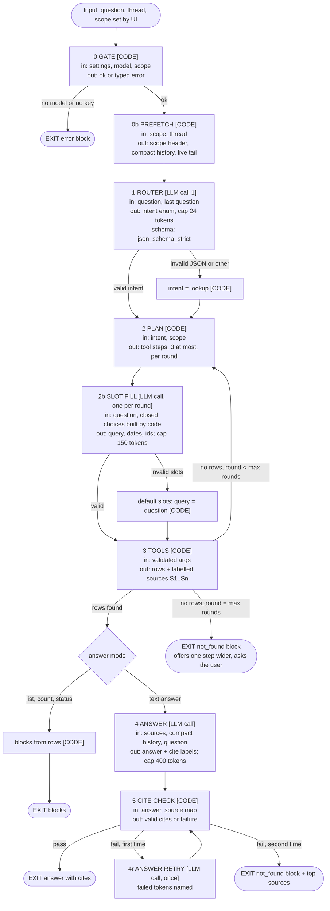
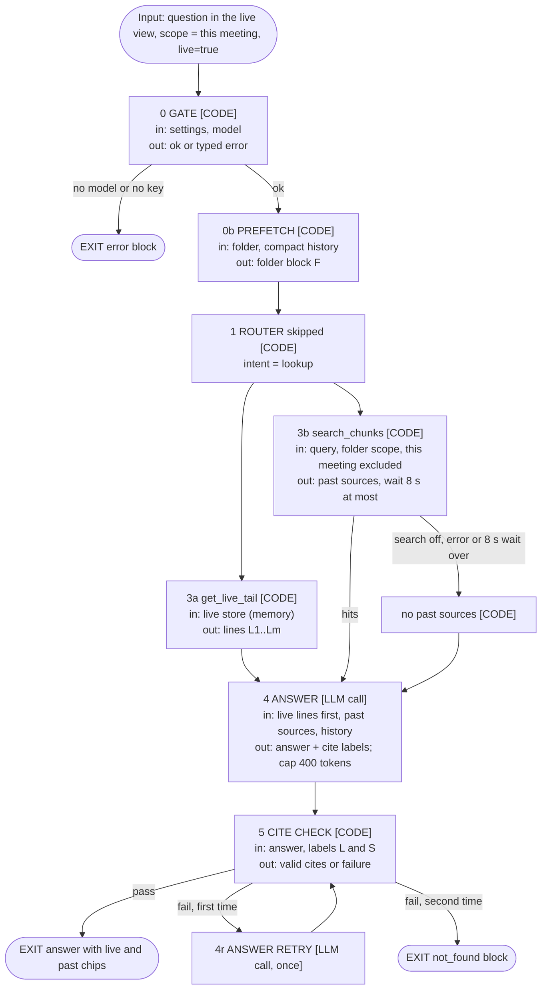
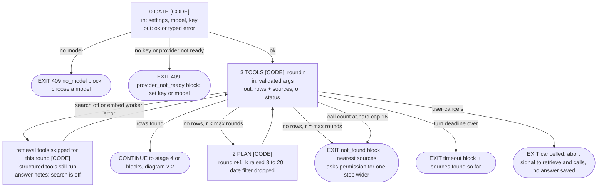
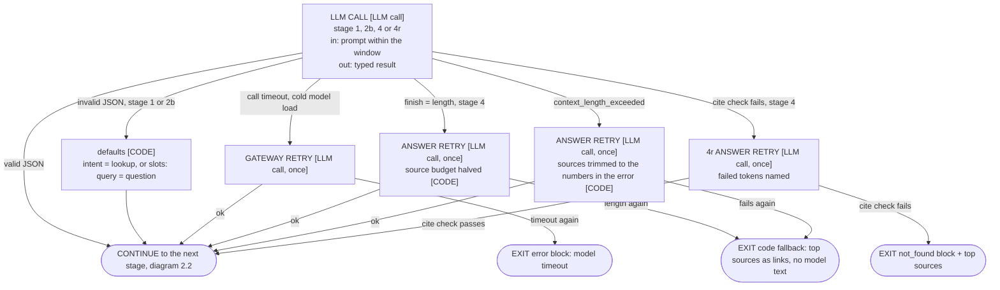
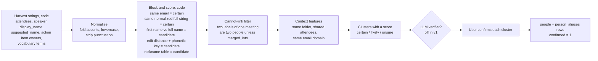
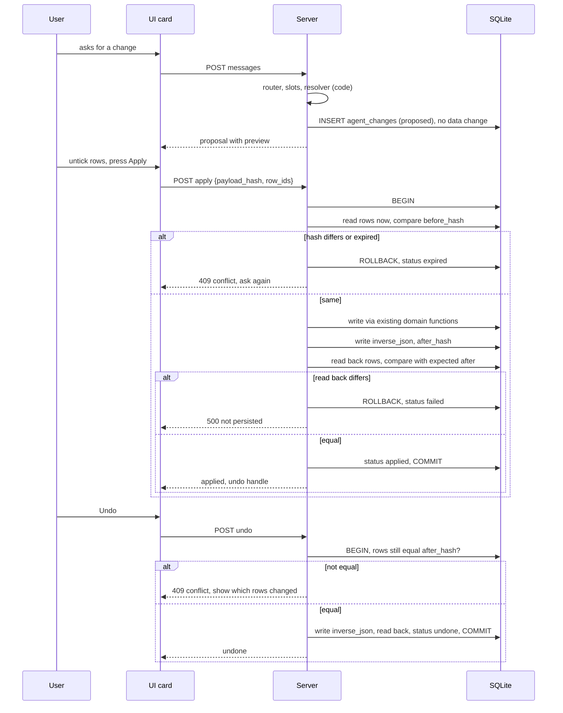
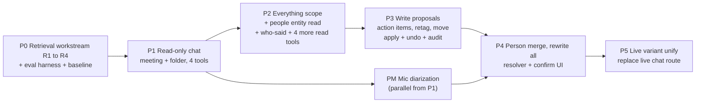

# Meeting chat agent (engineering spec)

Status: DRAFT for owner review. Date: 2026-10-31. Base: `main` at `a7083674`.
Revision 2 (2026-10-31, 09:49): owner answers applied. Section 12.1 lists them as decisions D1 to D4. Revision 3 (10:45): placement decided, D5 (section 11).
Revision 4 (2026-10-31, 11:10): owner review applied, decisions D6 to D18 (section 12.1). Name note: `SD8` is decision D8 of `specs/local-semantic-search.md`. `D1` to `D18` are decisions of this spec.
Scope of this document: design only. No product code is part of this change.
Language: ASD-STE100 Simplified Technical English.
Diagrams follow the rule "Diagram conventions" in `AGENTS.md`. The pipeline diagram (2.2), the live-variant diagram (2.4) and the failure diagrams (2.5a, 2.5b) are written to it. The other diagrams are small single-concern sketches.

## 0. How to read this spec

### 0.1 Labels

Every claim has one label or one source.

| Label | Meaning |
|---|---|
| `path:line` | VERIFIED. A line in the tree at `a7083674` shows it. |
| URL | VERIFIED in a discovery file. The URL is the source. |
| ASSUMPTION | My inference. No source says it. A test in section 8 must confirm it. |
| DECISION | A design choice of this spec. The reason follows. The owner can reverse it. |
| OPEN | The owner must decide. Section 12 lists them. |

### 0.2 Path prefixes

| Prefix | Path |
|---|---|
| `S/` | `apps/server/src/` |
| `V/` | `packages/validations/src/` |
| `R/` | `apps/electron/src/renderer/src/` |
| `W/` | `scripts/mlx_asr_server.py` (the local LLM worker) |

### 0.3 Sources

Three discovery files hold the research. They are in the private eval folder of the owner.
This spec names them. It does not copy their paths.

| Name | Content |
|---|---|
| Discovery A (`A-data-model.md`) | Tables, entities, write routes, gaps. |
| Discovery B (`B-retrieval-llm.md`) | Retrieval, live chat, LLM layer, worker limits. |
| Discovery C (`C-patterns.md`) | External research: small-model tool use, RAG, write safety, evaluation. |

I re-read the lines of the code that this spec cites most (retrieve, vector store, chat route, schema, gateway, worker). Other lines come from Discovery A and B.

### 0.4 Short summary

1. The agent is a fixed pipeline. It is not a free tool-calling loop.
2. Code sets the scope. A small router call picks the intent. Code runs 1 to 3 typed tools. One answer call writes the text from numbered sources. Code validates the cites.
3. The model never writes data. It can only fill the slots of a proposal. The user confirms. Every apply is logged and can be undone.
4. The design targets Gemma 4 E2B. A bigger model or a cloud model gets the same pipeline and must only do better.
5. Owner decisions D1 to D4 (section 12.1): cloud is allowed like any provider, but local is first. The mic channel needs diarization. A person merge rewrites everything, with full undo. Retrieval gets a full measured workstream in P0.
6. Principle (D8): structure and idempotency by default; relax only where the eval shows a cost. A weak model can be raised by a smart, well-built harness.
7. Gemma 4 E2B is the floor (D9). Every other model must score better on the gold set.
8. The work has 7 phases (P0 to P5 plus the mic workstream PM). Each phase ships behind a setting. Each phase needs an isolated-app E2E proof and gold-eval numbers.

## 1. Goals, non-goals and user stories

### 1.1 Goals

1. The user asks a question about one meeting, one folder (project) or all meetings. The user gets a short answer with cites.
2. Every fact in an answer traces to a source that the user can open.
3. When no source supports the answer, the answer says "not found".
4. The user can ask for a change (close an action item, merge two names, retag, move). The agent proposes it. The user confirms it.
5. The feature works with local Gemma 4 E2B on a Mac. Local first.
6. The same feature works during a recording (live variant). It reuses the live loop.
7. Every default has a measured number from the gold eval (section 8). This follows the owner rule "every default needs a measured number" (Discovery B section 4, last paragraph).

### 1.2 Non-goals

1. The default design does not use the native tools protocol. Tool choice and arguments come from `json_schema_strict` structured output. The local worker lacks the native tools protocol: it ignores `tools` and drops `tool` roles (`W:731`, `W:741-746`; Discovery B section 3.2). P0 measures a native-tools arm behind a flag against the structured router and keeps the winner (D11, section 2.1 point 6).
2. No free ReAct loop. Reason: the owner ethos "one narrow job per LLM stage, code does rule-like work" (`AGENTS.md`, section "LLM design ethos").
3. No delete by the agent. Not for meetings, folders, items or people (Discovery C section 3, risk tiers).
4. No edit of transcript text by the agent. No edit of key points or the overview. (Reason: no user edit path exists for them today, Discovery A section 3 last paragraph.)
5. No new embedding model is assumed. FTS5 hybrid search, a reranker and a multimodal embedding are measured in the P0 retrieval workstream (section 7.4) and built only if the bars are met.
6. No streaming of tokens. The worker does not stream (`W:734-735`).
7. No voice input, no speech output.
8. No chat over dictation history. (Non-goal D17 of the search spec, Discovery B section 1.2.)
9. No special "cloud blocked" rule. Cloud follows the normal provider choice (decision D1, section 12.1).

### 1.3 User stories and tool mapping

Scope key: M = one meeting, F = one folder, A = all meetings.
Tool names are in section 3.

| ID | Story | Scope | Intent | Tools | Answer mode |
|---|---|---|---|---|---|
| R1 | Lookup: "What did we decide about the vendor contract?" | M, F, A | lookup | `search_chunks`, then `get_meeting_summary` when needed | text with cites |
| R2 | Aggregation across meetings: "List the open action items for Ana in project X." | F, A | aggregate | `list_people`, `list_action_items` | list blocks, no LLM text |
| R3 | Temporal: "Which meetings did we have last week?" "What changed between the 3 Oct and the 17 Oct meeting?" | F, A | temporal | `list_meetings`, `get_meeting_summary` (2 calls) | list blocks, or text with cites |
| R4 | Who said: "Who proposed the pilot?" "What did Ana say about the budget?" | M, F, A | who_said | `search_chunks`, `get_transcript_window`, `list_people` | text with cites |
| R5 | Review: "Show all decisions of October." "Which questions are still open?" | F, A | review | `list_decisions_questions`, `list_action_items` | list blocks |
| R6 | Project status: "Where do we stand on project X?" | F | status | `folder_status` | status blocks (code) |
| R7 | Count: "How many meetings mentioned the audit?" | F, A | aggregate | `search_chunks` (grouped by meeting), `list_meetings` | number block + cites |
| R8 | Follow-up in the same thread: "And who owns it?" | any | any | same as above, with the last question | as above |
| R9 | Not answerable: "What was the budget?" (never said) | any | any | any | "not found" block |
| W1 | Dedup person names in a project | F | write | `list_people`, `propose_merge_people` | proposal cards |
| W2 | Close, reopen or edit an action item | M, F, A | write | `list_action_items`, `propose_action_item_change` | proposal card |
| W3 | Retag meetings | M, F, A | write | `list_meetings`, `propose_retag` | proposal card |
| W4 | Move a meeting to another folder | M, F, A | write | `list_meetings`, `propose_move` | proposal card |

Live stories (P5): R1, R4 (Me or Them only), R8 and R9 during a recording. Writes during a recording touch only other meetings (section 2.4).

## 2. Architecture

### 2.1 Why a code router and not a tool loop

1. The local worker has no tool calling (`W:731`, `W:741-746`). It does support JSON-schema grammar through llguidance (`W:649-652`, `W:761-774`). The gateway ladder for the local provider is `json_schema_strict`, then `prompt_only` (`S/lib/llm/model-profiles.ts:198-200`).
2. No measured tool-call accuracy exists for E2B in the repo (Discovery B section 4, row "Tool-calling accuracy"). Google gives Tau2 24.5% for E2B and 42.2% for E4B (https://huggingface.co/google/gemma-4-E2B-it/raw/main/README.md, Discovery C section 1.1). Tau2 measures agentic tool use. It is not our task. It still shows that E2B is weak at free tool use.
3. Owner principle (D8): structure and idempotency by default. Relax a rule only where the eval shows a cost. A weak model can be raised by a smart, well-built harness. One study warns of a cost: hard schema decoding gave 48.0% executable accuracy against 91.5% for prompt-only JSON on Qwen2.5-1.5B (https://arxiv.org/abs/2605.26128, not Gemma). So the answer stage has two arms ("strict" against "lenient", section 8.5). The default is strict. The lenient arm replaces it only for a model where the eval shows a cost. The code router and the closed choices are settled (owner agreed).
4. Anthropic advises the simplest solution and fixed code paths for well-defined tasks (https://www.anthropic.com/engineering/building-effective-agents).
5. DECISION: the model makes only small closed choices (intent, slot values, one choice from a list that code builds). Code runs the tools. Free text appears in one place: the answer call.
6. Native tools arm (D11). mlx-lm ships a Gemma 4 tool-call parser. Checked by command on the bundled worker: `dist/mlx_asr_worker/_internal/mlx_lm/tool_parsers/gemma4.py` exists, the version file says `0.32.2` (the pin in `S/lib/mlx-asr/families.ts:24`), and `tokenizer_utils.py:735-739` reads a `tool_parser_type` or infers one. (`dist/` is build output and is not tracked. Re-run the check on the build used.) The Gemma 4 E2B chat template has `tools`, `tool_call` and `tool_response` blocks (Discovery B section 3.2). P0 adds an arm T1: the worker accepts `tools`, passes them to the chat template, parses the call with the Gemma 4 parser and returns `tool_calls`, behind a flag. The scope stays set by code. The model sees only the tools of the plan (at most 8). Code validates tool name and arguments in both arms. T1 is compared with the structured router (A1) on tool-choice accuracy and argument accuracy on the gold set. The winner stays; the loser is removed. T1 cannot use `callStructured`, which throws on a `tool-calls` finish (`S/lib/llm/gateway.ts:1089-1099`), so it needs a gateway entry or the light path. The Gemma card says thinking must stay in history for tool-call turns (Discovery C section 1.1). The T1 loop code keeps it.

### 2.2 The pipeline

DECISION: the turn has stages 0 to 5. Stages 0, 2, 3 and 5 are code. Stages 1, 2b and 4 are LLM calls. The number of tool rounds is a user setting (D7), default 3.

Legend: boxes marked [CODE] run without a model. Boxes marked [LLM] are one model call. Every exit of the turn is drawn.



Counting from the diagram: the LLM calls are 1 (router), 2b (once per round), 4 (answer) and 4r (retry, once). Each call has one transport retry from the gateway (`S/lib/llm/call-unit.ts:16-23`). The loop 3 to 2 is bounded by the round setting. The exits are X1 to X5.

Budget of one turn (DECISION). The knobs are user settings on the Ask page (D7, section 2.9). The bars of section 8 are measured at the defaults only.

| Item | Default | Range | Note |
|---|---|---|---|
| Tool rounds `R` | 3 | 1 to 5 | |
| LLM calls (logical) | `R + 3` at most: 1 router, `R` slot fills, 1 answer, 1 answer retry. Typical 3. | | formula |
| LLM calls (with transport retries) | `2 x (R + 3)` at most | | each call may be retried once by the gateway (`S/lib/llm/call-unit.ts:16-23`) |
| Hard cap per turn | 16 calls (`2 x (5 + 3)`), a constant, not a setting | | stops any runaway loop. A turn that reaches it ends with the not_found block |
| Answer source budget | 6000 estimated tokens | 2000 to the window of the model minus output minus fixed | cut to the window like the live chat (`S/routes/meetings-chat.ts:54-56`, `:104-111`) |
| Retrieval `k` | 8 | 3 to 20 | |
| Output caps | router 24, slot fill 150, answer 400 tokens | fixed | caps given by the caller; section 2.6 says how (ASSUMPTION) |
| Turn deadline | 60 s | 20 to 180 s | The first call after an idle unload can load the model. The live chat uses a 120 s cold timeout and a 30 s warm timeout (`S/lib/llm/task-profiles.ts:130-136`; Discovery B section 2.1 step 6) |

Typical cost on E2B (ASSUMPTION, arithmetic from numbers in the repo): the live chat answers in 246 ms warm (`specs/live-chat.md`, section 6). Prefill is 23,985 tok/s and decode 144 tok/s (`specs/llm-runtime-tuning.md:63`). A turn of 3 small calls should take about 1 to 2 s warm. Section 8 measures it.

### 2.3 Stages in detail

#### Stage 0 Gate (code)

1. The setting `meeting_chat_enabled` is `"true"`. DECISION: a new setting, default off, experimental. The live chat keeps `live_chat_enabled` (`V/settings-keys.ts:66`).
2. `resolveTaskCall("meetingChat")` returns a model. DECISION: one new task id `meetingChat` for all stages. A new task id needs a profile, a settings key and a route branch (`S/lib/llm/task-profiles.ts:158-161`).
3. Provider (decision D1). The chat uses the model that the user assigned to the task `meetingChat`, local or cloud, through the normal provider and key flow. The gate fails only when no model or no key is set. Today the live chat blocks non-local providers (`S/routes/meetings-chat.ts:98-103`). The new route has no such block. The old live route changes in P5 (section 10). Local stays the first target of the design and of the eval. Rules: the app sends only the sources of the turn (up to 6000 estimated tokens, section 2.2) to the chosen provider, never to another one. The thread shows the name of the provider and model that answered. The default model is the shared resident model (section 2.7).
4. The scope exists (meeting or folder id found).
5. Search state is read. `off` does not stop the turn. Only retrieval tools degrade (section 2.5).

#### Stage 0b Prefetch (code)

Code reuses the live chat context builder for the blocks `[F]` (folder name and description) and `[L#]` (live tail) (`S/lib/meetings/live/chat-context.ts:22-31`, `:146-161`, `:84-105`). The last 4 saved messages join the prompt (`S/routes/meetings-chat.ts:53`).

#### Stage 1 Router (LLM call 1)

DECISION: the router is one small call with `json_schema_strict`. Its job is one choice.

Schema:

```json
{ "type": "object", "required": ["intent"], "additionalProperties": false,
  "properties": { "intent": { "enum": ["lookup","who_said","aggregate","temporal","review","status","write","other"] } } }
```

1. The router does not choose the scope. The UI sets the scope. Reason: a scope guess is one more error source, and Granola also lets the user choose the scope (https://help.granola.ai/article/chatting-with-your-meetings-ask-granola; Discovery C section 2.1).
2. The router prompt is under 150 words. It lists the 8 intents, each with 2 short examples. ASSUMPTION: examples in the 7 UI languages are needed. Section 8 measures router accuracy per language.
3. Invalid output or `other` gives the default intent `lookup`. A lookup with the answer call is the safest path.
4. Why an LLM and not rules: the question can be in 7 languages (`AGENTS.md`, section "UI conventions"). A rule list per language is a large, brittle table. DECISION: rules stay as the baseline arm in the eval. A rule route is used only if it matches the router on the gold set (section 8).

#### Stage 2 Plan (code)

A table maps (intent, scope) to a plan. A plan is a list of at most 3 tool steps and one fallback chain.

| Intent | Scope M | Scope F | Scope A |
|---|---|---|---|
| lookup | `search_chunks(meeting)`, then `get_meeting_summary` if the hit is thin | `search_chunks(folder)` | `search_chunks(all)` |
| who_said | `search_chunks(meeting)`, `get_transcript_window` | `search_chunks(folder)`, `get_transcript_window` on the best hit | same as F |
| aggregate | `list_action_items(meeting)` | `list_people`, `list_action_items(folder)` or `search_chunks` grouped by meeting | same, all scope |
| temporal | `get_transcript_window` | `list_meetings`, `get_meeting_summary` x2 | same |
| review | `list_decisions_questions` or `list_action_items` | same, folder | same, all |
| status | `get_meeting_summary` | `folder_status` | `list_meetings` + `list_action_items(all, open)` |
| write | write plan, section 5 | write plan | write plan |

Fallback chain for an empty `search_chunks` (DECISION): round 2 raises `k` from 8 to 20 and drops the date filter. Round 3 adds the keyword channel (section 7.4) when it exists. Then `not_found`.

#### Stage 2b Slot fill (LLM call)

The model fills slots. Code builds each slot as a closed choice where it can.

| Slot | Form | Who builds the choices |
|---|---|---|
| `query` | short standalone search text, max 200 chars | model (it rewrites a follow-up into a full query) |
| `date_from`, `date_to` | ISO date or null | model, with today's date in the prompt. Code checks that both parse and `from <= to`. |
| `person` | one `person_id` from a list, or `none` | code lists people of the scope (max 30, ranked by string match with the question) |
| `item` | one candidate label `A1..A8`, or `none` | code ranks open items by word overlap with the question and lists the top 8 |
| `meeting` | one of the meetings in a short list, or `none` | code lists meetings that match the date filter (max 12) |

Reason: a choice from a list is the most reliable output for a small model. ASSUMPTION; section 8 measures slot accuracy per model.

#### Stage 3 Tools (code)

Section 3 has the catalogue. Rules:

1. Code validates the arguments with zod before each call. Unknown meeting ids and ids outside the scope are rejected, not repaired.
2. Every tool result registers sources in a per-turn map: label `S1..Sn` to a source record (section 6.1).
3. A tool never returns more than the source budget. Long text is cut by code.
4. Tools read the database directly. They do not call HTTP routes.

#### Stage 4 Answer (LLM call)

1. Input: system prompt (one job: "answer from the numbered sources, cite labels"), sources, question, last 4 messages. Same pattern as `S/lib/meetings/live/chat-prompt.ts:9-16`.
2. Output: `{ "answer": string, "cites": string[] }`. The live chat reply format is the same (`S/lib/meetings/live/chat-prompt.ts:15-16`).
3. The answer is in the language of the question (`S/lib/meetings/live/chat-prompt.ts:10` rule).
4. Two arms are measured: strict schema (with `maxLength` on `answer` and `maxItems` on `cites`, to prevent `length` loops, precedent `S/lib/meetings/workflow/unit.ts:36-57`) and lenient parse (as the live chat does, `S/lib/meetings/live/chat-prompt.ts:24-55`). The arm with the higher answer accuracy wins per model class. Reason: the Constraint Tax finding (section 2.1 point 3).

#### Stage 5 Cite validation (code)

Section 6.

### 2.4 Live variant

During a recording the meeting has no index rows. `BUSY_STATUSES` (`recording`, `transcribing`) skip the indexer (`S/lib/search/indexer.ts:44`, `:212`). Its text is only in the in-memory live store (`S/lib/meetings/live/store.ts:99-113`).

DECISION:

1. The live variant is the same pipeline with scope `meeting` and the flag `live=true`.
2. A tool `get_live_tail` joins the tool set. It reads the live store and returns `[L#]` lines (labels as today).
3. Live lines win over older sources, as the live chat rule says (`S/lib/meetings/live/chat-prompt.ts:12`).
4. During a recording the intents are limited to `lookup`, `who_said`, `other`. Speaker labels in live lines are only Me and Them. The speaker pass runs after Stop (`specs/live-chat.md`, section 7 "No live diarization").
5. Write proposals never target the live meeting. Reason: its ids are not final. Segments are rewritten by the final pass (`specs/live-chat.md`, section 8).
6. The router call is skipped in live mode when the question has no write verb. DECISION to save latency: live mode uses intent `lookup` directly. ASSUMPTION; the eval compares both.
7. The chat model and the ASR model are different workers. The live chat already runs this way (`specs/live-chat.md`, section 6, memory numbers).



Counting from the diagram: the live turn has 1 LLM call (stage 4), plus 1 retry call (4r) and one gateway transport retry for each call. The router and the slot fill do not run. The exits are LX1 to LX3. LLM failures follow diagram 2.5b.

The 8 s retrieval wait is the live chat value (`S/lib/meetings/live/chat-context.ts:31`).

### 2.5 Failure paths

Two diagrams. 2.5a covers the gate and the tools (stages 0 and 3 of diagram 2.2). 2.5b covers the LLM calls (stages 1, 2b, 4 and 4r).

#### 2.5a Gate, tools and turn limits



Counting from the diagram: no LLM call is made here. The only loop is 3 to 2 to 3, bounded by the round setting (default 3, range 1 to 5). The exits are X1 to X5 and the CONTINUE node.

#### 2.5b LLM call failures



Counting from the diagram: each path adds at most one extra LLM call to the call it follows. A gateway transport retry can still happen once for each call (`S/lib/llm/call-unit.ts:16-23`). The total stays under the hard cap of 16 calls (section 2.2). The exits are X1 to X3 and the CONTINUE node.

Facts behind the paths:

1. Search off returns `{status:"off", reason}`. The search route answers 200 with the reason (`S/lib/search/retrieve.ts:137-138`; `S/routes/search.ts:52-58`). An embed worker error returns `{status:"error", kind}` (`S/lib/search/retrieve.ts:123-134`).
2. The worker returns a typed 400 `context_length_exceeded` with the token numbers (`W:672-698`).
3. A `length` finish with a whitespace loop was a real failure on E2B. The worker now bounds whitespace to 24 characters (`W:649-657`; Discovery B section 4).
4. The gateway never loops. It makes one request per call and has typed errors and one retry (`S/lib/llm/gateway.ts:68`; `S/lib/llm/call-unit.ts:16-23`; Discovery B section 3.1).
5. The embed worker unloads after 5 idle minutes. The first search can wait for the load (`S/lib/mlx-embed/server.ts:17-32`).

### 2.6 How the stages call the model

1. DECISION: all LLM calls use the gateway (`callUnit` with a zod schema). Reason: typed errors, one retry, and the recorder (`S/lib/llm/recorder.ts`) so the LLM inspector shows each stage (Discovery B section 3.1, style b).
2. The agent does not use `callStructured` for a native tool loop. The gateway throws `UnexpectedToolCallsError` on a `tool-calls` finish (`S/lib/llm/gateway.ts:1089-1099`). This spec has no native tool loop, so it does not matter.
3. `llm_runs` has `scope` and `scope_id` columns and no fixed enum (`S/lib/schema.ts:1036-1050`). DECISION: one run per turn with `scope = "chat"` and `scope_id = thread id`. Each stage is one `llm_calls` row.
4. Output caps per stage are given by the caller. ASSUMPTION: `callUnit` accepts a per-call `maxOutputTokens`. P1 must verify this in code before the build. If not, add one task id per stage (`meetingChatRoute`, `meetingChatAnswer`).
5. Sampling: the Auto path sends temperature 0 for every stage (`S/lib/llm/task-profiles.ts:51`; `AGENTS.md`, rule 2.2 "New model rule"). Runs at temperature 0 are deterministic (`specs/llm-runtime-tuning.md:427`). This makes the eval repeatable.
6. Thinking is off, as for `liveChat` (`S/lib/llm/task-profiles.ts:130-136`).
7. The lane: one request at a time per local model (`S/lib/llm/lane.ts:106`). The lane is held per request, so a dictation can run between two stages (Discovery B section 3.1, last bullet).

### 2.7 Shared resident model (D6)

Owner decision D6: chat (`meetingChat`) and the live chat default to the model that is already loaded and serving the other tasks. One serving instance serves all tasks, to save memory.

1. The live chat already follows this: its default assignment is the app default LLM, which is the dictation cleanup model, so both share one worker (`specs/live-chat.md` section 3). The pool maps one model id to one HTTP worker, and two tasks with the same model share that worker (`specs/llm-runtime-tuning.md:365`). The cleanup model is pinned while cleanup is on (`specs/llm-runtime-tuning.md:367`).
2. DECISION: the default assignment of `meetingChat` is the model of the task `cleanup`. No second model loads for chat.
3. A different model for chat is an explicit opt-in on the Models page. Before the user confirms, the row shows a warning with the RAM cost (the MLX peak of the catalog entry, for example 5.1 GiB for E2B and 16.3 GiB for 26B-A4B, `S/lib/mlx-llm/constants.ts:65-73`, `:110-118`) and the load time (ASSUMPTION: measured in P1 and shown as a number). The pool admission rule can refuse a model that does not fit (`specs/llm-runtime-tuning.md:366`).
4. The 120 s cold path applies mostly after an idle unload, because the shared model stays loaded while dictation uses it. "Keep ready" keeps it loaded (`specs/llm-runtime-tuning.md:368`).
5. The sharing has two costs. Both are measured risks (section 9.2, risk 6), not assumptions:
   - Dictation delay: all tasks of one model share one lane with one slot (`specs/llm-runtime-tuning.md:369`; `S/lib/llm/lane.ts:106`). A dictation can wait for one chat call. Bar in 8.7.
   - Prefix cache: the worker keeps one prefix entry, sent on cleanup requests only (`W:905-925`). A chat call with a different system prompt can evict it, and the next cleanup prefills again.
6. Fix options if the cost is too high (decided by the measurement, in order): (a) chat stages put the same fixed system prefix first, so the cached prefix survives. ASSUMPTION; the measurement shows if it works. (b) The worker keeps a prefix cache of 2 entries (a worker change). (c) The user opts in to a separate model for chat (point 3). (d) Chat calls are split so that each is short. No option is built before the number exists.

### 2.8 Context window handling (D18)

The owner calls this "one of the most sensitive parts of any chat". The rules are code, not model choices.

1. Fixed budget split for each LLM call. Parts: system prompt, sources, history, question. Each part has its own cap. The answer call: system about 300 tokens, question up to 300, history up to 600, sources the rest of the source budget (default 6000 total, section 2.2). The live chat has the same idea with a fixed block order (`S/lib/meetings/live/chat-context.ts:22-31`). The caps are ASSUMPTIONS until P1 measures them.
2. History never pushes sources out. If the parts do not fit, code shrinks history first (older turns drop), then the question stays whole, and sources are dropped whole, last-ranked first. A source is never cut in the middle, so a cite always points to complete text. The live chat drops whole blocks from the end of the list and cuts each hit to 320 characters (`S/lib/meetings/live/chat-context.ts:29`, Discovery B section 2.1). This spec keeps the 320 characters for chunk hits and cuts nothing else.
3. Compact history. A past turn enters the prompt as: the question, a short answer (at most 200 characters, taken from the first sentence of the stored answer by code) and the cite ids. It does not include the full answer text or the source texts. The last 4 messages today are full text (`S/routes/meetings-chat.ts:53`). This spec replaces them with the compact form. The full thread stays in the database.
4. Standalone follow-up rewrite before retrieval. The `query` slot of the slot fill (stage 2b) rewrites a follow-up ("and who owns it?") into a full search query, using the compact history. Retrieval never runs on the raw follow-up. The eval slice "follow-up" measures it.
5. Budget per model. The window is the real context of the model (`contextWindowFor`, `S/lib/llm/token-budget.ts:88`; 32,768 for the catalog models, `S/lib/mlx-llm/constants.ts:65-135`; null for an own server, which has no guard, Discovery B section 3.3). The default source budget is capped by measured prefill time. At the prefill rates in `specs/llm-runtime-tuning.md:63` (E2B 23,985 tok/s, 26B-A4B 4,283, Qwen3.8 27B 736), 6000 tokens cost about 0.25 s, 1.4 s and 8.2 s (arithmetic, ASSUMPTION). P1 measures it and sets the default per model class. A user value above the measured default is labelled "unmeasured".
6. The trace records what was cut: for each call, the token count of each part, the sources dropped (labels and titles), and the history turns dropped. The step trail in the UI can show "2 sources left out". The trace is stored in `trace_json` (section 4.2). The recorder keeps the final messages (`llm_calls.messages_json`, `S/lib/schema.ts:1070`).
7. Overflow from the worker (`context_length_exceeded`, `W:672-698`) triggers one retry with the numbers from the error, as in the failure paths (2.5).
8. Eval: threads of 5 to 10 turns with a fact planted early (turn 1 or 2) and asked again late. The fact must still be answerable, or the answer must be a correct not-found. Metrics: late-fact accuracy, sources dropped per turn, and answer accuracy against thread length (section 8.3).

### 2.9 Settings: the "Ask" page (D7)

Owner decision D7: the budget values are user settings on a new Settings sub-page "Ask" (chat parameters).

| Setting | Default | Range |
|---|---|---|
| Tool rounds | 3 | 1 to 5 |
| Answer source budget (tokens) | 6000 | 2000 to the model limit |
| Retrieval k | 8 | 3 to 20 |
| Turn deadline | 60 s | 20 to 180 s |
| Search wider | "ask me, one step at a time" | also "do not offer" |
| Chat history retention (later) | keep | one global knob, later (D18) |

Rules:

1. Every setting is read by the code at the moment of use, and a test pins it. The repo has a past case of a phantom knob: the enhance timeout shipped with a validator and no reader (`S/lib/llm/task-profiles.ts:158-161`). New settings need a settings key, a validator in `V/` and a route branch.
2. The eval bars are measured at the defaults. A non-default value shows the label "unmeasured" next to the field.
3. Decision D7 sets a UI knob for run settings. An older owner rule says no UI knobs for run settings (project memory "LLM runtime plan"; Discovery B section 4, last paragraph). D7 is the newer request and covers this page only.
4. The switch `meeting_chat_enabled` and the model choice stay where they are (Settings, Meetings; Models page).
5. Strings in 7 locales plus template.

## 3. Tool catalogue

### 3.1 Rules for all tools

1. A tool is a TypeScript function with a zod input schema. Code calls it. The model never calls it directly.
2. Every tool gets `scope` from the turn context. A tool input cannot widen the scope. DECISION.
3. Scope rule: scope M allows one `meeting_id`. Scope F allows meetings with that `folder_id`. Scope A allows all. Unfiled meetings belong to scope A only. (The vector store uses the partition `''` for unfiled, `S/lib/search/vec-store.ts:18-25`.)
4. At most 8 tools are visible per turn. Visible means "in the plan and in the slot-fill prompt". Read-only turns show at most 5. Write turns show the read tools of the plan plus one write tool.
5. Cost classes: C0 SQL read, under 20 ms. C1 embed plus KNN, about 80 ms embed per batch and about 1.2 ms KNN on 46,000 rows once the embed worker is loaded (Discovery B section 1.6; `S/lib/mlx-embed/client.ts:23`; `specs/local-semantic-search.md` S1). C2 resolver or LLM work.
6. Every result row carries what code needs for a cite: `meeting_id`, `title`, `started_at` and a time or item id.

### 3.2 Read tools

| Tool | Purpose | Input (JSON schema, short) | Output | Scope rule | Stories | Cost |
|---|---|---|---|---|---|---|
| `search_chunks` | Find text by meaning. Add meeting and date filters. | `{query:string(1..200), meeting_ids?:string[](<=500), date_from?:iso, date_to?:iso, kinds?:("transcript"\|"summary")[], k?:int(1..50, default 8)}` | `hits[{label, meeting_id, title, started_at, kind, start_ms, end_ms, best_ms, text(<=320 chars), score}]`, grouped: best chunk per meeting plus up to 2 more transcript chunks | `meeting_ids` is intersected with the scope. In scope F code sets the folder partition. | R1, R4, R7, R9 | C1 |
| `get_meeting_summary` | Read the summary of one meeting. | `{meeting_id}` | `{meeting_id, title, started_at, overview, key_points[], decisions[{item_id,text}], action_items[{item_id,task,owner,due,done}], open_questions[{item_id,text}]}` | meeting in scope | R1, R3, R5, R6 | C0 |
| `list_action_items` | List action items with done state. | `{status?:"open"\|"done"\|"all", person_id?, date_from?, date_to?, meeting_id?}` | `{total, items[{item_id, meeting_id, title, task, owner_person?, owner_text, due, done, group_size}]}` grouped like the folder overview (`S/lib/meetings/folder-overview.ts:85`) | folder or all, as scope | R2, R5, W2 | C0 |
| `list_decisions_questions` | List decisions or open questions. | `{kind:"decision"\|"open_question", date_from?, date_to?, meeting_id?, limit?:int(<=50)}` | `{total, items[{item_id, meeting_id, title, text, started_at}]}` | as scope | R5 | C0 |
| `list_people` | List people (resolved). | `{query?:string, min_meetings?:int}` | `{people[{person_id, name, aliases[], meetings_count, confirmed}]}`. Before P4 it returns only certain matches (section 4.3). | as scope | R2, R4, W1 | C0 |
| `get_transcript_window` | Read transcript lines of one meeting, with speakers. | `{meeting_id, from_ms:int, to_ms:int (max 180000 span), speaker?:string}` | `lines[{label, start_ms, end_ms, speaker, text}]` | one meeting in scope | R4, R3 | C0 |
| `folder_status` | Where a project stands. | `{}` (folder from scope) | `{folder:{name,description}, standing:{bullets[],generated_at,stale}, overview:{open_actions, recent_decisions, open_questions, people, timeline}}` | scope F only | R6 | C0 |
| `list_meetings` | List meetings by date, tag, folder. | `{date_from?, date_to?, tag?, limit?:int(<=50)}` | `{total, meetings[{meeting_id,title,started_at,folder,tags[],has_summary}]}` | as scope | R3, R7, W3, W4 | C0 |
| `get_live_tail` | Live lines of the recording. | `{}` | `lines[{label:"L#", time, speaker:"Me"\|"Them", text}]` | live meeting only | live R1 | C0 |

Notes and grounding:

1. `search_chunks` extends `retrieve()` (`S/lib/search/retrieve.ts:136`). Today `RetrieveInput` has no meeting scope and no date filter (`S/lib/search/retrieve.ts:26-35`). The KNN layer has `meetingIds` (`S/lib/search/vec-store.ts:133`, `:159-166`) with a cap of 500 per query (`KNN_IN_LIST_MAX`, `S/lib/search/vec-store.ts:16`). The tag path already groups ids by 500 (Discovery B section 1.3). A date filter becomes a SQL pre-filter on `meetings.started_at` that yields a `meetingIds` list. Section 7 has the plan.
2. `search_chunks` returns no `meta` chunks. The live chat drops them too (`S/lib/meetings/live/chat-context.ts:233`).
3. `get_meeting_summary` and the list tools read `meeting_summaries.summary_json` through `parseSummary` (`S/lib/meetings/folder-overview.ts:158`). Older rows have NULL `summary_json` (Discovery A section 1.2). The tool then returns `has_summary:false` and the markdown text as one source.
4. `list_action_items` in scope F uses the group logic of `folderActionGroups` (`S/lib/meetings/folder-overview.ts:252`). The overview limits are 100 meetings and 30 people (`S/lib/meetings/folder-overview.ts:16-18`). For scope A the tool loops over folders and reads unfiled meetings too. Done state of an unfiled meeting does not exist today: `folder_action_item_state` has a foreign key to `meeting_folders` (`S/lib/schema.ts:1291-1298`). Section 4.1 fixes this.
5. `get_transcript_window` reads `loadMergedTranscript` (`S/lib/meetings/transcript-io.ts:90-123`). It returns `speaker_label` and the speaker names from `meeting_speakers`. The mic channel is always "Me" (`S/lib/meetings/merge.ts:412`).
6. `folder_status` reuses `buildFolderOverview` (`S/lib/meetings/folder-overview.ts:341`, no LLM) and the stored `folder_standing` row (Discovery A section 1.3). It never starts a standing LLM call. If the standing is stale, the block says so.
7. The cap on `date` filters uses epoch ms in `meetings.started_at` (Discovery A section 2, row "Date/time").

### 3.3 Write proposal tools

Write tools return a proposal object. They change no data. Section 5 has the object.

| Tool | Purpose | Input | Proposal payload | Applied through | Stories | Risk tier |
|---|---|---|---|---|---|---|
| `propose_action_item_change` | Close, reopen or edit one action item. | `{item_id, change:{done?:bool, task?:string(<=220), owner_person_id?, owner_text?, due?:string\|null}}` | `{item_id, before, after}` | done: `setActionItemDone` (`S/lib/meetings/folder-overview.ts:428`). Edit: new write path on `summary_json` (section 5.5). | W2 | low (done), medium (edit) |
| `propose_retag` | Add or remove tags on meetings. | `{meeting_ids[] (<=20), add?:string[], remove?:string[]}` | per meeting: `{before:tags[], after:tags[]}` | `setMeetingTags` is a full replace (`S/lib/meetings/tags.ts:74`). Code computes the full new set. | W3 | low |
| `propose_move` | Move meetings to a folder or to unfiled. | `{meeting_ids[] (<=20), folder_id:string\|null}` | per meeting: `{from_folder, to_folder}` | the move logic of `POST /meetings/move` (`S/routes/meeting-folders.ts:166`), which also re-partitions vectors (`S/routes/meeting-folders.ts:197-203`; `S/lib/search/indexer.ts:104-121`) | W4 | low |
| `propose_merge_people` | Merge a cluster of names into one person. | `{cluster_id}` (a cluster from the resolver, not free names) | `{person_ids[], canonical, affected:{meetings, speaker_rows, action_items}, rewrite:bool}` | person tables and the rewrite of section 5.6 | W1 | medium |

Rules:

1. Write tools take ids from the lists that code built. The model cannot pass a free name.
2. Moving a meeting does not move the done marks. They stay under the old folder id (Discovery A section 3, row "POST /meetings/move", marked there as inference). Section 4.1 fixes this with per-item status.
3. The move and retag tools handle at most 20 meetings per proposal. A larger request becomes several proposals.

## 4. Data model changes

### 4.1 Stable ids for action items, decisions and questions

Gap: items live only inside `summary_json` as plain strings (`S/lib/meetings/workflow/schemas.ts:224-240`). The done mark key is a hash of meeting id and the normalized task (`S/lib/meetings/folder-overview.ts:43-48`). A changed task text gives a new key and loses the mark (`S/lib/meetings/folder-overview.ts:40-42`).

DECISION: `summary_json` stays the stored LLM output and the source that all existing readers use. A new table `meeting_items` adds ids and state on top of it. Reason: no change for current readers (folder overview, summary view). Rollback means dropping the table.

```sql
-- schema v54 (next free version at build time; SCHEMA_VERSION is 53 today, S/lib/schema.ts:14)
CREATE TABLE IF NOT EXISTS meeting_items (
  id TEXT PRIMARY KEY,                    -- UUID, stable
  meeting_id TEXT NOT NULL REFERENCES meetings(id) ON DELETE CASCADE,
  kind TEXT NOT NULL CHECK(kind IN ('decision','action','question')),
  ordinal INTEGER NOT NULL,               -- index in the summary_json array
  text_hash TEXT NOT NULL,                -- sha256 of normalized text, drift check
  legacy_key TEXT,                        -- actionItemKey(), kinds 'action' only
  status TEXT NOT NULL DEFAULT 'open' CHECK(status IN ('open','done')),
  status_updated_at INTEGER,
  created_at INTEGER NOT NULL,
  superseded_at INTEGER                   -- set when a new summary drops the item
);
CREATE INDEX IF NOT EXISTS idx_meeting_items_meeting ON meeting_items(meeting_id, kind, ordinal);
CREATE UNIQUE INDEX IF NOT EXISTS uq_meeting_items_pos ON meeting_items(meeting_id, kind, ordinal) WHERE superseded_at IS NULL;
```

Migration (one transaction, in `S/lib/schema.ts`, like the v52 block at `:1324`):

1. For each row of `meeting_summaries` with `summary_json`: parse it with `parseSummary`. Insert one `meeting_items` row for each decision, action and question. Compute `legacy_key` for actions with `actionItemKey(meeting_id, task)`.
2. For each row of `folder_action_item_state` with `done = 1`: find the `meeting_items` row with the same `legacy_key` in a meeting of that folder. Set `status = 'done'`. Keep the old table untouched.
3. Old summaries with NULL `summary_json` get no items. The tool reads their markdown.

Sync rule (DECISION):

1. After a new summary is saved (`S/lib/meetings/workflow/nodes/save.ts:242`), a sync step compares the new items with the live rows. A new item matches an old one when `sameOverviewItem` is true (`S/lib/meetings/folder-overview.ts:57`; it builds on `sameItem`, `S/lib/meetings/workflow/schemas.ts:118`). A match keeps the id and status. A non-match gets a new id. Old rows without a match get `superseded_at`.
2. The `text_hash` detects a `summary_json` change that bypassed the sync. A read tool with a hash mismatch re-syncs first.
3. Dual write for the done state: a done change writes `meeting_items.status` and `folder_action_item_state` in one transaction. The folder overview keeps reading the old table, so it needs no change in P3. Unfiled meetings have only `meeting_items.status`. This closes the unfiled gap. A later change can make the overview read `meeting_items`. It is not part of this spec.
4. Rollback: stop reading `meeting_items`. The old table is complete for filed meetings because of the dual write. Unfiled done marks are lost on rollback. DECISION: accept this, because they never existed before.

Stability limits:

1. A re-summarize can change the wording, so a match can fail. The old item goes to `superseded_at` and its done mark is lost. This is the same behavior as the key hash today (`S/lib/meetings/folder-overview.ts:40-42`). It is a known limit.
2. A re-transcribe rewrites segment rows (`INSERT OR REPLACE`, Discovery A section 1.1). Items do not depend on segment ids. Cites use `meeting_id` plus `start_ms` (Discovery A, gap 10).

### 4.2 Chat threads for folder and global scope

Gap: `meeting_chat_messages` has one meeting id and cascades with the meeting (`S/lib/schema.ts:1324-1342`; `S/lib/meetings/live/chat-store.ts:1-6`).

```sql
-- schema v55
CREATE TABLE IF NOT EXISTS chat_threads (
  id TEXT PRIMARY KEY,                                  -- UUID
  meeting_id TEXT REFERENCES meetings(id) ON DELETE CASCADE,
  folder_id  TEXT REFERENCES meeting_folders(id) ON DELETE CASCADE,
  title TEXT,
  created_at INTEGER NOT NULL,
  updated_at INTEGER NOT NULL,
  CHECK (NOT (meeting_id IS NOT NULL AND folder_id IS NOT NULL))
);                                    -- both NULL = scope "all"
CREATE INDEX IF NOT EXISTS idx_chat_threads_scope ON chat_threads(meeting_id, folder_id, updated_at);
CREATE TABLE IF NOT EXISTS chat_messages (
  id INTEGER PRIMARY KEY AUTOINCREMENT,
  thread_id TEXT NOT NULL REFERENCES chat_threads(id) ON DELETE CASCADE,
  role TEXT NOT NULL CHECK(role IN ('user','assistant')),
  content TEXT NOT NULL,                -- plain text of the answer, or the question
  blocks_json TEXT,                     -- structured answer blocks (list, count, status, not_found)
  cites_json TEXT,                      -- [{label, meeting_id, start_ms, item_id, kind}]
  trace_json TEXT,                      -- tool names, row counts, ms per stage
  change_ids_json TEXT,                 -- proposal ids (section 5)
  run_id TEXT REFERENCES llm_runs(id) ON DELETE SET NULL,
  model_id TEXT,
  ms INTEGER,
  created_at INTEGER NOT NULL
);
CREATE INDEX IF NOT EXISTS idx_chat_messages_thread ON chat_messages(thread_id, id);
```

DECISION: two nullable foreign keys with a CHECK. Reason: SQLite has no polymorphic foreign key. A deleted meeting or folder removes its threads, as `meeting_chat_messages` does today. A folder delete is blocked when the folder is not empty (Discovery A section 3, row `DELETE`), so folder threads rarely cascade.

Migration: `meeting_chat_messages` is copied into `chat_messages` with one thread per meeting. It runs in P5 (section 9). The old table stays for one release. Rollback: the old table is complete until the P5 switch.

### 4.3 Cross-meeting person entity

Gap: no person table exists. One human appears as an attendee name or email, a `display_name`, a `suggested_name`, an action item owner, loose text, `speaker_names_lost`, and a vocabulary term (Discovery A section 2.1). The only merge logic today is `countPeople`, which lowercases and trims names (`S/lib/meetings/folder-overview.ts:297`).

```sql
-- schema v56
CREATE TABLE IF NOT EXISTS people (
  id TEXT PRIMARY KEY,                 -- UUID
  display_name TEXT NOT NULL,          -- canonical name shown in answers
  email TEXT,                          -- from calendar, if any
  is_account_owner INTEGER NOT NULL DEFAULT 0,   -- the "Me" person; set by the user
  merged_into TEXT REFERENCES people(id),        -- soft merge pointer
  created_at INTEGER NOT NULL,
  updated_at INTEGER NOT NULL
);
CREATE TABLE IF NOT EXISTS person_aliases (
  id INTEGER PRIMARY KEY AUTOINCREMENT,
  person_id TEXT NOT NULL REFERENCES people(id) ON DELETE CASCADE,
  alias TEXT NOT NULL,                 -- as written
  alias_norm TEXT NOT NULL,            -- folded, lowercase
  source TEXT NOT NULL CHECK(source IN ('attendee','speaker_display','speaker_suggested','owner','vocabulary','manual')),
  meeting_id TEXT REFERENCES meetings(id) ON DELETE CASCADE,
  speaker_label TEXT,                  -- link to (meeting_id, speaker_label) when source is a speaker
  confirmed INTEGER NOT NULL DEFAULT 0,
  created_at INTEGER NOT NULL
);
CREATE UNIQUE INDEX IF NOT EXISTS uq_person_alias ON person_aliases(person_id, alias_norm, source, COALESCE(meeting_id,''), COALESCE(speaker_label,''));
CREATE INDEX IF NOT EXISTS idx_person_alias_norm ON person_aliases(alias_norm);
```

The labels "Me" and "Them N" are not names. The resolver skips them. Decision D2 changes what "Me" means: it is not "every mic segment". Section 4.5 describes the mic workstream. The person with `is_account_owner = 1` is created after one user confirmation. It links only to the mic speaker clusters that the user confirms as themselves. Today the mic channel is always "Me" and has no `meeting_speakers` row (`S/lib/meetings/merge.ts:15`, `:412`; Discovery A section 1.1). The prompt tells the summary model to write "Me", "Them 2" or a confirmed name as owner (`S/lib/meetings/workflow/prompts.ts:184-186`).

Entity resolution (DECISION: code first, human confirms):



1. Certain matches (same email, or the same normalized full string inside one folder) create unconfirmed `people` rows. They are used by `list_people` and by owner filters at once. DECISION: a certain match does not change any text.
2. Likely and unsure clusters are not used by tools until the user confirms them (P4).
3. The cannot-link rule: `meeting_speakers` has one row per label per meeting (`S/lib/schema.ts:856` block; Discovery A section 1.1). Two different labels in one meeting are two people, except when the user set `merged_into` (`S/routes/meetings.ts:2286` route).
4. ASR spelling variants of one name are common. One-word bias-term segments are noise and are not evidence (owner-verified note in project memory "short leak segments"; Discovery C section 4, last bullet). DECISION: the resolver reads names, never segments.
5. The LLM verifier is off in v1. If the dedup precision on the labelled set (section 8.6) is below the bar, P4 adds a verifier call that may answer "unsure". An LLM judge raised precision to 95.4% and cut recall to 50.9% in one blog test on products (https://pub.towardsai.net/using-gpt-4o-mini-as-an-entity-resolution-judge-95-precision-for-0-04-b216d44a7f20; a blog, not people). With a human confirm step, a lower recall is acceptable. ASSUMPTION.
6. The nickname table is a small data file per language. ASSUMPTION; the eval measures its gain.
7. The first run on a folder builds the rows. Later runs update them when a speaker or summary changes. Staleness uses the same idea as the index source hash (`S/lib/search/source.ts:146-154`).

### 4.4 Apply and undo audit log

```sql
-- schema v57
CREATE TABLE IF NOT EXISTS agent_changes (
  id TEXT PRIMARY KEY,                    -- UUID, the proposal id
  batch_id TEXT NOT NULL,                 -- groups proposals from one turn
  thread_id TEXT REFERENCES chat_threads(id) ON DELETE SET NULL,
  message_id INTEGER,
  kind TEXT NOT NULL CHECK(kind IN ('action_item','retag','move','merge_people')),
  status TEXT NOT NULL CHECK(status IN ('proposed','applied','undone','failed','expired','rejected')),
  payload_json TEXT NOT NULL,             -- what to do, ids only
  payload_hash TEXT NOT NULL,             -- sha256 of canonical payload_json
  idempotency_key TEXT NOT NULL UNIQUE,   -- hash(kind, payload_hash)
  preview_json TEXT NOT NULL,             -- before/after rows shown to the user
  before_hash TEXT NOT NULL,              -- hash of the rows read at proposal time
  inverse_json TEXT,                      -- old values, written at apply
  after_hash TEXT,                        -- hash of the rows right after apply
  run_id TEXT REFERENCES llm_runs(id) ON DELETE SET NULL,   -- the LLM run that built the proposal
  model_id TEXT,
  created_at INTEGER NOT NULL,
  expires_at INTEGER NOT NULL,
  applied_at INTEGER,
  undone_at INTEGER,
  error TEXT
);
CREATE INDEX IF NOT EXISTS idx_agent_changes_thread ON agent_changes(thread_id, created_at);
ALTER TABLE meeting_summary_versions ADD COLUMN change_id TEXT;   -- nullable
```

Prose and field changes need a before and after text for each place. DECISION: one more table in the same migration.

```sql
-- schema v57, same migration
CREATE TABLE IF NOT EXISTS agent_change_places (
  id INTEGER PRIMARY KEY AUTOINCREMENT,
  change_id TEXT NOT NULL REFERENCES agent_changes(id) ON DELETE CASCADE,
  table_name TEXT NOT NULL,          -- meeting_summaries, meeting_speakers, meetings, folder_standing, ...
  row_key TEXT NOT NULL,             -- primary key of the row, as text
  field TEXT NOT NULL,               -- column or JSON path, e.g. summary_json.keyPoints[2]
  before_text TEXT NOT NULL,
  after_text TEXT NOT NULL,
  before_hash TEXT NOT NULL,         -- hash of the full field value before
  after_hash TEXT NOT NULL,          -- hash of the full field value right after apply
  patches_json TEXT NOT NULL,        -- [{start, before, after}] spans inside the field, for prose
  status TEXT NOT NULL DEFAULT 'applied' CHECK(status IN ('applied','undone','conflict','superseded','skipped'))
);
CREATE INDEX IF NOT EXISTS idx_agent_change_places_change ON agent_change_places(change_id);
CREATE INDEX IF NOT EXISTS idx_agent_change_places_row ON agent_change_places(table_name, row_key, field);
```

DECISION: a new table and not `llm_call_links`. Reason: `llm_call_links` records what an LLM wrote (`target_type`, `applied_text`, `outcome`, `S/lib/schema.ts:1082-1093`). Here the user writes, and the LLM only proposes. The table links to the run through `run_id`, so the inspector can show the proposal call.

Migration plan for v54 to v57:

1. All four migrations are additive (new tables, one nullable column). The migration block pattern is `if (currentVersion < N && tableExists(...))` (`S/lib/schema.ts:1324`).
2. An app that is older than the database returns early at `if (currentVersion >= SCHEMA_VERSION) return;` (`S/lib/schema.ts:168`). It ignores the new tables. ASSUMPTION: no old code path fails on extra tables. A test opens a v57 database with the v53 build (P0 gate for the first migration).
3. Rollback of the feature: set `meeting_chat_enabled` off. No data loss. Applied changes stay applied. The user can undo them before the rollback; after it, undo is not available.
4. Data written by P3 apply (done marks, tags, folder, summary versions) is normal app data. It stays valid without the new tables, except `meeting_items.status` of unfiled meetings (section 4.1 point 4).
5. Each migration needs a unit test with a seeded v53 database. The test checks counts and the dual write.

### 4.5 Workstream PM: diarize the mic channel (decision D2)

Owner decision D2: the mic channel can hold more than one person (a team in one room on one mic). So "Me" must not mean "every mic segment". Diarization is needed on all channels, the mic included.

What exists today:

1. Diarization is opt-in and runs on the system channel only. It spawns `fluidaudio-diarize` on `system.wav` and writes `speaker_label` ("1", "2", ...) on segments (`S/lib/meetings/diarize.ts:3-12`, `:590-597`).
2. The merged transcript labels every mic segment "Me" and every system segment "Them" (`S/lib/meetings/merge.ts:15`, `:412`). The mic channel has no row in `meeting_speakers` (Discovery A section 1.1). `meeting_speakers` holds a mapping over the diarizer label index (`S/lib/schema.ts:848-856`).
3. The live loop has no diarization during the recording. The speaker pass runs after Stop (`specs/live-chat.md` section 7).
4. Raw diarizer turns are stored in `meeting_diarizer_turns` with primary key `(meeting_id, idx)` and no channel column (`S/lib/schema.ts:948`; Discovery A section 1.1).

What PM changes (DECISIONS):

| Item | Change |
|---|---|
| Diarizer input | Run the helper on `mic.wav` too, after the system pass. ASSUMPTION: the helper accepts a mic file as it accepts `system.wav`. A spike in PM step 1 proves or disproves it. |
| Labels | Mic labels use a prefix: `m1`, `m2`, ... System labels stay "1", "2", .... Reason: `meeting_speakers` has primary key `(meeting_id, speaker_label)` (`S/lib/schema.ts:856`), and both channels would collide on "1". No schema change is needed for the labels: the column `meeting_segments.speaker_label` already exists (`S/lib/schema.ts:824`). |
| Diarizer turns | Add a `source` column (`'system'` default, `'mic'`). The primary key must include it. SQLite cannot change a primary key in place, so the migration rebuilds the table (create new, copy, drop, rename). The table holds derived data and can be rebuilt from audio. |
| Merge output | `mergeTranscript` stops hard-coding "Me" for mic rows (`S/lib/meetings/merge.ts:15`, `:412`). A mic row gets its label. The `Speaker` type widens. A mic row with no label (diarization off or failed) keeps "Me" as today. |
| Display name for a mic cluster | If the cluster is linked to the account-owner person: "Me". Else the confirmed name. Else "Mic 1", "Mic 2" in the UI. If a meeting has exactly one mic cluster and no confirmation yet: "Me" (today's behavior). |
| Owner link | The person with `is_account_owner = 1` links through `person_aliases` rows with `source = 'speaker_display'`, `meeting_id` and `speaker_label = 'm1'` (section 4.3). Only clusters that the user confirmed as themselves link to the owner. Other mic clusters become their own speakers and people. |
| Confirmation flow | One confirmation creates the owner person. Per meeting: if the meeting has one mic cluster, code links it to the owner and shows this in the change preview. If it has more than one, the UI asks "which voice is you?" and plays a short audio snippet for each cluster. The answer is a normal speaker update (`S/routes/meetings.ts:2286`). |
| Carry over | The carry rule after a re-transcribe (`S/lib/meetings/speaker-carry.ts`) must work with mic labels. It keys on time overlap. PM step 2 adds a test with mic labels. |
| Summary owner strings | The summary prompt tells the model to write the transcript label as owner (`S/lib/meetings/workflow/prompts.ts:184-186`). A mic cluster label (a name or "Mic 2") flows through that rule with no prompt change. ASSUMPTION; the eval checks owner accuracy on multi-voice meetings. |
| Cannot-link rule | Two mic clusters in one meeting are two people unless the user merged them (section 4.3, point 3). |
| Cross-meeting voice identity (D15) | Depends on four existing issues, all OPEN on 2026-10-31 (checked with the GitHub issue view): #67 "Recognize the same speaker across meetings", #73 "Store voiceprints on the device only", #79 "Add voiceprint enrollment with a consent screen", #85 "Match known voiceprints in new meetings". A mic or system cluster that is near a stored voiceprint becomes a suggestion ("same voice as Ana, last meeting"). The user confirms. Nothing links by voice alone. A voiceprint is created only after consent. It is kept until the person is deleted or the user asks, on the device only. Its retention does not depend on audio retention. PM does not build voiceprints. It only reads the suggestion when #85 exists. |
| Live recording | The live view shows "Me" and "Them" until Stop (`specs/live-chat.md` section 7). The live chat answers with those two. |

Risks specific to PM:

1. Echo: the mic can pick up remote voices from the speakers. The code already repairs some mic tracks (`system.original.wav` repair, `S/lib/meetings/retention.ts:15-17`) and removes echo rows before chunking (Discovery B section 1.2). The diarizer could then make mic clusters for remote people. Code must compare each mic cluster with the system channel in time (overlap of speech with the same audio content) and mark likely echo clusters "echo" so they are not offered as people. ASSUMPTION; the eval has an echo case.
2. A single speaker can be split into two clusters (false split). The user can merge two labels of one meeting with the existing `merged_into` path (`S/routes/meetings.ts:2286`).
3. Time: a second diarizer run adds time to the post-recording job. PM measures it (system pass today: Discovery has no number; GAP).
4. The summary of old meetings keeps "Me" as owner string for every mic voice. The merge preview of section 5.6 shows these places, and the user decides.

Eval (also section 8.8): fictional multi-voice mic audio.

## 5. Write safety

### 5.1 The rule

The model never writes. The path is: propose, preview, user confirms, apply, log, undo. This follows the pattern in Discovery C section 3: Linear keeps the human as owner and the agent as delegate (https://linear.app/developers/agents). Granola lets chat fix names and reassign action points (https://help.granola.ai/article/chatting-with-your-meetings-ask-granola). Approval requests hold the action, params, a preview, an expiry and an idempotency key (https://pypi.org/project/agent-runtime-governance/). Sources for the last pattern are practitioner pages, not standards (Discovery C section 3).

### 5.2 Proposal object

```json
{
  "id": "uuid",
  "batch_id": "uuid",
  "kind": "action_item | retag | move | merge_people",
  "scope": {"kind": "folder", "id": "..."},
  "payload": { "...ids and new values only..." },
  "payload_hash": "sha256 of canonical JSON of payload",
  "idempotency_key": "sha256(kind + payload_hash)",
  "before_hash": "sha256 of the rows read now",
  "preview": [ { "row_id": "...", "label": "...", "before": "...", "after": "...", "cite": {"meeting_id": "...", "start_ms": 0} } ],
  "risk": "low | medium",
  "expires_at": 0
}
```

1. Code builds the proposal. The model only chose ids from a list (section 2.3, slot fill).
2. The preview has one row per change. The user can untick single rows (a merge or a retag of many meetings).
3. `expires_at`: DECISION 30 minutes. A late apply needs a new proposal. Reason: the data can change.

### 5.3 Routes

DECISION: placement-agnostic routes under `/api/chat`. The names are proposals.

| Route | Action |
|---|---|
| `POST /api/chat/threads` | Create a thread `{scope}`. |
| `POST /api/chat/threads/:id/messages` | Ask `{question}`. Returns the answer, cites, trace and `changes[]` (proposals). |
| `GET /api/chat/threads/:id` | Messages, oldest first. |
| `POST /api/chat/changes/:id/apply` | Body `{payload_hash, row_ids?}`. Applies. |
| `POST /api/chat/changes/:id/reject` | Marks `rejected`. |
| `POST /api/chat/changes/:id/undo` | Undoes an applied change. |
| `GET /api/chat/changes` | The audit log, newest first, filter by thread or folder. |

### 5.4 Apply and undo



Rules:

1. Apply is idempotent. The `idempotency_key` is unique. A second apply of an applied change returns the first result and writes nothing.
2. Apply checks `payload_hash` from the client against the stored hash. A changed payload is refused.
3. Apply re-reads the rows and compares `before_hash`. A mismatch means the data changed since the proposal. The change expires.
4. Every write reads back inside the transaction and compares with the expected state. Reason: the owner rule "a write that returns success may have stored nothing. Read it back" (user-wide `CLAUDE.md`, section "How the Definition of Done gets faked").
5. Undo applies `inverse_json` only when the rows still equal `after_hash`. Otherwise it reports a conflict and lists the rows.
6. Apply uses the existing domain code, not raw SQL, so side effects stay right. Examples: the vector re-partition of a move, the `transcript.md` rewrite of a speaker rename (Discovery A section 3). ASSUMPTION: some route bodies (`POST /meetings/move`, `PATCH /:id/speakers/:label`) hold inline logic. P3 and P4 extract it to `S/lib/` functions first, with a no-behavior-change test.
7. Delete is not a change kind (non-goal 3).

### 5.5 Edit of an action item

1. `done` changes use the dual write of section 4.1.
2. A text, owner or due edit patches `summary_json.actionItems[ordinal]`. Steps in one transaction: copy the current row to `meeting_summary_versions` with `change_id` (same pattern as `S/lib/meetings/workflow/nodes/save.ts:231-242`), update `summary_json`, re-render `markdown` with `renderSummaryMarkdown` (`S/lib/meetings/workflow/summary-pure.ts:44`), update `meeting_items.text_hash` and `legacy_key`, and copy the done state to the new `folder_action_item_state` key.
3. Reason to re-render: `markdown` and `summary_json` can drift apart if only one changes (Discovery A section 4, gap 4).
4. The index sees the summary change through its source hash and re-embeds the summary chunk (`S/lib/search/source.ts:146-154`).
5. No summary restore route exists today (Discovery A section 1.2). Undo uses `inverse_json`. DECISION: P3 does not add a restore UI for versions.

### 5.6 Person merge: rewrite everything (decision D3)

Owner decision D3: a merge rewrites every place where the names appear, including prose. The default in the preview is on for every place. Every rewrite is a versioned copy. Every rewrite can be undone.

Discovery A section 2.1 lists where one person's strings live. The merge treats each place like this:

| Place | What a merge does | Version kept in |
|---|---|---|
| `people`, `person_aliases` | Soft merge: `merged_into` points to the canonical person. Aliases move. | `inverse_json` of the change |
| `meeting_speakers.display_name` | Set to the canonical name | `agent_change_places`. Through the existing speaker update path (`S/routes/meetings.ts:2286`), which also rewrites `transcript.md` (Discovery A section 3). |
| `summary_json.actionItems[].owner` | Replace the alias with the canonical name. Labels "Me" and "Them N" are never replaced (they are labels, not aliases). | `meeting_summary_versions` (copy of the old row, as `S/lib/meetings/workflow/nodes/save.ts:231-242`) and `agent_change_places` |
| `summary_json` prose: overview, key points, decisions, open questions, action item text | Replace aliases by the canonical name (rules below) | same |
| `meeting_summaries.markdown` | Re-rendered from the new `summary_json` with `renderSummaryMarkdown` (`S/lib/meetings/workflow/summary-pure.ts:44`) | same |
| `folder_standing.bullets_json` | Replace aliases in the bullets by the same rules. The row has no versions today (Discovery A section 1.3). | `agent_change_places` |
| `meetings.title`, `meetings.context` | Replace aliases by the same rules | `agent_change_places` |
| `meeting_chunks` and vectors | Re-embedded by the indexer after the summary and title change | The source hash changes (`S/lib/search/source.ts:146-154`). Undo changes it back and the indexer re-embeds. |
| Chat history (`meeting_chat_messages`, `chat_messages`) | Display only: the renderer maps aliases of merged people to the canonical name when it shows a message. Stored text is not changed. | Nothing to version. Undo of the merge restores the old display at once. |
| `meetings.calendar_attendees` (display names) | Replace the `name` of an attendee that matches a confirmed alias. The `email` stays the key and is never changed. | `agent_change_places` |
| Transcript text: `meeting_segments.text` and `enhanced_text` | Replace confirmed aliases (D13). Only confirmed aliases: an ASR misspelling is fixed only when the user confirmed it as an alias of the person. No fuzzy match. The transcript export file is rebuilt from the new text. | `agent_change_places`, one row per changed segment field (before text and after text) |
| `vocabulary.term` | Not changed. It is a global list and not a project record. | n/a |

Decision D13 (was Q14): the merge also rewrites the stored transcript text and the attendee display names. Transcript rows in the preview start ticked, like all other places. Facts and limits:

1. Until now the app does not overwrite the raw `text` of a segment after the transcription (Enhance writes `enhanced_text`, Discovery A section 3). This is the first agent write to `text`. The audit rows keep the old text, so it can be restored.
2. A re-transcribe rewrites the segment rows (Discovery A section 1.1) and an Enhance run rewrites `enhanced_text`. A calendar re-sync rewrites the attendee columns (`S/routes/meetings.ts:1742`). In each case the affected places become `superseded` (section 5.7 rule 5).
3. Changed segments change the source hash, so the indexer re-embeds only the changed chunks (`S/lib/search/source.ts:140-154`; Discovery B section 1.6).
4. A large merge can change thousands of segments. The preview groups transcript rows by meeting with a count and a tick for the group, and each row can still be opened.

Replacement rules (DECISION):

1. Only aliases of the merged people are replaced. The alias list comes from `person_aliases` of the cluster that the user confirmed.
2. A latin-script alias matches at word boundaries, ignoring case and accents. The replacement keeps the case pattern of the match (all lower, Capitalized, ALL CAPS).
3. For Japanese and other scripts with no word spaces, an alias matches as an exact substring of 2 or more characters.
4. Ambiguous-alias guard: if an alias is also an alias of another person in the same folder (two people called "Ana"), code does not replace that alias in free text. The preview lists those places as "left, ambiguous" with a tick box that is off.
5. A match inside a longer name that belongs to another person ("Ana Souza" when merging "Ana" into "Ana Silva") is skipped by the same guard.
6. A grammar effect is possible (a language with name inflections). Code does not repair it. The preview shows each changed place so the user can untick it.

Preview content: every changed place is a row. A row shows table, meeting title, field, the text before and after with 40 characters of context around each change, and a tick box. A summary line shows counts for each place type. The row count shown equals the rows in `agent_change_places` after Apply (a test checks this).

### 5.7 Conflict and undo rules for prose

1. Apply writes one `agent_change_places` row per changed field. The row holds the full before and after hash and the list of patches (position, before span, after span).
2. Undo goes place by place. For each place, code reads the current field value and compares its hash with `after_hash`.
3. Same hash: restore `before_text`. Status `undone`.
4. Different hash (the user or another process edited the text after the merge): try a patch-level undo. For each patch, if the `after` span is still at the expected place (same 40 characters of context), put back the `before` span. If all patches fit, status `undone`. If some do not fit, status `conflict` for those patches. Code leaves them as they are and lists them. The user can edit the text by hand.
5. A summary replaced by a new Summarize run, a transcript replaced by a re-transcribe, an `enhanced_text` replaced by a new Enhance run, or attendee names replaced by a calendar re-sync since the merge: the place is `superseded`. Undo skips it. The merge copy stays in `meeting_summary_versions`. The new summary is a fresh LLM output and has its own names.
6. Order rule: if a later applied change touched the same place, undo of the earlier change is blocked for that place until the later change is undone. The check uses `agent_change_places` for the same `(table_name, row_key, field)` with a newer `applied` row.
7. Undo of the entity merge (`merged_into`) happens last and only when no place is in `conflict`. Otherwise the merge stays soft-merged and the UI says which places need manual work. DECISION: partial undo is allowed, and it is logged in the audit table with the per-place status.
8. Undo re-reads and compares inside one transaction, like apply (section 5.4 rule 4).
9. After apply and after undo, `folder_standing` and the index need no extra step: the standing input hash changes (stale mark), and the indexer re-embeds changed chunks.
10. A re-transcribe or a re-diarize after the merge rewrites segments and `meeting_speakers` (Discovery A section 3). The carry rule (`S/lib/meetings/speaker-carry.ts`) keeps names by overlap. The alias rows stay linked to `(meeting_id, speaker_label)`. If the label changes, the link is marked `stale` and the user sees it in the next merge preview. ASSUMPTION; P4 tests it.

## 6. Grounding and citations

### 6.1 Source labels

DECISION: numbered labels `S1..Sn` per turn. In live mode the live lines keep `L1..Lm`. The model sees only the label, the meeting title, the date and the text. Reason: short labels are easy to copy for a small model, and the live chat already works with short labels (`S/lib/meetings/live/chat-prompt.ts:9-16`). ASSUMPTION: E2B copies labels with high accuracy. The eval measures label copy accuracy (section 8).

The per-turn source map:

| Field | Meaning |
|---|---|
| `label` | `S3` |
| `kind` | `transcript`, `summary`, `item`, `window`, `live`, `folder` |
| `meeting_id`, `title`, `started_at` | for display |
| `start_ms`, `end_ms` | time range for transcript, window and live |
| `item_id` | for action items, decisions, questions |
| `text` | the text shown to the model, kept for the checks |
| `scope_ok` | set by code at tool time |

The cite that goes to the UI and the database is `{label, kind, meeting_id, start_ms, item_id}`. It uses `meeting_id` plus `start_ms`. It does not use segment ids, because a re-transcribe rewrites them (Discovery A, gap 10).

### 6.2 Code checks

For each answer, code checks in this order. No LLM is used.

1. Label exists: every cite label is in the source map. This is the live chat check (`S/routes/meetings-chat.ts:155-169`).
2. In scope: the source `scope_ok` is true and its meeting is in the scope.
3. Fact check (DECISION). Code extracts three kinds of tokens from the answer: numbers and dates (digits, resolved date strings), known entity names (people aliases, folder names, meeting titles, attendee names), and quoted strings. Each token must appear (after accent folding and lowercase) in the text of the cited sources, the question, or the tool metadata (titles and dates). Names and numbers that fail are the main small-model errors (Discovery C section 2.4, last bullet; ASSUMPTION).
4. Coverage: an answer with text and zero valid cites is not shown as an answer. It becomes "not found", unless the intent is `other`.

On a failed check:

1. If the unsupported token appears in another source of the turn, code adds that source to the cites (repair).
2. Else the answer call runs once more, with the failed tokens named ("remove or fix: ...").
3. Else the response is a `not_found` block with the top sources as links. No model text is shown.

Optional later check: an NLI score with HHEM-2.1-Open (https://huggingface.co/vectara/hallucination_evaluation_model; Apache-2.0, small, local). No speed number on Apple Silicon is known (Discovery C section 2.4, gap). It is not in the plan. The eval may test it as an extra signal. ALCE reports 85.1% and 77.6% agreement with humans for its NLI checks (https://arxiv.org/abs/2305.14627, a search-summary figure in Discovery C). So the NLI check is a signal and not the truth.

### 6.3 Not-found behavior

1. A turn is `not_found` when all tools return nothing after the fallback chain, when the best score is below a floor, or when cite validation fails twice. The score floor is a number that section 8 measures (no value is set here).
2. The response is a structured block: `{kind:"not_found", scope, nearest:[cites]}`. The renderer writes the text in the UI language with `t()`. Reason: code answers need no server-side translation (7 locales, `AGENTS.md`, section "UI conventions").
3. When the model itself says "not found" (the prompt rule as in `S/lib/meetings/live/chat-prompt.ts:13`), code converts the reply to the same block.
4. Search wider (D16). When the selected scope finds nothing, the not_found block asks the user for permission to widen. One confirm widens one step: meeting to folder, folder to everything. An unfiled meeting goes straight to everything. A new turn runs at the wider scope in the same thread, and its cites show that scope. Code never widens on its own, also not in the last tool round. The setting "Search wider" (section 2.9) can turn the offer off.

### 6.4 Language

1. A text answer uses the language of the question (the live chat rule).
2. Code-mode answers (lists, counts, status, not-found) are structured blocks. The renderer localizes the fixed words. Item texts stay in the language of the summary.
3. Question language: the live loop already uses `tinyld` for text language detection (`specs/live-chat.md`, section 1). The router prompt does not need it.

## 7. Retrieval improvements (in order)

Each step lists a measurement. All numbers come from the gold eval in section 8 (recall of gold source ranges at k, and cite precision).

### 7.1 R1 Meeting scope and date filter in `retrieve()`

1. Add `scope: {kind:"meeting", meetingId}` and an optional `dateRange` to `RetrieveInput` (`S/lib/search/retrieve.ts:26-35`). Meeting scope passes `meetingIds=[id]` to `knn` (`S/lib/search/vec-store.ts:133`).
2. A date range runs a SQL query on `meetings.started_at` (within the folder scope) and passes the ids as `meetingIds`. Above 500 ids, the call splits into groups of 500, as the tag path does (Discovery B section 1.3; `S/lib/search/vec-store.ts:16`).
3. The public route `POST /api/search/meetings` stays as is (`V/search.ts:42-49`). The new filters are used by the tools. A later change can expose them.
4. Measure: recall@8 of the gold source range on the "lookup" and "temporal" questions, before and after, for scope M and for date-bounded questions. No regression on the existing search eval of `specs/local-semantic-search.md`.

### 7.2 R2 Who said

1. Keep rule S7: no speaker label in chunk text (`S/lib/search/chunker.ts:6`). Changing it would force a full re-embed of all meetings.
2. Add `get_transcript_window` (section 3.2). A chunk stores its `segment_ids` (`S/lib/schema.ts:1177-1190`; Discovery A section 1.4). Code joins them to `meeting_segments.speaker_label` and the speaker names. This needs no re-index.
3. Plan for who_said: `search_chunks` finds the chunk. Code opens the window of the best segment. The answer call gets lines with speaker names.
4. Measure: who-said accuracy by key (speaker person id). Compare with the arm that has no window (retrieval text only).

### 7.3 R3 Fix #297 and #298 where they hurt cites

1. #297 (open): a transcript hit opens at the first segment of the chunk, not at the matching line (Discovery B section 1.5). A chunk has several segments. The `search_chunks` tool adds `best_ms`: code picks the segment inside the chunk with the highest word overlap with the query. The cite uses `best_ms`.
2. #298 (open): one meeting can give up to 3 rows (meta, summary, transcript). The tool groups by meeting and keeps the best row plus up to 2 more transcript chunks (section 3.2).
3. DECISION: the fix lives in the tool first, so the agent does not wait for the UI issues. The two issues stay open for the search UI. A shared helper can fix both later.
4. Measure: cite time error (ms between `best_ms` and the gold line start) and duplicate meeting rate per answer.

### 7.4 Retrieval workstream R4 (in P0, decision D4)

Owner decision D4: "if we add anything, we do it right." Owner decision D10: the embedder stays EmbeddingGemma 2 (there is little reason for another embedder). A reranker is built only if the eval shows the need. The workstream compares four things on one gold set, then keeps only what the numbers support.

Why this reverses decision SD8 of the search spec. SD8 says: "Vectors only, no plain-RRF hybrid" (`specs/local-semantic-search.md:71`). The same spec lists hybrid search, a reranker and an "ask" answer as non-goals (`specs/local-semantic-search.md:49`; Discovery B section 1.4). Reasons to reverse now:

1. The agent asks questions that hold exact names and numbers. The spike measured recall@10 of 0.613 (PT) and 0.703 (EN) for the current int8 vectors on a hard set (`specs/local-semantic-search.md:105-111`). About 3 of 10 hard queries miss in the top 10.
2. The agent cannot repair a miss. It answers "not found" or a wrong fact, and the cite check cannot see what the search missed.
3. Outside evidence says BM25 plus embeddings cut failed top-20 retrievals by 49% (5.7% to 2.9%), and a reranker cut them by 67% (to 1.9%) (https://www.anthropic.com/news/contextual-retrieval). Their data sets differ from ours. This is a hint, not a promise.
4. The spec's own reason for SD8 is in an issue comment that the spec links. This spec does not restate it. The P0 PR must quote it and answer it with the measured numbers. The search spec is edited in the P0 PR (SD8 and the non-goal line change status to "reversed by `specs/meeting-chat-agent.md` section 7.4, with numbers").

Arms (all use the same gold set, section 8.2, plus the #233 hard set for continuity):

| Arm | Retrieval | Notes |
|---|---|---|
| V0 | Dense vectors only (today): EmbeddingGemma 2 text tower, int8, cosine | baseline, `S/lib/mlx-embed/constants.ts:44-62`, `S/lib/search/vec-store.ts:18-25` |
| H1 | V0 plus BM25 from SQLite FTS5, fused with RRF (k=60) | fusion: https://www.elastic.co/search-labs/blog/improving-information-retrieval-elastic-stack-hybrid |
| H2 | H1 with a second FTS5 tokenizer (see below) | picks the tokenizer |
| R1 | H1 or V0 candidates, then a cross-encoder reranker | picks the model |
| M1 | V0 plus audio vectors from the multimodal EmbeddingGemma 2 (same family, so D10 holds) | spike only (section 7.4.4). Audio vectors follow the retention of D14. |

##### 7.4.1 BM25 with FTS5

1. The unit is the chunk, the same unit as the vectors. Chunk text is not stored today. The indexer rebuilds it from segments and summaries (`S/lib/search/retrieve.ts:243-295`, Discovery B section 1.1). DECISION (owner, 2026-10-31, P0 report section 9 point 4): the FTS table is CONTENTLESS and uses the word tokenizer (`unicode61 remove_diacritics 2`). It stores the index only and no copy of the chunk text. `rowid = meeting_chunks.id`. The indexer fills it in the same transaction as the vectors (`S/lib/search/indexer.ts:299-302` area). The meeting, folder and date filters are a join with `meeting_chunks` (a contentless table cannot filter by a column). P0 measured 0.73 x the transcript text at 46,080 chunks, under the size bar.
2. Two tokenizers are compared. The repo already has an FTS5 table with the `trigram` tokenizer for dictation history, which matches any substring of 3 or more characters (`S/lib/schema.ts:960-975`). The other candidate is a word tokenizer with accent folding. ASSUMPTION: the word tokenizer gives better BM25 ranking for PT and EN, and trigram is needed for Japanese. The eval decides. The names of the SQLite tokenizers are from the repo comment above. P0 must read the SQLite FTS5 documentation and quote it before the build (the discovery files do not contain it: GAP).
3. Filters: the folder filter is a `JOIN` on `meetings.folder_id`. The meeting and date filters are `meeting_id IN (...)`, the same list that the vector channel uses (section 7.1).
4. Query building: code, not the model. Code removes stop words per language and quotes terms, to avoid FTS syntax errors. A name list (people aliases, section 4.3) gets a boost. ASSUMPTION; the eval measures it.

##### 7.4.2 Fusion

1. Each channel returns its top 50 chunk ids. RRF with k=60 gives a fused list. Elastic reports that RRF raised average NDCG@10 by 1.4% over its learned sparse model alone, and by 18% over BM25 alone, with no tuning (https://www.elastic.co/search-labs/blog/improving-information-retrieval-elastic-stack-hybrid).
2. The eval also tests a weighted RRF (weights per channel) and a plain score-normalized sum. The simple RRF wins ties.
3. The fused top 30 go to the reranker when it exists. Else the top 8 go to the tool output.

##### 7.4.3 Reranker

Rule (D10): a reranker is built only if the eval shows the need and it passes the bars in 7.4.6. Decision (owner, 2026-10-31): Qwen3-Reranker-0.6B, 15 candidates first; 30 candidates (batched) only if the measured added p95 stays at most 400 ms. P1 measured it (PR #401): the constant `RERANK_CANDIDATES` in `S/lib/mlx-rerank/constants.ts` holds the result. No other embedder is tested. Candidates:

| Candidate | Facts | Source |
|---|---|---|
| Qwen3-Reranker-0.6B | Text reranker, 0.6B parameters, 100+ languages, 32k context, Apache-2.0. Scores on reranking subsets: MTEB-R 65.80, CMTEB-R 71.31, MMTEB-R 66.36, MLDR 67.28 (reranking the top 100 of Qwen3-Embedding-0.6B). Scoring is the probability of "yes" against "no". | https://huggingface.co/Qwen/Qwen3-Reranker-0.6B |
| Qwen3-Reranker-4B | Same family, larger. Used as the default in the MLX service below. | https://github.com/aperepel/mlx-rerank |
| MLX builds of the Qwen reranker | A community MLX service uses `mlx-community/Qwen3-Reranker-4B-mxfp8` by default and shows `mlx-community/Qwen3-Reranker-0.6B-mxfp8` in its example. It needs Apple Silicon and `mlx-lm`. It states no license, no latency and no memory numbers. | https://github.com/aperepel/mlx-rerank |
| Sentence-Transformers cross-encoders `ms-marco-MiniLM-L6-v2` / `L12-v2` | NDCG@10 on TREC DL 19: 74.30 and 74.31. Speed on the page: 1800 and 960 docs/s (the hardware is not stated). Trained on MS MARCO. ASSUMPTION: English-only, so weak on PT. | https://sbert.net/docs/cross_encoder/pretrained_models.html |
| `BAAI/bge-reranker-v2-m3` | Listed on the same page as a community model, with no metrics there. ASSUMPTION: multilingual (the name says "m3"). | https://sbert.net/docs/cross_encoder/pretrained_models.html |

Runtime options on a Mac (what is known):

1. MLX: the Qwen3 reranker runs through `mlx-lm`, with one forward pass per (query, document) pair (https://github.com/aperepel/mlx-rerank). The app already bundles an MLX LLM worker (Discovery B section 3.2: mlx-lm 0.32.2, `S/lib/mlx-asr/families.ts:24`). A reranker needs its own worker process, like the embed worker, with idle unload (`S/lib/mlx-embed/server.ts:17-32`). One worker for the embed model and the reranker is an option. The eval measures RAM.
2. ONNX Runtime or CoreML for small cross-encoders (MiniLM, bge): GAP. The discovery files do not confirm backend support. P0 spikes it with a time box and reports.
3. The Sentence-Transformers page links a "Speeding up Inference" page with ONNX and OpenVINO sections. This spec did not read it (GAP).
4. The chat LLM itself as a listwise reranker is not a candidate. It holds the lane (`S/lib/llm/lane.ts:106`) and breaks the one-job ethos.

##### 7.4.4 Multimodal embedding: does it exist, and is it viable locally?

Findings:

1. The app already uses EmbeddingGemma 2, not the first EmbeddingGemma. The id is `embeddinggemma-2-bf16-text`: the text tower only, 413 tensors, from a community MLX mirror (`S/lib/mlx-embed/constants.ts:44-62`).
2. A multimodal EmbeddingGemma exists. Google released EmbeddingGemma 2 on 2026-10-06 (https://vpsranking.com/news/ai/ai-2026-10-06-google-embeddinggemma-2/; secondary source). The primary model card is at https://huggingface.co/google/embeddinggemma-2. It says: one shared 768-dimension space for text, code, images, video and audio; 740M parameters in total; 270M text, 170M vision, 300M audio; 8,192 tokens of context shared across modalities; audio at 25 tokens per second, up to about 327 seconds, mono 16 kHz; Apache-2.0.
3. The card lets you load only some towers: text only (270M), text and image (440M), text and audio (570M), all (740M), by setting `vision_config` or `audio_config` to `None` in `config_kwargs` for Sentence-Transformers. The card says this varies by library (https://huggingface.co/google/embeddinggemma-2).
4. Scores on the card (768 dimensions): MAEB (audio, mean over tasks) 49.87; MSEB (audio retrieval, MRR@10) 69.54; MTEB multilingual v2 61.36; MTEB code 78.68. What the MSEB tasks contain is not stated on the page I read (GAP).
5. The first EmbeddingGemma was text-only: 0.3B, 768 dimensions, MTEB multilingual v2 61.15, input up to 2048 tokens (https://huggingface.co/google/embeddinggemma-300m). So the text score is about the same (61.36 against 61.15 on the card numbers).
6. Frameworks on the card: Transformers, Sentence-Transformers, Safetensors. The article says Google lists MediaPipe and LiteRT for devices, and does not mention MLX or ONNX. Whether the audio tower runs under `mlx-vlm` (the runtime of the embed worker, Discovery B section 1.1) is UNKNOWN. Whether the text tower of the full model gives the same vectors as the current text-only mirror is UNKNOWN (ASSUMPTION: yes; a cosine test on 1000 chunks checks it before any mixing).
7. A cloud multimodal model also exists: Gemini Embedding 2 (text, image, video, audio) (https://www.mayhemcode.com/2026/03/google-gemini-embedding-2-review-first.html, a blog review; not verified). It is not local. Under D1 it could be a user-chosen provider. It is not in the plan.
8. I found no other verified local multimodal embedding candidates. GAP.

Viability limits (INFERRED from the facts above and the repo):

1. Audio is deleted by the retention sweep after `meeting_retention_days` (`S/lib/meetings/retention.ts:15-21`). Audio vectors must be built before the sweep. After it they cannot be rebuilt.
2. An audio window is at most about 327 s. The chunk unit of the text index is about 300 tokens (`S/lib/search/chunker.ts:9-13`). ASSUMPTION: 30 s windows give a comparable unit, at 750 tokens each.
3. Cost: 300M more parameters, and every minute of audio becomes vectors. P0 measures index time per audio hour, RAM and size.
4. Benefit case: search that survives ASR errors on names (query text against audio vectors), and a voice query. ASSUMPTION; the eval slice "ASR-error names" measures it.

DECISION: M1 is a time-boxed spike in P0, not a shipping feature. Steps: load the 570M text and audio setup in a Python environment, embed 30 s windows of the fictional audio (section 8.2 spoken meetings), run text queries, and report recall@8 on the ASR-error slice against V0 and H1. It becomes a build item only if it beats H1 by a margin set in 7.4.6 and runs under MLX or another runtime that the app can bundle. Else the report names the blocker.

##### 7.4.5 Index and cost

1. The vector index stays as is. Dimensions stay 768, int8.
2. New: FTS table, optional reranker worker, optional audio vectors.
3. A full rebuild of the FTS table from existing segments runs as a background job at the first start of the new version, one meeting per tick, like the slow scan (`S/lib/search/indexer.ts:426-447`).

##### 7.4.6 Metrics and initial pass bars (P0)

Metrics, per language (PT and EN) and per slice (names and exact numbers, concept questions, ASR-error names, date-bounded):

| Metric | Definition |
|---|---|
| recall@k | gold chunk range found in the top k, for k = 1, 5, 10 |
| nDCG@10 | on graded gold ranges (2 = exact line, 1 = same chunk window) |
| MRR@10 | continuity with the #233 spike table (`specs/local-semantic-search.md:105-111`) |
| Latency | p50 and p95 of the retrieval call: embed query, KNN, FTS, fusion, rerank. Warm and cold (embed worker load) separate. |
| RAM | peak RSS of the embed worker and of the reranker worker, sampled every 5 s |
| Index size | bytes of FTS table and of audio vectors per hour of meeting; time to index one hour |

Pass bars (ASSUMPTION: initial targets. P0 measures V0 first; the owner confirms the bars; "every default needs a measured number"):

| Item | Bar |
|---|---|
| Hybrid H1 against V0 | nDCG@10 not lower than V0 in any language. At least +5 points on the names and exact numbers slice. |
| Hybrid recall@10 on the #233 hard set | at least 0.75 PT and 0.80 EN (V0 is 0.613 and 0.703, `specs/local-semantic-search.md:111`) |
| Reranker R1 adopted | at least +3 points nDCG@10 overall over the best of V0 or H1, no language below V0, added p95 latency at most 400 ms for 30 candidates on an M-class Mac, added RAM at most 1.5 GB |
| Multimodal M1 adopted | at least +5 points recall@8 on the ASR-error slice over H1, runs in a bundled runtime, audio indexing at most 0.2x real time |
| Index size | FTS table at most 1.0x of the transcript text size |
| Query latency p95 warm, hybrid without reranker | at most 150 ms (V0 query is dominated by about 80 ms embed and 1.2 ms KNN, Discovery B section 1.6) |
| No regression | the existing search UI results for the #233 set do not drop in nDCG@10 |

##### 7.4.7 Output of P0

A table of arms against metrics in the PR, a decision per candidate (adopt, drop, later), and the changes to the search spec. The agent tools use the winning arm behind the same `search_chunks` interface, so a later change needs no tool change.

### 7.5 R5 Chunk context by code

Idea from Anthropic's contextual retrieval: prepend context to each chunk (https://www.anthropic.com/news/contextual-retrieval). Their method calls an LLM for each chunk. A code-only version prepends title, date and folder. ASSUMPTION. It needs a re-embed of every chunk. It is one more arm for the P0 workstream if time allows (arm C1). The `meta` chunk already holds title and tags (`S/lib/search/source.ts:84-92`).

### 7.6 Order

| Step | Phase | Gate |
|---|---|---|
| R1 meeting scope and date filter | P0 | recall@8 not lower than the current search eval |
| R3 `best_ms` and grouping (in the tool) | P0 | cite time error measured |
| R4 FTS5 + RRF, reranker, multimodal spike | P0 | bars in 7.4.6 |
| R2 transcript window | P2 | who-said accuracy measured |
| R5 contextual chunk text | P0 if time allows | slice recall gain |

## 8. Evaluation plan

### 8.1 Rules

1. Fixed answer keys. No LLM judge decides pass or fail. This is the owner rule. Reasons on record: blind judges and gold keys were wrong against the owner on 22 answers (project memory "judges unreliable"; Discovery B section 4). Judges over-credit wrong answers without a reference (https://arxiv.org/abs/2607.12885).
2. The corpus is fictional (privacy). No owner data enters the repo or the eval keys.
3. The eval runs against the real server over HTTP in an isolated app (skill `.claude/skills/live-testing/SKILL.md`). A mock of the model does not count as a result.
4. Each model run takes the shared GPU lock (`/tmp/openstyle-gpu.lock`) only for the model steps, like `.claude/skills/app-check/SKILL.md` step 4.
5. Temperature 0. Same input gives same output (`specs/llm-runtime-tuning.md:427`), so one run per cell is a valid measure. A rerun checks it.

### 8.2 Corpus

DECISION: a script builds the corpus from templates and a seeded random number generator. It is in `scripts/chat-eval/` (new, P0).

1. 30 fictional meetings. 4 folders (6 to 8 meetings each) and 4 unfiled meetings. Dates over 12 weeks.
2. 12 fictional people. Each has 2 to 4 spelling variants and a nickname ("Ana", "Ana S.", "Anna"). 4 people share a first name.
3. Languages: 20 meetings in English, 6 in Portuguese, 4 mixed. ASSUMPTION: these cover the owner's main case (Discovery B section 6 spike set is PT and EN).
4. Each meeting has transcript segments with speakers (Me and Them N, some named), a summary with decisions, action items (some done) and questions. Facts are planted at known lines. Some facts change between meetings (knowledge update).
5. Distractors: similar numbers, similar names in other folders.
6. The corpus loads into the isolated app through the seed path used by the live-testing skill. A subset of 3 meetings is also spoken with the macOS speech tool and run through the ASR path, to check that the chat works on real pipeline output (like the live chat proof).

### 8.3 Question taxonomy and keys

About 190 questions. The mix follows LongMemEval's abilities (https://arxiv.org/abs/2410.10813: extraction, multi-session reasoning, temporal reasoning, knowledge update, abstention) plus who-said, count and write.

| Type | N | Scope mix | Key form (code-scored) |
|---|---|---|---|
| Lookup | 25 | M, F, A | regex set of accepted values (normalized), plus the gold cite range |
| Who said | 20 | M, F, A | person id set |
| Aggregation (lists) | 20 | F, A | set of item ids (precision, recall, F1) |
| Count | 10 | F, A | integer |
| Temporal | 20 | F, A | list of facts with gold ranges, or meeting id set |
| Knowledge update | 10 | F, A | date or value plus the id of the newest meeting |
| Not answerable | 30 (above 15%) | any | must be a `not_found` block, no text answer |
| Scope trap | 10 | M, F | a fact that exists only outside the scope. The answer must be `not_found`. |
| Follow-up | 10 | any | as lookup, with a prior turn |
| Long thread (5 to 10 turns, a fact planted in turn 1 or 2 and asked again late) | 10 | M, F, A | as lookup, or a correct not-found. Also scores sources dropped per turn (section 2.8). |
| Write proposal | 25 | M, F, A | expected proposal: kind plus id set. Compared as a set, not as prose. |

Key forms for text answers: a list of "must contain" alternatives and a list of "must not contain" distractors. Both are normalized (accent fold, lowercase, digits). Pass means all must-contain groups match and no must-not-contain token appears. This is deterministic code. Free-text quality beyond the key is not scored by a judge. The owner spot-checks a sample of 20 answers per model (rule from Discovery C section 5.3).

### 8.4 Metrics

| Metric | Definition | How scored |
|---|---|---|
| Answer accuracy | pass by key | code |
| List F1 | precision and recall of item ids | code |
| Cite precision | valid cites whose source range overlaps a gold range / all cites shown | code |
| Cite recall | gold ranges covered by a cite / gold ranges | code |
| Cite validity | shown cites with a label in the source map | code (must be 100% by construction) |
| Not-found accuracy | not-answerable and scope-trap questions answered with a `not_found` block | code |
| False not-found rate | answerable questions answered with `not_found` | code |
| Route accuracy | router intent equals the gold intent (labelled per question) | code |
| Slot accuracy | slot values equal the gold slots | code |
| Label copy accuracy | labels in the answer that exist in the source map / labels in the answer | code |
| Rounds per turn, calls per turn | from the trace | code |
| Latency p50, p95 | wall time of a turn, warm and cold separate | harness clock |
| RAM | RSS of the chat worker, sampled every 5 s (method of `specs/live-chat.md`, section 6, proof 9) | harness |
| Write proposal match | kind and id set equal the key | code |
| Apply and undo round trip | hash of the affected tables before and after undo is equal | code |
| Dedup precision, recall | on the labelled set (8.6) | code |

### 8.5 Arms and models

Per-model runs: Gemma 4 E2B (`gemma-4-e2b-qat-4bit`), Gemma 4 E4B (`gemma-4-e4b-qat-4bit`), Nemotron 3.5 Bolt E4B (`nemotron-3.5-bolt-e4b-4bit`), Qwen3.8 27B (`qwen3.8-27b-4bit`), and Gemma 4 26B-A4B (`gemma-4-26b-a4b-qat-4bit`) (ids: `S/lib/mlx-llm/constants.ts:66,77,95,111,128`). The owner said "E2B, E4B, Qwen, Nemotron Bolt". The 26B model is optional.

Arms (each on E2B first):

| Arm | Change |
|---|---|
| A0 | Baseline: the live chat as it is (one-shot context, no router), on the same questions with scope M or F |
| A1 | Router, tools, answer, strict answer schema |
| A2 | Same, lenient answer parse |
| A3 | Rules router instead of the LLM router |
| A4 | A1 plus the FTS channel (when built) |
| A5 | No slot fill (default slots) to measure the value of the slot call |
| T1 | Native `tools` / `tool_calls` in the local worker behind a flag, with the Gemma 4 parser of mlx-lm (section 2.1 point 6). Compared with A1 on tool-choice accuracy and argument accuracy. The winner stays (D11). |

An arm wins by the key metrics. Per decision D1, cloud models are normal providers. Local models are the focus and set the bars. Decision D12 (was Q15): no cloud reference models for now.

E2B is the floor (D9). If E2B gives acceptable results, that is a win. Every other model must score better than E2B on the gold set. Rule: for a model to be offered as an option for the chat, its answer accuracy by key, list F1 and not-found accuracy must each be at least those of E2B, and its answer accuracy must be higher. A model that fails the rule is reported and not offered. The check runs at the default settings of section 2.9.

### 8.6 Name-dedup set

1. A fictional set: 200 labelled string pairs from the corpus people (same person: yes or no), with ASR-style variants, nicknames, shared first names.
2. An owner-labelled set (D17): the owner labels by hand on a labelling page, like the earlier gold labelling page. Choices: same, different, unsure, skip. The pairs come from the likely and unsure candidates of the resolver on real meetings. This happens between P2 and P4 (100 to 200 pairs, Discovery C section 4). The page is a local tool and not part of the shipped app (DECISION). The labels and strings stay private on the Mac. Only precision and recall numbers go into the repo.
3. Metrics: precision and recall of the clusters before the human step; precision after "certain" only. A wrong merge costs more than a missed one, so the bar is precision first.
4. The eval compares code-only against code plus an LLM verifier that may answer "unsure". The verifier is built only if code-only precision is under the bar.

### 8.7 Pass bars

No measured baseline exists for any of these numbers. The values below are initial targets (ASSUMPTION). P0 measures A0 and the arms, then the owner confirms the bars before P1 starts. This follows the rule "every default needs a measured number".

| Metric | P1 (E2B) | P2 | P3 write | P4 |
|---|---|---|---|---|
| Cite validity | 100% | 100% | 100% | 100% |
| Invalid cite shown | 0 | 0 | 0 | 0 |
| Not-found accuracy (not-answerable plus scope trap) | at least 90% | at least 90% | at least 90% | at least 90% |
| False not-found rate | at most 15% | at most 15% | at most 15% | at most 15% |
| Answer accuracy, lookup and follow-up | beat A0 by at least 10 points | at least 70% | | |
| List F1 (aggregation) | at least 0.85 | at least 0.85 | | |
| Route accuracy | at least 90% | at least 90% | | |
| Cite precision | at least 0.8 | at least 0.8 | | |
| Who-said accuracy | n/a | at least 70% | | |
| Write proposal match | n/a | n/a | at least 90% | |
| Apply then undo equals before (hash) | n/a | n/a | 100% | 100% |
| Direct writes by the model | 0 | 0 | 0 | 0 |
| Dedup precision (certain plus confirmed) | n/a | n/a | n/a | at least 0.98 before confirm on "certain"; recall reported |
| Latency p95 warm, E2B | at most 6 s | at most 6 s | at most 6 s | at most 6 s |
| Dictation latency while a chat turn runs | not more than 1 call later | | | |

E4B, Nemotron and Qwen must meet the same bars or better. A bar missed by E2B but met by bigger models is a finding for the owner. It does not change the E2B target silently.

#### 8.7a P1.1 changes (issue #402, PR #404)

The P1 eval on E4B missed five bars. P1.1 changes the pipeline as follows. Each change is code, and each has a unit test (`apps/server/tests/chat-pipeline.test.ts`, `chat-plan.test.ts`).

1. **Cited line by the reranker.** A question in another language than the meeting shares no word with any segment of a chunk. The word count then picked the first segment, so the 640-character snippet and the cite start missed the fact. When no segment holds a query word, one reranker call scores the segments of the shown chunks (at most 60 documents, the worker limit is 64) and the best one starts the snippet and the cite (`rankPieces`, `tools.ts`).
2. **Follow-up query.** The search query of a follow-up holds the earlier question, the earlier answer and the new question. "My first question" points to the first turn (`followUpQuery`, `plan.ts`). The slot scorer of the eval builds the query with the same function.
3. **Review kind by code.** `reviewKind` reads "decision" or "open question" from the words of the question. The review slot call is gone.
4. **Intent corrections by code** (`refineIntent`): a lookup with a numbered day is temporal, a temporal with no date, no "when" word and no meeting word is a lookup, a who_said with no who word and no verb of speech is a lookup.
5. **Cheap route.** When the native call gives no valid tool and the question asks for no list, count, status or change, code makes the search call. The structured router and the slot call do not run. A plain follow-up (a question with earlier turns) skips the native turn: on E4B all 10 follow-ups and 7 of 10 long-thread turns got text and no tool call after 650 to 850 ms.
6. **Cross-language rewrite.** A first search with a best score under the floor (0.5) gets one model call that writes English search words. The second search replaces the first only when its best score is at least 0.8 (`REWRITE_SCORE`). A hit just over the floor is another topic: a rewrite at the floor turned two not-answerable questions into false answers on E2B.
7. **Count of mentions.** "In how many meetings was X named?" is counted in SQL over the transcripts of the scope (`countMentions`). The count block cites the meetings. No model writes the number.
8. **Cite start by the reranker.** After the cite check, one reranker call scores the segments of the cited transcript sources against the question (with the earlier turn for a follow-up). The best segment gives the start of the cite (`pickCiteTimes`, `cites.ts`). The word count of `refineCiteTimes` stays as the fallback.
9. **Answer rule.** The answer prompt asks for the full name of a person when the sources have it (surname keys).

Tried and removed: an empty-answer retry at a best score of 0.9. After change 1 it fixed no question, and it turned the not-answerable question q130 (best score 0.98) into a false answer in both variants (with and without a prompt that forbids an empty list). Also tried and removed: the question text as the search query. It raised the best score of unanswerable questions (0.06 to 0.56 on E2B) and broke the not-found floor.

#### 8.7b P1.2 changes (branch fix/ask-followups-thread-persist)

The owner asked four questions in one thread ("What has been decided?", "Why?", "But why did we decide that?", "But, what WAS this last meeting about?"). All four got the same answer text and the same cite. Two bugs caused this. A third bug showed a raw "[S1]" in the text. A fourth bug lost the conversation when the owner left the meeting during a turn.

1. **A follow-up keeps the topic, not the old answer.** P1.1 built the search query from the earlier question, the whole earlier answer and the new question. The old answer took over the query, so every follow-up found the same chunk. Now `isDependentFollowUp` (`plan.ts`) decides in code: a question is a follow-up when it is short (3 words or fewer), starts with a conjunction, holds a reference word ("that", "isso", "dies"), asks "why" or "who" and is short, or points to "my first question". A follow-up searches with the new question first, then the earlier question, then the first 100 characters of the earlier answer (`followUpQuery`). A question with its own topic searches with its own words only, and it makes a native turn again. The skip of the native turn (P1.1 change 5) applies to a dependent follow-up only.
2. **Overview questions read the summary.** "What was this meeting about?" is not a follow-up. `asksOverview` (`plan.ts`, 7 UI languages) matches it. In a meeting scope, code calls `get_meeting_summary` (`pipeline.ts`, step `rules:overview`). No search runs first.
3. **Cite marker strip.** The model sometimes writes "[S1]" inside the sentence. `stripCiteMarkers` (`cites.ts`) removes `[S1]`, `[S1, S2]`, `[S1][S2]`, `(S1)`, `【S1】`, `[Source 1]` and `[source: S2]` before the cite check. The answer prompt also forbids labels in the text and tells the model to answer the new question and not to copy an earlier answer.
4. **A turn does not stop when the client leaves.** `POST /api/chat/threads/:id/messages` used the abort signal of the HTTP request. A window reload or a closed request cancelled the turn and saved no answer. Now only the deadline ends a turn (`routes/chat.ts`). `GET /api/chat/threads/:id` returns `pending` (a turn runs now) and `failure` (the last turn failed with no answer). The user message is saved first, as before. The Ask tab reloads the thread every 1.5 s while `pending` is true, remembers the selected thread of each meeting (`ask-model.ts`), merges messages by id and shows a failed turn that nobody waited for with a Retry button.

Eval: `pnpm chat-eval p1 --only threads` runs 12 threads of 4 to 5 turns on a fictional meeting each. The REAL answer of each turn goes back as history. The turns are a fact, "why?", "who said that?", a topic switch and "what was this meeting about?". Keys: a text key for fact, switch, speaker and topic; "why?" has no key (the corpus holds no reasons), so it passes when it is not a repeat. A repeat is an answer with a word overlap (Jaccard) of 0.8 or more with an earlier answer to another question. The threads are not part of the gold set, so the gold hash does not change.

### 8.8 Retrieval eval (P0) and mic diarization eval (PM)

Retrieval eval: metrics, arms and bars are in section 7.4. The gold ranges come from the corpus of 8.2. Add to the corpus: 40 queries with exact names, 40 with exact numbers, 30 concept queries, 20 with an ASR-style misspelling of a name in the transcript, 20 date-bounded queries. Half are in Portuguese and half in English, so nDCG@10 is per language.

Mic diarization eval (fictional multi-voice mic audio):

1. Audio: scripted meetings spoken with 2 to 4 different macOS voices on one mic track, with room noise and a typing track, 2 to 5 minutes each. Also: one voice on the mic (false-split check), one mic voice plus remote voices on the system track, and one case where the system audio leaks into the mic (echo). The method follows the live chat proof (fictional scripts, macOS voices, `specs/live-chat.md` section 6).
2. Key: a script file that says which voice speaks each sentence and when.
3. Metrics, scored by code:

| Metric | Definition |
|---|---|
| Speaker count accuracy | detected mic clusters equal the true voice count |
| Label purity | share of mic sentences whose cluster maps (best one-to-one match) to the true voice |
| False split rate | single-voice mic meetings that produce 2 or more clusters |
| Owner link accuracy | the cluster that the user confirms as owner is the true owner voice, and no other voice links to the owner |
| Echo rejection | echo clusters not offered as people |
| Summary owner accuracy | action items spoken by a non-owner mic voice do not get the owner as owner |
| Time | diarizer time per audio minute for the mic pass |
| No regression | system-channel labels and ASR text are unchanged on the existing fixtures |

4. Initial bars (ASSUMPTION): speaker count accuracy at least 80% on 2 to 3 voices; label purity at least 0.85; false split rate at most 15%; owner link accuracy 100% on cases with one confirmation; echo rejection at least 90%; no regression. PM step 1 measures the helper on the mic first, then the owner confirms the bars.

## 9. Phased plan

### 9.1 Phases

Every phase is a vertical slice behind a setting. Every phase has a draft PR at birth (`.claude/skills/branch-lifecycle/SKILL.md`, rule 1). At most 2 PRs are open at once (rule 2). Each phase is one or more PRs.



| Phase | Content | Schema | Setting | DoD (all needed) |
|---|---|---|---|---|
| P0 | R1 meeting scope and date filter; R3 `best_ms` and grouping helper; the retrieval workstream R4 of section 7.4 (FTS5 BM25, RRF fusion, reranker candidates, multimodal spike) with its own eval and bars; reversal of SD8 in the search spec; the chat eval corpus builder and harness (`scripts/chat-eval/`); the native-tools arm T1 in the worker behind a flag, compared with the structured router (D11); baseline runs of A0 on E2B, E4B, Nemotron, Qwen; a skill `.claude/skills/chat-eval/SKILL.md` | FTS table (version at build time) only if H1 passes its bar | none (no user feature) | Arms table (V0, H1, H2, R1, M1) with recall@k, nDCG@10 per language, latency, RAM, index size, in the PR. Unit tests of the new filters. The existing search eval does not regress. The harness runs against an isolated app. Bars of 7.4.6 met or the PR says which arm was dropped. T1 against A1 table (tool-choice and argument accuracy); the loser is removed. |
| P1 | Router, plan table, slot fill, answer, cite validation. Tools: `search_chunks`, `get_meeting_summary`, `list_action_items` (read only, derived key), `folder_status`. Threads and messages. Scope M and F. The Ask tab on the meeting page only (section 11.4). Built (2026-10-31, PR #401): all 8 read tools and the 4 write-proposal builders (eval only, nothing is applied), because the P0 bars are measured on the full gold set. The router is MIXED (native tool call, then the structured router). Schema: v54 is the FTS5 table (not items), v55 is threads and messages. The items table (`meeting_items`, section 4.1) moves to P3: P1 is read only and uses the derived key. | v54 (FTS5), v55 (threads) | `meeting_chat_enabled` (default off) | E2E in the isolated app on the meeting Ask tab: a real question per story R1, R2 (one meeting), R5, R9 with screenshots in light and dark, and the accessibility tree check of 11.3. R6 and folder-level R2 and R5 are proven by the gold eval and by command (said so in the PR); their screen proof is in P2. Gold eval numbers for E2B meet the P1 bars. Failure paths 2.5 each tested. |
| P2 | Scope A. Tools: `list_meetings`, `list_decisions_questions`, `list_people` (certain matches only), `get_transcript_window`. Resolver for certain matches. The Ask tab on the folder Overview, Cmd+K with widening to Everything, and the source-text panel of 11.5. | v56 (people) | same | E2E for R3, R4, R6, R7 and folder-level R2 and R5 in the screen, Cmd+K widen and continue-in-tab. Gold numbers meet the P2 bars. Resolver run on the fictional corpus. |
| P3 | `propose_action_item_change`, `propose_retag`, `propose_move`. Proposal cards. Apply, undo, audit log. Extract the move and tag logic to lib functions. Item sync after summarize. | v57 (changes) | same | E2E: propose, apply, check in the screen, undo, check again, for each kind. The undo round trip hash test. Write bars met. No path writes without Apply (a test posts a write-intent question and checks the tables did not change). |
| PM | Workstream of section 4.5: spike of the helper on `mic.wav`, mic labels `m1..`, `source` column in diarizer turns, merge output without the hard-coded "Me", owner confirmation flow, echo check, carry rule with mic labels. Starts after P1 (one PR open at a time with the main line, WIP limit 2). | rebuild of `meeting_diarizer_turns` (version at build time) | extends the diarization setting | Multi-voice mic eval of 8.8 meets its bars. E2E in the isolated app: a fictional 3-voice mic meeting shows 3 speakers, the user confirms one as owner, light and dark screenshots. No regression on single-voice meetings. |
| P4 | `propose_merge_people`, resolver clusters (likely, unsure), confirm UI, full rewrite of D3 with the preview of every changed place, `agent_change_places`, conflict rules of 5.7. Needs PM for the owner link. | none beyond v57 | same | E2E on a fictional folder with 3 name variants and a mic with 2 voices: merge, check every place in the screen, edit one summary line by hand, undo, see the conflict report. Dedup precision bar. Round trip hash test for tables without a conflict. |
| P5 | Live variant on the pipeline, `get_live_tail`, thread migration from `meeting_chat_messages`, the old route becomes an adapter. | none (data copy) | `live_chat_enabled` keeps gating the live view | The 9 proofs of `specs/live-chat.md` section 6 still pass. Latency and RSS no worse than today (246 ms warm chat, 231 to 247 MB app RSS, 9.0 GB peak all processes). Gold live questions pass. |

Rule for all phases: an E2E result on the screen is needed. A 200 response alone does not count (user-wide `CLAUDE.md`, "A 200 is not evidence"). Evidence is the command and its real output, plus screenshots in light and dark (project memory "UI proof: both themes").

### 9.2 Risks and mitigations

| # | Risk | Why it matters (source) | Mitigation |
|---|---|---|---|
| 1 | E2B is too weak for the router, the slots or the answer | Tau2 24.5% for E2B (https://huggingface.co/google/gemma-4-E2B-it/raw/main/README.md); a 4k multi-job prompt lost to a focused prompt on E2B (`AGENTS.md` ethos section) | Small closed choices. Code renders lists. P0 baseline before any build. Arms A1 to A5. Bars confirmed by the owner. |
| 2 | Hard schema lowers answer quality | https://arxiv.org/abs/2605.26128 | Strict only on small closed outputs. Arm A2 compares lenient parse. |
| 3 | A wrong person merge corrupts data in many meetings | Names appear in 7 places (Discovery A section 2.1) | Entity merge is soft (`merged_into`). The full rewrite (D3) is shown place by place in the preview. Cannot-link rule. Ambiguous-alias guard. User confirms every cluster. Versioned copy of every place. Patch-level undo with a conflict report. Precision first. |
| 4 | Vector-only recall misses names and numbers | recall@10 0.613 PT, 0.703 EN (`specs/local-semantic-search.md:105-111`) | Structured tools for counts and owners. Optional FTS5 channel by a measured gate. |
| 5 | Item ids drift on re-summarize or re-transcribe | Key hash changes with text (`S/lib/meetings/folder-overview.ts:40-42`); segment ids rewritten (Discovery A, gap 10) | `sameOverviewItem` sync, `text_hash` drift check, cites by `meeting_id` plus `start_ms`. |
| 6 | The lane or RAM hurts dictation or small Macs | One request at a time per local model (`S/lib/llm/lane.ts:106`); peak 9.0 GB with ASR and chat models, 16 GB Macs untested (`specs/live-chat.md` section 7); the prefix cache of cleanup is one entry (`W:905-925`) | The default is the shared resident model (D6). Measure dictation latency during a chat turn (bar in 8.7) and the cleanup prefix cache after a chat turn. If a cost shows, use the fix options of 2.7 point 6 in order. The turn deadline is a setting (default 60 s). |
| 7 | Data goes to a cloud provider that the user chose, in a chat over many meetings | Decision D1 lifts the local-only rule of the live chat (`S/routes/meetings-chat.ts:98-103`) | The app sends only the sources of the turn (up to 6000 estimated tokens) to the provider that the user set for the task. The thread shows provider and model. The LLM inspector keeps the sent messages (`llm_calls.messages_json`, `S/lib/schema.ts:1070`). No fallback to another provider. |
| 8 | Eval corpus does not match real use | Fictional corpus (8.2) | Owner-labelled private set for dedup. Owner spot check of 20 answers per model. The three spoken meetings. |
| 9 | Scope creep from the UI | Three surfaces (tab, folder tab, Cmd+K) plus dissents (section 11.5) | The API is placement-agnostic. P1 builds only the meeting tab. Cmd+K and the folder tab wait for P2. |

Two more risks come from the owner decisions. Risk 10: a mic diarizer that splits one voice, or makes clusters from echo (section 4.5). Risk 11: a prose rewrite that changes the wrong word (section 5.6 rules 4 to 6). Mitigation for 11: ambiguous-alias guard, per-place preview, patch-level undo. Top five by impact: 1, 3, 4, 5, 6.

### 9.3 Open questions for the owner

See section 12.2. Decisions D1 to D5 are in section 12.1.

## 10. Effect on existing features

| Feature | Effect | What is reused |
|---|---|---|
| Live chat (`S/routes/meetings-chat.ts`, `S/lib/meetings/live/*`) | Replaced in P5. In P5 the local-only block (`S/routes/meetings-chat.ts:98-103`) goes away, by decision D1. The text of `specs/live-chat.md` section 3 ("only a local model answers") is updated in the same PR. Until then it is untouched. The routes `GET/POST /api/meetings/:id/chat` stay as an adapter in P5 so the live panel keeps working. The 9 proofs must pass again. | Context builder blocks F and L, prompt style, cite drop, live store, panel (`R/pages/meetings/live-chat-panel.tsx`), cite chips |
| `meeting_chat_messages` | Copied to threads in P5. Kept one release. | Table rows |
| Folder standing and overview | Read only through `folder_status`. Overview unchanged. After a merge the standing shows stale through its input hash. | `buildFolderOverview`, `folder_standing`, `folderActionGroups` |
| Folder action item done marks | P3 adds a dual write with `meeting_items.status`. The overview stays unchanged. | `setActionItemDone` |
| Search UI (`R/pages/meetings/search.tsx`) | Unchanged API. Retrieval changes are additive. #297 and #298 stay open for the UI. | `retrieve()`, `hitText()` |
| Search index | A summary edit by Apply re-embeds the summary chunk. A move re-partitions vectors. | indexer, vec store |
| Cleanup (dictation cleanup, renamed from "Tone" in #398) | It shares the default LLM worker and the lane with the chat (`specs/live-chat.md` section 3). A chat turn of several calls can delay a dictation by up to one call. Chat does not send the prefix-cache header, so a chat call can evict the one-entry cleanup cache (`W:905-925`; `S/lib/llm/registry.ts:529-534`). Measured in P1. | `resolveTaskCall`, `withLlmLane`, the lane |
| Summarize and Enhance | P3 item sync runs after the save step. A new summary keeps ids by `sameOverviewItem`. | `save.ts` pipeline |
| Speaker naming and diarization | P4 uses the existing speaker update path. PM adds the mic channel to diarization and changes `merge.ts` (section 4.5). | `PATCH /:id/speakers/:label`, `fluidaudio-diarize` helper |
| Search spec | SD8 and the hybrid and reranker non-goals are reversed with numbers (section 7.4). | `specs/local-semantic-search.md` |
| Models page and Settings | A warning on the opt-in row for a separate chat model (2.7). A new Settings sub-page "Ask" (2.9). | Task rows of the Models page |
| Voiceprints | Suggestions of the same voice depend on issues #67, #73, #79 and #85 (4.5). | |
| Retention (work outside the chat spec, D14) | Listed below in 10.1. | |
| AGENTS.md | A new rule "Diagram conventions" (same PR). | |
| LLM inspector | Shows chat stages through `llm_runs` with `scope = "chat"`. | recorder, inspector UI |
| Settings, Models page | New switch `meeting_chat_enabled`. New row for the task `meetingChat` on the Models page (as `models.taskProfiles.liveChat`, `specs/live-chat.md` section 5). 7 locales plus template. | task profile UI |
| Knip | New files must be imported or listed in `knip.jsonc` (`AGENTS.md`, development gotchas). | |

### 10.1 Retention work outside the chat spec (D14)

Owner decision D14 (was Q13): audio vectors follow the retention of the app. The default is no retention: data persists. This is separate work with its own PR, because it changes existing behavior.

Today: one global setting `meeting_retention_days` with a default of 30 days (`V/settings.ts:196`, `V/settings-keys.ts:93`). The sweep deletes only the WAV files and sets `audio_dir` to NULL. The database rows (segments and summaries) stay forever. A meeting with `retention_exempt = 1` is never swept (`S/lib/meetings/retention.ts:15-21`).

New policy:

1. Default: no retention. Meetings persist. Audio and vectors persist.
2. Per folder: meetings in a folder persist by default. A folder may opt in to a retention period.
3. Unfiled meetings get a retention period. When it ends, the purge removes the WHOLE meeting: audio, transcript, summary, vectors and chat. The delete path today removes the row with cascade and removes the audio directory (`S/routes/meetings.ts:2502`).
4. Before the purge, the app shows a warning that lists the meetings, with a "move to a folder" action. A move exempts the meeting (the move route is `S/routes/meeting-folders.ts:166`).
5. Vectors and audio are always deleted together. Audio vectors, if M1 ships, die with the audio. Text vectors die with the meeting.

Work items (not part of the chat phases):

| # | Item |
|---|---|
| 1 | A per-folder retention setting: a nullable column on `meeting_folders` (`NULL` = persist) and a field in the folder controls. |
| 2 | The retention period for unfiled meetings: change the meaning of `meeting_retention_days` from "delete audio of all meetings" to "purge unfiled meetings". A migration decides what happens to users who have the 30-day default today (OPEN Q16). |
| 3 | The warning surface and the move action. |
| 4 | The sweep change in `S/lib/meetings/retention.ts`: whole-meeting purge with the vector cleanup that a meeting delete already does (the GC trigger of `meeting_chunk_gc`, Discovery A section 1.4), and the audio-vector deletion. |
| 5 | Tests: a folder meeting is never purged, an unfiled meeting is purged only after the warning period, and an exempted meeting stays. |

## 11. UI placement: decided (D5)

Status: DECIDED by the owner on 2026-10-31 (decision D5, section 12.1). The choice is concept C of the prototype canvas, with the dissents of the persona conference recorded in 11.5. The server API in section 5.3 did not depend on the choice and does not change.

### 11.1 The placement

| Surface | What it is | Scope |
|---|---|---|
| Ask tab on the meeting page | A tab in the tab row of the meeting detail (the active tab is state in `R/pages/meetings/detail.tsx:171-173`; the live chat already adds a tab when a meeting has chat messages, `R/pages/meetings/detail.tsx:225`). | this meeting (M) |
| Ask tab on the folder Overview | A tab next to the Overview in the folder panel (`R/pages/meetings/folder-panel.tsx:75`, tab row at `:383`). | this folder (F) |
| Cmd+K quick ask | A palette opened from anywhere in the app. It starts with the scope of the page the user is on. The user can widen it to Everything (A). A long exchange continues in the Ask tab of the matching meeting or folder, or in an Everything thread. | page scope, widenable to A |
| Live view during a recording | The live view stays as it is: transcript left, chat right (`specs/live-chat.md` section 5). Its chat becomes the same Ask pipeline at scope "this meeting, live" (section 2.4). Until P5, today's live chat panel (`R/pages/meetings/live-chat-panel.tsx`) stays unchanged. | this meeting, live |
| Ask page (concept B) | Not built now. A later option only for the Everything scope and for search over old threads. | A |

The owner said the Cmd+K quick ask and the Ask tab have "an awesome synergy". The design keeps one thread model for both (section 4.2): a thread made in Cmd+K has a scope, and the tab for that scope lists it.

### 11.2 Requirements for the surfaces

1. A scope line in words, with the scope default from context: the meeting tab gives M, the folder tab gives F, Cmd+K gives the page scope. In Cmd+K the user widens to A with one action. In a tab the scope is fixed by the page, and the tab offers "ask across everything" which opens Cmd+K at A. DECISION: the tab does not change its own scope. Reason: a meeting tab that answers from other meetings confuses the cites.
2. Cite chips. A chip opens the meeting at `start_ms`, or opens the item. A dead chip (meeting deleted) is shown as "removed".
3. Answer blocks: text, list, count, status, not-found with the "search wider" offer (D16, section 6.3).
4. Proposal cards with a before and after preview, row checkboxes, Apply, Reject, and Undo after Apply (P3 and later).
5. An activity log of applied changes with Undo (reads `GET /api/chat/changes`).
6. A step trail of the tools that ran ("searched 3 meetings, read 1 summary"). It comes from `trace_json`. The POST returns once, because the worker does not stream (`W:734-735`).
7. A "warming" state for the first call, as in the live chat (`specs/live-chat.md` section 5).
8. All strings through `t()` in 7 locales. Light and dark themes. Accent rules of `specs/design-system.md`.
9. The thread list of the current scope, newest first. Cmd+K shows recent threads of the scope.
10. Cmd+K is a keyboard shortcut of the renderer. It must not clash with a global dictation hotkey (OS-level hotkeys go through the main process, `AGENTS.md` section "IPC"). ASSUMPTION; P2 checks the existing shortcuts before it binds the key.

### 11.3 Accessibility notes (from the persona conference)

1. Tab semantics: the Ask tab is a real tab in the existing tab list, with the tab role, `aria-selected`, arrow-key movement and a tab panel. The tab row of the meeting page and the folder panel already use the shared `Tabs` component (`R/pages/meetings/folder-panel.tsx:383`; `R/components/ui/tabs.tsx:87`). The component wraps the Radix tabs primitive (`R/components/ui/tabs.tsx:3`), which is expected to give the roles (ASSUMPTION). P1 checks it in the screen (accessibility tree) and does not claim it from code reading.
2. Live region for the thinking state: the "thinking" and "warming" text, and the step trail, sit in a polite live region (`aria-live="polite"`), so a screen reader hears "thinking", the steps and then the answer. The answer itself is added to the message list and is not read twice. Because the answer is not streamed (`W:734-735`), the live region announces only state changes.
3. Cmd+K palette: dialog role with a label, focus moves into the input on open, Escape closes and returns focus to the element that opened it, and arrow keys move in the result list.
4. Cite chips and proposal buttons are real buttons with names that include the target ("Open meeting Weekly sync at 12:40"). Do not rely on colour alone for applied, undone and conflict states.
5. Both themes are checked (project rule: UI proofs in light and dark).

### 11.4 What this changes in the plan

| Phase | UI scope |
|---|---|
| P1 | One thin UI: the Ask tab on the meeting page (scope M). The API and the eval already cover scope F. The folder questions (R2 at folder level, R5, R6) are proven by the gold eval and by command against the real server in P1, and this is stated in the PR. Their screen proof comes in P2. |
| P2 | The Ask tab on the folder Overview (scope F), and Cmd+K with widening to Everything (scope A) and "continue in the tab". Screen proofs for R3, R4, R6, R7. |
| P3 and P4 | Proposal cards and the activity log in the same tab (and in the Cmd+K result when a proposal comes from there). |
| P5 | The live view chat panel switches to the Ask pipeline at scope "this meeting, live". |
| Later | Ask page for the Everything scope and old-thread search. |

### 11.5 Dissents (recorded)

1. Power user: wants an optional drawer later, so the chat stays open while the user moves between pages. Not in the plan. Reopen after P2 if Cmd+K plus the tab is not enough.
2. Product manager: wants the source-text panel of concept B (the cited text next to the answer) inside the tab. Plan: a cite chip opens the cited lines in a side panel of the tab (transcript lines around `start_ms`, from `get_transcript_window`, section 3.2), in addition to opening the meeting. DECISION: P2 builds it, because it needs the window tool.

## 12. Owner decisions and open questions

### 12.1 Decisions (owner answers, 2026-10-31 09:49)

| ID | Decision | Where it applies |
|---|---|---|
| D1 (was Q1) | Cloud models are allowed like every other provider and model the app supports. It is the user's choice. Local is always first and is the focus of the design and the eval. There is no special "cloud blocked" rule. The usual provider and key flow stays. Data goes only where the user chose. | 1.2, 2.3 stage 0, 2.5, 8.5, 9.2 risk 7, 10 |
| D2 (was Q4) | The app creates the account-owner person after one confirmation. The mic channel can hold more than one person, so diarization is needed on all channels. "Me" is not "every mic segment". The owner person links only to the mic clusters that the user confirms. Other mic voices are their own speakers. | 4.3, 4.5, 8.8, 9.1 (PM) |
| D3 (was Q5) | A person merge rewrites everything by default, prose included: speaker names, action item owners, summary prose, standing bullets, search chunks (re-index) and chat history display. Always a versioned copy, with full undo. The preview shows every changed place. | 5.6, 5.7, 4.4 |
| D4 (was Q6) | Retrieval gets a full workstream in P0: FTS5 BM25 plus dense vectors with RRF, a reranker if it helps, and research on a multimodal embedding. Decision SD8 of the search spec is reversed, with the reason in 7.4. Own metrics and initial bars. | 7.4, 8.8, 9.1 (P0) |
| D5 (was Q2) | UI placement is concept C: an Ask tab on the meeting page and on the folder Overview (scope is where you are), plus a Cmd+K quick ask from anywhere that can widen to Everything and continue in the tab. The live view keeps its layout and its chat moves to the Ask pipeline in P5. The Ask page (concept B) is a later option for Everything and old-thread search. | 11, 9.1 (P1, P2, P5) |

| D6 | Shared resident model: chat and live chat default to the model that already serves the other tasks. A separate chat model is an explicit opt-in with a RAM and load-time warning. Keep the two sharing costs as measured risks. | 2.7, 9.2 risk 6 |
| D7 | Tool rounds (default 3, range 1 to 5) and the related budgets are user settings on a new Settings sub-page "Ask". Bars are measured at defaults. Non-default values are labelled "unmeasured". The call count is a formula with a hard cap. | 2.2, 2.9 |
| D8 | Structure and idempotency by default. Relax only where the eval shows a cost. A weak model can be raised by a smart, well-built harness. The code router and closed choices are settled. | 2.1 |
| D9 | E2B is the floor. If E2B gives acceptable results, that is a win. Every other model must score better than E2B on the gold set. | 8.5 |
| D10 | Embeddings stay EmbeddingGemma 2. A reranker only if the eval shows the need. | 7.4 |
| D11 | Tool choice and arguments come from structured output by default. P0 measures a native tools arm (T1) in the worker behind a flag and keeps the winner. | 1.2, 2.1, 8.5 |
| D12 (was Q15) | No cloud reference models for now. Local models set the bars. | 8.5 |
| D13 (was Q14) | A person merge also rewrites stored transcript text and attendee display names (email stays the key). Transcript rows start ticked. Re-transcribe, Enhance and calendar re-sync make places superseded. ASR misspellings only through confirmed aliases. Changed chunks are re-embedded. | 5.6, 5.7 |
| D14 (was Q13) | Audio vectors follow app retention. Default is no retention. Folders persist by default. Unfiled meetings get a period, and the purge removes the whole meeting after a warning with a move option. Vectors and audio are deleted together. | 10.1 |
| D15 (was Q12) | Voice fingerprints depend on issues #67, #73, #79 and #85. A near voiceprint is a suggestion, and the user confirms. Voiceprints are kept until the person is deleted or on request, on device only, created after consent, independent of audio retention. | 4.5 |
| D16 (was Q11) | Search wider: ask permission, one step per confirm (meeting, folder, everything; unfiled goes to everything). Code never widens alone. | 6.3 |
| D17 (was Q10) | The owner labels name pairs by hand on a labelling page (same, different, unsure, skip), from resolver candidates on real meetings, between P2 and P4. Labels stay private. | 8.6 |
| D18 (was Q9) | Keep chats for now. Later one global retention knob on the Ask page. Threads cascade with their meeting or folder. Context window handling is specified in 2.8. | 2.8, 4.2 |

### 12.2 Open questions

| # | Question | Default in this spec |
|---|---|---|
| Q3 | Approve the pass bars of sections 7.4.6, 8.7 and 8.8 after the P0 and PM measurements? | wait for the numbers |
| Q16 | What happens to users who have the 30-day audio retention today when D14 lands: keep their period as the unfiled period, or switch to no retention? | keep their value for unfiled meetings; new installs get none |
| Q7 | Is an unfiled meeting allowed to hold its own done marks (section 4.1)? | yes |

## 13. Sources

### 13.1 Repo (re-read for this spec)

`S/lib/search/retrieve.ts`, `S/lib/search/vec-store.ts`, `S/routes/meetings-chat.ts`, `S/lib/schema.ts`, `S/lib/llm/gateway.ts`, `S/lib/llm/task-profiles.ts`, `S/lib/llm/lane.ts`, `S/lib/llm/model-profiles.ts`, `S/lib/meetings/folder-overview.ts`, `S/lib/meetings/workflow/schemas.ts`, `S/lib/meetings/workflow/nodes/save.ts`, `S/lib/meetings/workflow/summary-pure.ts`, `S/lib/meetings/transcript-io.ts`, `S/lib/meetings/live/chat-prompt.ts`, `S/lib/meetings/live/chat-store.ts`, `S/lib/meetings/live/store.ts`, `V/llm-task-profiles.ts`, `V/search.ts`, `W` (the local LLM worker), `specs/live-chat.md`, `AGENTS.md`, `.claude/skills/branch-lifecycle/SKILL.md`, `.claude/skills/app-check/SKILL.md`.

### 13.2 Repo (taken from Discovery A or B, line numbers not re-read by me)

`S/lib/meetings/live/chat-context.ts`, `S/lib/meetings/merge.ts`, `S/lib/meetings/tags.ts`, `S/lib/search/indexer.ts`, `S/lib/search/source.ts`, `S/lib/search/chunker.ts`, `S/lib/mlx-embed/*`, `S/routes/meeting-folders.ts`, `S/routes/meetings.ts`, `S/routes/search.ts`, `S/lib/llm/registry.ts`, `S/lib/llm/call-unit.ts`, `S/lib/llm/recorder.ts`, `S/lib/meetings/workflow/prompts.ts`, `S/lib/meetings/workflow/unit.ts`, `S/lib/meetings/folder-standing.ts`, `specs/local-semantic-search.md`, `specs/llm-runtime-tuning.md`. A build step re-verifies each line before it uses it (house convention, `AGENTS.md`, last paragraph).

### 13.3 External (from Discovery C)

- https://huggingface.co/google/gemma-4-E2B-it/raw/main/README.md
- https://arxiv.org/abs/2605.26128 (Constraint Tax)
- https://arxiv.org/abs/2410.10813 (LongMemEval)
- https://arxiv.org/abs/2305.14627 (ALCE)
- https://arxiv.org/abs/2607.12885 (judges and references)
- https://www.anthropic.com/engineering/building-effective-agents
- https://www.anthropic.com/news/contextual-retrieval
- https://www.elastic.co/search-labs/blog/improving-information-retrieval-elastic-stack-hybrid
- https://help.granola.ai/article/chatting-with-your-meetings-ask-granola
- https://linear.app/developers/agents
- https://pypi.org/project/agent-runtime-governance/
- https://huggingface.co/vectara/hallucination_evaluation_model
- https://pub.towardsai.net/using-gpt-4o-mini-as-an-entity-resolution-judge-95-precision-for-0-04-b216d44a7f20 (blog)

### 13.4 Known gaps in the evidence

1. No tool-call accuracy for E2B, E4B, Nemotron Bolt on our task. P0 measures the router, slot and answer stages instead.
2. The Qwen3.5-4B BFCL table needs a re-check (Discovery C section 6, item 6). This spec does not use it.
3. Notion and Granola help pages do not state confirm or undo rules for agent edits (Discovery C section 3). The write design rests on the practitioner pattern.
4. The wait for the index after a meeting finishes is not measured (Discovery B section 8, item 5). P1 measures it.
5. Behavior of the lane when a dictation arrives between two stages is not measured (Discovery B section 8, item 6). P1 measures it.
